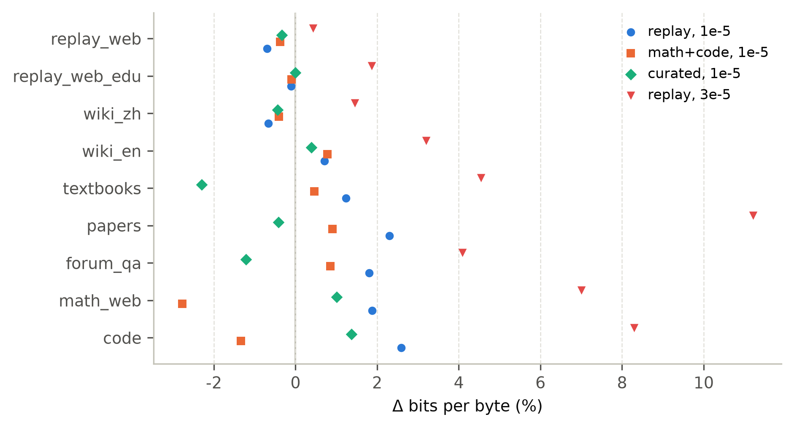

<div align="center">

# qwen-midtrain

[English](README.md) | [中文](README.zh-CN.md)

Continued pretraining ("mid-training") of the Qwen3.5 base models on general-purpose text. The question is which
mixture, curation and packing of that text leaves a base model that fine-tunes better and can solve more problems
in k tries, without losing what it knew. Small models (0.8B, 2B) run the experiments, the 4B checks them, the 9B is
the target. Hardware: four A100 40 GB GPUs on a workstation and A100 nodes of a Slurm cluster.

</div>

```
 9 public sources, 3.7B tokens ──┐
 teacher rewrites of real text ──┼──► recipe: shares, schedule, ──► continued pretraining ──┬──► regression suite (forgetting)
 curation funnel, hygiene gates ─┘    long share, packing            (40M tokens per run)   └──► fixed fine-tune ──► pass@1 … pass@64
                                                                                                        │
                    next recipes ◄── optimum under "no forgetting" ◄── mixing law, interference matrix ◄┘
```

> **Status, 2026-11-20 (day 1).** The pool, the trainer, the mixture sampler, the evaluation sets with graders, the
> fine-tuning probe and the cluster queue are built and tested. Six pilot runs on the 0.8B model are in progress.
> Section 13 holds the predictions, written before any probe result existed. Sections marked *planned* describe
> code that is not written or not run yet. This file is updated with every result.

## Summary

A base model is usually judged by its loss: lower loss on held-out text means a better model. For a model that
will be fine-tuned and then trained with reinforcement learning, that is the wrong yardstick. What matters after
post-training is how well the model takes a fine-tune and how many problems it can solve at all when it may try k
times (pass@k), because RL can only reinforce an answer that the model sometimes produces. Loss says little about
either: in a study of 50 models, perplexity ordered pairs of models correctly after fine-tuning 33-38% of the time
(arXiv 2504.12491). Therefore, I judge every checkpoint with a fixed short fine-tune followed by 64 sampled answers
per question, and with a regression suite that catches forgetting (§3).

The main lever is the mixture of the training text. Dense text (math, code, textbooks, rewritten explanations) is
expected to raise the skills that post-training needs, and replay of ordinary web text is expected to protect the
rest. The shares sum to one and they interact, so tuning one share at a time does not find the best mixture.
Therefore, I treat the mixture as an experiment: 18 runs in an orthogonal design vary seven factors at once, a
regression turns the runs into a mixing law (how each measurement moves with each share), and the law gives the best
mixture under the constraint that the regression suite does not fall (§6).

Experiments on a 9B model are slow: one run takes about half a day on three GPUs. Small models are 5 to 10 times
faster, but a decision made on a small model is only useful if the large model ranks the mixtures the same way.
Therefore, every design runs on two sizes (0.8B and 2B), their rank agreement is measured, and only mixtures on
which both sizes agree go to the 4B and the 9B (§6.5).

Three more levers change the text itself. A stronger teacher rewrites real passages into explanations, notes and
worked questions, which adds reasoning without inventing facts (§7). A funnel removes duplicates and keeps the
documents that the student cannot predict yet and a stronger model can (§8). Long sequences are filled with related
documents, so that distant context is worth reading (§9). Two gates guard all of it: no benchmark text may enter
the training data, and no generated batch may be less diverse than real text (§11).

The first measurements are about the learning rate and about replay (§1.2). At a peak learning rate of 3e-5 the
0.8B model gets worse on every source, including the one it trains on. At 1e-5, training on web text alone makes
the model about 2% worse on code, papers and math and 0.7% better on web text. **Web replay is not a neutral
anchor for this model: it pulls the model toward the web.** That changes what "replay" should mean here, and it is
the reason for prediction P1 in §13.

## Contents

1. [Where the project stands](#1-where-the-project-stands)
2. [Quick start](#2-quick-start)
3. [Define success before training](#3-define-success-before-training)
4. [The text pool](#4-the-text-pool)
5. [The continued-pretraining loop](#5-the-continued-pretraining-loop)
6. [The mixture as an experiment](#6-the-mixture-as-an-experiment)
7. [Teacher rewriting of real text](#7-teacher-rewriting-of-real-text)
8. [Curation for learnability](#8-curation-for-learnability)
9. [Long-context packing](#9-long-context-packing)
10. [Priming for exploration](#10-priming-for-exploration)
11. [Guardrails](#11-guardrails)
12. [Compute plan](#12-compute-plan)
13. [Predictions, written before the results](#13-predictions-written-before-the-results)
14. [Repository layout](#14-repository-layout)
15. [References](#15-references)
16. [Data and licensing](#16-data-and-licensing)

[PITFALLS.md](PITFALLS.md) collects the failure modes met while building this pipeline and the checks that
now catch them.

---

## 1. Where the project stands

### 1.1 Model, data and compute

| | |
|---|---|
| Models | Qwen3.5 base checkpoints of 0.8B, 2B, 4B and 9B parameters (Apache-2.0). The text part is loaded alone; vision and other weights are copied back unchanged when a checkpoint is saved |
| Pool | 9 public sources, 2.67M documents, **3.71B training tokens**; 0.5% of each source is held out for validation (`results/pool_summary.json`) |
| One run | 40M tokens of continued pretraining (pilot: 20M), 4,096-token sequences, 32,768 tokens per step, linear warm-up then linear decay to zero |
| Probe | fixed fine-tune on 22,161 conversations (6.18M tokens, 3.49M of them with loss), 2 epochs, then 64 samples per question on GSM8K, MATH-500, HumanEval and MBPP (`results/probe_data_summary.json`) |
| Regression suite | MMLU-Pro, ARC-Challenge, HellaSwag, CommonsenseQA, CMMLU, TriviaQA, plus few-shot GSM8K, MATH-500, HumanEval, MBPP on the base checkpoint (*planned*, §3.2) |
| Hardware | 4 x A100 40 GB on a workstation shared with other jobs; A100 nodes (3 GPUs each) of a Slurm cluster through a file-based task queue |
| Measured speed | 0.8B: 7.7K tokens/s in the pilot runs (one A100, includes validation); 2B: 5.7K; 4B: 2.8K (speed test). The 9B runs over three GPUs; its speed is not measured yet |

### 1.2 Results so far

**Pilot, validation loss.** The 0.8B model, 20M tokens per run. The table gives the change of bits per byte on the
held-out documents of each source, in percent of the starting value. A negative number is an improvement.
(`results/training/pilot_*.json`)

| trained on | peak LR | web | web-edu | wiki zh | wiki en | textbooks | papers | forum | math | code |
|---|---|---|---|---|---|---|---|---|---|---|
| web 85%, wiki zh 15% (replay only) | 1e-5 | -0.70 | -0.11 | -0.66 | +0.71 | +1.24 | +2.30 | +1.80 | +1.87 | +2.59 |
| replay 50%, math 30%, code 20% | 1e-5 | -0.38 | -0.10 | -0.41 | +0.78 | +0.46 | +0.90 | +0.86 | **-2.77** | **-1.33** |
| replay 50%, curated 50% (wiki en, textbooks, papers, forum) | 1e-5 | -0.33 | +0.00 | -0.44 | +0.38 | **-2.30** | -0.42 | **-1.22** | +1.01 | +1.37 |
| web 85%, wiki zh 15% (replay only) | 3e-5 | +0.43 | +1.87 | +1.46 | +3.20 | +4.54 | **+11.21** | +4.09 | +7.00 | +8.29 |

<p align="center"></p>

Each marker is one run; left of the vertical line the run improved the loss on that source.

Four things can be read from it.

- **3e-5 is too high.** Every source gets worse, even the web text the run trained on: a step of that size moves
  the weights further than 20M tokens of new text can pay back. The later designs use 3e-6 and 1e-5.
- **Replay on web text alone costs the other domains about 2%.** The base model was pretrained on something much
  broader than a web crawl. Training it on a web crawl moves it toward the web and away from code, papers and math.
- **The hard mixture halves that cost and gains on its own domains.** With 30% math and 20% code the loss on math
  falls by 2.8% and on code by 1.3%, and the loss on papers and textbooks rises less than under replay alone.
- **Curated text does the same for its own domains.** With 50% curated text the loss on textbooks falls by 2.3% and
  on forum answers by 1.2%, and math and code pay about 1%. Each component lowers the loss where it comes from and
  raises it a little elsewhere: the interference matrix of §6.3 in miniature.

Caveats, plainly: one seed per run; 24,576 validation tokens per source, so differences below about 0.5% are noise
(English Wikipedia at +0.4% after a run that was 15% Wikipedia is one of them; the design runs use 131,072 tokens);
loss only, and §3 explains why loss is not the yardstick here; the 3e-6 run and every probe result are still running.

**Probe and regression suite.** Pending. The probe ran end to end in a short test (20 fine-tuning steps, 12 items
per task, 8 samples); those numbers only show that every stage works and are not reported.

---

## 2. Quick start

```bash
# --- environment -----------------------------------------------------------------------------------------------
cp site.env.example site.env            # where the data, the models and the Python environment live on this machine
source scripts/env.sh                   # sets MIDTRAIN_DATA, MIDTRAIN_MODELS, MIDTRAIN_PYTHON, PYTHONPATH=src

# --- the pool: download, normalise, tokenize (CPU, about an hour) -------------------------------------------------
env -u HF_HUB_OFFLINE $MIDTRAIN_PYTHON -m midtrain.data_sources download
$MIDTRAIN_PYTHON -m midtrain.data_sources build
$MIDTRAIN_PYTHON -m midtrain.data_sources summary                      # writes results/pool_summary.json

# --- evaluation sets and the probe's fine-tuning data ---------------------------------------------------------
env -u HF_HUB_OFFLINE $MIDTRAIN_PYTHON -m midtrain.eval_tasks build
$MIDTRAIN_PYTHON -m midtrain.eval_tasks check                          # gold answers through graders and sandbox
env -u HF_HUB_OFFLINE $MIDTRAIN_PYTHON -m midtrain.sft_probe build-data

# --- measurement audit: run BEFORE believing any result --------------------------------------------------------
$MIDTRAIN_PYTHON -m pytest tests -q
$MIDTRAIN_PYTHON -m midtrain.data_hygiene decontaminate --methods ngram   # benchmark text in the pool?
$MIDTRAIN_PYTHON -m midtrain.mixture show configs/recipes/pilot_hard_heavy.yaml   # the shares a recipe really gives

# --- one candidate: continued pretraining, then the probe ------------------------------------------------------
CUDA_VISIBLE_DEVICES=0 $MIDTRAIN_PYTHON -m midtrain.train_continue --base-model $MIDTRAIN_MODELS/qwen35_0.8B_base \
    --recipe configs/recipes/pilot_hard_heavy.yaml --run-name pilot_hard_heavy_0.8B_lr1e-5 --peak-learning-rate 1e-5
CUDA_VISIBLE_DEVICES=0 $MIDTRAIN_PYTHON -m midtrain.sft_probe run --run-name pilot_hard_heavy_0.8B_lr1e-5 \
    --checkpoint $MIDTRAIN_DATA/runs/pilot_hard_heavy_0.8B_lr1e-5/checkpoint_final

# --- many candidates: put one script per task into a queue folder, start a worker per machine ---------------------
MIDTRAIN_QUEUE=$MIDTRAIN_DATA/queue_local bash scripts/cluster/node_worker.sh --this-node-only
sbatch scripts/cluster/worker.slurm                                    # the same worker on cluster nodes
```

---

## 3. Define success before training

### 3.1 Why loss is not the yardstick

The common habit is to train, watch the validation loss and keep the checkpoint with the lowest one. The pilot
table above shows what loss does measure well: which domain a run moved toward. It does not say whether the model
became a better starting point for post-training. Two models with the same loss can differ in how often they reach
a correct answer in 64 tries, and that number is the room an RL stage has to work with.

Therefore, the target of this project is measured after a fine-tune, by sampling. Loss stays in the log as a
diagnostic and as the fastest warning that a run went wrong.

### 3.2 Two judges for every checkpoint

| judge | what it does | what it answers |
|---|---|---|
| regression suite (`base_regression.py`) | the checkpoint as a base model: multiple choice by the log-likelihood of the answer letter, few-shot generation for math, code and trivia, bits per byte on every source, and the gain from few-shot examples | did the run forget anything, and can the model use context |
| fixed fine-tuning probe (`sft_probe.py`) | the same small fine-tune for every checkpoint, then 64 samples per question at temperature 1, graded | how well does the checkpoint fine-tune, and how many questions can it solve at all |

The regression suite has ten public sets. Their sizes are in `$MIDTRAIN_DATA/eval/manifest.json` after the build:
MMLU-Pro 1,200 questions (a stratified sample), ARC-Challenge 1,172, HellaSwag 1,000, CommonsenseQA 1,221, CMMLU
1,000, TriviaQA 1,000, GSM8K 1,319, MATH-500 500, HumanEval 164, MBPP 257.

### 3.3 The probe

Everything in the probe is fixed in `configs/probe.yaml`: the conversations and their order, the learning rate
(2e-5) and the two epochs, the test items and the sampling. Only the checkpoint changes. A difference after the
probe then comes from the checkpoint.

The fine-tuning set uses human-written solutions where they exist (GSM8K and MATH train splits, MBPP reference
programs from the task ids that are not tested) and instruction data for the rest. Its math and code questions are
worded by the same function that words the test questions, so the fine-tune teaches the format and the test
measures what the checkpoint brought along.

```python
# src/midtrain/eval_tasks.py: the unbiased estimate of pass@k from n samples of which c are correct
def estimate_pass_at_k(correct_sample_count: int, sample_count: int, k: int) -> float:
    return 1.0 - math.comb(sample_count - correct_sample_count, k) / math.comb(sample_count, k)
```

pass@1 is the usual accuracy of one sampled answer. pass@64 is the share of questions that the model solves at
least once in 64 tries. The gap between them is what a later RL stage can close. A mixture that raises pass@1 and
lowers pass@64 has made the model more confident and narrower, which is a loss for RL even though the accuracy went
up.

Model-written programs are graded by running them. They run in a sandbox without network and without access to
files outside a temporary folder, with limits on memory and time (`eval_tasks.run_python_program_in_sandbox`).

### 3.4 Noise, and how the design deals with it

A run of 40M tokens is small, so its effect on pass@k is small. With 200 questions per task, the interval of one
pass@1 value is about ±3 points. Three things bring the noise below the effects:

- **Paired comparison.** Every checkpoint answers the same questions with the same sampling, so two checkpoints are
  compared question by question.
- **64 samples per question.** The per-question success rate is known to about ±6 points, and the average over
  questions is far tighter than a single greedy answer per question would be.
- **Pooling by design.** In an orthogonal design each factor effect is the mean of 6 or 9 runs against the mean of
  6 or 9 others (§6.2), which divides the run-to-run noise by about 2.5.

The noise floor itself is measured: the probe is repeated on the same checkpoint with other seeds, and no effect
smaller than that spread is reported as a finding.

### 3.5 What is held out

Validation documents are chosen by a hash of the document id (1 in 200), so a rebuild picks the same ones.
Benchmark items never enter the pool: §11 describes the two checks. The fine-tuning probe trains on train splits
only; for MBPP the assert on task ids in `sft_probe.py` keeps the tested tasks out.

---

## 4. The text pool

A mixture study needs sources with known roles. Each source is a first slice of a much larger public dataset, read
by `configs/sources.yaml` and normalised to one row per document (`docs/conventions.md`).

| source | role | what it is | documents | train tokens | median tokens |
|---|---|---|---|---|---|
| `replay_web` | replay | FineWeb sample, no quality filter | 662,491 | 477.0M | 428 |
| `replay_web_edu` | replay | the same crawl after the FineWeb-Edu classifier | 493,081 | 516.7M | 629 |
| `wiki_zh` | replay | Chinese Wikipedia | 155,091 | 227.5M | 728 |
| `wiki_en` | curated | English Wikipedia | 220,833 | 252.3M | 651 |
| `textbooks` | curated | open textbooks and course material | 93,611 | 225.8M | 1,251 |
| `papers` | curated | openly licensed research papers, full text | 59,525 | 974.1M | 11,448 |
| `forum_qa` | curated | StackExchange questions with answers | 363,606 | 257.6M | 469 |
| `math_web` | hard | FineMath, pages with mathematical content | 306,605 | 477.6M | 888 |
| `code` | hard | permissively licensed educational code | 318,020 | 297.5M | 488 |
| `synthetic_rephrase`, `synthetic_qa` | synthetic | teacher rewrites of real passages (§7) | *planned* | | |

**Why a pool of 3.7B tokens for runs of 40M.** A run should not see a document twice, and a curated subset keeps
only part of a source. With 200M to 1B tokens per source, a 40M-token run reads at most a few percent of any
source.

**What replay stands for.** Replay is meant to be the distribution the model was pretrained on. That distribution
is not public. A web crawl with some Chinese text is my stand-in, and §1.2 shows it is a narrow one: the model
drifts when trained on it alone. The design in §6 therefore treats the replay share as a factor to be measured.

---

## 5. The continued-pretraining loop

### 5.1 Why a custom loop

The usual choice is a general trainer. Three properties of this problem made a small custom loop simpler.

| hazard | why it breaks training here | resolution |
|---|---|---|
| The vocabulary has 248,320 words. Logits for 16,384 tokens in one piece need about 16 GB | out of memory at 16K tokens per forward on a 40 GB GPU (measured in the first speed test) | the loss is computed in chunks of 1,024 tokens on a detached copy of the hidden states; the gradient goes back through the body once (`chunked_language_model_loss`) |
| A learning rate of 1e-5 times a typical gradient is below the resolution of 16-bit weights | updates round to zero and training stalls silently | the working weights are 16-bit, the optimizer keeps 32-bit master weights and applies the update there (`MasterWeightAdamW`) |
| The serving engine needs the checkpoint in the base model's full layout | a text-only checkpoint was refused at load time | `save_checkpoint` writes the trained tensors under the base's names and copies every other tensor and file from the base |

The schedule is linear warm-up over 2% of the steps, then linear decay to zero. Decay to zero is the cooldown that
the project is about: the last steps make small moves on the final mixture.

### 5.2 Exact mixtures

The common way to mix sources is to pick a source at random for each sequence. A 20M-token run has about 5,000
sequences, and a 5% source then misses its share by several percent of itself, which is the size of the effects
under study. Therefore, the sampler gives every sequence slot to the source that is furthest behind its target
(`mixture.py`). The realised shares equal the recipe's to within one sequence, and two runs with the same recipe
and seed read the same tokens in the same order.

```yaml
# configs/recipes/pilot_hard_heavy.yaml
token_budget: 20004864          # 610 steps of 32,768 tokens
context_length: 4096
components: {replay_web: 0.425, wiki_zh: 0.075, math_web: 0.30, code: 0.20}
schedule: uniform               # or late / early: when the non-replay share is spent (§6.2)
seed: 1
```

---

## 6. The mixture as an experiment

### 6.1 Why one share at a time does not work

The natural plan is to vary the replay share with everything else fixed, pick the best, then vary the next share.
It fails for two reasons. The shares sum to one, so "everything else fixed" is impossible: more of one source is
less of another, and the result depends on which one gave way. And the factors interact: the best share of
rewritten text may differ between a low and a high learning rate. A sequence of one-factor sweeps needs many runs
and still cannot see an interaction.

Therefore, the factors are varied together in an orthogonal array. Every level of every factor meets every level
of every other factor equally often, so each factor's effect is an average over all settings of the others.

### 6.2 The screening design

The design is the L18 array: 18 runs, one factor with two levels and up to seven with three. The factors are
ratios, because the questions are about ratios.

| column | factor | levels |
|---|---|---|
| 1 | peak learning rate | 3e-6, 1e-5 |
| 2 | replay share of all tokens | 55%, 70%, 85% |
| 3 | synthetic share of the non-replay text | 0, 25%, 50% |
| 4 | hard share (math and code) of the real non-replay text | 25%, 50%, 75% |
| 5 | math share of the hard text | 25%, 50%, 75% |
| 6 | long context: 40% of the non-replay tokens in 16K sequences | none, random packs, semantic packs |
| 7 | schedule of the non-replay share | uniform, late, early |
| 8 | (empty) | its "effect" shows how large a pure-noise effect is |

In the L18 the interaction of columns 1 and 2 is not mixed with any other column, so the design also answers
whether the best replay share depends on the learning rate. `late` and `early` multiply the non-replay share by a
factor that moves linearly from 0.4 to 1.6 (or back) over the run; the mean share is the same in all three.

Each run trains 40M tokens. The whole design costs 18 runs per model size, against 2 x 3^6 = 1,458 for the full
grid.

### 6.3 From runs to a mixing law

Each run gives a row of measurements: pass@1, pass@16 and pass@64 per probe task, the regression-suite scores, and
bits per byte per source. For each measurement, a regression on the absolute token shares gives

```math
y \;=\; b_0 \;+\; \sum_j b_j\, s_j \;+\; c_{\text{late}} + c_{\text{early}} + c_{\text{lr}}
```

where $`s_j`$ is the share of component $`j`$ (rewritten text, curated text, math, code, random packs, semantic
packs) and replay is what remains. $`b_j`$ is then the change of the measurement when one unit of replay is
replaced by component $`j`$. With 10 parameters and 18 runs, 8 degrees of freedom are left to estimate the noise.

Collected over all measurements, the $`b_j`$ form the **interference matrix**: one row per measurement, one column
per component. Its diagonal-like entries say how much a component helps its own domain. Its off-diagonal entries
say what the component costs or gives elsewhere. The pilot already shows two entries: 30% math lowers the math loss
by 2.8%, and web replay raises the loss on papers by 2.3%.

The published data-mixing law (arXiv 2403.16952) is exponential in the shares. For shifts of a few percent, as
measured here, the exponential and the linear form agree to within the noise, so the linear form is fitted and a
curvature term in the total non-replay share is added when the three replay levels call for it.

### 6.4 The best mixture under a constraint

The best mixture is the one that maximises the target (mean pass@16 over the probe tasks, with pass@64 reported
next to it) while the predicted regression-suite score stays within the noise of the replay-only control. The
search stays inside the tested ranges: the law is not trusted outside them.

A linear law puts the optimum on the edge of the tested region. That is an honest answer and it means the region
was too small on that side. The next runs then follow the direction of steepest ascent beyond the edge until the
target stops rising, and a small second design around that point measures the curvature. This is the classical
response-surface sequence: screen, climb, then fit the top.

### 6.5 Two scales before the large model

A small model is a proxy. The check is rank agreement: the 18 runs are ordered by each measurement on the 0.8B and
on the 2B, and the Spearman correlation of the two orders is computed with an interval. The effects ($`b_j`$) are
compared too: sign, size and how they change with model size. A proposal for the 9B needs agreement of both sizes
on the sign of the effects it relies on. The 4B then runs the proposed mixture, the replay-only control and two
neighbours as a third point. Known hazard: proxies trained at a high learning rate misrank recipes (arXiv
2512.24503), which is one reason the learning rates here are low.

Code: `mixing_law.py` turns the design file (`configs/designs/screen18.yaml`) into 18 recipes and queue tasks, and
the finished runs into level means, the law, the interference matrix, the constrained optimum and the rank
agreement between two sizes. `mixing_law.py compare` sets two runs side by side question by question. A test plants
a known law in the 18 designed mixtures and recovers it exactly (`tests/test_mixture_and_design.py`).

---

## 7. Teacher rewriting of real text

### 7.1 Why rewriting and not free generation

Good public text is finite. Letting a model write new text from nothing is the obvious way to get more, and it is
the risky one: a model trained on a model's free output drifts toward a narrower distribution with every
generation. The published work that held up at scale keeps a real passage as the source of facts and asks the
model to change only the form. Reported optima are near 30% rewritten text, and the real text is added to, never
replaced.

### 7.2 What is generated

A 27B teacher of the same family rewrites passages of 350 to 1,200 tokens from Wikipedia, textbooks, papers, math
pages and forum answers (`synthetic_rephrase.py`). Six forms show the same content from several sides:

| form | goes to | what it adds |
|---|---|---|
| explanation from first principles | `synthetic_rephrase` | the steps between the claims |
| structured notes | `synthetic_rephrase` | definitions, relations, a procedure, two typical mistakes |
| questions with worked answers | `synthetic_qa` | reasoning over the passage |
| worked problems | `synthetic_qa` | exercises made from the content, solved and checked |
| dialogue with one corrected mistake | `synthetic_qa` | a wrong turn and its repair |
| what-if analysis | `synthetic_qa` | consequences of a changed condition |

The outputs are plain text without chat tokens: chat tokens in mid-training data took one published model's GSM8K
score from 49 to 0. Every output is checked for length, refusals and meta-comments, and for copying: an output
that shares more than half of its 8-word sequences with its source is dropped, because a copy is a real passage
at a higher price. The batch then has to pass the diversity gate of §11 before a recipe may use it.

Status: 60,000 passages are selected (90,087 rewrites planned). Generation has not started.

---

## 8. Curation for learnability

### 8.1 Why not a quality classifier alone

The common filter is a quality classifier: keep pages that look educational. It removes junk, and it also removes
text that looks plain and teaches a lot, and it knows nothing about what this model already predicts. A token the
model predicts perfectly teaches nothing. A token nobody can predict (noise, lists of names) teaches nothing
either. The useful text lies between: the student cannot predict it yet and a stronger model can.

### 8.2 The funnel

`curation_funnel.py` removes text in the order of its cost, cheapest first, so the expensive stages only see what
survived the cheap ones.

| stage | removes | cost |
|---|---|---|
| filter | too short or long, repetition, symbol soup, menus | string checks |
| dedup | exact copies, then near copies (MinHash with banding), across sources | CPU |
| embed, semdedup | paraphrases: one vector per document, k-means, cosine similarity inside each cluster | one small model |
| score | nothing; records each document's mean loss under the student and under a reference model | one forward pass per model |
| select | documents outside the learnable band: excess loss = student loss minus reference loss | none |

A stage never rewrites text. It writes one small file per stage keyed by document id with `keep`, `drop_reason` and
the numbers it measured, so a threshold can be changed without recomputing anything.

**The comparison for P6.** Three versions of one web crawl fill the 85% web share of a replay recipe, at the same
token budget: the crawl as it is (200,000 FineWeb documents), the crawl after the FineWeb-Edu quality classifier, and
the same 200,000 documents kept by learnability (the largest gap between the loss of the 0.8B student and the 4B
reference on their first 512 tokens, 50M tokens kept). The first two funnel stages removed 79 of the 200,000
documents: FineWeb is filtered and deduplicated upstream, so in this comparison the selection rule does all the
work. The scoring stage is queued behind the screening design (`configs/recipes/curation/`).

---

## 9. Long-context packing

Most documents are short: the median is 651 tokens for Wikipedia and 469 for forum answers. A 16K-token training
sequence therefore holds many documents. When they are concatenated at random, nothing in the first 12K tokens
helps to predict the last 4K, and the model learns that distant context can be ignored.

Therefore, long sequences are filled with related documents: an article, a textbook section and a forum question
on one topic (`document_packing.py`). The control arm holds exactly the same documents grouped at random, so a
difference between the arms comes from the grouping alone. A third arm uses documents that are long by themselves,
mostly papers.

How related documents are found. Each candidate document (64 to 8,192 tokens, from Wikipedia, textbooks, forum
answers, math pages and code) becomes a TF-IDF vector reduced to 128 dimensions. A pack starts from a random
document and grows by the unused document closest to the mean of the pack so far, until it holds 16,384 tokens.
The build takes about two minutes on the CPU for 125,000 documents.

| pack set | packs | documents | sources per pack | similarity of neighbours | repeated 8-word sequences |
|---|---|---|---|---|---|
| semantic | 6,782 | 108,246 | 1.89 | **0.811** | 0.27% |
| random (same documents) | 6,827 | 108,246 | 4.65 | 0.152 | 0.003% |
| natural (one long document each) | 7,324 | 7,324 | 1 | | |

Similarity is the cosine between consecutive documents of a pack in the 128-dimensional space; the last column is
the share of a pack's 8-word sequences that already occurred earlier in the same pack (`results/pack_summary.json`).

Two hazards showed up in the first build, and both would have made the comparison unfair:

| hazard | why it breaks the comparison | resolution |
|---|---|---|
| The same textbook section exists in several editions, and similarity packing put the editions side by side: 9% of semantic packs held a document more than half repeated from earlier in the pack | the model can lower its loss by copying from context, which is a different skill from using related text, and the random arm has almost none of it | a document is skipped for a pack when more than 10% of its 8-word sequences already occur in it; repeated text fell from 2.07% to 0.27%, and what remains are stock phrases |
| The packs built last are leftovers: the mean similarity fell from 0.87 in the first tenth of packs to 0.65 in the last | the semantic arm would contain a tail of unrelated packs that look like the random arm | 10% more documents are sampled, and packs below 0.5 similarity plus the last ones built are dropped from both arms |

A third choice keeps packs from collapsing onto one source: two unrelated documents of one source score 0.25,
against 0.12 across sources, so without a correction 61% of packs held a single source. A candidate now loses 0.1
times the share of the pack that comes from its own source, which brings single-source packs to 37% at a cost of
0.01 in similarity.

The effect is looked for where it should appear. The regression suite measures how much few-shot examples help
(accuracy with shots minus accuracy without), and how much the loss on the last 2K tokens of a long document falls
when 14K tokens of context are given compared with 2K. Short-task scores are compared too, since the cost of long
sequences is expected there.

---

## 10. Priming for exploration

The fourth lever in the project brief is text that widens what the model can reach in k tries: reasoning
primitives, traces that contain a mistake and its repair, and generic tool-use formats. Its generator is not built
in this version, so this factor is absent from the design in §6.2 and prediction P4 in §13 stays untested. Two
parts of the question are still covered by what exists: the probe reports pass@64 next to pass@1 for every
mixture, and one of the rewriting forms in §7 contains a corrected mistake.

---

## 11. Guardrails

Two defects of training text do not show in the loss curve and ruin a result anyway (`data_hygiene.py`).

**Contamination.** A benchmark question in the training text makes the benchmark measure memory. Gate 1 compares
the pool with every evaluation file, the few-shot files included. The first layer is exact: any 13-word sequence of
an evaluation text (after normalisation) found in a pool document flags it. The second layer embeds evaluation
questions and pool windows and flags near matches, which catches a reworded question. Flagged documents are left
out of every mixture. No evaluation text is ever written into `results/`, because that folder is committed.

**Collapse.** A generator can fill a batch with the same few documents in different words. Gate 2 measures the
batch (token entropies, distinct n-grams, compression ratio, repeated templates, nearest-neighbour similarity,
number of embedding clusters) and compares it with a baseline measured on real text at the same sample size. A
batch that is clearly less diverse than real text is rejected before it reaches a recipe.

**What the 13-gram layer found.** It scanned 2,686,237 documents against 8,886 evaluation items in 2 minutes and
flagged 6,030 documents, 0.22% of the pool (`results/hygiene_decontamination.json`). That count overstates the
contamination. Reading the matched 13-grams showed four kinds:

| kind of match | documents | what it is |
|---|---|---|
| only numbers and symbols | 3,257 (54%) | the test cases of HumanEval and MBPP hold long lists of numbers, and so does any table in a paper or a math page |
| mostly numbers | 731 (12%) | the same, with a word or two in between |
| a run of single letters | 592 (10%) | "a b c d e f g h i j k l m" |
| words | 1,450 (24%) | where real leaks are: 714 match CMMLU in Chinese Wikipedia (many are famous classical quotes that a question cites), 265 MATH-500, 163 MMLU-Pro, 141 TriviaQA |

The gate stays strict and drops all 6,030: it costs 0.2% of the pool, and a real leak would cost the evaluation.
The price is uneven, though: math pages lose 3.5% of their tokens and papers 2.7%, mostly to runs of numbers
(79% of the flagged math tokens and 94% of the flagged paper tokens).

**Does it catch a leak?** One question of each of the ten sets was planted inside an unrelated document. Every
planted question was flagged. When only the last two thirds of a question were planted, 3 of 10 were missed: the
part left was shorter than 13 words. A short question rewritten in other words passes this layer by design; the
embedding layer is for that case and has not run on the whole pool yet.

---

## 12. Compute plan

The dates in the project brief were written for months. The plan below fits ten days because a proxy run takes
about an hour.

| stage | model | runs | GPU-hours | where |
|---|---|---|---|---|
| pilot: learning rate, effect size, probe noise | 0.8B | 6 runs + 7 probes | 12 | workstation |
| screening design (§6.2) | 0.8B | 18 | 48 | workstation |
| screening design | 2B | 18 | 76 | workstation, cluster |
| steepest ascent and confirmation, two seeds | 0.8B, 2B | about 20 | 70 | workstation, cluster |
| third scale | 4B | 6 | 42 | workstation, cluster |
| ablations: curation, synthetic share to collapse, packing | 0.8B, 2B | about 20 | 80 | workstation |
| target | 9B | proposed mixture, replay-only control, neighbours, seeds | 48 per run | one 3-GPU node per run |

The estimates use the measured speeds of §1.1 and a probe of about one hour for the 0.8B. The 9B number is an
estimate until its first run.

**One queue for every machine.** A task is a shell script in a folder. A worker claims a task by renaming it,
which is atomic on a shared file system, runs it and moves it to `done` or `failed` with its output
(`scripts/cluster/node_worker.sh`). The workstation and every cluster node run the same worker. Cluster jobs are
submitted before their tasks exist and read the queue when they start, because the wait in the cluster queue is
the slowest part of an experiment.

---

## 13. Predictions, written before the results

Written on 2026-11-20. At that time the validation losses of three pilot runs were known (§1.2) and no probe or
regression-suite result existed. Each prediction names the measurement that would prove it wrong. They will stay
here unchanged, with the outcome added below each one.

**The recipe I expect to propose for the 9B:** replay near 60% of the tokens; of the rest about one quarter
rewritten text, the remainder split evenly between curated text and math plus code; about 15% of all tokens in long
sequences of related documents; uniform or early schedule; peak learning rate between 3e-6 and 1e-5 with linear
decay to zero.

| | prediction | proved wrong if |
|---|---|---|
| P1 | **Less web replay is better here.** The best replay share is at the low end of the tested range (55 to 65%), and the regression suite is flat or slightly better there, because broad curated text is closer to what the model was pretrained on than a web crawl is. | the regression suite falls by more than its noise as replay goes from 85% to 55%, or the probe is best at 85% |
| P2 | **A quarter of rewritten text helps a little; half does not help more.** Real text is not scarce here (3.7B tokens for 40M-token runs), so rewriting can only win by being denser. Expected effect on probe pass@1 for math: under 1 point. pass@64 is no higher at 50% than at 25%. | 50% beats 25% on pass@64 by more than the noise, or rewritten text lowers pass@1 |
| P3 | **Hard text moves its own domains and little else.** About -0.9% math loss per 10 points of math share and -0.65% code loss per 10 points of code share (the pilot's slopes), +0.5 to +1.5 points of probe pass@1 on math from the lowest to the highest hard share, knowledge scores within noise. | knowledge scores fall by more than 1 point, or the probe does not move |
| P4 | Text with reasoning primitives and repaired mistakes widens the gap between pass@64 and pass@1. | untested: the generator is not built (§10) |
| P5 | **Related packs teach the use of context; random packs do not.** The gain from few-shot examples and the loss reduction from distant context are larger after semantic packs than after random packs. Short-task probe scores do not change with up to 18% of the tokens in long sequences. | random packs give the same context gains, or the short-task scores fall by more than the noise |
| P6 | **Learnability selection beats a quality classifier by a small margin and narrows the data.** Under 1 point on the probe; a measurable drop in the diversity numbers of §11. | the classifier subset wins, or the diversity numbers do not move |
| P7 | **Early beats late.** With a learning rate that decays linearly to zero, text shown early gets 1.2 times the learning-rate-weighted dose of a uniform schedule and text shown late gets 0.8 times. In this small-step regime the dose decides, so the order on the non-replay domains' loss is early, uniform, late. This is the opposite of the usual advice to inject the target data late. | late gives the lowest loss on math and code, or the best probe |
| P8 | **Total loss ranks the runs badly; matched loss ranks them fairly.** Over the 18 runs, the rank correlation between web loss and probe pass@16 is below 0.4 in size. Between math loss and the math probe it is 0.5 to 0.7. | web loss predicts the probe with a correlation above 0.7 |
| P9 | **The two proxy sizes agree on losses and less on the probe.** Rank correlation between 0.8B and 2B over the 18 runs: at least 0.7 for the losses, 0.3 to 0.6 for pass@k. The two largest effects have the same sign on both sizes. | the largest effect changes sign between the sizes |
| P10 | **The 9B gains less than the proxies.** Proposed mixture against replay-only control at the same budget: +1 to +3 points of probe pass@16 on math, regression suite within ±0.5 points, effects smaller than on the 0.8B. GSM8K pass@64 is near its ceiling for the 9B, so MATH-500 and MBPP carry the result. | the proposed mixture loses to the control, or the regression suite falls by more than 1 point |
| P11 | **The fine-tune hides part of the difference.** The spread of few-shot pass@1 of the base checkpoints over the 18 runs is at least 1.5 times the spread of pass@1 after the probe, because 6M tokens of fine-tuning on math and code partly overwrite 40M tokens of mid-training. | the spread after the probe is as large as before it |
| P12 | **3e-6 keeps everything and gains less; 1e-5 gains more and costs up to 1 point of knowledge.** | 1e-5 costs nothing, or 3e-6 gains as much |

---

## 14. Repository layout

```
configs/
  sources.yaml            the public sources of the pool: files, licences, how much to take
  probe.yaml              the fixed fine-tune and its test: data, steps, sampling
  recipes/                one YAML per mixture
docs/conventions.md       the contracts between the modules: file layouts, schemas
scripts/
  env.sh                  reads site.env, sets paths and the Python environment
  cluster/                node_worker.sh (the queue worker), worker.slurm (the same worker as a batch job)
src/midtrain/
  data_sources.py         download, normalise, tokenize; the pool
  mixture.py              recipes to exact token sequences; schedules; long-context share
  train_continue.py       the continued-pretraining loop; checkpoints in the base layout
  eval_tasks.py           ten public evaluation sets, prompts, graders, the sandbox for model-written code
  sft_probe.py            the fixed fine-tune, sampling, pass@k
  synthetic_rephrase.py   teacher rewriting of real passages, checks on every output
  curation_funnel.py      filter, dedup, semantic dedup, loss scoring, learnability selection
  data_hygiene.py         decontamination against the evaluation sets; diversity gate
  document_packing.py     related documents into long sequences; the random and natural control arms
  base_regression.py      the regression suite: the checkpoint as a base model
  mixing_law.py           the orthogonal design, the mixing law, the interference matrix, paired comparisons
  figures.py              every figure of this README, drawn from results/
tests/                    one file per module
results/                  small result files; every number in this README comes from one of them
assets/                   the figures, PNG for the README and PDF, in English and Chinese
PITFALLS.md               the failure atlas: incidents met while building the pipeline
```

---

## 15. References

**Mid-training and annealing.** OLMo 3 (arXiv 2512.13961): mid-training mix, no chat tokens in mid-training data,
long-context stage. Proxy runs and learning rate (arXiv 2512.24503).

**Loss against post-training outcomes.** Perplexity does not order fine-tuned models (arXiv 2504.12491). DataDecide
(arXiv 2504.11393).

**Mixtures.** Data Mixing Laws (arXiv 2403.16952). Scaling Laws for Optimal Data Mixtures (arXiv 2507.09404).

**Rewriting and synthetic text.** WRAP, Nemotron-CC, REWIRE, BeyondWeb; the share of rewritten text (arXiv
2510.01631).

**Curation.** SemDeDup; MinHash; FineWeb-Edu classifier; WebOrganizer (arXiv 2502.10341).

**Exploration and pass@k.** RL raises pass@1 and not pass@256 (arXiv 2504.13837); diverse verified solutions before
RL (arXiv 2605.08472); mistakes and backtracking in training text (arXiv 2503.01307, 2408.16293).

**Decontamination.** Tulu 3: n-gram overlap rule and the limits of embedding matching.

---

## 16. Data and licensing

Code: MIT (`LICENSE`). The pool is built from public datasets under their own licences, listed per source in
`configs/sources.yaml` (ODC-By, CC BY-SA, CC BY, CC0, permissive code licences). No pool text and no evaluation
text is committed: only counts and scores are. Rewritten text is produced with an openly licensed model from
openly licensed passages. The evaluation sets keep their licences; CMMLU is CC BY-NC and is used for evaluation
only.
