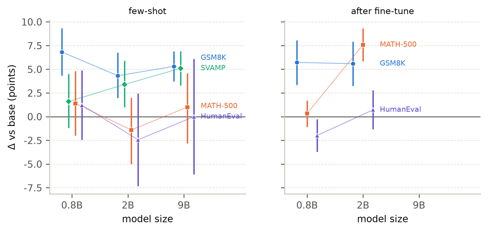
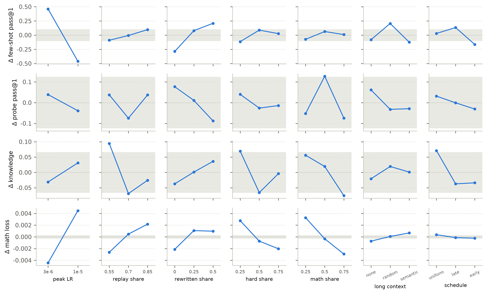
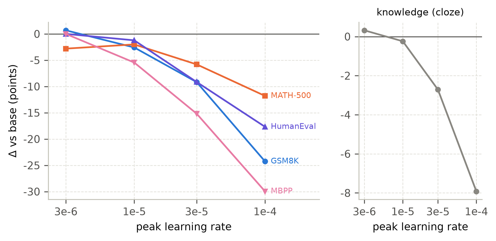
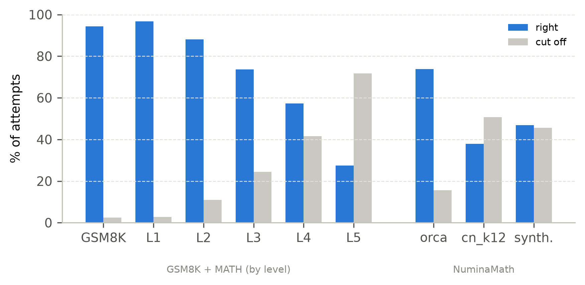
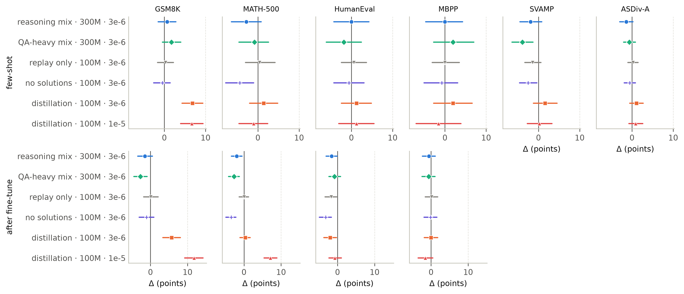
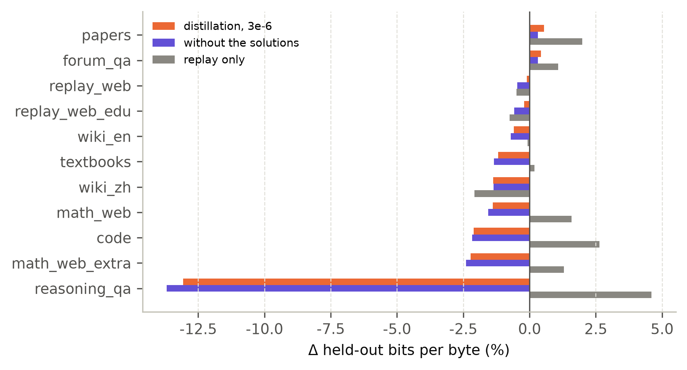
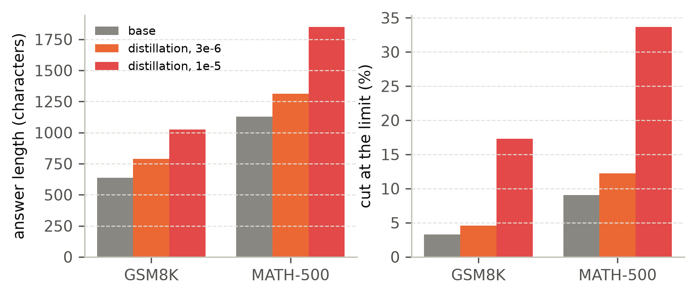
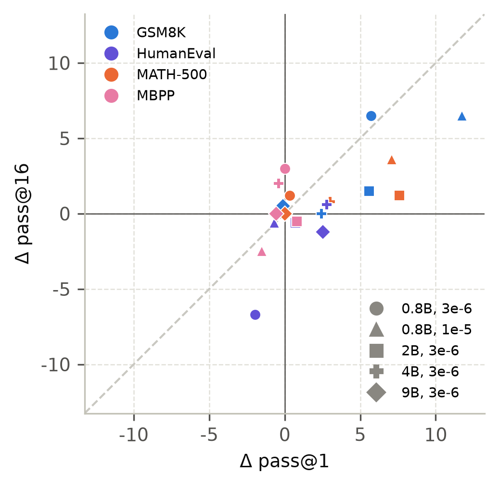

<div align="center">

# qwen-midtrain

[English](README.md) | [中文](README.zh-CN.md) | [data on Hugging Face](https://huggingface.co/datasets/jiazhe868/qwen-midtrain-data) | [checkpoints on Hugging Face](https://huggingface.co/jiazhe868/qwen-midtrain-checkpoints)

A study of mid-training on the Qwen3.5 base models, from 0.8B to 9B parameters. Public text did not make these
models better. Worked solutions written by a stronger model did, at every size. Hardware: four A100 40 GB GPUs on a
workstation and A100 nodes of a Slurm cluster.

</div>

<p align="center"></p>

The figure shows the main result. Each mark is one model size. Its height is how much the model improved after
mid-training on distilled solutions, measured against the same model before training (the "base"). The bar through
each mark is a 95% interval: a mark whose bar stays above zero improved by more than chance. The left panel tests the
model directly, with a few solved examples in the prompt. The right panel tests it after a short, fixed fine-tune
(§2.2). In the right panel the gain shrinks as the model grows. GSM8K gains about 6 points at 0.8B and 2B, 2.4 at 4B,
and nothing at 9B (§5.5).

## Abstract

Large language models are usually built in three stages. Pretraining teaches a model language and knowledge from
trillions of tokens of text. Post-training then turns the model into an assistant and sharpens its reasoning. Between
the two, many teams add a short middle stage called mid-training, in which the model reads a chosen mixture of
high-quality text.

The aim of mid-training is to give post-training a better starting point. For a strong open model such as Qwen3.5,
that is difficult. The model has probably been trained on most of the good text that is publicly available. Its
pretraining has also ended in a settled state, and new training can disturb that state before it adds anything.

This project tested two kinds of data on the Qwen3.5 base models. The first kind was public text: math web pages,
question-answer pairs, Wikipedia, textbooks, code and general web text. No mixture of public text made the 0.8B model
better. With a larger learning rate the mixtures made it worse, and with a small one they changed nothing.

The second kind was distilled data. A larger model with 27B parameters, the "teacher", wrote step-by-step
solutions to the training problems of two math benchmarks, GSM8K and MATH. Only solutions with the right final answer
were kept. In the few-shot test, this data raised GSM8K accuracy by 6.8 points for the 0.8B model, 4.3 for the 2B
model and 5.3 for the 9B model. The 4B model gained only 1.4 points, which is within the noise. The gain also appeared
on word problems from a different source (SVAMP, +5.1 at 9B), and the models kept their general knowledge.

A second test asks what a model can do after a short, fixed fine-tune, which is closer to how a model is used.
Here the gain shrinks as the model grows. GSM8K gains about 6 points at 0.8B and 2B, 2.4 points at 4B, and nothing
at 9B. At 9B, the fine-tuned base model does as well as the distilled one.

Two control runs show where the gain comes from. Training on general text alone changed nothing. Training on the same
mixture with the solutions removed changed nothing either. The main lesson is simple: **mid-training a strong model
works when the data teaches something the model does not already know.** In this project, that something was the
reasoning of a stronger model, checked against known answers. The shrinking gain fits the same lesson. The teacher
is 34 times larger than the 0.8B model and only three times larger than the 9B model, and the larger the student,
the more of what these solutions show it already knows. The next 9B runs therefore keep only the solutions of
problems that the 9B model cannot solve by itself.

## Contents

1. [Introduction](#1-introduction)
2. [How a mid-trained model is measured](#2-how-a-mid-trained-model-is-measured)
3. [Public text: what did not work](#3-public-text-what-did-not-work)
4. [Distillation: the options and our pipeline](#4-distillation-the-options-and-our-pipeline)
5. [Results](#5-results)
6. [Conclusions](#6-conclusions)
7. [Reproducing the study](#7-reproducing-the-study)
8. [Appendices](#8-appendices): the text pool, the training loop, the screening design, teacher rewriting,
   components built for later, guardrails, compute, predictions, repository layout
9. [References](#9-references)
10. [Data and licensing](#10-data-and-licensing)

[PITFALLS.md](PITFALLS.md) collects the failure modes met while building this pipeline and the checks that now
catch them.

---

## 1. Introduction

### 1.1 What mid-training is

A language model learns in stages. Each stage uses different data and has a different goal:

```
pretraining     trillions of tokens of broad text; the model learns language and knowledge
mid-training    a smaller, chosen mixture at the end of pretraining; the model strengthens skills that matter later
post-training   a fine-tune on conversations, then reinforcement learning (RL) on problems with checkable answers
```

During pretraining, the learning rate controls how large each update to the model's weights is. It rises at the
start of training and then falls slowly toward zero. Near the end, the updates are tiny, and the model settles into a
stable state. This slow cooling is called annealing, and a model released after it is said to be annealed.

Mid-training is usually done as a final phase of pretraining on a narrower mixture. The reports of several open models
describe it. OLMo 2 trains its final stage, 50B tokens and more, on a curated mix of web text, math and synthetic data.
Llama 3 anneals on small sets of high-quality math and code. The Qwen reports describe a last stage weighted toward
science, code and reasoning. The usual recipe has three parts:

1. more text from the domains that matter, such as math and code;
2. some replay of general text, so that the model does not forget what it knew;
3. a learning rate that decays to zero over the stage.

Two outcomes decide whether mid-training worked. The first is what post-training can reach from the new starting
point. A good mid-training stage gives a model that solves more problems after a fine-tune, and that finds more right
answers for reinforcement learning to reward. The second outcome is what the model keeps. Its general knowledge and
its skills outside the targeted domains should not get worse.

### 1.2 Why a strong base model is hard to improve

The common view is that more good text makes a model better. For a released base model like Qwen3.5, three facts
make this less certain.

**First, the model has probably been trained on this text already.** Qwen3.5 was trained on tens of trillions of
tokens. The public datasets that a mid-training mixture would use, such as FineWeb-Edu, Wikipedia, FineMath and StackExchange,
are of the same kind as the data in its own final stage. A model that has seen a book once may learn little from
reading it a second time.

**Second, the model has already settled.** Its weights were annealed into a stable state on its own data mixture.
Continued training has to raise the learning rate again, and larger updates can push the model out of that state.
When that happens, the model loses some ability before it can gain any. Studies of continued pretraining that recover
from this effect use tens to hundreds of billions of tokens. This project could afford a few hundred million.

**Third, small gains are easy to measure wrongly.** Every training run changes the model's loss on held-out text, so
loss always shows some movement. That movement says little about what post-training can reach (§2.1). A test that
fine-tunes on the tested tasks' own solutions can also hide the differences between models (§2.3). And with one
training run per setting, the noise between repeated runs is unknown.

### 1.3 What this study asked, and what it found

The project set out to answer three questions:

1. Can a carefully chosen mixture of public text still improve Qwen3.5 at a small dose?
2. If not, what kind of data can?
3. If some data helps, does the gain survive a fine-tune, carry over to problems from other sources, and hold from the
   0.8B model to the 9B model?

The answers, in the order the sections present them:

- **Public text did not help (§3).** The 0.8B model was trained on many mixtures of public text, for 40M and 300M
  tokens. With a peak learning rate of 1e-5 or more, every mixture made it worse, including a mixture of general text
  alone. With 3e-6, every mixture left it where it was.
- **Distilled solutions helped (§5.1).** A 27B teacher model wrote worked solutions, and only the correct ones were
  kept. Training on them raised few-shot GSM8K accuracy by 6.8 points at 0.8B, 4.3 at 2B and 5.3 at 9B. At 4B the rise
  was 1.4 points, within the noise. General knowledge stayed the same.
- **The solutions are what helped (§5.2).** A run on general text alone gained nothing. A run on the same mixture
  without the solutions gained nothing either.
- **The result repeats (§5.8).** Three seeds of the 0.8B distillation run gain 6.3 to 7.3 points on few-shot GSM8K,
  and the controls stay near zero with either seed.
- **The gain carried partly to new problems (§5.3).** On SVAMP, a set of word problems written by other people, the
  gain was 1.6, 3.4, 1.4 and 5.1 points from the smallest model to the largest. At 4B and 9B, all of the GSM8K gain
  carried over. The MATH-500 test did not move when the model was asked directly, and code did not move at all.
- **For the two smallest models, a fine-tune revealed more of the gain (§5.4).** After a short generic fine-tune, GSM8K rose by
  up to 11.8 points and MATH-500 by up to 7.6. Most of this extra gain is reliability: the model got the right answer
  more often on problems it could already sometimes solve (§5.6).
- **The larger the model, the less of the gain survived the fine-tune (§5.5).** After the same fine-tune, GSM8K
  gained 2.4 points at 4B. The distilled 9B model was no better than the fine-tuned base model: the fine-tune alone
  gave the base model the same skill. The solutions had taught the 9B model mostly what it already knew.
- **The first set of solutions lacked the hardest problems (§4.4).** The teacher's answers were limited to 1,024 tokens. That limit cut
  off 72% of its attempts on the hardest MATH problems, so those problems are nearly missing from the data. A second
  pass, with room for 4,096 tokens, starts today.

> **Status.** As of 2026-11-25, the results of all four sizes are in, with their controls (the 9B control is
> running), and the 0.8B result has been repeated with three seeds (§5.8). Running now: three more 9B runs (targeted
> solutions, a learning rate of 1e-5, the teacher's thinking traces) and the experiments listed in §6.4. This file is
> updated with every result.

### 1.4 Models, data and compute

| | |
|---|---|
| Models | Qwen3.5 base checkpoints of 0.8B, 2B, 4B and 9B parameters (Apache-2.0). Only the text part is trained; vision and other weights are copied back unchanged at every save |
| Public text | 11 sources and 4.97B training tokens: web text, Wikipedia, textbooks, papers, forum answers, two slices of FineMath, educational code, and 2.29M question-answer pairs from WebInstructSub (Appendix A) |
| Teacher | Qwen3.8-27B (Apache-2.0) with 4-bit weights, one copy per 40 GB GPU |
| Teacher-written text | 45,177 checked solutions to GSM8K and MATH training problems (23.2M tokens); 21,445 to NuminaMath-1.5 problems (12.9M); 10,349 rewrites of real passages (11.1M) |
| One run | usually 100M tokens (40M in the screening design, 300M in the first dose runs); sequences of 4,096 tokens; 32,768 tokens per step; the learning rate warms up over the first 2% of steps and then decays linearly to zero |
| Evaluation | accuracy on the full test sets of GSM8K, MATH-500, HumanEval, MBPP, SVAMP and ASDiv-A; a fixed fine-tuning test; knowledge on five multiple-choice sets and TriviaQA (§2.2) |
| Hardware | 4 × A100 40 GB on a workstation shared with other jobs; A100 nodes of a Slurm cluster, fed by a file-based task queue (Appendix G) |
| Speed | 0.8B: 7.7K tokens/s on one GPU. 2B: 4.0K. 4B: 1.9K. 9B: 1.1K on two GPUs, so 100M tokens take about 26 hours |

---

## 2. How a mid-trained model is measured

Every later number depends on how a model is judged. So the measurement comes before the experiments.

### 2.1 Why loss is not enough

Loss measures how well a model predicts the next word of a text. A lower loss on held-out text means the model
finds that text less surprising. In pretraining it is natural to watch the loss and keep the model with the lowest one.

For mid-training, loss is a weak guide. Loss shows which kind of text a run moved the model toward. It does not show
whether the model became a better starting point for post-training. Two results of this study make the point. In the
18-run screening design (§3.2), the choice of mixture explained almost all of the differences in loss between runs,
and almost none of the differences after a fine-tune. And in §5.2, a run with the teacher's solutions and a run without
them changed the losses by the same amounts, yet only the first run got better on the tests.

Loss is still useful. It shows early when a run goes wrong, so every run records it.

### 2.2 Four ways to look at a model

This project judges each model in four ways. Each one answers a different question.

**1. Few-shot accuracy.** The model sees a few solved examples in its prompt, then a new problem, and writes an
answer. This tests the base model directly, before any post-training, and it is the standard yardstick of
mid-training. Every item of each test set is used once, with greedy decoding, which means the model always picks its
most likely next word. The sets are GSM8K (1,319 grade-school word problems), MATH-500 (500 competition problems),
HumanEval (164 programming tasks) and MBPP (257 programming tasks).

**2. Word problems from other sources.** SVAMP (1,000 problems) and ASDiv-A (1,218 problems) are grade-school word
problems written by other people. They are asked with the same eight GSM8K examples in the prompt. They show whether a
gain on GSM8K carries over to problems that were written elsewhere.

**3. A fixed fine-tuning test, the "generic probe".** Every model gets the same short fine-tune: two passes over 6,842
instruction conversations, at a peak learning rate of 2e-5. The conversations are general instructions: Python
functions, tasks with constraints, summaries, rewrites and everyday chat. None of them comes from a tested task, and
none is a math problem. After the fine-tune, the model answers a fixed sample of test questions: 200 from GSM8K, 250
from MATH-500, all 164 of HumanEval and 200 from MBPP. It answers each question 16 times at temperature 1, which means
it samples a different answer each time. This shows what post-training can reach from the model. Two numbers come
out of it. pass@1 is the chance that one sampled answer is right. pass@16 is the share of questions the model
solves at least once in 16 tries.

**4. Knowledge and loss.** Five multiple-choice sets (MMLU-Pro, ARC-Challenge, HellaSwag, CommonsenseQA and CMMLU)
and TriviaQA test what the model knows. The multiple-choice sets are scored by cloze: the model's likelihood of
each answer's own text, with no answer letters. Small models prefer some letters over others, and cloze removes that
bias (PITFALLS B4). The loss on held-out text from every source is recorded too. It is given in bits per byte:
the average number of bits the model needs to encode one byte of the text. Lower is better.

| view | what it asks | code |
|---|---|---|
| few-shot accuracy | what the base model can do right now | `base_regression.py final` |
| word problems from other sources | does a gain carry to problems written elsewhere | same command |
| generic probe | what post-training can reach from this model | `sft_probe.py --variant generic` |
| knowledge and loss | did the model forget anything | `base_regression.py run` |

The gap between pass@1 and pass@16 matters for the stage after this one. Reinforcement learning can only reward an
answer that the model sometimes gives. A problem the model never solves in 16 tries gives RL nothing to work with.

```python
# src/midtrain/eval_tasks.py: the standard unbiased estimate of pass@k from n samples, of which c are correct
def estimate_pass_at_k(correct_sample_count: int, sample_count: int, k: int) -> float:
    return 1.0 - math.comb(sample_count - correct_sample_count, k) / math.comb(sample_count, k)
```

### 2.3 A probe that trained on the tested tasks

The first version of the fine-tuning test did not use instruction conversations. It fine-tuned each model on about
15,000 training solutions of GSM8K, MATH and MBPP, and then tested on those same tasks. This looked like a
direct way to measure what post-training can reach.

It turned out to measure something else. On the 0.8B base model, this "in-domain" probe scored lower than the generic
probe on every task, and lower than the model's own few-shot accuracy:

| task | probe trained on the tasks' own solutions, pass@1 | generic probe, pass@1 | 0.8B base, few-shot | 2B base, few-shot |
|---|---|---|---|---|
| GSM8K | 37.2 | 39.8 | 42.7 | 61.6 |
| MATH-500 | 13.6 | 22.8 | 23.0 | 37.2 |
| HumanEval | 9.6 | 15.4 | 21.3 | 34.1 |
| MBPP | 22.8 | 29.0 | 37.4 | 49.4 |

The reason is the style of those training solutions. GSM8K solutions are short notes with calculator marks, and MATH
solutions skip steps. The fine-tune taught the model to answer in that terse style, which is worse than the model's
own. The same probe also made different models look alike. After it, the choice of mixture explained only 12% of the
differences between the 18 design runs. That is less than a model of the same size explains of pure noise.

Therefore, I replaced it with the generic probe, whose conversations contain no tested task, and made few-shot
accuracy on the full test sets the main measure (`results/probe/`, `results/probe_generic/`, `results/final_eval/`).

**A probe that trains on the tested tasks' own solutions measures the probe more than the model.**

### 2.4 Noise, and what one run cannot tell

Small differences need a careful comparison. Every model answers the same questions with the same prompts. So two
models can be compared question by question: on each question, one model may be right and the other wrong, or both
may score the same. The average of these per-question differences is the gain.

To know whether a gain is real, the comparison is repeated 2,000 times on random resamples of the questions. The
middle 95% of the results is the 95% interval shown in every table. If the interval does not include zero, the
difference is larger than the luck of which questions happen to be in the test (`mixing_law.py compare-with-base`,
which writes `results/comparisons/dose_vs_base_<size>.json`).

This interval has a limit. It covers the choice of questions, not the randomness of training. A second training run
with a different data order could give a somewhat different model. Section 5.8 reports the first
repeats with other seeds.

### 2.5 What is kept out of training

A test only measures skill if its questions were never in the training data. If a test question appears in the
training text, the model can answer it from memory. This leak is called contamination.

Every document in the training pool is checked against every test question, including the few-shot examples. A
document that shares any sequence of 13 words with a test text is flagged, and the sampler never uses it. The current
scan flags about 13,500 documents, a quarter of a percent of the pool (`results/hygiene_decontamination.json`).
Problems for the teacher come only from training splits. Problem sets written by other models are also checked by
meaning, with text embeddings, before the teacher sees them. Appendix F describes the checks and what they can miss.

---

## 3. Public text: what did not work

### 3.1 The pool and the mixtures

The experiments draw on a pool of public text. It holds 11 sources and 4.97B training tokens (Appendix A). Each source
has a role:

- **replay**: general web text (FineWeb and FineWeb-Edu) and Chinese Wikipedia, which stand in for the model's
  original training data;
- **curated text**: English Wikipedia, open textbooks, research papers and StackExchange answers;
- **hard text**: two slices of FineMath (web pages with mathematics) and educational code;
- **question-answer text**: 2.29M questions with worked answers from WebInstructSub.

A recipe sets the share of each source, for example "30% math, 20% code, 50% replay". The sampler then fills every
training sequence from the source that is furthest behind its target. So the shares a run actually sees match the
recipe almost exactly (Appendix B).

All the public-text experiments used the 0.8B model. They went from small doses to large ones.

### 3.2 Forty million tokens: a screening design

The common way to tune a mixture is to change one share at a time. For mixtures this does not work well. The shares
must add up to one, so raising one share lowers others. The shares also interact: the best amount of math text may
depend on the learning rate.

Therefore, I varied seven factors at once in an orthogonal design, a classical plan from experimental statistics.
In such a plan, every level of every factor appears with every level of every other factor equally often. Eighteen
runs were enough to estimate the effect of each factor. The factors were the learning rate, the share of replay, the
share of teacher rewrites, the share of math and code, the share of math within that, long-context packing, and when
in the run the non-replay text is shown (Appendix C). Each run trained the 0.8B model on 40M tokens.

A simple linear model fitted to the 18 runs shows how much of each measurement the mixture explains
(`results/designs/screen18_0.8B_analysis.json`):

| measurement | share explained by the mixture | spread across the runs | noise of one run |
|---|---|---|---|
| math loss / code loss (bits per byte) | 0.98 / 0.94 | 0.0063 / 0.0031 | 0.0013 / 0.0011 |
| few-shot pass@1, average of four tasks | 0.92 | 0.58 | 0.24 |
| few-shot GSM8K pass@16 | 0.96 | 2.11 | 0.65 |
| knowledge (cloze) | 0.63 | 0.14 | 0.13 |
| probe pass@1 after the in-domain fine-tune | 0.12 | 0.20 | 0.28 |

How to read the table. The second column is the share of the differences between runs that the mixture explains.
Even pure noise would reach a share of about 0.53 here, because a linear model with ten terms can fit part of any 18
numbers. So only a share well above 0.53 means that a measurement truly follows the mixture. The third column is the
standard deviation across the 18 runs. The fourth is the noise of one run, the part the linear model cannot explain.
The losses and the few-shot scores clearly follow the mixture. The knowledge score and the probe do not.

<p align="center"></p>

Each point is the average over the runs at one level of a factor, minus the average of all runs. The grey band is the
range of an empty factor, which shows how large an "effect of nothing" can be.

The effects are real, and they are small. Math text lowered the math loss by 0.011 bits per byte for each 10% of
tokens it took from replay. Teacher rewrites raised few-shot GSM8K pass@16 by 1.7 points per 10% of tokens. The lower
learning rate, 3e-6, beat 1e-5 on every loss. The in-domain probe then erased all of these differences. The obvious
next step was a larger dose.

### 3.3 Three hundred million tokens: the learning-rate limit

Published mid-training stages use hundreds of millions of tokens or more. So the next experiment gave the 0.8B model
300M tokens, 7.5 times as much as before. The mixture was rich in reasoning: FineMath (25%), WebInstructSub (25%),
teacher rewrites (5%), code (7%), textbooks (3%) and replay (35%) (`configs/recipes/dose/`). It first ran at three
peak learning rates, 1e-5, 3e-5 and 1e-4, next to a control run on replay text alone at 3e-5.

<p align="center"></p>

The left panel shows the change in few-shot accuracy against the base model, for each learning rate. The right panel
shows the change in knowledge. Lower is worse.

The pattern is consistent. Every run at a learning rate of 1e-5 or higher ended below the base model. The higher the
learning rate, the larger the damage:

| run (300M tokens) | GSM8K | MATH-500 | HumanEval | MBPP | knowledge (cloze) | FineWeb-Edu loss |
|---|---|---|---|---|---|---|
| base model | 42.7 | 23.0 | 21.3 | 37.4 | 34.7 | — |
| reasoning mix, 1e-5 | 40.1 | 21.0 | 20.1 | 31.9 | 34.5 | +0.2% |
| reasoning mix, 3e-5 | 33.5 | 17.2 | 12.2 | 22.2 | 32.0 | +3.0% |
| reasoning mix, 1e-4 | 18.4 | 11.2 | 3.7 | 7.4 | 26.8 | +9.7% |
| replay only, 3e-5 | 28.2 | 8.6 | 7.3 | 18.3 | 32.9 | +0.9% |

Then I lowered the learning rate to 3e-6, the rate that had done best in the screening design. The damage
disappeared. So did any gain. The table shows each run minus the base, with 95% intervals
(`results/comparisons/dose_vs_base_0.8B.json`):

| run (300M tokens, LR 3e-6) | GSM8K | MATH-500 | HumanEval | MBPP | knowledge (cloze) | FineWeb-Edu loss |
|---|---|---|---|---|---|---|
| reasoning mix | +0.7 [−1.5, +2.8] | −2.8 [−6.4, +0.8] | 0.0 [−4.3, +4.3] | 0.0 [−4.7, +4.3] | 35.0 | −0.5% |
| QA-heavy mix (45% WebInstructSub) | +1.7 [−0.5, +4.0] | −0.8 [−4.6, +2.6] | −1.8 [−6.1, +2.4] | +1.9 [−2.7, +7.0] | 34.9 | −0.1% |

All intervals include zero. After the generic probe, both runs were 0.6 to 2.7 points below the base model on every
task.

One more idea was tested. Averaging the weights of a damaged run with the weights of the base model is a known way to
recover from forgetting. I averaged the 1e-5 run with the base, at 25% and at 50% weight on the run (`merging.py`).
This brought the accuracy back to within 2.4 points of the base. It never rose above the base by more than 0.8 points.
Averaging repairs damage. It does not add skill.

### 3.4 Why public text fails here

Four observations point to one explanation.

**The damage comes from the training itself.** The replay-only control trained on FineWeb-Edu. At a learning rate of
3e-5, its loss on held-out FineWeb-Edu text went up by 0.9%. Training on a kind of text should not make the model
worse at that same kind of text. A plausible reading: the raised learning rate pushed the model out of the settled
state its own training had reached, and 300M tokens were too few to bring it back.

**At a safe learning rate, the model has little left to learn.** At 3e-6, the loss on held-out public text fell by
only 0.1 to 2%. The model already predicts this text well.

**What it does learn is style.** The largest drop in loss was 13%, on held-out WebInstructSub answers. That same drop
appears whether or not the teacher's solutions are in the mixture (§5.2). Yet only the run with the solutions improved
on the tests. So the model learnt how those answers are written, and that is not the skill the tests ask for.

**The missing ingredient is rare in public text.** The tests reward correct, step-by-step solutions. Math web pages
mostly hold finished answers and discussions. Complete, correct working is much rarer.

**A strong, annealed base model is easier to damage than to improve. At a safe learning rate, public text adds almost
nothing it has not already learnt.**

---

## 4. Distillation: the options and our pipeline

If the model has already learnt the public text, the text to add is text it has not seen. A direct source of
such text is a stronger model. A stronger model can solve problems the smaller one cannot, and it can write out the
steps. This section explains the main ways a stronger model can teach a weaker one, the choices involved, and exactly
what this study did.

### 4.1 The ways a stronger model can teach

Distillation means training a smaller model, the student, to behave like a larger one, the teacher. The
methods differ in what the student learns from.

**Soft-label distillation.** In the original form (Hinton et al., 2015), the student learns to match the teacher's
full probability for every possible next token. A probability distribution carries more information than a single
right answer. It shows, for example, which wrong answers are almost right. The cost is high: the teacher must run on
every training token, and both models must use exactly the same vocabulary. Gemma 2 used this method to pretrain its
small models.

**Sequence-level distillation.** Here the teacher writes text, and the student trains on that text with the ordinary
next-token loss (Kim and Rush, 2016). The teacher runs only once, to write the data. Training stays unchanged. This is
what "distillation" usually means for language models today. It is the same as training on synthetic data written by
a stronger model.

**Synthetic data in general.** Any text a model writes is synthetic data. Examples are rewrites of real passages,
synthetic textbooks and question-answer pairs. Synthetic data is only as useful as what it adds. A rewrite restates
facts that the student already knows. A solution written by a stronger model can carry reasoning that the student
cannot yet do. This study tried both kinds with the same teacher, and only the solutions helped (§5.3).

**Verification.** A teacher makes mistakes too. One remedy is to let the teacher write several attempts and keep only
the attempts that pass a check against outside information. The check can be a known reference answer, a set of unit
tests or a judge model. This turns generation into selection. Methods such as STaR and rejection-sampling fine-tuning
use the same idea to train a model on its own correct outputs.

**On-policy distillation.** In the methods above, the student learns from text the teacher wrote. In on-policy
distillation, the student writes, and the teacher scores or corrects the student's own text (Agarwal et al., 2024;
Gu et al., 2024). The student then learns on the kind of text it actually produces. The teacher has to run inside
the training loop, which makes this method close to reinforcement learning.

The four ideas can be summarised by what the student learns from:

```
soft-label distillation   the teacher's probability for every next token              needs the teacher during training
sequence-level            text the teacher wrote, with the usual next-token loss      the teacher only writes data
  + verification          only text whose answer passes a check                       needs problems with known answers
on-policy                 the student's own text, scored or corrected by the teacher  needs the teacher in the loop
```

This study used sequence-level distillation with verification. It is the cheapest of the four. It fits into
ordinary mid-training without any change to the training code. And verification removes most of the teacher's
errors.

### 4.2 The choices behind distillation data

Building distillation data means making a series of choices. Each choice changes what the student learns. The table
lists the main choices, what this study picked, and whether the pick was tested.

| choice | options | this study | status |
|---|---|---|---|
| teacher | model, size, weight precision, thinking mode, sampling | Qwen3.8-27B with 4-bit weights, thinking mode off, temperature 1.0; thinking mode on for the fourth set (§4.4) | the largest model that fits on one 40 GB GPU; other teachers untested |
| what the teacher writes | rewrites of real text, solutions to existing problems, new problems | solutions to existing problems with known answers; rewrites were tested separately (Appendix D) | tested: solutions help, rewrites do not |
| verification | none, final answer, unit tests, a judge | the final answer must match the reference, checked by the same grader the tests use | cheap and exact for math; a wrong argument that ends at the right number still passes |
| problems | where they come from, how hard, how many | the training splits of GSM8K and MATH (14,262 problems); later NuminaMath-1.5 (20,000) and the hard problems again (2,591) | §4.4 |
| answer length | how many tokens the teacher may write | 1,024; then 4,096 for the hard problems; 8,192 with thinking | 1,024 was too short (§4.4) |
| copies per problem | how many different solutions of one problem to keep | up to 4 (2 for NuminaMath) | one copy per problem is in the cluster sweep |
| format | chat format or plain text; whether the question counts in the loss | plain "Question: … Answer: …" text; every token counts | chat tokens in mid-training data can break base-model tests (OLMo 3); other formats untested |
| how it is used | a fine-tune or part of mid-training; share; amount; learning rate | 40% of a 100M-token mid-training mixture; peak learning rate 3e-6 | share, amount and rate are in the cluster sweep |
| learning signal | sampled text or probabilities; teacher's text or student's text | sampled text from the teacher, written once | probabilities and on-policy methods untried (§4.5) |

Three of these choices turned out to matter most. Verification decides whether the data is right. The problems decide
what the student practises. The answer length decides which problems can be solved at all, as §4.4 shows.

### 4.3 Our pipeline, step by step

The pipeline turns problems with known answers into training text. Here is the whole path for the first solution set:

```
problems with known answers: the training splits of GSM8K (7,473) and MATH (6,789 usable)
   │  the teacher writes 8 attempts per GSM8K problem and 4 per MATH problem, at most 1,024 tokens each
   ▼
86,108 attempts
   │  check: the attempt finished, and its final boxed answer equals the reference answer
   ▼
72,076 right attempts ── keep at most 4 different ones per problem ──► 45,177 solutions of 11,915 problems
   │  contamination check against every test question and few-shot example: 482 solutions left out
   ▼
the pool source synthetic_solutions (23.2M tokens) ── 40% of a 100M-token mixture
   │  continued pretraining at a peak learning rate of 3e-6
   ▼
student model
```

The steps in detail:

**Step 1: ask the teacher.** The teacher receives one instruction and the problem. Its thinking mode is switched off,
so it answers directly:

```python
# src/midtrain/synthetic_rephrase.py
solution_instruction = (
    "Solve the problem step by step. Write each step as a short sentence or an equation, check the result, and end "
    "with the sentence 'The final answer is \\boxed{...}.'")
```

Here is what a solution looks like. This example was written for this README, in the same format as the teacher's
solutions:

```
Question: A bakery makes 48 muffins in the morning and 36 in the afternoon. It sells three quarters of them.
How many muffins are left?

Answer: The bakery makes 48 + 36 = 84 muffins in total.
It sells three quarters of them: 84 × 3/4 = 63 muffins.
So 84 − 63 = 21 muffins are left.
Check: 63 + 21 = 84, which matches the total.
The final answer is \boxed{21}.
```

**Step 2: check every attempt.** An attempt is kept only if it finished within the token limit and its last boxed
answer matches the reference answer. The match uses the same function that grades the tests. It compares numbers by
value, so 0.5 and 1/2 count as equal, and it compares other answers as normalised LaTeX:

```python
# src/midtrain/synthetic_rephrase.py (solve_training_problems)
predicted = find_last_boxed_content(solution_text)
is_correct = bool(finish_reason == "stop" and predicted is not None
                  and is_math_answer_equivalent(predicted, problem["reference_answer"]))
```

The teacher got 94% of its GSM8K attempts right and 60% of its MATH attempts
(`results/synthetic_solutions_summary.json`). For 2,347 problems, no attempt was right.

**Step 3: select and format.** Identical attempts are merged, and at most four solutions are kept per problem. Each
solution becomes one plain-text document: the question, then the answer. The text has no chat tokens. The student
reads it like any other text, and the loss counts every token.

**Step 4: check for contamination.** The new source goes through the same 13-word check as every other source (§2.5).
It flagged 482 solutions. Most matched the fixed wording of MATH problems, such as "enter your answer in the form".
Sixteen were solutions of three GSM8K training problems that are near-copies of GSM8K test problems. The sampler
never uses any of the 482.

**Step 5: mix and train.** The solutions take 40% of the training tokens. With 23.2M tokens of solutions and 100M
tokens of training, each solution is seen about 1.7 times. The other 60% keeps the question-answer text, math pages
and code of the earlier mixtures, plus a small share of replay:

```yaml
# configs/recipes/dose/dose_distill_100m.yaml
token_budget: 100007936           # 3,052 steps of 32,768 tokens
components:
  synthetic_solutions: 0.40
  reasoning_qa: 0.15
  math_web: 0.10
  code: 0.10
  textbooks: 0.05
  wiki_en: 0.05
  replay_web_edu: 0.10
  wiki_zh: 0.05
```

Training uses the same loop as every other run (Appendix B), at a peak learning rate of 3e-6. That is the rate that
did no harm in §3.3.

### 4.4 Three solution sets, and what limited them

<p align="center"></p>

The blue bars show the share of the teacher's attempts that were right. The grey bars show the share that ran past the
1,024-token limit before finishing. The groups are GSM8K, the five difficulty levels of MATH (L1 easiest, L5 hardest)
and three sources of NuminaMath (`results/synthetic_attempts_*.json`).

**The first set lacks the hardest problems.** The 1,024-token limit was chosen with GSM8K in mind, and GSM8K solutions are
short. MATH solutions are longer, and the harder the problem, the longer the solution. At level 1, only 3% of the
attempts were cut off. At level 4 it was 42%, and at level 5 it was 72%, where only 27% of the attempts were right.
The teacher did not get these problems wrong: its attempts reached the token limit before they finished. As a result, the kept MATH solutions are mostly easy
ones, and the hardest problems are nearly missing. This is a likely reason why MATH-500 did not move at 9B
(§5.1).

**The second set widens the problems.** GSM8K and MATH cover only two kinds of problems. The second set draws 20,000
problems from three other sources in NuminaMath-1.5 (Apache-2.0):

- orca_math: grade-school word problems written by a model;
- cn_k12: Chinese school exercises, translated into English;
- synthetic_math: new problems in the style of competitions.

Only problems that NuminaMath marks as valid, with a short final answer that can be checked, were drawn. Before the
teacher saw them, the contamination check removed 960 of the 26,000 drawn problems. About 350 of those shared a
13-word sequence with a SVAMP or ASDiv-A question, and 83 with a MATH-500 question. Most came from orca_math
(`results/synthetic_solutions_numina_selection.json`). The teacher wrote two attempts per problem, which gave 21,445
right solutions of 11,367 problems (12.9M tokens). The same 1,024-token limit cut off 37% of these attempts overall,
and about half of the attempts on cn_k12 and synthetic_math.

**A third pass adds the hard problems.** 2,591 problems of the first set were solved again. They are the 2,347 problems with
no right attempt, plus the MATH problems of levels 4 and 5 with only one right attempt. Of the 2,591, 1,442 are level
5 and 602 are level 4. This time the teacher could write 4,096 tokens, four attempts each, at temperature 0.8.

With room to finish, the teacher solved most of them. It solved 2,085 of the 2,591 problems, including 1,846 of the
2,347 that had no right attempt before. At level 5 it solved 1,194 of 1,442 problems, and 71% of its attempts were
right. Even 4,096 tokens cut off 24% of the level-5 attempts. Only the 205 GSM8K problems of this pass stayed mostly
unsolved (44 solved) (`results/synthetic_attempts_training_splits_hard.json`). The 7,287 right solutions (14.1M
tokens) became their own source, `synthetic_solutions_hard`.

Two check runs (0.8B and 2B) then trained on the recipe with 10% of the tokens taken from these solutions
(`configs/recipes/dose/dose_distill_hard_100m.yaml`). MATH-500 did not move beyond the noise. In the few-shot test it
changed by −0.4 points at 0.8B and +0.8 at 2B. After the fine-tune it changed by +1.2 and +6.4, against +0.3 and +7.6
with the first set alone. Only pass@16 on MATH-500 at 2B rose a little more, +4.0 against +1.2, and that is within the
noise too (`results/comparisons/dose_vs_base_<size>.json`). One reading is that the small models cannot yet use
solutions of problems this hard.

**A fourth set records the teacher's reasoning.** The first three sets hold only the solutions the teacher wrote. For
the 3,597 problems that the 9B base model fails (§5.5), the teacher was also run in its thinking mode, in which it
reasons at length before it writes the solution. Each problem got two attempts at temperature 0.6, with up to 8,192
tokens. 74% of the 7,194 attempts were right, and 2,842 of the problems were solved. At MATH level 5, 68% of the
attempts were right and 26% were cut off. A kept document holds the question, the reasoning and the solution as plain
text, without the tags that mark the reasoning in the teacher's chat format. The 5,332 kept documents hold 11.8M
tokens (`results/synthetic_attempts_student_fails_9B_thinking.json`,
`results/synthetic_solutions_thinking_summary.json`). A 9B run on them is training (§6.4).

### 4.5 What we did not try, and why

- **Soft-label distillation.** It needs the teacher's probabilities on every training token. For 100M tokens, that is
  a forward pass of the 27B model per token, which costs more than training the 9B model itself. The two vocabularies
  would also have to match exactly.
- **On-policy distillation.** It puts the teacher inside the training loop. That turns mid-training into something
  close to reinforcement learning, which is the next stage of training.
- **Code solutions checked by unit tests.** HumanEval and MBPP never moved, and the recipe has no code solutions. The
  teacher could write programs, and a sandbox could run their tests. It did not fit into the time available.
- **Checking each step of a solution.** A judge model could reject a solution whose reasoning is wrong even when its
  final number is right. The final-answer check lets such solutions through.
- **A stronger teacher.** A teacher stronger than the 27B model does not fit on the workstation's GPUs at a useful
  speed. The 27B teacher's thinking mode was added later (§4.4).

---

## 5. Results

### 5.1 The gain at every size

The first question is simple: does the distillation recipe help, and does it help at every size? The table shows each
run minus the base model of the same size. All runs used a peak learning rate of 3e-6 and 100M tokens
(`results/comparisons/dose_vs_base_<size>.json`).

How to read it. The first block of columns is few-shot accuracy. The "probe" columns are pass@1 after the generic
fine-tune. Knowledge is the cloze score, in points. A bold value has an interval that excludes zero.

| size | base GSM8K | GSM8K | SVAMP | MATH-500 | HumanEval | MBPP | knowledge | probe GSM8K | probe MATH-500 |
|---|---|---|---|---|---|---|---|---|---|
| 0.8B | 42.7 | **+6.8 [+4.3, +9.3]** | +1.6 [−1.2, +4.5] | +1.4 [−2.0, +4.8] | +1.2 | +1.9 | +0.2 | **+5.7 [+3.3, +8.1]** | +0.3 [−1.1, +1.7] |
| 2B | 61.6 | **+4.3 [+2.0, +6.8]** | **+3.4 [+1.0, +5.9]** | −1.4 [−5.0, +2.0] | −2.4 | −1.6 | −0.5 | **+5.6 [+3.2, +7.9]** | **+7.6 [+5.8, +9.3]** |
| 4B | 82.8 | +1.4 [−0.5, +3.3] | +1.4 [−0.5, +3.2] | −2.2 [−6.0, +1.4] | −3.0 | −1.9 | −0.7 | **+2.4 [+0.9, +4.0]** | **+3.0 [+1.4, +4.7]** |
| 9B | 87.1 | **+5.3 [+3.7, +6.9]** | **+5.1 [+3.3, +6.9]** | +1.0 [−2.8, +4.6] | 0.0 | −0.4 | +0.4 | −0.1 [−1.3, +1.0] | 0.0 [−1.3, +1.4] |

What to notice:

- GSM8K rises at three of the four sizes, by 4 to 7 points. At 4B it rises by only 1.4, within the noise. For the
  9B model, which already solves 87.1% of GSM8K, the rise means that the share of problems it gets wrong falls from
  12.9% to 7.6%. That is 41% fewer mistakes.
- Knowledge stays the same. It moves by less than one point at any size. The held-out loss also falls on 9 of 11
  public sources at every size.
- MATH-500 and code do not move in the few-shot test. Their changes stay within the noise.
- After the fine-tune, MATH-500 rises too, by 7.6 points at 2B and 3.0 at 4B. Section 5.4 explains why the two
  tests differ.
- At 9B, the fine-tune removes the gain. After it, the distilled 9B model scores the same as the fine-tuned base
  model on GSM8K and MATH-500. Section 5.5 looks at why.

**Mid-training on checked solutions from a stronger model raises the base model's few-shot score at no cost in
knowledge, and the gain that survives a fine-tune shrinks as the model grows.** The few-shot GSM8K score rises at
0.8B, 2B and 9B. After a fine-tune, the gain is gone at 9B.

### 5.2 Where the gain comes from

The distillation recipe differs from the public-text runs of §3 in two ways. It adds the solutions. It also changes
the rest of the mixture: the other 60% is mostly question-answer text, math pages and code, with little replay. Either
change could be the cause.

Two control runs separate the two. Both use the same budget and the same learning rate. The replay-only control
trains on general text alone: FineWeb-Edu and Chinese Wikipedia. The ablation keeps the recipe but gives the
solutions' 40% to general web text (`configs/recipes/dose/dose_nosolutions_100m.yaml`).

| run, minus base (100M tokens, LR 3e-6) | GSM8K | MATH-500 | HumanEval | probe GSM8K | probe MATH-500 | knowledge |
|---|---|---|---|---|---|---|
| 0.8B distillation | **+6.8 [+4.3, +9.3]** | +1.4 [−2.0, +4.8] | +1.2 [−2.4, +4.9] | **+5.7 [+3.3, +8.1]** | +0.3 [−1.1, +1.7] | +0.2 |
| 0.8B without the solutions | −0.5 [−2.6, +1.4] | **−4.4 [−7.8, −1.0]** | −0.6 [−4.3, +3.0] | −1.0 [−3.0, +0.9] | **−3.5 [−4.8, −2.2]** | +0.5 |
| 0.8B replay only | +0.3 [−1.7, +2.2] | +0.4 [−3.0, +4.2] | +0.6 [−2.4, +3.7] | +0.1 [−1.8, +2.1] | 0.0 [−1.3, +1.2] | +0.6 |
| 2B distillation | **+4.3 [+2.0, +6.8]** | −1.4 [−5.0, +2.0] | −2.4 [−7.3, +2.4] | **+5.6 [+3.2, +7.9]** | **+7.6 [+5.8, +9.3]** | −0.5 |
| 2B replay only | −0.7 [−2.6, +1.1] | −3.8 [−7.8, 0.0] | −1.2 [−5.5, +3.0] | +0.7 [−1.2, +2.6] | **−1.8 [−3.4, −0.2]** | +0.6 |
| 4B distillation | +1.4 [−0.5, +3.3] | −2.2 [−6.0, +1.4] | −3.0 [−7.3, +1.2] | **+2.4 [+0.9, +4.0]** | **+3.0 [+1.4, +4.7]** | −0.7 |
| 4B replay only | +0.3 [−1.1, +1.7] | −2.8 [−6.4, +1.0] | −5.5 [−11.6, +0.6] | +0.5 [−1.0, +1.9] | +0.7 [−0.9, +2.3] | +0.9 |

The result is unambiguous. Continued training alone does nothing: the replay-only controls stay level at all three sizes.
The rest of the mixture does nothing either: without the solutions, the same mixture gains nothing and even loses 4.4
points on MATH-500. **The solutions carry the gain.**

<p align="center"></p>

This figure puts every 0.8B run of the study side by side. The top row is few-shot accuracy, and the bottom row is
pass@1 after the generic probe. Each mark is one run minus the base model. Only the distillation runs move clearly to
the right of zero, and only on GSM8K and MATH-500.

The held-out losses show the same thing from another side:

<p align="center"></p>

Each bar is the change in held-out loss on one public source, for three 0.8B runs. The distillation run (orange) and
the run without the solutions (purple) change every loss by about the same amount. Both lower the loss on the
WebInstructSub answers (reasoning_qa) by about 13%. Yet only the first run improves on the tests. The skill the
solutions add does not show up in any of these losses. The replay-only control (grey) shows a third pattern: it
raises the loss on most specialised sources, such as papers, code and math pages, because it reads only general text.

### 5.3 How far the gain carries

The solutions answer GSM8K and MATH training problems. The GSM8K test questions come from the same distribution. So
part of the GSM8K gain could simply be a gain on that one kind of problem.

SVAMP and ASDiv-A test this. They are grade-school word problems written by other people, and no solution shares a
13-word sequence with them (`results/hygiene_decontamination_word_problems.json`). Both use the same eight GSM8K
examples in the prompt, so only the problems change.

| run, minus base | GSM8K | SVAMP | ASDiv-A |
|---|---|---|---|
| base accuracy, 0.8B / 2B / 4B / 9B | 42.7 / 61.6 / 82.8 / 87.1 | 61.2 / 71.1 / 86.5 / 87.5 | 90.2 / 95.3 / 97.0 / 97.6 |
| 0.8B distillation | +6.8 [+4.3, +9.3] | +1.6 [−1.2, +4.5] | +1.1 [−0.6, +2.7] |
| 2B distillation | +4.3 [+2.0, +6.8] | **+3.4 [+1.0, +5.9]** | −0.4 [−1.6, +0.8] |
| 4B distillation | +1.4 [−0.5, +3.3] | +1.4 [−0.5, +3.2] | +0.6 [−0.3, +1.6] |
| 9B distillation | +5.3 [+3.7, +6.9] | **+5.1 [+3.3, +6.9]** | −0.2 [−1.1, +0.7] |
| 0.8B replay only | +0.3 [−1.7, +2.2] | −1.4 [−3.3, +0.6] | +0.2 [−1.0, +1.5] |

What to notice:

- The larger the model, the more of the gain carries over. On SVAMP, the 0.8B model keeps about a quarter of its
  GSM8K gain, the 2B model about four fifths, and the 4B and 9B models all of it.
- ASDiv-A does not move. The base models already solve 90 to 98% of it, so there is little room.
- Public text hurts here. Every public-text mixture lowered SVAMP.
- Few-shot MATH-500 moves at no size. The missing hard problems of the first solution set (§4.4) are a likely reason.
- Code never moves. The recipe contains no code solutions.

A wider problem set moves the gain to other problems. It does not make the gain larger. The second solution set
(§4.4) replaced half of the first set, keeping the solutions at 40% of the tokens:

| solutions in the mixture (0.8B) | GSM8K | MATH-500 | SVAMP | probe GSM8K | probe MATH-500 |
|---|---|---|---|---|---|
| first set, 40% | **+6.8 [+4.3, +9.3]** | +1.4 [−2.0, +4.8] | +1.6 [−1.2, +4.5] | **+5.7 [+3.3, +8.1]** | +0.3 [−1.1, +1.7] |
| first set 20% + NuminaMath 20% | **+4.4 [+2.0, +6.8]** | −0.4 [−4.0, +3.0] | **+3.6 [+1.0, +6.2]** | **+5.4 [+3.0, +7.8]** | +0.1 [−1.4, +1.5] |

Halving the GSM8K training solutions cost about two points on GSM8K and gained about two points on SVAMP. Nothing else
changed. The SVAMP gain needs a caution. orca_math writes problems of the same kind as SVAMP. The contamination check
removes only near-copies, so problems that are close but not copies can still help on SVAMP. The 1,024-token limit
also means that the kept solutions of the harder sources are the shorter ones.

The teacher's rewrites of real passages are a useful counter-example (Appendix D). They are synthetic text from the
same teacher, and they did not help. They had a small few-shot effect at 40M tokens, which the in-domain probe erased,
and no effect at 300M. **What mattered was the content of the text: checked reasoning on problems like the tests. The
fact that a model wrote it did not matter.**

### 5.4 Two views of one model: few-shot and fine-tuned

The few-shot test asks the base model directly. The generic probe first teaches it to answer conversations, and then
asks. At 0.8B, the two views disagree about the best learning rate:

| 0.8B distillation, minus base | GSM8K few-shot | MATH-500 few-shot | probe GSM8K | probe MATH-500 | knowledge |
|---|---|---|---|---|---|
| LR 3e-6 | **+6.8 [+4.3, +9.3]** | +1.4 [−2.0, +4.8] | **+5.7 [+3.3, +8.1]** | +0.3 [−1.1, +1.7] | +0.2 |
| LR 1e-5 | **+6.7 [+3.9, +9.4]** | −1.0 [−4.6, +2.4] | **+11.8 [+9.2, +14.2]** | **+7.1 [+5.4, +8.9]** | −0.5 |
| LR 3e-5 | **+5.3 [+2.4, +8.1]** | +0.4 [−3.4, +4.4] | **+14.9 [+11.9, +17.9]** | **+7.2 [+4.9, +9.4]** | −2.6 |

In the few-shot test, both learning rates gain the same on GSM8K, and neither gains on MATH-500. After the fine-tune,
the 1e-5 run gains twice as much on GSM8K, and it gains 7.1 points on MATH-500. A run at 3e-5, added later, continues
the trend: it gains 14.9 points on GSM8K after the fine-tune and loses 2.6 points of knowledge.

The answers themselves explain the difference:

<p align="center"></p>

The left panel shows the average answer length after the generic fine-tune. The right panel shows the share of
answers that reach the probe's length limit. Each panel compares the 0.8B base model with the two distillation runs.

In the few-shot test, every model copies the format of the eight short examples in the prompt, which people wrote.
After the fine-tune, each model answers in its own style. The 1e-5 model writes long worked solutions, like its
teacher's. On MATH-500 its answers are 64% longer than the base model's, and a third of them reach the length limit
and count as wrong. Even so, it solves more problems. The skill the solutions taught shows up only when the prompt
lets the model use it.

At 2B, the lower learning rate already achieves what 1e-5 achieved at 0.8B: after the fine-tune, MATH-500 rises by 7.6
points. One possible reading is that the larger model learns more from the same solutions.

**The learning rate trades the base model's own scores against what a fine-tune can reach.** 3e-6 keeps the few-shot
scores and the knowledge. 1e-5 doubles the gain after the fine-tune and costs half a point of knowledge. 3e-5 gains
more on GSM8K after the fine-tune and costs 2.6 points of knowledge.

### 5.5 At 9B, a fine-tune gives the same gain

The fine-tuned test of the 9B models finished last, and it does not follow the smaller sizes. After the generic
fine-tune, the distilled 9B model is no better than the fine-tuned base model. GSM8K pass@1 changes by −0.1
[−1.3, +1.0], and MATH-500 by 0.0 [−1.3, +1.4]. The one clear change is on HumanEval, +2.5 [+0.6, +4.5]. The 4B
replay-only control shows the same change (+2.5 [+0.4, +4.8]), so it does not come from the solutions.

The first thing to rule out is the sample. The probe asks only 200 GSM8K questions and 250 MATH-500 questions, so it
could miss a gain that the full sets show. So I compared the few-shot answers on exactly those questions. There, the
distilled 9B model is clearly ahead. It solves 94.5% of the 200 GSM8K questions, and the base model solves 86.5%, a
gain of 8.0 [+4.5, +12.0]. The gain is present in the sample. The fine-tune removes it.

The table follows both 9B models through the fine-tune, on the same questions. Few-shot accuracy is greedy, and the
probe's pass@1 is an average over 16 sampled answers, so the columns are not directly comparable. What matters is the
gap between the two rows in each column (`few_shot_greedy_on_probe_items` in
`results/comparisons/dose_vs_base_9B.json`, and `results/probe_generic/`):

| 9B, same questions | GSM8K few-shot | GSM8K after the fine-tune | MATH-500 few-shot | MATH-500 after the fine-tune |
|---|---|---|---|---|
| base model | 86.5 | 89.9 | 51.2 | 65.2 |
| distillation run | 94.5 | 89.8 | 54.4 | 65.2 |

Two observations follow. First, the fine-tune lifts the base model a lot: by 14 points on MATH-500, although the
fine-tune contains no math at all. So the 9B base model already had this skill. The few-shot prompt did not bring it
out, and a short fine-tune did. Second, after the fine-tune both models end at the same level.

The answers show how the solutions helped in the few-shot test. The distilled 9B model writes GSM8K answers that are
51% longer than its base model's (394 against 261 characters): it writes out its working, like the teacher. At 0.8B
and 2B, the few-shot answers grew by only 7 to 8%. After the fine-tune, the 9B base model also writes out its working
(604 characters), and it reaches the same accuracy (`mean_completion_characters` in `results/final_eval/` and
`results/probe_generic/`).

The 2B model behaves differently. The same fine-tune lifts its base model by only 1.4 points on MATH-500 (from 37.2
to 38.6 on the probe's questions). It lifts the distilled 2B model by 12.6 points (from 33.6 to 46.2). On GSM8K, the
distilled 2B model keeps most of its lead through the fine-tune: 7.0 points before it and 5.6 after. At 2B, the
solutions added a skill that the fine-tune alone does not reach.

The 4B model lies between the two. After the fine-tune it gains 2.4 points on GSM8K and 3.0 on MATH-500, about half of
the 2B model's gain. The table lines up the four sizes with how much larger the 27B teacher is than each student:

| student | teacher's size ÷ student's size | GSM8K after the fine-tune | MATH-500 after the fine-tune |
|---|---|---|---|
| 0.8B | 34 | **+5.7 [+3.3, +8.1]** | +0.3 [−1.1, +1.7] |
| 2B | 13.5 | **+5.6 [+3.2, +7.9]** | **+7.6 [+5.8, +9.3]** |
| 4B | 6.8 | **+2.4 [+0.9, +4.0]** | **+3.0 [+1.4, +4.7]** |
| 9B | 3 | −0.1 [−1.3, +1.0] | 0.0 [−1.3, +1.4] |

From 2B on, the gain that survives the fine-tune falls as the student grows. The 0.8B model is the exception on
MATH-500: at this learning rate it gains nothing there, and at 1e-5 it gains 7.1 points (§5.4).

**For the largest student, the teacher's solutions taught mostly what the model already knew, and a short fine-tune
elicits it equally well.** The closer the student comes to the teacher's size, the less the teacher's solutions carry
that is new to it.

**Perplexity on the teacher's text is consistent with this.** Training leaves the teacher-written text out of its own
validation, so I measured it separately: the loss of every model on held-out teacher solutions, in bits per byte
(`base_regression.py teacher-text-loss`, `results/teacher_text_loss/`). The hard-problem solutions of §4.4 make a
clean test, because none of these runs trained on them.

| model | base, first set | distilled, first set | base, hard set | distilled, hard set | replay only, hard set |
|---|---|---|---|---|---|
| 0.8B | 0.284 | 0.191 | 0.292 | 0.239 (−18%) | 0.320 (+10%) |
| 2B | 0.245 | 0.145 | 0.245 | 0.198 (−19%) | 0.267 (+9%) |
| 4B | 0.204 | 0.093 | 0.198 | 0.159 (−20%) | 0.215 (+9%) |
| 9B | 0.180 | 0.086 | 0.183 | 0.143 (−22%) | — |

The larger the base model, the better it predicts the teacher's text before any training: 0.18 bits per byte at 9B
against 0.28 at 0.8B on the first set. Training on the first set lowers the loss on solutions it never saw by about a fifth at every
size, and the 9B is no exception. So the 9B model took on the teacher's way of writing as much as the small models
did. At 9B that did not turn into a gain after the fine-tune. Perplexity on the teacher's text measures how much of
the teacher's style a model takes on. Training on general text raises it by about a tenth. (On the first set, the
distilled numbers are lower partly because a held-out solution can share its problem with trained ones.)

**Which problems can still teach the largest student?** This result sets the next experiments at 9B (§6.4). The solutions that can
still teach the 9B model are those of problems it cannot solve by itself. To find them, I asked the 9B base model
every problem the teacher had been given: 25,621 problems, four answers each, in the training format with four teacher
solutions as examples, graded by the teacher's own check (`synthetic_rephrase.py student-check`,
`results/student_check_9B_base.json`):

| problems | answers right | answers cut at 1,024 tokens | problems right at most once in 4 tries |
|---|---|---|---|
| GSM8K (7,469) | 86% | 2% | 6% |
| MATH level 1–2 (1,756) | 85% | 8% | 7% |
| MATH level 3–4 (2,989) | 65% | 25% | 27% |
| MATH level 5 (2,038) | 31% | 54% | 64% |
| NuminaMath (11,367) | 81% | 9% | 8% |

The 9B base model already solves most of what the teacher was given. It fails 3,597 problems, mostly at MATH levels 4
and 5. Their solutions from all three sets come to 14.2M tokens, 82% of them from the hard pass of §4.4
(`results/student_subset_9B_base.json`). One caveat: more than half of the 9B model's level-5 answers reached the
token limit, so this set is biased toward problems that need long answers. A larger learning rate is the other option: at 0.8B it
doubled the gain that survives the fine-tune (§5.4).

### 5.6 Reliability, not reach

A gain in pass@1 can mean two different things. The model may solve new problems it could never solve before. Or it
may solve the same problems more often. For a later stage of reinforcement learning, the difference matters.

<p align="center"></p>

Each point is one test (colour) for one distillation run (marker), after the generic probe. The horizontal position
is the change in pass@1, and the vertical position is the change in pass@16. A point on the dashed diagonal gained
equally in both. A point below it gained more in pass@1 than in pass@16.

Where the points sit depends on the size. At 2B, the gains are almost all reliability. MATH-500 pass@1 rises by 7.6
points, and its pass@16 by only 1.2, which is within the noise. GSM8K pass@1 rises by 5.6 and pass@16 by 1.5. So the
distilled 2B model is right more often on problems the base model could already solve some of the time, and it
solves few new ones. At 0.8B, GSM8K also gains in reach: pass@16 rises by 6.5 points [+1.0, +11.5] at 3e-6, and by
the same amount at 1e-5. The smallest model solves new problems too. At 4B the gains are reliability again: GSM8K pass@1 rises by 2.4 and pass@16 does not move.
At 9B, the points sit near zero (§5.5).

For reinforcement learning, the two kinds of gain mean different things. More reliability gives each group of samples
more right answers to reward. More reach gives RL problems it could not learn from before, because no sample was
right. The 2B model gains the first kind. The 0.8B model gains both kinds on GSM8K.

### 5.7 Is any of it contamination?

Three checks say no.

1. The solutions went through the contamination check when they were made. The 482 flagged solutions never entered a
   run (§4.3).
2. Every test question that any solution touches was listed (`data_hygiene.py matched-items`): 3 GSM8K questions and
   53 MATH-500 questions. Without them, the 0.8B gain on the other 1,316 GSM8K questions is the same, +6.8
   [+4.4, +9.2], and MATH-500 stays within the noise (`without_matched_items` in
   `results/comparisons/dose_vs_base_0.8B.json`).
3. The gain carries over to SVAMP, which no solution touches.

### 5.8 Repeats: how much the numbers move between runs

Each number above comes from one training run. A second run that reads the documents in another order gives a
slightly different model, and the intervals in the tables do not cover that difference (§2.4). So the three main 0.8B
runs were trained again with other seeds. The seed changes only the order of the documents.

How to read the table. Each row is one run minus the base model. The GSM8K, MATH-500 and SVAMP columns are few-shot
accuracy, and the probe columns are pass@1 after the generic fine-tune. A bold value has an interval that excludes
zero.

| 0.8B run, minus base | seed | GSM8K | MATH-500 | SVAMP | probe GSM8K | probe MATH-500 | knowledge |
|---|---|---|---|---|---|---|---|
| distillation | 1 | **+6.8 [+4.3, +9.3]** | +1.4 [−2.0, +4.8] | +1.6 [−1.2, +4.5] | **+5.7 [+3.3, +8.1]** | +0.3 [−1.1, +1.7] | +0.2 |
| distillation | 2 | **+6.3 [+3.6, +8.9]** | −0.6 [−4.2, +3.0] | **+4.2 [+1.3, +7.1]** | **+7.8 [+5.5, +10.0]** | +0.8 [−0.6, +2.1] | −0.6 |
| distillation | 3 | **+7.3 [+4.5, +9.9]** | −0.4 [−4.0, +3.2] | +2.7 [−0.1, +5.6] | **+6.9 [+4.8, +9.1]** | +1.6 [0.0, +3.1] | −0.3 |
| replay only | 1 | +0.3 [−1.7, +2.2] | +0.4 [−3.0, +4.2] | −1.4 [−3.3, +0.6] | +0.1 [−1.8, +2.1] | 0.0 [−1.3, +1.2] | +0.6 |
| replay only | 2 | +0.3 [−1.6, +2.2] | +1.0 [−2.2, +4.2] | +1.6 [−0.2, +3.5] | +0.7 [−1.4, +2.8] | −0.4 [−1.6, +0.8] | +0.4 |
| without the solutions | 1 | −0.5 [−2.6, +1.4] | **−4.4 [−7.8, −1.0]** | **−2.5 [−4.6, −0.4]** | −1.0 [−3.0, +0.9] | **−3.5 [−4.8, −2.2]** | +0.5 |
| without the solutions | 2 | −1.5 [−3.6, +0.6] | −1.4 [−4.4, +1.8] | +0.7 [−1.6, +3.0] | **−2.4 [−4.5, −0.3]** | **−2.8 [−4.2, −1.6]** | +0.2 |

What to notice:

- The gain of the distillation run repeats. Few-shot GSM8K rises by 6.3 to 7.3 points with the three seeds, and by 5.7
  to 7.8 points after the fine-tune. The seeds differ by about one point before the fine-tune and by about two points
  after it.
- The replay-only control stays near zero with both seeds.
- SVAMP varies more between seeds than GSM8K does, from +1.6 to +4.2. One SVAMP number at this size should be read
  with that spread in mind.
- Without the solutions, few-shot MATH-500 falls by 4.4 points with the first seed and by 1.4 with the second, which
  is within the noise. After the fine-tune, both seeds lose about three points on MATH-500.

The 2B distillation run has a second seed too:

| 2B run, minus base | seed | GSM8K | MATH-500 | SVAMP | probe GSM8K | probe MATH-500 | knowledge |
|---|---|---|---|---|---|---|---|
| distillation | 1 | **+4.3 [+2.0, +6.8]** | −1.4 [−5.0, +2.0] | **+3.4 [+1.0, +5.9]** | **+5.6 [+3.2, +7.9]** | **+7.6 [+5.8, +9.3]** | −0.5 |
| distillation | 2 | **+4.0 [+1.7, +6.5]** | +1.6 [−2.2, +5.4] | **+3.8 [+1.6, +6.2]** | **+4.0 [+1.9, +6.0]** | **+5.1 [+3.5, +6.7]** | −0.3 |

The few-shot gains repeat closely: 4.3 and 4.0 points on GSM8K, and 3.4 and 3.8 points on SVAMP. After the fine-tune,
the second seed gains less than the first: 4.0 against 5.6 points on GSM8K, and 5.1 against 7.6 points on MATH-500.
Both remain well outside the noise.

Seeds for the 4B and 9B runs are training (§6.4).

---

## 6. Conclusions

### 6.1 What this study concludes

1. For a strong, annealed base model such as Qwen3.5, mixtures of public text, at up to 300M tokens, do not improve
   math, code or knowledge. Learning rates of 1e-5 and above damage the model. A rate of 3e-6 leaves it unchanged.
2. Worked solutions from a stronger model, checked against reference answers, improve the few-shot scores of the base
   model. GSM8K rises by 4 to 7 points at 0.8B, 2B and 9B, and by 1.4 at 4B, which is within the noise. Knowledge
   stays the same.
3. The gain belongs to the solutions. Continued training on general text gains nothing, and so does the rest of the
   mixture without the solutions.
4. The gain carries partly beyond the problems that were solved, and larger models carry more of it (SVAMP +5.1 at
   9B). It does not reach code, which the solutions do not cover.
5. At 0.8B and 2B, a fine-tune shows more of the gain than a few-shot test, especially at the higher learning rate
   (MATH-500 +7.1 at 0.8B with 1e-5, and +7.6 at 2B with 3e-6). This extra gain is mostly reliability.
6. The gain that survives a fine-tune shrinks as the student grows: on GSM8K +5.6 at 2B, +2.4 at 4B and −0.1 at 9B.
   At 9B, the fine-tuned base model reaches the same level, because it already knew most of what the solutions teach.

### 6.2 Lessons that carry beyond this project

- **Measure what post-training will see, with a test that does not train on the tested tasks.** A fine-tune on the tested
  tasks' own solutions hid every difference between models. A few-shot test hid half the gain of the 1e-5 run.
- **Check the gain after a fine-tune, at the size you care about.** The few-shot gain at 9B was as large as at 0.8B
  and 2B, and a short fine-tune erased it. A few-shot test alone would have called the 9B run a success.
- **A teacher has less to teach a larger student.** The 27B teacher's solutions survive a fine-tune at 2B and vanish
  at 9B, a student only three times smaller. The remedies are a stronger teacher, or problems the student fails.
- **Loss cannot tell useful data from useless data here.** The distillation run and the run without its solutions
  changed every held-out loss in the same way. Only one of them got better.
- **Get the learning rate right first.** On an annealed model, the step from a rate that does nothing to a rate that
  does damage is only a factor of three.
- **"Synthetic" is not what makes data useful.** The same teacher's rewrites did nothing, and its checked solutions
  helped. New information, a correctness check and closeness to the target are what count.
- **Look at what the generator could not write.** A token limit chosen for easy problems removed most of the hardest
  ones. The solution set looked complete until its failures were counted by difficulty.

### 6.3 Limitations, plainly

- Most settings were trained once. The intervals cover the choice of test questions, not the randomness of training.
  The 0.8B and 2B runs that were repeated differ by up to 2.5 points between seeds (§5.8).
- The gain is largest on GSM8K, whose training problems the teacher solved. SVAMP and the fine-tuned MATH-500 show
  transfer; code shows none.
- The student check gave the 9B base model 1,024 tokens per answer, and 54% of its level-5 answers were cut off, so
  the targeted solutions lean toward problems that need long answers.
- The generic probe is one light fine-tune. A full post-training run with reinforcement learning may keep more of the
  gain, or less of it.
- The teacher ran with 4-bit weights and a 1,024-token limit, so the solution sets lack the hardest problems.
- Public text was tested only at 0.8B and at most 300M tokens. Much larger amounts, with a full warm-up and decay, or
  domains where Qwen is weak, may behave differently.

### 6.4 What comes next

Three 9B runs are training. Each changes one thing from the first 9B run (§5.5), and their results are due on 11-26:

- **targeted solutions**: only the solutions of the 3,597 problems the 9B base model fails, from all three solution
  sets (14.2M tokens, seen 2.5 times each; `configs/recipes/dose/dose_distill_targeted_9B_base_100m.yaml`);
- **a larger learning rate**: the same recipe as the first 9B run, at 1e-5;
- **the teacher's thinking mode**: the fourth set of §4.4, the teacher's reasoning followed by its solution, for the
  same 3,597 problems. This run uses sequences of 8,192 tokens, so that a long trace stays in one sequence with its
  question. It is also tested with answers of up to 4,096 tokens (`configs/probe_generic_long.yaml`), and so is the 9B
  base model.

The cluster allocation ends on 11-30. Until then its nodes run the following:

- **more runs of the largest model**: the 9B replay-only control, targeted solutions at 1e-5, all three solution sets together, second
  seeds, public text only, and the first recipe with 200M tokens;
- **a direct test of the main lesson**, at 0.8B, 2B and 4B: the first solution set is split by what the student
  already solves. One run trains on the teacher's solutions of the problems the student fails, one on the teacher's
  solutions of the problems it solves, and one on the student's own right answers to those problems;
- **a second fine-tuning test** (`configs/probe_math.yaml`): the generic fine-tune with 4,000 teacher solutions of
  other math problems added. It asks whether the base model reaches the distilled model when the fine-tune itself
  teaches worked solutions;
- **repeats**: second seeds at 2B and 4B, the generic probe run twice on the same checkpoints, and the long-answer
  probe at every size;
- **sweeps on the smallest model**: at 0.8B, learning rates from 1e-6 to 3e-5, 20% and 60% solutions, 50M and 200M tokens, and one
  solution per problem;
- **public text at larger sizes and doses**: 300M tokens at 2B, 100M tokens at 4B and 9B, and one billion tokens at
  0.8B.

---

## 7. Reproducing the study

The commands below rebuild every result in this README. The fast path downloads the data and checkpoints from the
Hugging Face Hub instead of rebuilding them.

```bash
# --- environment -----------------------------------------------------------------------------------------------
cp site.env.example site.env            # where the data, the models and the Python environment live on this machine
source scripts/env.sh                   # sets MIDTRAIN_DATA, MIDTRAIN_MODELS, MIDTRAIN_PYTHON, PYTHONPATH=src

# --- the fast way: the pool, the teacher-written text, the probe data and every checkpoint from the Hub ----------
env -u HF_HUB_OFFLINE $MIDTRAIN_PYTHON -m midtrain.hub download-data              # about 28 GB into $MIDTRAIN_DATA
env -u HF_HUB_OFFLINE $MIDTRAIN_PYTHON -m midtrain.hub download-checkpoint --run dose_distill_lr3e-6_9B

# --- or build the pool yourself (CPU, about an hour) ---------------------------------------------------------------
env -u HF_HUB_OFFLINE $MIDTRAIN_PYTHON -m midtrain.data_sources download
$MIDTRAIN_PYTHON -m midtrain.data_sources build
$MIDTRAIN_PYTHON -m midtrain.data_hygiene decontaminate --methods ngram          # the check every source passes

# --- test sets and probe data ---------------------------------------------------------------------------------------
env -u HF_HUB_OFFLINE $MIDTRAIN_PYTHON -m midtrain.eval_tasks build
$MIDTRAIN_PYTHON -m midtrain.eval_tasks check                                    # gold answers through the graders
env -u HF_HUB_OFFLINE $MIDTRAIN_PYTHON -m midtrain.sft_probe build-data --variant generic

# --- distillation data: the teacher solves, the right solutions join the pool ----------------------------------------
$MIDTRAIN_PYTHON -m midtrain.synthetic_rephrase serve --gpu 0 --port 8200 &      # one teacher per GPU
$MIDTRAIN_PYTHON -m midtrain.synthetic_rephrase solve --endpoint http://127.0.0.1:8200 --samples-per-problem 8
$MIDTRAIN_PYTHON -m midtrain.synthetic_rephrase publish-solutions --maximum-per-problem 4
$MIDTRAIN_PYTHON -m midtrain.data_sources tokenize --source synthetic_solutions
$MIDTRAIN_PYTHON -m midtrain.data_hygiene decontaminate --methods ngram          # a new source must pass the check

# --- one run and its evaluations --------------------------------------------------------------------------------------
CUDA_VISIBLE_DEVICES=0 $MIDTRAIN_PYTHON -m midtrain.train_continue --base-model $MIDTRAIN_MODELS/qwen35_0.8B_base \
    --recipe configs/recipes/dose/dose_distill_100m.yaml --run-name dose_distill_lr3e-6_0.8B --peak-learning-rate 3e-6
run=dose_distill_lr3e-6_0.8B; checkpoint=$MIDTRAIN_DATA/runs/$run/checkpoint_final
CUDA_VISIBLE_DEVICES=0 $MIDTRAIN_PYTHON -m midtrain.base_regression final --checkpoint $checkpoint --run-name $run
CUDA_VISIBLE_DEVICES=0 $MIDTRAIN_PYTHON -m midtrain.base_regression run --checkpoint $checkpoint --run-name $run
CUDA_VISIBLE_DEVICES=0 $MIDTRAIN_PYTHON -m midtrain.sft_probe run --variant generic --checkpoint $checkpoint --run-name $run

# --- the comparisons and figures of this README -----------------------------------------------------------------------
$MIDTRAIN_PYTHON -m midtrain.mixing_law compare-with-base --model-size 0.8B      # results/comparisons/dose_vs_base_0.8B.json
$MIDTRAIN_PYTHON -m midtrain.figures                                             # assets/*.png and *.pdf, English and Chinese

# --- many runs: one script per task in a queue folder, one worker per machine ------------------------------------------
MIDTRAIN_QUEUE=$MIDTRAIN_DATA/queue_local bash scripts/cluster/node_worker.sh --this-node-only
```

A 9B run takes about 26 hours on two 40 GB GPUs. If it stops, `--resume-from-step N` continues from its last saved
checkpoint (Appendix B). The checkpoints of every run are on the Hub, one folder per run
(`jiazhe868/qwen-midtrain-checkpoints`). The pool, the teacher-written text and the probe data are there too
(`jiazhe868/qwen-midtrain-data`).

---

## 8. Appendices

The appendices hold the engineering detail behind the main text. They are written as reference material.

### A. The text pool

Each source is the first slice of a much larger public dataset. `configs/sources.yaml` says which files to read, and
every source is normalised to one row per document (`docs/conventions.md`; counts in `results/pool_summary.json`).
The counts below are the training split; a small validation split of each source is held out for the loss.

| source | role | what it is | documents | train tokens |
|---|---|---|---|---|
| `replay_web` | replay | FineWeb sample, no quality filter | 662,491 | 477.0M |
| `replay_web_edu` | replay | the same crawl after the FineWeb-Edu classifier | 493,081 | 516.7M |
| `wiki_zh` | replay | Chinese Wikipedia | 155,091 | 227.5M |
| `wiki_en` | curated | English Wikipedia | 220,833 | 252.3M |
| `textbooks` | curated | open textbooks and course material | 93,611 | 225.8M |
| `papers` | curated | openly licensed research papers, full text | 59,525 | 974.1M |
| `forum_qa` | curated | StackExchange questions with answers | 363,606 | 257.6M |
| `math_web`, `math_web_extra` | hard | FineMath, pages with mathematical content (two slices) | 613,074 | 949.6M |
| `code` | hard | permissively licensed educational code | 318,020 | 297.5M |
| `reasoning_qa` | question-answer | WebInstructSub question-answer pairs (Apache-2.0) | 2,289,334 | 791.9M |
| `synthetic_rephrase`, `synthetic_qa` | teacher-written | rewrites of real passages (Appendix D) | 10,349 | 11.1M |
| `synthetic_solutions` | teacher-written | checked solutions to GSM8K and MATH training problems (§4.3) | 44,950 | 23.1M |
| `synthetic_solutions_numina` | teacher-written | checked solutions to NuminaMath-1.5 problems (§4.4) | 21,338 | 12.9M |

**What replay stands for.** Replay is meant to resemble the data the model was pretrained on. That data is not
public, so a web crawl with some Chinese text stands in for it. The stand-in is narrow. In the first pilot, training
on web text alone at a learning rate of 1e-5 made the 0.8B model about 2% worse on code, papers and math, and 0.7%
better on web text. Web replay is not a neutral anchor for this model: it moves the model toward web text.

### B. The continued-pretraining loop

A small custom training loop (`train_continue.py`) was simpler than a general trainer, for three reasons:

| problem | why it breaks training here | solution |
|---|---|---|
| The vocabulary has 248,320 words. Computing the outputs for 16,384 tokens at once needs about 16 GB | out of memory on a 40 GB GPU | the loss is computed in chunks of 1,024 tokens on a detached copy of the hidden states, and the gradient goes back through the model once (`chunked_language_model_loss`) |
| A learning rate of 1e-5 times a typical gradient is smaller than the precision of 16-bit weights | updates round to zero, and training stops without an error | 16-bit working weights, with 32-bit master weights and Adam moments in the optimizer (`MasterWeightAdamW`) |
| The serving engine needs the checkpoint in the base model's full layout | a text-only checkpoint was refused at load time | `save_checkpoint` writes the trained tensors under the base model's names and copies every other tensor and file from the base |

**Master weights on the CPU.** From 2B up, the 32-bit master weights and Adam moments do not fit next to the model on
a 40 GB GPU, so they live in the computer's main memory. The first version copied each tensor separately and ran the
optimizer one tensor at a time. One step took 7.6 seconds for the 2B model. The current version keeps one page-locked
16-bit buffer per tensor and runs the optimizer as one fused CPU kernel. One step now takes 2.1 seconds, and the
weights match the first version's to the last bit (`tests/test_train_continue.py`). The 9B model splits its layers
over two GPUs and keeps 163 GB of optimizer state in main memory.

**Exact mixtures.** Choosing a source at random for each sequence makes small shares miss their target by several
percent of themselves in a short run. That error is as large as the effects being measured. So the sampler gives
every slot to the source that is furthest behind its target (`mixture.py`). Two runs with the same recipe and seed
read the same tokens in the same order. The `--seed` option changes only the order of the documents.

**Schedule and clipping.** The learning rate warms up linearly over 2% of the steps and then decays linearly to zero.
The overall gradient size is clipped at 1.0. The base models' gradient size on this data is about 3, so every step is
clipped. Under the Adam optimizer, this mostly damps sudden spikes, and it is the same in every run.

**Warm restart.** A 9B run takes a day on a shared workstation, and a crash would lose all of it. The option
`--resume-from-step N` loads the checkpoint saved after step N, skips the batches before it, and continues the
learning-rate schedule. The Adam moments start empty, because saving them would take 72 GB for the 9B model. A test
run that was stopped after step 5 and restarted from step 4 reproduced the original step-5 loss exactly.

### C. The screening design and the mixing law

The design is the L18 orthogonal array: 18 runs, one factor with two levels and up to seven factors with three. Every
level of every factor meets every level of every other factor equally often. So each factor's effect is an average
over all settings of the others. Testing every combination would need 1,458 runs.

| column | factor | levels |
|---|---|---|
| 1 | peak learning rate | 3e-6, 1e-5 |
| 2 | replay share of all tokens | 55%, 70%, 85% |
| 3 | rewritten share of the non-replay text | 0, 25%, 50% |
| 4 | hard share (math and code) of the real non-replay text | 25%, 50%, 75% |
| 5 | math share of the hard text | 25%, 50%, 75% |
| 6 | long context: 40% of the non-replay tokens in 16K sequences | none, random packs, semantic packs |
| 7 | when the non-replay text is shown | evenly, late, early |
| 8 | (empty) | its "effect" shows the size of an effect of nothing |

For each measurement, a regression on the token shares gives a mixing law:

```math
y \;=\; b_0 \;+\; \sum_j b_j\, s_j \;+\; c_{\text{late}} + c_{\text{early}} + c_{\text{lr}}
```

Here $`s_j`$ is the share of component $`j`$ (rewritten text, curated text, math, code, random packs, semantic packs),
and replay is what remains. $`b_j`$ is the change in the measurement when one unit of replay is replaced by component
$`j`$. With 10 parameters and 18 runs, 8 degrees of freedom are left to estimate the noise. Together, the $`b_j`$ of
all measurements form an interference matrix: what each component gives its own domain and what it costs the
others.

`mixing_law.py` turns the design file (`configs/designs/screen18.yaml`) into 18 recipes and queue tasks. It turns the
finished runs into level means, the law, the interference matrix, a best mixture under constraints, and the rank
agreement between two model sizes. A test plants a known law in the 18 designed mixtures and recovers it exactly
(`tests/test_mixture_and_design.py`). The 2B design stopped after 9 runs, when the dose experiment needed the GPUs.

### D. Teacher rewriting of real text

Good public text is limited. Letting a model write text from nothing tends to narrow the text with every generation.
The published methods that hold up keep a real passage as the source of facts and ask the model to change only the
form. Here, the same 27B teacher rewrote passages of 350 to 1,200 tokens from Wikipedia, textbooks, papers, math pages
and forum answers. The rewrites took the form of explanations, structured notes, questions with worked answers,
worked problems and "what if" analyses (`synthetic_rephrase.py`).

**The diversity check failed twice before it passed.** A batch of rewrites must be about as varied as the real
passages it came from (Appendix F). The first batch failed. Its Vendi score, which measures the effective number of
distinct documents, was 22.1 and 18.6 for the two rewrite sources, against 31.4 for their real passages. A second
batch, with a random reader and writer's voice for each request, failed by even more.

Measurements found the cause. The topics survived the rewriting. What the rewrites shared was a habit of the teacher:
it kept talking about the text itself. In 83 of 144 rewrites, the teacher referred to "the passage", "the text" or
"the author", a source that the reader never sees. Seven wordings of the request were tried on the same 150
passages. Every added frame, such as a reader, a format or a genre, made the rewrites more alike. Removing the frame
the teacher added by itself helped most (`results/synthetic_request_variants.json`). The third batch asks the teacher
to write as the author, to keep the source's names and numbers, and drops any rewrite that still points at a hidden
source. It passed the check, with Vendi ratios of 0.83 and 0.82 (`results/synthetic_sample_check_v3_4500.json`).

One repeated phrase can move a diversity score more than any added variety. Find what the documents share before
adding variety (PITFALLS A3).

### E. Built for later: curation, long-context packing, priming

These components are built and tested. They were not part of the dose experiment.

- **Curation for learnability** (`curation_funnel.py`). A quality classifier removes text that looks plain but
  teaches a lot, and it knows nothing about what the model already predicts. The funnel removes junk, duplicates and
  paraphrases, then scores every document with the loss of the student and of a stronger reference model. The useful
  text is what the student cannot predict yet and the reference can. A three-way comparison of one web crawl is
  queued: the crawl as it is, after the FineWeb-Edu classifier, and after learnability selection.
- **Long-context packing** (`document_packing.py`). A long training sequence filled with unrelated short documents
  teaches the model that distant context can be ignored. Semantic packs fill a sequence with related documents (the
  similarity of neighbours is 0.81, against 0.15 for random packs of the same documents). Two problems were fixed on
  the way: editions of one textbook placed side by side, and a tail of leftover packs (PITFALLS A1, A2). In the
  screening design, neither kind of pack changed how much the model gains from distant context, and semantic packs
  lowered few-shot GSM8K pass@16.
- **Priming for exploration.** Text with reasoning primitives and repaired mistakes, meant to widen what a model can
  reach in k tries, was not built in this version.

### F. Guardrails

**Contamination.** Every pool document is compared with every test file, few-shot files included. Any 13-word
sequence of a test text found in a document flags it, and the sampler never uses a flagged document
(`data_hygiene.py decontaminate`). Reading the first scan's matches showed that two thirds of the flagged documents
matched only runs of numbers: the test cases of HumanEval and MBPP against tables in papers and math pages (PITFALLS
B2). The check still drops them all, because it costs only a quarter of a percent of the pool. Planted questions were
all caught. A question shorter than 13 words, or a reworded one, can pass this check. That is why problem sets
written by other models are also checked by meaning. No test text is ever written into `results/`, because that
folder is published. `data_hygiene.py matched-items` lists every test question a source touches, and
`compare-with-base` reports every gain without those questions.

**Collapse.** A generator can fill a batch with the same few documents in different words. The diversity check
measures a batch in several ways (token entropy, distinct n-grams, compression, repeated templates, similarity to the
nearest neighbour, embedding clusters, Vendi score) and compares it with real text at the same sample size. A batch
that is clearly less varied than real text is rejected.

### G. Compute and the task queue

One queue serves every machine. A task is a shell script in a folder. A worker claims a task by renaming it, which is
atomic on a shared file system. It runs the task and moves it to `done` or `failed` with its output
(`scripts/cluster/node_worker.sh`). The workstation and every cluster node run the same worker. A task named
`node__…` takes every GPU of a worker, as a 9B run does, and a task named `gpu__…` takes one.

Cluster jobs are submitted before their tasks exist, and they read the queue when they start. The wait in the cluster
queue is the slowest part of an experiment. The allocation's priority was near zero after an earlier project, so a
new job waits until its age gives it priority. The jobs submitted on 11-20 started on 11-25. The first 9B
runs therefore ran on the workstation, two GPUs each. A cluster node has three GPUs and no other user, and it trains
the 9B model at about 1,750 tokens per second, against 1,100 on the workstation.

Two incidents on the cluster are recorded here. On 11-24, seven runs trained there and every evaluation failed. The
inference server's default sampler compiles a CUDA kernel when it is first used, and the compute nodes have no CUDA
compiler. The server's PyTorch sampler needs none (`VLLM_USE_FLASHINFER_SAMPLER=0`). On 11-25, a dozen 9B tasks were
queued and no one-GPU task ran. A node that saw a pending whole-node task stopped taking one-GPU tasks, so that the
node task could start. Now a node that works on one-GPU tasks stays on them, and whole-node tasks are taken by nodes
that start or that have just finished one.

### H. Predictions written before the results

Twelve predictions were written on 2026-11-20, when only the losses of three pilot runs were known. Each named the
measurement that would prove it wrong. They stay unchanged, with outcomes from the 0.8B screening design.

| | prediction | outcome |
|---|---|---|
| P1 | less web replay is better | not supported: the probe and knowledge did not move with the replay share |
| P2 | a quarter of rewritten text helps a little, half not more | right on the probe, wrong in kind: rewritten text raised the few-shot scores in proportion to its share |
| P3 | hard text moves its own domains and little else | half right: steeper loss slopes than predicted, and no probe change |
| P4 | reasoning primitives widen pass@64 over pass@1 | untested (Appendix E) |
| P5 | related packs teach the use of context | wrong: no pack changed the context gain |
| P6 | learnability selection beats a quality classifier slightly | pending |
| P7 | text shown early beats text shown late | not supported: late was best on few-shot GSM8K pass@16 |
| P8 | total loss ranks runs badly, matched loss fairly | half right: neither ranks runs as the probe does |
| P9 | the two small sizes agree on losses, less on the probe | pending (the 2B design stopped at 9 runs) |
| P10 | the 9B gains less than the small models | confirmed after the fine-tune: GSM8K gains +5.7, +5.6, +2.4 and −0.1 from 0.8B to 9B (§5.5); in the few-shot test the 9B gains 5.3, between the 0.8B's 6.8 and the 2B's 4.3; the 9B replay-only control waits for the cluster |
| P11 | the fine-tune hides part of the difference | confirmed, more strongly than predicted: the spread before the probe was 2.9 times the spread after it |
| P12 | 3e-6 keeps everything and gains less; 1e-5 gains more and costs knowledge | wrong in the design (3e-6 was better everywhere); right for distillation (§5.4) |

### I. Repository layout

```
configs/
  sources.yaml            the public sources of the pool: files, licences, how much to take
  probe*.yaml             the fine-tuning probes and their tests: in-domain, generic, long answers, with math solutions
  recipes/                one YAML per mixture; recipes/dose/ holds the dose and distillation recipes
  designs/                the screening design
docs/conventions.md       the contracts between the modules: file layouts, schemas
scripts/
  env.sh                  reads site.env, sets paths and the Python environment
  cluster/                node_worker.sh (the queue worker), worker.slurm, sync.sh (code and data to the cluster)
src/midtrain/
  data_sources.py         download, normalise, tokenize; the pool
  mixture.py              recipes to exact token sequences; schedules; subsets; the contamination check at sampling time
  train_continue.py       the continued-pretraining loop; master weights; checkpoints in the base layout; warm restart
  eval_tasks.py           twelve public test sets, prompts, graders, the sandbox for model-written code
  base_regression.py      the regression suite and the few-shot final evaluation
  sft_probe.py            the fixed fine-tuning probes, sampling, pass@k
  synthetic_rephrase.py   the teacher: rewrites of real passages, solutions to problems, their checks and summaries
  data_hygiene.py         contamination checks, matched test questions, the diversity check
  curation_funnel.py      filtering, deduplication, loss scoring, learnability selection
  document_packing.py     related documents into long sequences; the random and natural control arms
  mixing_law.py           the orthogonal design, the mixing law, paired comparisons with the base model
  merging.py              weight averaging between two checkpoints
  figures.py              every figure of this README, drawn from results/
  hub.py                  data and checkpoints to and from the Hugging Face Hub
tests/                    one file per module
results/                  small result files; every number in this README comes from one of them
assets/                   the figures, PNG for the README and PDF, in English and Chinese
PITFALLS.md               the failure atlas: incidents met while building the pipeline
```

---

## 9. References

**Mid-training and continued pretraining.** OLMo 2 (Team OLMo, 2025, arXiv 2501.00656): the Dolmino mid-training
mix. OLMo 3 (arXiv 2512.13961): no chat tokens in mid-training data. The Llama 3 Herd of Models (Dubey et al., 2024,
arXiv 2407.21783): annealing on high-quality math and code. Qwen3 Technical Report (2025, arXiv 2505.09388). Simple
and Scalable Strategies to Continually Pre-train Large Language Models (Ibrahim et al., 2024, arXiv 2403.08763).
Don't Stop Pretraining (Gururangan et al., 2020, arXiv 2004.10964). OctoThinker: mid-training and the readiness of
base models for reinforcement learning (Wang et al., 2025). Proxy runs and the learning rate (arXiv 2512.24503).

**Distillation and synthetic data.** Distilling the Knowledge in a Neural Network (Hinton, Vinyals and Dean, 2015,
arXiv 1503.02531). Sequence-Level Knowledge Distillation (Kim and Rush, 2016, arXiv 1606.07947). STaR (Zelikman et
al., 2022, arXiv 2203.14465). Rejection-sampling fine-tuning (Yuan et al., 2023, arXiv 2308.01825). On-policy
distillation, GKD (Agarwal et al., 2024, arXiv 2306.13649). MiniLLM (Gu et al., 2024, arXiv 2306.08543). Gemma 2
(2024, arXiv 2408.00118): distillation in pretraining. NuminaMath-1.5 (AI-MO, the dataset card).

**Loss and what post-training can reach.** Perplexity does not order fine-tuned models (arXiv 2504.12491). DataDecide
(arXiv 2504.11393). Reinforcement learning raises pass@1 more than pass@256 (arXiv 2504.13837).

**Mixtures.** Data Mixing Laws (arXiv 2403.16952). Scaling Laws for Optimal Data Mixtures (arXiv 2507.09404).

**Rewriting.** WRAP, Nemotron-CC, REWIRE, BeyondWeb; the share of rewritten text (arXiv 2510.01631).

**Curation and contamination.** SemDeDup; MinHash; the FineWeb-Edu classifier; WebOrganizer (arXiv 2502.10341);
Tulu 3 on n-gram decontamination.

---

## 10. Data and licensing

Code: MIT (`LICENSE`). The pool is built from public datasets under their own licences, listed per source in
`configs/sources.yaml` (ODC-By, CC BY-SA, CC BY, CC0, Apache-2.0, permissive code licences). The teacher-written text
comes from an openly licensed model (Qwen3.8-27B, Apache-2.0) applied to openly licensed passages and problems (GSM8K
and MATH, MIT; NuminaMath-1.5, Apache-2.0). No pool text and no test text is committed; only counts and scores are.
The test sets keep their licences; CMMLU is CC BY-NC and is used for evaluation only. The checkpoints are released
under Apache-2.0, like the base models.
