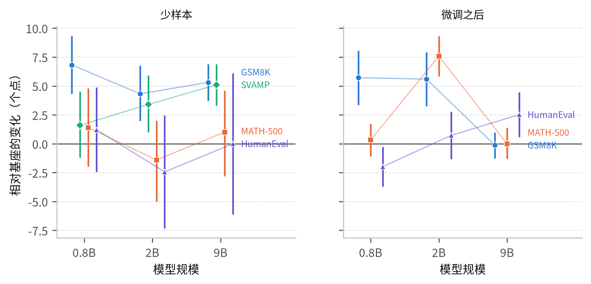
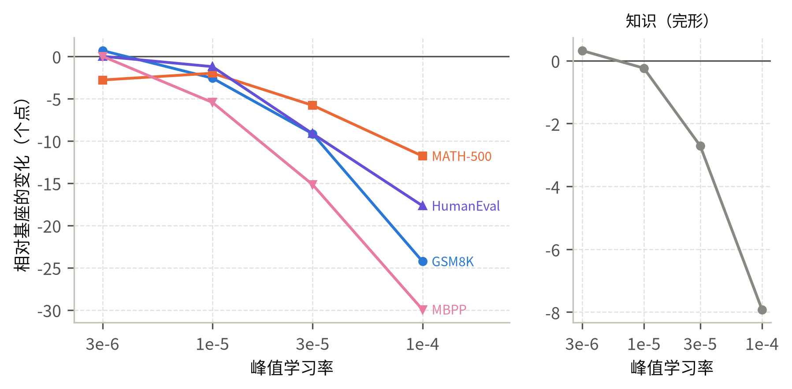
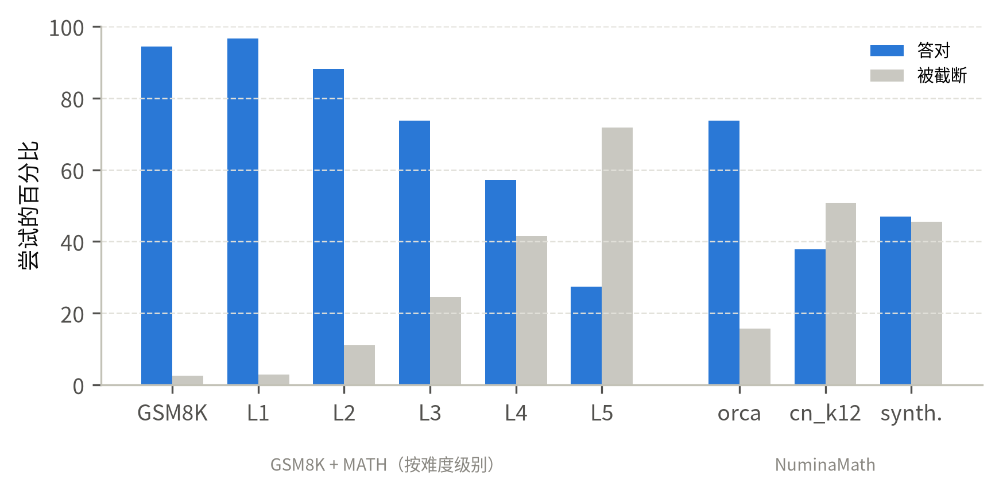
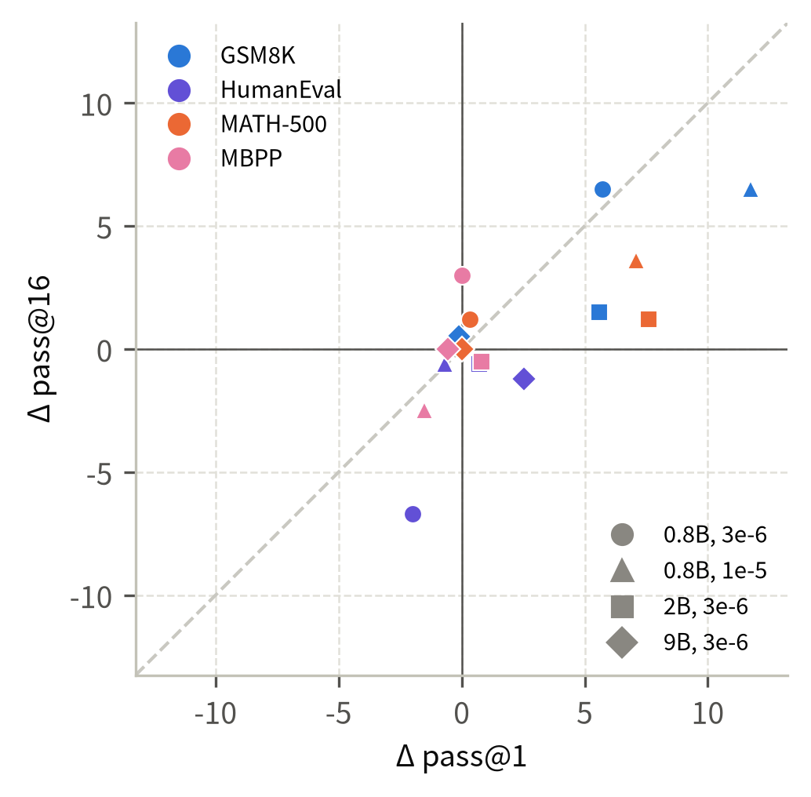

<div align="center">

# qwen-midtrain

[English](README.md) | [中文](README.zh-CN.md) | [Hugging Face 上的数据](https://huggingface.co/datasets/jiazhe868/qwen-midtrain-data) | [Hugging Face 上的检查点](https://huggingface.co/jiazhe868/qwen-midtrain-checkpoints)

一项在 Qwen3.5 基座模型上做中期训练（mid-training）的研究，模型参数从 0.8B 到 9B。公开文本没有让这些模型变好。更强的模型写出的详细解答让它们变好了，每种规模都是如此。硬件：一台工作站上的四张 A100 40 GB GPU，以及一个 Slurm 集群的 A100 节点。

</div>

<p align="center"></p>

这张图是主要结果。每个标记代表一种模型规模。标记的高度，是模型在蒸馏解答上做中期训练之后提高了多少，比较的对象是训练之前的同一个模型（即“基座”）。穿过每个标记的线段是 95% 区间：线段整个位于零以上的标记，它的提高超出了偶然能解释的范围。左图直接测试模型，提示中给几道已解出的示例。右图在一次简短、固定的微调之后再测试（§2.2）。在 0.8B 和 2B 上，增益在两幅图中都成立。在 9B 上，它只在左图中成立（§5.5）。

## 摘要

大语言模型通常分三个阶段构建。预训练（pretraining）用数万亿 token 的文本教会模型语言和知识。随后，后训练（post-training）把模型变成助手，并提高它的推理能力。在这两个阶段之间，很多团队会加一个简短的中间阶段，叫作**中期训练**。在这个阶段，模型阅读一份精心挑选的高质量文本配比（mixture）。

中期训练的目的，是给后训练一个更好的起点。对 Qwen3.5 这样强的开放模型来说，这比听上去要难。这个模型已经读过公开可得的大部分好文本。它的预训练也已经在一个稳定的状态中结束。新的训练在带来任何东西之前，就可能先扰乱这个状态。

本项目在 Qwen3.5 基座模型上测试了两类数据。第一类是**公开文本**：数学网页、问答对、维基百科、教科书、代码和普通网页文本。没有哪一种公开文本的配比让 0.8B 模型变好。学习率较大时，这些配比让模型变差；学习率较小时，它们什么也没有改变。

第二类是**蒸馏数据**（distilled data）。一个参数为 27B 的更大模型，即“教师”（teacher），为两个数学基准 GSM8K 和 MATH 的训练题写出逐步的解答。只保留最终答案正确的解答。这些数据在每种模型规模上都有帮助。GSM8K 准确率在 0.8B 模型上提高 6.8 个点，在 2B 模型上提高 4.3 个点，在 9B 模型上提高 5.3 个点。增益也出现在另一个来源的应用题上（SVAMP，9B 上 +5.1），模型也保住了通用知识。

第二种测试问的是：经过一次简短、固定的微调之后，模型能做到什么。这更接近模型实际被使用的方式。在这里，结果按规模分开了。0.8B 和 2B 模型保住了增益。9B 模型没有：微调之后，9B 基座模型做得和蒸馏后的模型一样好。

两次对照运行说明了增益从哪里来。只用普通文本训练，什么也没有改变。用去掉解答的同一配比训练，同样什么也没有改变。主要的教训很简单：**当数据能教给模型它还不知道的东西时，对强模型做中期训练就会有效。** 在本项目中，这种东西是更强的模型的推理，并且已经对照已知答案检查过。9B 的结果也符合同一个教训。教师的参数量只有 9B 模型的三倍，而这些解答展示的东西，9B 模型大多已经知道。所以接下来的 9B 运行只保留 9B 模型自己解不出的那些题的解答。

## 目录

1. [引言](#1-引言)
2. [怎样测量一个经过中期训练的模型](#2-怎样测量一个经过中期训练的模型)
3. [公开文本：哪些做法没有用](#3-公开文本哪些做法没有用)
4. [蒸馏：可选的方法与我们的流水线](#4-蒸馏可选的方法与我们的流水线)
5. [结果](#5-结果)
6. [结论](#6-结论)
7. [复现本研究](#7-复现本研究)
8. [附录](#8-附录)：文本池、训练循环、筛选设计、教师改写、为以后准备的组件、护栏、算力、预测、仓库结构
9. [参考文献](#9-参考文献)
10. [数据与许可](#10-数据与许可)

[PITFALLS.zh-CN.md](PITFALLS.zh-CN.md) 汇集了搭建这条流水线时遇到的失败方式，以及现在用来发现它们的检查。

---

## 1. 引言

### 1.1 什么是中期训练

语言模型分阶段学习。每个阶段用的数据不同，目标也不同：

```
预训练      数万亿 token 的广泛文本；模型学会语言和知识
中期训练    在预训练末尾，用一份较小的、精心挑选的配比；模型加强以后要用到的能力
后训练      先在对话上微调，再在答案可检查的题目上做强化学习（RL）
```

在预训练期间，**学习率**（learning rate）控制每次更新模型权重的幅度。它在训练开始时上升，之后慢慢降向零。临近结束时，更新非常小，模型稳定在一个状态中。这种缓慢的冷却叫作**退火**（annealing），在退火之后发布的模型，就称为经过退火的模型。

中期训练通常作为预训练的最后一个阶段来做，用的配比更窄。好几个开放模型的报告都描述过它。OLMo 2 的最后阶段训练 500 亿乃至更多 token，数据是网页文本、数学和合成数据的精选组合。Llama 3 在少量高质量的数学和代码数据集上退火。Qwen 的报告描述了一个偏重科学、代码和推理的最后阶段。通常的配方（recipe）有三部分：

1. 更多来自重要领域的文本，比如数学和代码；
2. 一些普通文本的**回放**（replay），让模型不忘记原来会的东西；
3. 在这个阶段中衰减到零的学习率。

有两个结果决定中期训练是否奏效。第一个是后训练从新的起点出发能达到什么。一个好的中期训练阶段，给出的模型在微调之后能解出更多的题，也能找到更多正确答案，供强化学习去奖励。第二个结果是模型保住了什么。它的通用知识，以及目标领域之外的能力，都不应该变差。

### 1.2 为什么强基座模型难以改进

常见的看法是：好文本越多，模型越好。对 Qwen3.5 这样已经发布的基座模型，有三个事实让这一点变得不那么确定。

**第一，模型很可能已经读过这些文本。** Qwen3.5 训练时用了数十万亿 token。中期训练配比会用到的最好的公开数据集，比如 FineWeb-Edu、维基百科、FineMath 和 StackExchange，和它自己最后阶段的数据属于同一类。一个模型读过一本书之后，第二次再读可能学不到多少东西。

**第二，模型已经稳定下来了。** 它的权重已经在它自己的数据配比上退火到一个稳定的状态。继续训练必须重新调高学习率，而更大的更新可能把模型推出这个状态。一旦发生这种情况，模型在获得任何能力之前，会先失去一些能力。能从这种效应中恢复过来的继续预训练（continued pretraining）研究，用了几百亿到几千亿 token。本项目能负担的是几亿 token。

**第三，小的增益很容易测错。** 每次训练都会改变模型在留出（held-out）文本上的损失，所以损失总会有一些变动。这种变动很难说明后训练能达到什么（§2.1）。一个在被测任务自己的解答上做微调的测试，也可能掩盖模型之间的差别（§2.3）。而且每种设置只训练一次，重复运行之间的噪声是未知的。

### 1.3 本研究问了什么，发现了什么

本项目要回答三个问题：

1. 用一份精心挑选的公开文本配比，在小剂量下还能改进 Qwen3.5 吗？
2. 如果不能，什么样的数据能？
3. 如果某种数据有帮助，它的增益能否经受住微调，能否延伸到其他来源的题目上，能否从 0.8B 模型一直保持到 9B 模型？

答案如下，顺序与各节的顺序一致：

- **公开文本没有帮助（§3）。** 0.8B 模型在很多种公开文本的配比上训练过，训练量为 4,000 万和 3 亿 token。峰值学习率为 1e-5 或更高时，每一种配比都让模型变差，只含普通文本的配比也一样。学习率为 3e-6 时，每一种配比都让它停在原地。
- **蒸馏得到的解答有帮助（§5.1）。** 一个 27B 教师模型写出详细的解答，只保留正确的那些。用它们训练，在每种规模上都提高了 GSM8K 准确率：0.8B 上提高 6.8 个点，2B 上提高 4.3 个点，9B 上提高 5.3 个点。通用知识保持不变。
- **起作用的是这些解答（§5.2）。** 只用普通文本的运行没有任何增益。去掉解答的同一配比也没有增益。
- **增益有一部分延伸到了新题目上（§5.3）。** SVAMP 是一套由别人编写的应用题。在它上面，从最小的模型到最大的模型，增益依次是 1.6、3.4 和 5.1 个点。直接提问时，MATH-500 测试没有变化，代码则完全没有变化。
- **在 0.8B 和 2B 上，微调显露出更多的增益（§5.4）。** 经过一次简短的通用微调之后，GSM8K 最多提高 11.8 个点，MATH-500 最多提高 7.6 个点。这部分额外增益大多是可靠性：对于本来就偶尔能解出的题，模型更常答对了（§5.6）。
- **在 9B 上，微调抹掉了增益（§5.5）。** 经过同样的微调之后，蒸馏后的 9B 模型并不比微调后的基座模型好。单靠微调，基座模型就得到了同样的能力。这些解答教给 9B 模型的，大多是它已经知道的东西。
- **第一个解答集有一个缺口（§4.4）。** 教师的回答被限制在 1,024 个 token 以内。这个上限截断了它在最难的 MATH 题上 72% 的尝试，所以这些题在数据里几乎没有。第二轮解题允许写 4,096 个 token，今天开始。

> **状态，2026-11-24。** 0.8B、2B 和 9B 的结果已经出来，其中包括 9B 模型的微调测试。正在运行的有：4B 的运行，以及对难题的第二轮解题。接下来：再做两次 9B 运行（§6.4）。重复运行和一组设计选择的扫描要等集群。每出一个结果，本文件就更新一次。

### 1.4 模型、数据与算力

| | |
|---|---|
| 模型 | 参数规模为 0.8B、2B、4B 和 9B 的 Qwen3.5 基座检查点（Apache-2.0）。只训练文本部分；每次保存时，视觉等其他权重原样复制回去 |
| 公开文本 | 11 个数据源，49.7 亿训练 token：网页文本、维基百科、教科书、论文、论坛回答、FineMath 的两个切片、教学代码，以及 WebInstructSub 中的 229 万对问答（附录 A） |
| 教师 | Qwen3.8-27B（Apache-2.0），4 位权重，每张 40 GB GPU 上放一份 |
| 教师写的文本 | GSM8K 和 MATH 训练题的 45,177 条检查过的解答（2,320 万 token）；NuminaMath-1.5 题目的 21,445 条解答（1,290 万）；真实段落的 10,349 条改写（1,110 万） |
| 一次运行 | 通常是 1 亿 token（筛选设计中为 4,000 万，最初几次剂量运行中为 3 亿）；序列长 4,096 个 token；每步 32,768 个 token；学习率在前 2% 的步数里预热，之后线性衰减到零 |
| 评测 | GSM8K、MATH-500、HumanEval、MBPP、SVAMP 和 ASDiv-A 完整测试集上的准确率；一次固定的微调测试；五个选择题集合和 TriviaQA 上的知识（§2.2） |
| 硬件 | 一台与其他作业共用的工作站上的 4 × A100 40 GB；一个 Slurm 集群的 A100 节点，通过基于文件的任务队列使用（附录 G） |
| 速度 | 0.8B：单张 GPU 上每秒 7.7 千 token。2B：4.0 千。4B：1.9 千。9B：两张 GPU 上 1.1 千，所以 1 亿 token 约需 26 小时 |

---

## 2. 怎样测量一个经过中期训练的模型

后面的每一个数字，都取决于怎样评判一个模型。所以先讲测量，再讲实验。

### 2.1 为什么只看损失不够

**损失**（loss）衡量模型预测文本中下一个词的能力。在留出文本上损失越低，说明这段文本对模型来说越不意外。在预训练中，盯着损失、留下损失最低的模型，是很自然的做法。

对中期训练来说，损失是一个很弱的向导。损失能显示一次运行把模型推向了哪一类文本。它显示不了模型是否成了后训练更好的起点。本研究有两个结果说明了这一点。在 18 次运行的筛选设计（screening design，§3.2）中，配比的选择解释了各次运行之间几乎全部的损失差异。对于微调之后的差异，它几乎什么也解释不了。在 §5.2 中，一次用了教师解答的运行和一次没有用的运行，让各项损失变化的幅度相同。在测试上变好的，只有前一次运行。

损失仍然有用。它是一次运行出了问题时最快的警报，所以每次运行都会记录它。

### 2.2 看一个模型的四种方式

本项目从四个方面评判每个模型。每个方面回答一个不同的问题。

**1. 少样本（few-shot）准确率。** 模型在提示中看到几道已解出的示例，然后是一道新题，再写出答案。这在任何后训练之前直接测试基座模型，也是中期训练的标准尺子。每个测试集的每道题都用一次，采用贪心解码（greedy decoding），也就是模型总是选最可能的下一个词。这些测试集是 GSM8K（1,319 道小学应用题）、MATH-500（500 道竞赛题）、HumanEval（164 个编程任务）和 MBPP（257 个编程任务）。

**2. 其他来源的应用题。** SVAMP（1,000 道题）和 ASDiv-A（1,218 道题）是由别人编写的小学应用题。提问时，提示中放的是同样的八个 GSM8K 示例。它们说明 GSM8K 上的增益能否延伸到别处编写的题目上。

**3. 一次固定的微调测试，即“通用探针”（generic probe）。** 每个模型都做同样的简短微调：在 6,842 段指令对话上训练两遍，峰值学习率为 2e-5。这些对话是一般性的指令：Python 函数、带约束的任务、摘要、改写和日常聊天。没有一条来自被测任务，也没有一条是数学题。微调之后，模型回答一组固定抽取的测试题：GSM8K 200 道，MATH-500 250 道，HumanEval 全部 164 道，MBPP 200 道。每道题在温度 1 下回答 16 次，也就是说，每次采样出一个不同的回答。这显示了从这个模型出发，后训练能达到什么。由此得到两个数字。**pass@1** 是采样一个回答时答对的概率。**pass@16** 是模型在 16 次尝试中至少解出一次的题目所占的比例。

**4. 知识与损失。** 五个选择题集合（MMLU-Pro、ARC-Challenge、HellaSwag、CommonsenseQA 和 CMMLU）和 TriviaQA 测试模型知道什么。选择题集合用**完形**（cloze）方式打分：看模型给每个答案自身文本的似然，不用答案字母。小模型会偏爱某些字母，完形方式消除了这种偏差（PITFALLS B4）。每个数据源的留出文本上的损失也会记录下来。它以**每字节比特数**（bits per byte）给出：模型编码文本的一个字节平均需要的比特数。越低越好。

| 视角 | 问的是什么 | 代码 |
|---|---|---|
| 少样本准确率 | 基座模型现在能做到什么 | `base_regression.py final` |
| 其他来源的应用题 | 增益能否延伸到别处编写的题目上 | 同一条命令 |
| 通用探针 | 从这个模型出发，后训练能达到什么 | `sft_probe.py --variant generic` |
| 知识与损失 | 模型有没有忘掉什么 | `base_regression.py run` |

pass@1 与 pass@16 之间的差距，对下一个阶段很要紧。强化学习只能奖励模型有时会给出的答案。一道模型在 16 次尝试中一次也解不出的题，不给 RL 任何可用的东西。

```python
# src/midtrain/eval_tasks.py：由 n 个样本（其中 c 个正确）得到的标准 pass@k 无偏估计
def estimate_pass_at_k(correct_sample_count: int, sample_count: int, k: int) -> float:
    return 1.0 - math.comb(sample_count - correct_sample_count, k) / math.comb(sample_count, k)
```

### 2.3 一个在教考题的探针

微调测试的第一版没有用指令对话。它让每个模型在 GSM8K、MATH 和 MBPP 约 15,000 条训练解答上微调，然后在这几个任务上测试。这看起来是测量后训练能达到什么的最直接的办法。

结果它测到的是另一回事。在 0.8B 基座模型上，这个“领域内”（in-domain）探针在每个任务上的分数都低于通用探针，也低于模型自己的少样本准确率：

| 任务 | 在任务自己的解答上训练的探针，pass@1 | 通用探针，pass@1 | 0.8B 基座，少样本 | 2B 基座，少样本 |
|---|---|---|---|---|
| GSM8K | 37.2 | 39.8 | 42.7 | 61.6 |
| MATH-500 | 13.6 | 22.8 | 23.0 | 37.2 |
| HumanEval | 9.6 | 15.4 | 21.3 | 34.1 |
| MBPP | 22.8 | 29.0 | 37.4 | 49.4 |

原因在于这些训练解答的风格。GSM8K 的解答是带计算器标记的简短笔记，MATH 的解答会跳步。微调教会模型用这种简略的风格作答，这种风格比模型自己的更差。同一个探针还让不同的模型看起来差不多。经过它之后，配比的选择只能解释 18 次设计运行之间 12% 的差异。这比一个同样大小的线性模型对纯噪声的解释比例还低。

因此，我把它换成了通用探针。通用探针的对话里不含任何被测任务。我还把完整测试集上的少样本准确率定为主要的测量（`results/probe/`、`results/probe_generic/`、`results/final_eval/`）。

**一个在被测任务自己的解答上训练的探针，测到的更多是探针本身，而不是模型。**

### 2.4 噪声，以及一次运行说明不了什么

小的差别需要仔细比较。每个模型都用同样的提示回答同样的题目。所以两个模型可以逐题比较：在每道题上，可能一个模型对、另一个错，也可能两者得分相同。这些逐题差值的平均，就是增益。

为了知道增益是不是真的，在对题目随机重采样的结果上把这个比较重复 2,000 次。结果中间的 95%，就是每张表里给出的 **95% 区间**。如果区间不包含零，这个差别就超出了“哪些题碰巧在测试里”这种运气所能造成的范围（`mixing_law.py compare-with-base`，它写出 `results/comparisons/dose_vs_base_<size>.json`）。

这个区间有一个局限。它涵盖的是题目的选择，不涵盖训练的随机性。换一种数据顺序再训练一次，可能会得到一个稍有不同的模型。换其他种子的重复运行要等集群（§6.4）。

### 2.5 训练中排除了什么

只有当测试题从来没有出现在训练数据里，测试测到的才是能力。如果一道测试题出现在训练文本中，模型就能凭记忆回答。这种泄漏叫作**污染**（contamination）。

训练文本池（pool）中的每篇文档，都要与每道测试题对照检查，少样本示例也包括在内。一篇文档只要与某段测试文本共有任何一个 13 词序列，就会被标记，采样器永远不会用它。目前的扫描标记了约 13,500 篇文档，约占文本池的百分之零点二五（`results/hygiene_decontamination.json`）。给教师的题目只来自训练划分。由其他模型编写的题目集，在教师看到之前，还要用文本嵌入按语义检查一遍。附录 F 介绍这些检查，以及它们可能漏掉什么。

---

## 3. 公开文本：哪些做法没有用

### 3.1 文本池与配比

实验用的是一个公开文本池。它有 11 个数据源，共 49.7 亿训练 token（附录 A）。每个数据源都有一个角色：

- **回放**：普通网页文本（FineWeb 和 FineWeb-Edu）和中文维基百科，用来代替模型原来的训练数据；
- **精选文本**：英文维基百科、开放教科书、研究论文和 StackExchange 上的回答；
- **高难度文本**：FineMath 的两个切片（含数学内容的网页）和教学代码；
- **问答文本**：WebInstructSub 中带详细解答的 229 万道题。

一个**配方**规定每个数据源的占比，例如“30% 数学，20% 代码，50% 回放”。然后，采样器为每一条训练序列选择落后目标最多的数据源来填充。所以一次运行实际看到的占比，几乎与配方完全一致（附录 B）。

所有公开文本实验都用 0.8B 模型。剂量从小到大。

### 3.2 四千万 token：筛选设计

调配比的常见做法，是一次只改一个占比。对配比来说，这样做效果不好。各项占比之和必须为一，所以提高一个占比，就会降低别的占比。各项占比之间还有交互作用：数学文本的最佳用量，可能取决于学习率。

因此，我用一个**正交设计**（orthogonal design）同时改变七个因子。正交设计是实验统计学中的一种经典方案。在这种方案中，每个因子的每个水平，与其他每个因子的每个水平同时出现的次数都相同。十八次运行就足以估计每个因子的效应。这些因子是：学习率、回放占比、教师改写的占比、数学和代码的占比、其中数学所占的比例、长上下文打包，以及非回放文本在运行中的出现时机（附录 C）。每次运行用 4,000 万 token 训练 0.8B 模型。

对这 18 次运行拟合一个简单的线性模型，就能看出每项测量有多少由配比解释（`results/designs/screen18_0.8B_analysis.json`）：

| 测量 | 由配比解释的比例 | 各次运行之间的离散程度 | 一次运行的噪声 |
|---|---|---|---|
| 数学损失 / 代码损失（每字节比特数） | 0.98 / 0.94 | 0.0063 / 0.0031 | 0.0013 / 0.0011 |
| 少样本 pass@1，四个任务的平均 | 0.92 | 0.58 | 0.24 |
| 少样本 GSM8K pass@16 | 0.96 | 2.11 | 0.65 |
| 知识（完形） | 0.63 | 0.14 | 0.13 |
| 领域内微调之后的探针 pass@1 | 0.12 | 0.20 | 0.28 |

怎样读这张表。第二列是各次运行之间的差异中由配比解释的比例。在这里，即使是纯噪声也能达到约 0.53，因为一个有十项的线性模型，能拟合任意 18 个数字的一部分。所以只有远高于 0.53 的比例，才说明一项测量真正随配比变化。第三列是 18 次运行之间的标准差。第四列是一次运行的噪声，即线性模型解释不了的部分。损失和少样本分数明显随配比变化。知识分数和探针则没有。

<p align="center"></p>

每个点是某个因子在一个水平上各次运行的平均值，减去全部运行的平均值。灰色带是一个空因子的范围，它显示“没有效应”时效应能有多大。

这些效应是真的，也都很小。数学文本每从回放那里拿走 10% 的 token，数学损失就降低 0.011 比特/字节。教师改写每占 10% 的 token，少样本 GSM8K pass@16 就提高 1.7 个点。较低的学习率 3e-6 在每一项损失上都胜过 1e-5。然后，领域内探针抹掉了所有这些差别。显而易见的下一步是加大剂量。

### 3.3 三亿 token：学习率这道墙

已发表的中期训练阶段用几亿乃至更多 token。所以下一个实验给 0.8B 模型 3 亿 token，是之前的 7.5 倍。配比富含推理内容：FineMath（25%）、WebInstructSub（25%）、教师改写（5%）、代码（7%）、教科书（3%）和回放（35%）（`configs/recipes/dose/`）。它先在三个峰值学习率下运行：1e-5、3e-5 和 1e-4。同时还有一次对照运行，只用回放文本，学习率为 3e-5。

<p align="center"></p>

左图是每个学习率下，少样本准确率相对基座模型的变化。右图是知识的变化。越低越差。

情况很清楚。学习率为 1e-5 或更高的每次运行，最后都低于基座模型。学习率越高，损害越大：

| 运行（3 亿 token） | GSM8K | MATH-500 | HumanEval | MBPP | 知识（完形） | FineWeb-Edu 损失 |
|---|---|---|---|---|---|---|
| 基座模型 | 42.7 | 23.0 | 21.3 | 37.4 | 34.7 | — |
| 推理配比，1e-5 | 40.1 | 21.0 | 20.1 | 31.9 | 34.5 | +0.2% |
| 推理配比，3e-5 | 33.5 | 17.2 | 12.2 | 22.2 | 32.0 | +3.0% |
| 推理配比，1e-4 | 18.4 | 11.2 | 3.7 | 7.4 | 26.8 | +9.7% |
| 只做回放，3e-5 | 28.2 | 8.6 | 7.3 | 18.3 | 32.9 | +0.9% |

然后，我把学习率降到 3e-6，也就是在筛选设计中表现最好的学习率。损害消失了。增益也没有了。下表是每次运行减去基座模型，附 95% 区间（`results/comparisons/dose_vs_base_0.8B.json`）：

| 运行（3 亿 token，学习率 3e-6） | GSM8K | MATH-500 | HumanEval | MBPP | 知识（完形） | FineWeb-Edu 损失 |
|---|---|---|---|---|---|---|
| 推理配比 | +0.7 [−1.5, +2.8] | −2.8 [−6.4, +0.8] | 0.0 [−4.3, +4.3] | 0.0 [−4.7, +4.3] | 35.0 | −0.5% |
| 以问答为主的配比（45% WebInstructSub） | +1.7 [−0.5, +4.0] | −0.8 [−4.6, +2.6] | −1.8 [−6.1, +2.4] | +1.9 [−2.7, +7.0] | 34.9 | −0.1% |

所有区间都包含零。经过通用探针之后，两次运行在每个任务上都比基座模型低 0.6 到 2.7 个点。

还检验了一个想法。把受损运行的权重与基座模型的权重做平均，是一种已知的从遗忘中恢复的办法。我把 1e-5 的运行与基座模型做了平均，运行一方的权重取 25% 和 50%（`merging.py`）。这让准确率回到了基座模型 2.4 个点以内。它从来没有比基座模型高出 0.8 个点以上。平均能修复损害。它不能增加能力。

### 3.4 公开文本在这里为什么没有用

四项观察指向同一个解释。

**损害来自训练本身。** 只做回放的对照运行在 FineWeb-Edu 上训练。学习率为 3e-5 时，它在留出的 FineWeb-Edu 文本上的损失上升了 0.9%。在某一类文本上训练，不应该让模型在同一类文本上变差。一种说得通的解读是：重新调高的学习率，把模型推出了它自己的训练所达到的稳定状态，而 3 亿 token 太少，没能把它带回来。

**在安全的学习率下，模型没剩多少可学的。** 学习率为 3e-6 时，留出的公开文本上的损失只下降了 0.1% 到 2%。模型已经能很好地预测这些文本。

**它学到的是风格。** 损失下降最多的是留出的 WebInstructSub 回答，下降了 13%。不管配比里有没有教师的解答，都会出现同样的下降（§5.2）。在测试上变好的，只有含解答的那次运行。所以模型学到的是这些回答的写法，那不是测试所要求的能力。

**缺少的成分在公开文本中很少见。** 测试奖励正确的、逐步的解答。数学网页里大多是现成的答案和讨论。完整而正确的解题过程要少见得多。

**一个经过退火的强基座模型，被损坏比被改进容易。在安全的学习率下，公开文本几乎没有带来它还没学会的东西。**

---

## 4. 蒸馏：可选的方法与我们的流水线

如果模型已经学会了公开文本，要加的就是它没见过的文本。这种文本最直接的来源，是一个更强的模型。更强的模型能解出较小的模型解不出的题，还能把步骤写出来。本节讲解更强的模型教较弱模型的几种主要方式、其中涉及的选择，以及本研究具体做了什么。

### 4.1 更强的模型可以怎样教

**蒸馏**（distillation）是指训练一个较小的模型，即**学生**（student），让它表现得像一个较大的模型，即**教师**（teacher）。各种方法的区别，在于学生从什么中学习。

**软标签蒸馏（soft-label distillation）。** 在最初的形式中（Hinton et al., 2015），学生学习去匹配教师对每一个可能的下一个 token 给出的完整概率。一个概率分布携带的信息，比单个正确答案更多。例如，它能显示哪些错误答案几乎是对的。代价很高：教师必须在每一个训练 token 上运行，两个模型还必须使用完全相同的词表。Gemma 2 用这种方法预训练了它的几个小模型。

**序列级蒸馏（sequence-level distillation）。** 这里由教师写出文本，学生用普通的下一个 token 损失在这些文本上训练（Kim and Rush, 2016）。教师只运行一次，用来写数据。训练过程不变。如今说到语言模型的“蒸馏”，通常指的就是这个。它等同于在更强的模型写出的合成数据上训练。

**一般意义上的合成数据（synthetic data）。** 模型写出的任何文本都是合成数据。例子有真实段落的改写、合成的教科书和问答对。合成数据有多大用处，取决于它增加了什么。一条改写只是重述学生已经知道的事实。一条由更强的模型写出的解答，能带有学生还做不到的推理。本研究用同一个教师试了这两种，只有解答有帮助（§5.3）。

**验证（verification）。** 教师也会犯错。一个补救办法是让教师写出几次尝试，只保留那些通过外部信息检查的尝试。这种检查可以是一个已知的参考答案、一组单元测试，或者一个裁判模型。这就把生成变成了选择。STaR 和拒绝采样微调（rejection-sampling fine-tuning）等方法用的是同样的思路：用模型自己的正确输出训练它。

**同策略蒸馏（on-policy distillation）。** 在上面几种方法中，学生从教师写的文本中学习。在同策略蒸馏中，由学生来写，教师给学生自己的文本打分或加以纠正（Agarwal et al., 2024; Gu et al., 2024）。这样，学生学习的就是它实际会生成的那类文本。教师必须在训练循环内部运行，这让这种方法接近强化学习。

这四种思路可以按学生从什么中学习来概括：

```
软标签蒸馏    教师对每个下一个 token 给出的概率          训练时需要教师
序列级蒸馏    教师写的文本，用通常的下一个 token 损失    教师只负责写数据
  + 验证      只用答案通过检查的文本                     需要有已知答案的题目
同策略蒸馏    学生自己的文本，由教师打分或纠正           训练循环中需要教师
```

本研究用的是**带验证的序列级蒸馏**。它是四种方法中最便宜的。它不需要改动训练代码，就能放进普通的中期训练。验证还能去掉教师的大部分错误。

### 4.2 蒸馏数据背后的选择

构建蒸馏数据，意味着要做一连串的选择。每个选择都会改变学生学到的东西。下表列出主要的选择、本研究选了什么，以及这个选择有没有检验过。

| 选择 | 可选项 | 本研究 | 状态 |
|---|---|---|---|
| 教师 | 模型、规模、权重精度、思考模式、采样方式 | Qwen3.8-27B，4 位权重，关闭思考模式，温度 1.0 | 一张 40 GB GPU 上放得下的最强模型；其他教师没有检验过 |
| 教师写什么 | 真实文本的改写、现有题目的解答、新题目 | 有已知答案的现有题目的解答；改写另外单独检验过（附录 D） | 检验过：解答有帮助，改写没有 |
| 验证 | 不验证、最终答案、单元测试、裁判模型 | 最终答案必须与参考答案一致，由测试所用的同一个判分器检查 | 对数学来说便宜又精确；论证错误、最后数字正确的解答仍能通过 |
| 题目 | 来自哪里、多难、多少道 | GSM8K 和 MATH 的训练划分（14,262 道题）；之后是 NuminaMath-1.5（20,000 道），以及再解一次的难题（2,591 道） | §4.4 |
| 回答长度 | 教师最多可以写多少个 token | 1,024；之后对难题放宽到 4,096 | 1,024 太短（§4.4） |
| 每道题的份数 | 一道题保留多少条不同的解答 | 最多 4 条（NuminaMath 为 2 条） | 每道题一条的设置在集群扫描中 |
| 格式 | 对话格式还是纯文本；题目是否计入损失 | 纯文本 “Question: … Answer: …”；每个 token 都计入 | 中期训练数据中的对话标记可能破坏基座模型测试（OLMo 3）；其他格式没有检验过 |
| 怎样使用 | 用于微调还是作为中期训练的一部分；占比；用量；学习率 | 占 1 亿 token 中期训练配比的 40%；峰值学习率 3e-6 | 占比、用量和学习率在集群扫描中 |
| 学习信号 | 采样的文本还是概率；教师的文本还是学生的文本 | 教师采样出的文本，只写一次 | 概率和同策略方法没有尝试（§4.5） |

结果表明，其中三个选择最要紧。验证决定数据对不对。题目决定学生练习什么。回答长度决定哪些题根本有可能被解出，如 §4.4 所示。

### 4.3 我们的流水线，一步一步来

这条流水线把有已知答案的题目变成训练文本。下面是第一个解答集的完整路径：

```
有已知答案的题目：GSM8K 的训练划分（7,473 道）和 MATH 的训练划分（6,789 道可用）
   │  教师为每道 GSM8K 题写 8 次尝试，为每道 MATH 题写 4 次，每次最多 1,024 个 token
   ▼
86,108 次尝试
   │  检查：尝试已经写完，并且最后一个 boxed 答案等于参考答案
   ▼
72,076 次正确的尝试 ── 每道题最多保留 4 条不同的 ──► 11,915 道题的 45,177 条解答
   │  对照每道测试题和每个少样本示例做污染检查：482 条解答被排除
   ▼
文本池中的数据源 synthetic_solutions（2,320 万 token）── 占 1 亿 token 配比的 40%
   │  以峰值学习率 3e-6 继续预训练
   ▼
学生模型
```

各个步骤的细节如下：

**第 1 步：向教师提问。** 教师收到一条指令和题目。它的思考模式是关闭的，所以它直接作答：

```python
# src/midtrain/synthetic_rephrase.py
solution_instruction = (
    "Solve the problem step by step. Write each step as a short sentence or an equation, check the result, and end "
    "with the sentence 'The final answer is \\boxed{...}.'")
```

下面是一条解答的样子。这个例子是为本 README 写的，格式与教师的解答相同。示例保留英文原文，因为它展示的正是训练时使用的确切格式：

```
Question: A bakery makes 48 muffins in the morning and 36 in the afternoon. It sells three quarters of them.
How many muffins are left?

Answer: The bakery makes 48 + 36 = 84 muffins in total.
It sells three quarters of them: 84 × 3/4 = 63 muffins.
So 84 − 63 = 21 muffins are left.
Check: 63 + 21 = 84, which matches the total.
The final answer is \boxed{21}.
```

**第 2 步：检查每一次尝试。** 只有在 token 上限内写完、并且最后一个 boxed 答案与参考答案一致的尝试，才会保留。比较用的是给测试判分的同一个函数。它按数值比较数字，所以 0.5 和 1/2 算作相等。其他答案按规范化之后的 LaTeX 比较：

```python
# src/midtrain/synthetic_rephrase.py (solve_training_problems)
predicted = find_last_boxed_content(solution_text)
is_correct = bool(finish_reason == "stop" and predicted is not None
                  and is_math_answer_equivalent(predicted, problem["reference_answer"]))
```

教师在 GSM8K 上的尝试有 94% 正确，在 MATH 上有 60% 正确（`results/synthetic_solutions_summary.json`）。有 2,347 道题，没有一次尝试是对的。

**第 3 步：挑选并排版。** 相同的尝试合并为一条，每道题最多保留四条解答。每条解答成为一篇纯文本文档：先是题目，然后是答案。文本中没有对话标记（chat token）。学生像读其他文本一样读它，损失计入每一个 token。

**第 4 步：检查污染。** 这个新数据源和其他每个数据源一样，要通过同样的 13 词检查（§2.5）。它标记了 482 条解答。大多数匹配的是 MATH 题目的固定措辞，比如“enter your answer in the form”。其中十六条是三道 GSM8K 训练题的解答，这三道题与 GSM8K 的测试题近乎相同。这 482 条，采样器一条也不会用。

**第 5 步：混合并训练。** 解答占训练 token 的 40%。解答有 2,320 万 token，训练有 1 亿 token，所以每条解答大约被看到 1.7 次。其余 60% 保留了之前配比中的问答文本、数学网页和代码，再加上一小份回放：

```yaml
# configs/recipes/dose/dose_distill_100m.yaml
token_budget: 100007936           # 3,052 步，每步 32,768 个 token
components:
  synthetic_solutions: 0.40
  reasoning_qa: 0.15
  math_web: 0.10
  code: 0.10
  textbooks: 0.05
  wiki_en: 0.05
  replay_web_edu: 0.10
  wiki_zh: 0.05
```

训练用的循环与其他每次运行相同（附录 B），峰值学习率为 3e-6。这正是 §3.3 中没有造成损害的学习率。

### 4.4 三个解答集，以及限制它们的因素

<p align="center"></p>

蓝色柱是教师的尝试中答对的比例。灰色柱是还没写完就超过 1,024 token 上限的比例。各组依次是 GSM8K、MATH 的五个难度级别（L1 最容易，L5 最难）和 NuminaMath 的三个来源（`results/synthetic_attempts_*.json`）。

**第一个解答集在顶端有一个缺口。** 1,024 token 的上限是按 GSM8K 选的，GSM8K 的解答很短。MATH 的解答更长，题目越难，解答越长。在第 1 级，只有 3% 的尝试被截断。第 4 级是 42%，第 5 级是 72%，这一级只有 27% 的尝试答对。这些题教师并没有做错。它只是写不下了。结果，保留下来的 MATH 解答大多是容易的题，最难的题几乎没有。这最可能是 MATH-500 在 9B 上没有变化的原因（§5.1）。

**第二个解答集拓宽了题目范围。** GSM8K 和 MATH 只覆盖两类题目。第二个解答集从 NuminaMath-1.5（Apache-2.0）的另外三个来源中抽取 20,000 道题：

- orca_math：由模型编写的小学应用题；
- cn_k12：译成英文的中国中小学习题；
- synthetic_math：新编的竞赛风格题目。

只抽取 NuminaMath 标为有效、并且有可检查的简短最终答案的题目。在教师看到这些题之前，污染检查从抽出的 26,000 道题中去掉了 960 道。其中约 350 道与某道 SVAMP 或 ASDiv-A 题共有一个 13 词序列，83 道与某道 MATH-500 题共有。它们大多来自 orca_math（`results/synthetic_solutions_numina_selection.json`）。教师对每道题写两次尝试，得到 11,367 道题的 21,445 条正确解答（1,290 万 token）。同样的 1,024 token 上限，总共截断了这些尝试中的 37%，在 cn_k12 和 synthetic_math 上截断了大约一半。

**第三轮解题填补这个缺口。** 第一个解答集中的 2,591 道题会再解一次。它们是没有一次尝试答对的 2,347 道题，加上只有一次尝试答对的第 4、5 级 MATH 题。这 2,591 道题中，1,442 道是第 5 级，602 道是第 4 级。这一次，教师可以写 4,096 个 token，每道题四次尝试，温度 0.8。新的解答自成一个数据源：`synthetic_solutions_hard`。然后，两次检查运行（0.8B 和 2B）用这个配方训练，其中 10% 的 token 取自这些新解答（`configs/recipes/dose/dose_distill_hard_100m.yaml`）。

### 4.5 我们没有尝试的做法及原因

- **软标签蒸馏。** 它需要教师在每个训练 token 上的概率。对 1 亿 token 来说，这意味着每个 token 都要让 27B 模型做一次前向计算，比训练 9B 模型本身还贵。两个词表也必须完全一致。
- **同策略蒸馏。** 它把教师放进训练循环。这会让中期训练变成一种接近强化学习的东西，强化学习是训练的下一个阶段。
- **用单元测试检查的代码解答。** HumanEval 和 MBPP 从来没有变化，配方里也没有代码解答。教师可以写程序，沙箱可以运行它们的测试。现有的时间里放不下这项工作。
- **检查解答的每一步。** 一个裁判模型可以拒掉推理有错的解答，即使它最后的数字是对的。只查最终答案的检查会放过这样的解答。
- **开启思考模式的教师，或者更强的教师。** 思考过程很长，格式也不同。比 27B 模型更强的教师，没法以有用的速度放进工作站的 GPU。

---

## 5. 结果

### 5.1 每种规模上的增益

第一个问题很简单：蒸馏配方有没有帮助？在每种规模上都有帮助吗？下表是每次运行减去同一规模的基座模型。所有运行都用峰值学习率 3e-6 和 1 亿 token（`results/comparisons/dose_vs_base_<size>.json`）。

怎样读这张表。前面一组列是少样本准确率。“探针”列是通用微调之后的 pass@1。知识是完形分数，单位是点。加粗的数值，其区间不包含零。

| 规模 | 基座 GSM8K | GSM8K | SVAMP | MATH-500 | HumanEval | MBPP | 知识 | 探针 GSM8K | 探针 MATH-500 |
|---|---|---|---|---|---|---|---|---|---|
| 0.8B | 42.7 | **+6.8 [+4.3, +9.3]** | +1.6 [−1.2, +4.5] | +1.4 [−2.0, +4.8] | +1.2 | +1.9 | +0.2 | **+5.7 [+3.3, +8.1]** | +0.3 [−1.1, +1.7] |
| 2B | 61.6 | **+4.3 [+2.0, +6.8]** | **+3.4 [+1.0, +5.9]** | −1.4 [−5.0, +2.0] | −2.4 | −1.6 | −0.5 | **+5.6 [+3.2, +7.9]** | **+7.6 [+5.8, +9.3]** |
| 4B | 82.8 | 运行中 | | | | | | | |
| 9B | 87.1 | **+5.3 [+3.7, +6.9]** | **+5.1 [+3.3, +6.9]** | +1.0 [−2.8, +4.6] | 0.0 | −0.4 | +0.4 | −0.1 [−1.3, +1.0] | 0.0 [−1.3, +1.4] |

值得注意的是：

- **GSM8K 在每种规模上都上升了**，幅度为 4 到 7 个点。9B 模型本来就能解出 87.1% 的 GSM8K 题。对它来说，这意味着答错的题目比例从 12.9% 降到 7.6%。错误减少了 41%。
- **知识保持不变。** 在任何规模上，它的变化最多半个点。在 0.8B、2B 和 9B 上，11 个公开数据源中有 9 个的留出损失也下降了。
- **在少样本测试中，MATH-500 和代码没有变化。** 它们的变化都在噪声以内。
- **微调之后，MATH-500 也上升了**，在 2B 上提高 7.6 个点。第 5.4 节解释两种测试为什么不同。
- **在 9B 上，微调去掉了增益。** 微调之后，蒸馏后的 9B 模型在 GSM8K 和 MATH-500 上的得分与微调后的基座模型相同。第 5.5 节分析原因。

**用更强的模型写出、并经过检查的解答做中期训练，在测试过的每种规模上都改进了基座模型，而且不损失知识。** 经过微调之后，增益在 0.8B 和 2B 上保留下来，在 9B 上消失了。

### 5.2 增益从哪里来

蒸馏配方与 §3 的公开文本运行有两处不同。它加入了解答。它还改变了配比的其余部分：另外 60% 主要是问答文本、数学网页和代码，回放很少。两处改变都可能是原因。

两次对照运行把两者分开。它们用同样的预算和同样的学习率。**只做回放的对照组**只用普通文本训练：FineWeb-Edu 和中文维基百科。**消融运行**（ablation）保留这个配方，只是把解答的 40% 给了普通网页文本（`configs/recipes/dose/dose_nosolutions_100m.yaml`）。

| 运行减去基座（1 亿 token，学习率 3e-6） | GSM8K | MATH-500 | HumanEval | 探针 GSM8K | 探针 MATH-500 | 知识 |
|---|---|---|---|---|---|---|
| 0.8B 蒸馏 | **+6.8 [+4.3, +9.3]** | +1.4 [−2.0, +4.8] | +1.2 [−2.4, +4.9] | **+5.7 [+3.3, +8.1]** | +0.3 [−1.1, +1.7] | +0.2 |
| 0.8B 去掉解答 | −0.5 [−2.6, +1.4] | **−4.4 [−7.8, −1.0]** | −0.6 [−4.3, +3.0] | −1.0 [−3.0, +0.9] | **−3.5 [−4.8, −2.2]** | +0.5 |
| 0.8B 只做回放 | +0.3 [−1.7, +2.2] | +0.4 [−3.0, +4.2] | +0.6 [−2.4, +3.7] | +0.1 [−1.8, +2.1] | 0.0 [−1.3, +1.2] | +0.6 |
| 2B 蒸馏 | **+4.3 [+2.0, +6.8]** | −1.4 [−5.0, +2.0] | −2.4 [−7.3, +2.4] | **+5.6 [+3.2, +7.9]** | **+7.6 [+5.8, +9.3]** | −0.5 |
| 2B 只做回放 | −0.7 [−2.6, +1.1] | −3.8 [−7.8, 0.0] | −1.2 [−5.5, +3.0] | +0.7 [−1.2, +2.6] | **−1.8 [−3.4, −0.2]** | +0.6 |

答案很清楚。继续训练本身没有作用：在两种规模上，只做回放的对照组都持平。配比的其余部分也没有作用：去掉解答之后，同一配比没有任何增益，甚至在 MATH-500 上丢了 4.4 个点。**增益来自这些解答。**

<p align="center"></p>

这张图把本研究的每一次 0.8B 运行并排放在一起。上面一行是少样本准确率，下面一行是通用探针之后的 pass@1。每个标记是一次运行减去基座模型。只有蒸馏运行明显移到了零的右边，而且只在 GSM8K 和 MATH-500 上。

留出损失从另一个侧面说明了同一件事：

<p align="center"></p>

每根柱子是三次 0.8B 运行之一在一个公开数据源上的留出损失变化。蒸馏运行（橙色）和去掉解答的运行（紫色）让每一项损失变化的幅度都差不多。两者都让 WebInstructSub 回答（reasoning_qa）上的损失降低了约 13%。在测试上变好的，只有前一次运行。解答增加的能力，在这些损失里一项也看不出来。只做回放的对照组（灰色）呈现第三种模式：它让大多数专门领域数据源上的损失上升，比如论文、代码和数学网页，因为它只读普通文本。

### 5.3 增益能延伸多远

这些解答回答的是 GSM8K 和 MATH 的训练题。GSM8K 的测试题来自同一个分布。所以 GSM8K 增益的一部分，可能只是在这一类题目上的增益。

SVAMP 和 ASDiv-A 用来检验这一点。它们是由别人编写的小学应用题，没有任何一条解答与它们共有 13 词序列（`results/hygiene_decontamination_word_problems.json`）。两者在提示中都用同样的八个 GSM8K 示例，所以变的只有题目。

| 运行减去基座 | GSM8K | SVAMP | ASDiv-A |
|---|---|---|---|
| 基座准确率，0.8B / 2B / 9B | 42.7 / 61.6 / 87.1 | 61.2 / 71.1 / 87.5 | 90.2 / 95.3 / 97.6 |
| 0.8B 蒸馏 | +6.8 [+4.3, +9.3] | +1.6 [−1.2, +4.5] | +1.1 [−0.6, +2.7] |
| 2B 蒸馏 | +4.3 [+2.0, +6.8] | **+3.4 [+1.0, +5.9]** | −0.4 [−1.6, +0.8] |
| 9B 蒸馏 | +5.3 [+3.7, +6.9] | **+5.1 [+3.3, +6.9]** | −0.2 [−1.1, +0.7] |
| 0.8B 只做回放 | +0.3 [−1.7, +2.2] | −1.4 [−3.3, +0.6] | +0.2 [−1.0, +1.5] |

值得注意的是：

- **模型越大，延伸过去的增益越多。** 在 SVAMP 上，0.8B 模型只保住了 GSM8K 增益的一小部分，2B 模型保住了约一半，9B 模型全部保住。
- **ASDiv-A 没有变化。** 基座模型本来就能解出其中 90% 到 98% 的题，所以没有多少空间。
- **公开文本在这里有害。** 每一种公开文本配比都降低了 SVAMP。
- **少样本 MATH-500 在任何规模上都没有变化。** 第一个解答集的缺口（§4.4）是最可能的原因。
- **代码从来没有变化。** 配方里没有代码解答。

**更广的题目集把增益挪到了别的题目上。它没有让增益变大。** 第二个解答集（§4.4）替换了第一个解答集的一半，解答仍占 token 的 40%：

| 配比中的解答（0.8B） | GSM8K | MATH-500 | SVAMP | 探针 GSM8K | 探针 MATH-500 |
|---|---|---|---|---|---|
| 第一个解答集，40% | **+6.8 [+4.3, +9.3]** | +1.4 [−2.0, +4.8] | +1.6 [−1.2, +4.5] | **+5.7 [+3.3, +8.1]** | +0.3 [−1.1, +1.7] |
| 第一个解答集 20% + NuminaMath 20% | **+4.4 [+2.0, +6.8]** | −0.4 [−4.0, +3.0] | **+3.6 [+1.0, +6.2]** | **+5.4 [+3.0, +7.8]** | +0.1 [−1.4, +1.5] |

GSM8K 训练题的解答减半，在 GSM8K 上少了约两个点，在 SVAMP 上多了约两个点。其他都没有变化。对 SVAMP 的增益要提醒一句。orca_math 写的正是和 SVAMP 同一类的题目。污染检查只去掉近似副本，所以那些很接近、又不是副本的题目，仍然可能在 SVAMP 上起帮助作用。另外，由于 1,024 token 的上限，较难来源保留下来的解答都是较短的那些。

教师对真实段落的改写是一个有用的反例（附录 D）。它们也是同一个教师写出的合成文本。它们没有帮助。在 4,000 万 token 时，它们有一个小的少样本效应，被领域内探针抹掉了；在 3 亿 token 时，没有任何效应。**要紧的是文本的内容：在与测试相似的题目上经过检查的推理。文本是不是模型写的，并不要紧。**

### 5.4 同一个模型的两种视角：少样本与微调之后

少样本测试直接向基座模型提问。通用探针先教它回答对话，然后再提问。在 0.8B 上，两种视角对最佳学习率的看法不一致：

| 0.8B 蒸馏减去基座 | GSM8K 少样本 | MATH-500 少样本 | 探针 GSM8K | 探针 MATH-500 | 知识 |
|---|---|---|---|---|---|
| 学习率 3e-6 | **+6.8 [+4.3, +9.3]** | +1.4 [−2.0, +4.8] | **+5.7 [+3.3, +8.1]** | +0.3 [−1.1, +1.7] | +0.2 |
| 学习率 1e-5 | **+6.7 [+3.9, +9.4]** | −1.0 [−4.6, +2.4] | **+11.8 [+9.2, +14.2]** | **+7.1 [+5.4, +8.9]** | −0.5 |

在少样本测试中，两种学习率在 GSM8K 上的增益相同，在 MATH-500 上都没有增益。微调之后，1e-5 的运行在 GSM8K 上的增益翻了一倍，在 MATH-500 上提高了 7.1 个点。

回答本身解释了这个差别：

<p align="center"></p>

左图是通用微调之后回答的平均长度。右图是达到探针长度上限的回答所占的比例。每张图都把 0.8B 基座模型与两次蒸馏运行做比较。

在少样本测试中，每个模型都照着提示里八个简短示例的格式来写，那些示例是人写的。微调之后，每个模型按自己的方式作答。1e-5 的模型像它的教师那样，写长篇的详细解答。在 MATH-500 上，它的回答比基座模型的长 64%，其中三分之一达到长度上限，被算作错误。即便如此，它解出的题还是更多。只有当提示允许模型用上这种能力时，解答教给它的能力才会显现出来。

在 2B 上，较低的学习率就已经做到了 0.8B 上 1e-5 才做到的事：微调之后，MATH-500 提高 7.6 个点。一种可能的解读是，较大的模型更容易吸收这些解答。

**学习率在基座模型自身的分数与微调之后能达到的水平之间做取舍。3e-6 保住了少样本分数和知识。1e-5 让微调之后的增益翻倍，代价是半个点的知识。**

### 5.5 在 9B 上，微调带来同样的增益

9B 模型的微调测试最后才完成，它的结果和较小的规模不一样。经过通用微调之后，蒸馏后的 9B 模型并不比微调后的基座模型好。GSM8K 的 pass@1 变化 −0.1 [−1.3, +1.0]，MATH-500 变化 0.0 [−1.3, +1.4]。唯一明显的变化在 HumanEval 上，+2.5 [+0.6, +4.5]。这个变化很小，而且出现在解答没有覆盖的任务上。

首先要排除的是样本。探针只问 200 道 GSM8K 题和 250 道 MATH-500 题，所以它可能漏掉在完整测试集上能看到的增益。因此，我在完全相同的这些题上比较了少样本的回答。在这些题上，蒸馏后的 9B 模型明显领先。它解出 200 道 GSM8K 题中的 94.5%，基座模型解出 86.5%，增益为 8.0 [+4.5, +12.0]。增益在样本里是存在的。是微调把它去掉了。

下表在同样的题目上，跟踪两个 9B 模型经过微调前后的表现。少样本准确率用贪心解码，探针的 pass@1 是 16 个采样回答的平均，所以不同的列之间不能直接比较。要看的是每一列里两行之间的差距（`results/comparisons/dose_vs_base_9B.json` 中的 `few_shot_greedy_on_probe_items`，以及 `results/probe_generic/`）：

| 9B，同样的题目 | GSM8K 少样本 | GSM8K 微调之后 | MATH-500 少样本 | MATH-500 微调之后 |
|---|---|---|---|---|
| 基座模型 | 86.5 | 89.9 | 51.2 | 65.2 |
| 蒸馏运行 | 94.5 | 89.8 | 54.4 | 65.2 |

有两点很突出。第一，微调把基座模型提高了很多：MATH-500 提高 14 个点，而微调数据里根本没有数学。所以 9B 基座模型本来就有这种能力。少样本提示没有把它引出来，一次简短的微调做到了。第二，微调之后，两个模型停在同一个水平。

回答本身说明了解答在少样本测试中是怎样起作用的。蒸馏后的 9B 模型写出的 GSM8K 回答，比它的基座模型长 51%（394 对 261 个字符）：它像教师那样把解题过程写了出来。在 0.8B 和 2B 上，少样本回答只变长了 7% 到 8%。微调之后，9B 基座模型也把解题过程写了出来（604 个字符），于是追了上来（`results/final_eval/` 和 `results/probe_generic/` 中的 `mean_completion_characters`）。

2B 模型的表现不同。同样的微调只把它的基座模型在 MATH-500 上提高了 1.4 个点（在探针的题目上，从 37.2 到 38.6）。它把蒸馏后的 2B 模型提高了 12.6 个点（从 33.6 到 46.2）。在 GSM8K 上，蒸馏后的 2B 模型经过微调仍保住了大部分领先：微调前领先 7.0 个点，微调后领先 5.6 个点。在 2B 上，这些解答加入了一种单靠微调达不到的能力。

**在 9B 上，教师的解答教的大多是模型已经知道的东西，而一次简短的微调同样能把它引出来。** 教师有 27B 参数，是 9B 模型的三倍。它的参数量约为 2B 模型的 13 倍、0.8B 模型的 34 倍，它的解答里对这些小模型来说是新东西的部分也更多。

这个结果决定了 9B 上接下来的实验（§6.4）。还能教给 9B 模型东西的解答，是它自己解不出的那些题的解答，§4.4 中的难题就在其中。较大的学习率是另一个可以调的杠杆：在 0.8B 上，它让经受住微调的增益翻了一倍（§5.4）。

### 5.6 可靠性，不是覆盖面

pass@1 的增益可能意味着两件不同的事。模型可能解出了以前从来解不出的新题。也可能是同样的题解出得更频繁了。对后面的强化学习阶段来说，这个区别很要紧。

<p align="center"></p>

每个点是一次蒸馏运行（标记形状）在通用探针之后的一项测试（颜色）。横坐标是 pass@1 的变化，纵坐标是 pass@16 的变化。落在虚线对角线上的点，两者增益相同。落在它下方的点，pass@1 的增益大于 pass@16。

点落在哪里，取决于模型规模。在 2B 上，增益几乎全是可靠性。MATH-500 的 pass@1 提高 7.6 个点，它的 pass@16 只提高 1.2，在噪声以内。GSM8K 的 pass@1 提高 5.6，pass@16 提高 1.5。所以，对于基座模型本来就偶尔能解出的题，蒸馏后的 2B 模型更常答对，它新解出的题很少。在 0.8B 上，GSM8K 的覆盖面也有增益：3e-6 时 pass@16 提高 6.5 个点 [+1.0, +11.5]，1e-5 时提高的幅度相同。最小的模型也解出了新题。在 9B 上，各点都落在零附近（§5.5）。

对强化学习来说，这两种增益的含义不同。更高的可靠性让每组样本里有更多可以奖励的正确答案。更大的覆盖面给强化学习带来以前无法学习的题目，因为那些题以前没有一个样本是对的。2B 模型得到的是第一种增益。0.8B 模型在 GSM8K 上两种都得到了。

### 5.7 其中有没有污染？

三项检查都说没有。

1. 这些解答在生成时就通过了污染检查。被标记的 482 条解答从未进入任何一次运行（§4.3）。
2. 列出了任何一条解答触及的每一道测试题（`data_hygiene.py matched-items`）：GSM8K 3 道，MATH-500 53 道。去掉它们之后，0.8B 在其余 1,316 道 GSM8K 题上的增益不变，是 +6.8 [+4.4, +9.2]；MATH-500 仍在噪声以内（`results/comparisons/dose_vs_base_0.8B.json` 中的 `without_matched_items`）。
3. 增益延伸到了 SVAMP，没有任何一条解答触及 SVAMP。

---

## 6. 结论

### 6.1 本研究的结论

1. 对 Qwen3.5 这样经过退火的强基座模型，公开文本的配比在最多 3 亿 token 的剂量下，不能改进数学、代码或知识。1e-5 及以上的学习率会损害模型。3e-6 的学习率让它保持不变。
2. 更强的模型写出、并对照参考答案检查过的详细解答，在从 0.8B 到 9B 的每种规模上都改进了基座模型。在少样本测试中，GSM8K 提高 4 到 7 个点，知识保持不变。
3. 增益属于这些解答。在普通文本上继续训练没有增益；去掉解答之后，配比的其余部分也没有增益。
4. 增益有一部分延伸到了被解过的题目之外，模型越大，延伸得越多（9B 上 SVAMP +5.1）。它没有延伸到代码，解答也不涉及代码。
5. 在 0.8B 和 2B 上，微调显示出的增益比少样本测试更多，在较高的学习率下尤其如此（0.8B 用 1e-5 时 MATH-500 +7.1，2B 用 3e-6 时 +7.6）。这部分额外的增益主要是可靠性。
6. 在 9B 上，增益没有经受住微调。微调后的基座模型达到了同样的水平，因为这些解答教的东西，9B 模型大多已经知道。

### 6.2 适用于本项目之外的教训

- **测量后训练将会看到的东西，用一个不教考题的测试。** 在被测任务自己的解答上微调，掩盖了模型之间的每一个差别。少样本测试掩盖了 1e-5 运行一半的增益。
- **在你关心的规模上，检查微调之后的增益。** 9B 上的少样本增益和 0.8B、2B 上一样大，而一次简短的微调就把它抹掉了。只看少样本测试，会把这次 9B 运行判为成功。
- **在这里，损失分不出有用的数据和无用的数据。** 蒸馏运行和去掉解答的运行，让每一项留出损失都以同样的方式变化。只有其中一次变好了。
- **先把学习率定对。** 在经过退火的模型上，从没有作用的学习率到造成损害的学习率，只差三倍。
- **让数据有用的，不是“合成”这个属性。** 同一个教师的改写没有作用，它经过检查的解答有帮助。要紧的是新信息、正确性检查，以及与目标的接近程度。
- **看看生成器写不出什么。** 一个为容易的题选定的 token 上限，去掉了大部分最难的题。在按难度统计失败之前，这个解答集看起来是完整的。

### 6.3 坦白地说，有这些局限

- 每种设置只训练了一次。区间涵盖的是测试题的选择，不涵盖训练的随机性。
- 增益在 GSM8K 上最大，教师解过的正是它的训练题。SVAMP 和微调之后的 MATH-500 显示出迁移；代码没有显示任何迁移。
- 4B 的结果还在运行。
- 通用探针只是一次轻量的微调。带强化学习的完整后训练，保留下来的增益可能更多，也可能更少。
- 教师用 4 位权重和 1,024 token 的上限运行，所以解答集缺少最难的题。
- 公开文本只在 0.8B 上、最多 3 亿 token 的剂量下检验过。大得多的用量（配上完整的预热和衰减），或者 Qwen 薄弱的领域，可能表现不同。

### 6.4 接下来做什么

在工作站上运行的：

- 4B 的蒸馏运行及其只做回放的对照组；
- 用 4,096 token 的回答对难题做第二轮解题，之后是 0.8B 和 2B 的检查运行。

接下来是两次 9B 运行。每次只改变第一次 9B 运行中的一项（§5.5）：

- **有针对性的解答**：先让 9B 基座模型做一遍教师解出的每一道题，三个解答集都包括在内。只保留它做错的那些题的解答；
- **更大的学习率**：与第一次 9B 运行相同的配方，学习率用 1e-5。

等待集群的（作业预计从 11-26 开始）：

- 9B 只做回放的对照组；
- 0.8B 和 2B 实验的第二、第三次运行，用其他种子；
- 0.8B 上的学习率扫描，从 1e-6 到 3e-5；
- 0.8B 上的设计选择扫描：20% 和 60% 的解答，5,000 万和 2 亿 token，以及每道题一条解答。

---

## 7. 复现本研究

下面的命令能重建本 README 中的每一个结果。快速做法是从 Hugging Face Hub 下载数据和检查点，不用重新构建。

```bash
# --- 环境 ------------------------------------------------------------------------------------------------------
cp site.env.example site.env            # 数据、模型和 Python 环境在这台机器上的位置
source scripts/env.sh                   # 设置 MIDTRAIN_DATA、MIDTRAIN_MODELS、MIDTRAIN_PYTHON、PYTHONPATH=src

# --- 快速做法：从 Hub 取文本池、教师写的文本、探针数据和每一个检查点 ---------------------------------------------
env -u HF_HUB_OFFLINE $MIDTRAIN_PYTHON -m midtrain.hub download-data              # 约 28 GB，放进 $MIDTRAIN_DATA
env -u HF_HUB_OFFLINE $MIDTRAIN_PYTHON -m midtrain.hub download-checkpoint --run dose_distill_lr3e-6_9B

# --- 或者自己构建文本池（CPU，约一小时） ---------------------------------------------------------------------------
env -u HF_HUB_OFFLINE $MIDTRAIN_PYTHON -m midtrain.data_sources download
$MIDTRAIN_PYTHON -m midtrain.data_sources build
$MIDTRAIN_PYTHON -m midtrain.data_hygiene decontaminate --methods ngram          # 每个数据源都要通过的检查

# --- 测试集和探针数据 -----------------------------------------------------------------------------------------------
env -u HF_HUB_OFFLINE $MIDTRAIN_PYTHON -m midtrain.eval_tasks build
$MIDTRAIN_PYTHON -m midtrain.eval_tasks check                                    # 让标准答案过一遍判分器
env -u HF_HUB_OFFLINE $MIDTRAIN_PYTHON -m midtrain.sft_probe build-data --variant generic

# --- 蒸馏数据：教师解题，正确的解答加入文本池 ------------------------------------------------------------------------
$MIDTRAIN_PYTHON -m midtrain.synthetic_rephrase serve --gpu 0 --port 8200 &      # 每张 GPU 一个教师
$MIDTRAIN_PYTHON -m midtrain.synthetic_rephrase solve --endpoint http://127.0.0.1:8200 --samples-per-problem 8
$MIDTRAIN_PYTHON -m midtrain.synthetic_rephrase publish-solutions --maximum-per-problem 4
$MIDTRAIN_PYTHON -m midtrain.data_sources tokenize --source synthetic_solutions
$MIDTRAIN_PYTHON -m midtrain.data_hygiene decontaminate --methods ngram          # 新数据源必须通过这项检查

# --- 一次运行及其评测 -------------------------------------------------------------------------------------------------
CUDA_VISIBLE_DEVICES=0 $MIDTRAIN_PYTHON -m midtrain.train_continue --base-model $MIDTRAIN_MODELS/qwen35_0.8B_base \
    --recipe configs/recipes/dose/dose_distill_100m.yaml --run-name dose_distill_lr3e-6_0.8B --peak-learning-rate 3e-6
run=dose_distill_lr3e-6_0.8B; checkpoint=$MIDTRAIN_DATA/runs/$run/checkpoint_final
CUDA_VISIBLE_DEVICES=0 $MIDTRAIN_PYTHON -m midtrain.base_regression final --checkpoint $checkpoint --run-name $run
CUDA_VISIBLE_DEVICES=0 $MIDTRAIN_PYTHON -m midtrain.base_regression run --checkpoint $checkpoint --run-name $run
CUDA_VISIBLE_DEVICES=0 $MIDTRAIN_PYTHON -m midtrain.sft_probe run --variant generic --checkpoint $checkpoint --run-name $run

# --- 本 README 的比较和图 ---------------------------------------------------------------------------------------------
$MIDTRAIN_PYTHON -m midtrain.mixing_law compare-with-base --model-size 0.8B      # results/comparisons/dose_vs_base_0.8B.json
$MIDTRAIN_PYTHON -m midtrain.figures                                             # assets/*.png 和 *.pdf，中英文各一份

# --- 多次运行：每个任务一个脚本，放进队列文件夹；每台机器一个 worker ---------------------------------------------------
MIDTRAIN_QUEUE=$MIDTRAIN_DATA/queue_local bash scripts/cluster/node_worker.sh --this-node-only
```

一次 9B 运行在两张 40 GB GPU 上约需 26 小时。如果中途停了，`--resume-from-step N` 会从最后保存的检查点接着运行（附录 B）。每次运行的检查点都在 Hub 上，每次运行一个文件夹（`jiazhe868/qwen-midtrain-checkpoints`）。文本池、教师写的文本和探针数据也在那里（`jiazhe868/qwen-midtrain-data`）。

---

## 8. 附录

附录收录正文背后的工程细节。它们是作为参考资料来写的。

### A. 文本池

每个数据源都是一个大得多的公开数据集的开头一段。`configs/sources.yaml` 写明读取哪些文件，每个数据源都规范化为每篇文档一行（`docs/conventions.md`；计数见 `results/pool_summary.json`）。下面的计数是训练划分；每个数据源还留出一小份验证划分，用于计算损失。

| 数据源 | 角色 | 是什么 | 文档数 | 训练 token |
|---|---|---|---|---|
| `replay_web` | 回放 | FineWeb 样本，未做质量过滤 | 662,491 | 4.770 亿 |
| `replay_web_edu` | 回放 | 同一份爬取数据，经过 FineWeb-Edu 分类器过滤 | 493,081 | 5.167 亿 |
| `wiki_zh` | 回放 | 中文维基百科 | 155,091 | 2.275 亿 |
| `wiki_en` | 精选 | 英文维基百科 | 220,833 | 2.523 亿 |
| `textbooks` | 精选 | 开放教科书和课程材料 | 93,611 | 2.258 亿 |
| `papers` | 精选 | 开放许可的研究论文，全文 | 59,525 | 9.741 亿 |
| `forum_qa` | 精选 | StackExchange 上带回答的问题 | 363,606 | 2.576 亿 |
| `math_web`、`math_web_extra` | 高难度 | FineMath，含数学内容的网页（两个切片） | 613,074 | 9.496 亿 |
| `code` | 高难度 | 宽松许可的教学代码 | 318,020 | 2.975 亿 |
| `reasoning_qa` | 问答 | WebInstructSub 问答对（Apache-2.0） | 2,289,334 | 7.919 亿 |
| `synthetic_rephrase`、`synthetic_qa` | 教师所写 | 真实段落的改写（附录 D） | 10,349 | 1,110 万 |
| `synthetic_solutions` | 教师所写 | GSM8K 和 MATH 训练题的检查过的解答（§4.3） | 44,950 | 2,310 万 |
| `synthetic_solutions_numina` | 教师所写 | NuminaMath-1.5 题目的检查过的解答（§4.4） | 21,338 | 1,290 万 |

**回放代表什么。** 回放本应近似于模型预训练时用的数据。那些数据没有公开，所以用一份网页爬取数据加一些中文文本来代替。这个替代品很窄。在第一次预实验中，以 1e-5 的学习率只用网页文本训练，0.8B 模型在代码、论文和数学上变差了约 2%，在网页文本上变好了 0.7%。**对这个模型来说，网页回放不是中性的锚点：它会把模型拉向网页。**

### B. 继续预训练循环

自己写的一个小训练循环（`train_continue.py`）比通用的训练器更简单，原因有三个：

| 问题 | 为什么会在这里破坏训练 | 解决办法 |
|---|---|---|
| 词表有 248,320 个词。一次算出 16,384 个 token 的输出需要约 16 GB | 在 40 GB 的 GPU 上显存不足 | 在隐藏状态的一份分离（detached）副本上，按每块 1,024 个 token 分块计算损失，梯度只经模型回传一次（`chunked_language_model_loss`） |
| 1e-5 的学习率乘以一个典型的梯度，小于 16 位权重的精度 | 更新被舍入为零，训练悄悄停滞 | 工作权重是 16 位的，优化器中保存 32 位的主权重（master weights）和 Adam 矩（`MasterWeightAdamW`） |
| 推理服务引擎要求检查点采用基座模型的完整布局 | 只含文本部分的检查点在加载时被拒绝 | `save_checkpoint` 按基座模型中的名字写出训练过的张量，其余每个张量和文件都从基座模型复制 |

**主权重放在 CPU 上。** 从 2B 起，32 位的主权重和 Adam 矩无法与模型一起放进一张 40 GB 的 GPU，所以放在计算机的主内存里。第一版对每个张量分别拷贝，优化器也一个张量一个张量地运行。2B 模型一步要 7.6 秒。现在的版本为每个张量保留一块锁页（page-locked）的 16 位缓冲区，并把优化器作为一个融合（fused）的 CPU 内核来运行。现在一步只要 2.1 秒，权重与第一版的结果逐位相同（`tests/test_train_continue.py`）。9B 模型把它的层分在两张 GPU 上，并在主内存里保存 163 GB 的优化器状态。

**精确的配比。** 如果为每条序列随机挑一个数据源，在短的运行中，小的占比会偏离目标，偏差可达它自身的百分之几。这个误差与所测量的效应一样大。所以，采样器把每一个序列名额都分给落后目标最多的数据源（`mixture.py`）。配方和种子都相同的两次运行，会按相同的顺序读到相同的 token。`--seed` 选项只改变文档的顺序。

**学习率安排与梯度截断。** 学习率在 2% 的步数里线性预热，之后线性衰减到零。全局梯度大小在 1.0 处截断。在这些数据上，基座模型的梯度大小约为 3，所以每一步都会被截断。在 Adam 优化器下，这主要是压住突然出现的尖峰，而且每次运行都一样。

**热重启。** 一次 9B 运行在共用的工作站上要一天，一次崩溃就会让这一天全部白费。`--resume-from-step N` 选项加载第 N 步之后保存的检查点，跳过它之前的批次，并接着执行学习率安排。Adam 矩从空开始，因为对 9B 模型来说，保存它们要占 72 GB。一次测试运行在第 5 步之后停下，再从第 4 步重启，准确地重现了原来第 5 步的损失。

### C. 筛选设计与混合定律

这个设计用的是 L18 正交表（orthogonal array）：18 次运行，一个两水平因子，以及最多七个三水平因子。每个因子的每个水平，与其他每个因子的每个水平相遇的次数都相同。所以每个因子的效应，都是在其他因子的所有取值上取的平均。要测试每一种组合，需要 1,458 次运行。

| 列 | 因子 | 水平 |
|---|---|---|
| 1 | 峰值学习率 | 3e-6、1e-5 |
| 2 | 回放在全部 token 中的占比 | 55%、70%、85% |
| 3 | 改写文本在非回放文本中的占比 | 0、25%、50% |
| 4 | 高难度文本（数学和代码）在真实非回放文本中的占比 | 25%、50%、75% |
| 5 | 数学在高难度文本中的占比 | 25%、50%、75% |
| 6 | 长上下文：40% 的非回放 token 放在 16K 序列中 | 无、随机打包、语义打包 |
| 7 | 非回放文本在什么时候出现 | 均匀、靠后、靠前 |
| 8 | （空列） | 它的“效应”显示“没有效应”时效应有多大 |

对每项测量，以 token 占比为自变量做回归，就得到一条**混合定律**（mixing law）：

```math
y \;=\; b_0 \;+\; \sum_j b_j\, s_j \;+\; c_{\text{late}} + c_{\text{early}} + c_{\text{lr}}
```

其中 $`s_j`$ 是成分 $`j`$（改写文本、精选文本、数学、代码、随机包、语义包）的占比，剩下的部分是回放。$`b_j`$ 是把一个单位的回放换成成分 $`j`$ 时这项测量的变化。参数有 10 个，运行有 18 次，还剩 8 个自由度用来估计噪声。所有测量的 $`b_j`$ 合在一起，组成一个**干扰矩阵**（interference matrix）：每个成分给它自己的领域带来什么，又让其他领域付出什么。

`mixing_law.py` 把设计文件（`configs/designs/screen18.yaml`）变成 18 个配方和队列任务。它再把完成的运行变成各水平的均值、混合定律、干扰矩阵、约束下的最优配比，以及两种模型规模之间的排序一致性。有一个测试在 18 个设计好的配比中埋入一条已知的定律，并能把它准确地还原出来（`tests/test_mixture_and_design.py`）。剂量实验需要用 GPU 时，2B 设计在 9 次运行之后停了下来。

### D. 教师改写真实文本

好的公开文本是有限的。让模型凭空写文本，往往每过一代，文本就变窄一些。经得住检验的已发表方法，都保留一段真实文本作为事实的来源，只让模型改变形式。这里，同一个 27B 教师改写了维基百科、教科书、论文、数学网页和论坛回答中的段落，每段 350 到 1,200 个 token。改写采用这些形式：讲解、结构化笔记、带详细解答的问题、例题，以及“假设”（what if）分析（`synthetic_rephrase.py`）。

**多样性检查失败了两次才通过。** 一批改写必须与它所来自的真实段落差不多一样多样（附录 F）。第一批没有通过。Vendi 分数衡量的是有效的不同文档数。第一批在两个改写来源上的 Vendi 分数是 22.1 和 18.6，它们的真实段落是 31.4。第二批为每个请求随机配一类读者和一种写作者的口吻，差得更多。

测量找到了原因。话题经过改写保留了下来。改写共有的是教师的一个习惯：它总在谈论文本本身。144 条改写中有 83 条，教师提到了“这段文字”“原文”或“作者”，而读者从来看不到这个来源。在同样的 150 个段落上，试了七种请求的写法。每一层添加的框架，比如一类读者、一种格式或一种体裁，都让改写更相像。去掉教师自己加上的那层框架，效果最大（`results/synthetic_request_variants.json`）。第三批要求教师以作者的身份来写，保留来源中的名字和数字，并丢掉仍然指向看不见的来源的改写。它通过了检查，Vendi 比值为 0.83 和 0.82（`results/synthetic_sample_check_v3_4500.json`）。

**一个反复出现的短语对多样性分数的影响，可能比任何额外添加的花样都大。添加花样之前，先找出文档共有的是什么**（PITFALLS A3）。

### E. 为以后准备的组件：精选、长上下文打包、铺垫

这些组件已经做好并经过测试。它们不属于剂量实验。

- **按可学性精选**（`curation_funnel.py`）。质量分类器会去掉看起来平淡、其实能教很多东西的文本，而且它完全不知道模型已经能预测什么。这个漏斗先去掉垃圾内容、重复内容和同义改写，再用学生模型和一个更强的参考模型的损失给每篇文档打分。有用的文本，是学生还预测不了、参考模型能预测的那些。同一份网页爬取数据的三方比较已经在队列里：原样的爬取数据、经过 FineWeb-Edu 分类器的，以及经过可学性选择的。
- **长上下文打包**（`document_packing.py`）。一条装满互不相关的短文档的长训练序列，会教给模型远处的上下文可以忽略。语义包用彼此相关的文档填满一条序列（相邻文档的相似度是 0.81，用同样文档做的随机包是 0.15）。途中修好了两个问题：同一本教科书的不同版本被排在一起，以及一截剩下的边角料包（PITFALLS A1、A2）。在筛选设计中，两种包都没有改变模型从远处上下文中得到的增益，语义包还降低了少样本 GSM8K pass@16。
- **为探索做铺垫。** 含有推理基元（reasoning primitive）和已修正错误的文本，本意是拓宽模型在 k 次尝试内能达到的范围；这个版本没有做它。

### F. 护栏

**污染。** 文本池中的每篇文档都要与每个测试文件比对，少样本文件也包括在内。只要在一篇文档里找到测试文本的任何一个 13 词序列，这篇文档就被标记，采样器永远不用被标记的文档（`data_hygiene.py decontaminate`）。读第一次扫描的匹配结果发现，被标记的文档有三分之二只匹配了一串串数字：HumanEval 和 MBPP 的测试用例，对上了论文和数学网页里的表格（PITFALLS B2）。这项检查仍然把它们全部去掉，因为这只花掉文本池的百分之零点二五。埋进去的题目全都被抓住了。短于 13 个词的题目，或者换了措辞的题目，能通过这项检查。所以由其他模型编写的题目集，还要按语义检查一遍。测试文本从不写进 `results/`，因为这个文件夹是公开发布的。`data_hygiene.py matched-items` 列出一个数据源触及的每一道测试题，`compare-with-base` 报告去掉这些题之后的每一项增益。

**坍缩。** 生成器可能用换了说法的同样几篇文档填满一整批。多样性检查从几个方面测量一批文本（token 熵、不同 n-gram 的数量、压缩比、重复的模板、与最近邻的相似度、嵌入聚类、Vendi 分数），并与相同样本量的真实文本比较。明显不如真实文本多样的批次会被拒绝。

### G. 算力与任务队列

所有机器共用一个队列。一个任务就是文件夹里的一个 shell 脚本。worker 通过重命名来认领任务，在共享文件系统上，重命名是原子操作。worker 运行任务，再把它连同输出一起移到 `done` 或 `failed`（`scripts/cluster/node_worker.sh`）。工作站和每个集群节点运行的是同一个 worker。名为 `node__…` 的任务占用一个 worker 的全部 GPU，9B 运行就是这样；名为 `gpu__…` 的任务只占一张。

集群作业在任务还不存在时就提交，开始运行时才读取队列。在集群队列里排队，是一次实验中最慢的环节。这个账户在之前一个项目之后，优先级接近零，所以新作业要等到排队时长给它攒够优先级。11-20 提交的作业预计在 11-26 前后开始。因此，9B 的运行移到了工作站上，每次用两张 GPU；集群承担重复运行和扫描。

### H. 写在结果之前的预测

2026-11-20 写下了十二条预测，当时只知道三次预实验的损失。每条预测都写明了什么样的测量结果会证明它错了。这些预测保持原样，后面附上 0.8B 筛选设计给出的结果。

| | 预测 | 结果 |
|---|---|---|
| P1 | 网页回放少一些更好 | 没有得到支持：探针和知识都不随回放占比变化 |
| P2 | 四分之一的改写文本有一点帮助，加到一半不会帮得更多 | 在探针上相符，但性质不对：改写文本让少样本分数按其占比成比例上升 |
| P3 | 高难度文本改变它自己的领域，对别处影响很小 | 对了一半：损失的斜率比预测的更陡，探针没有变化 |
| P4 | 推理基元会拉大 pass@64 相对 pass@1 的差距 | 未检验（附录 E） |
| P5 | 相关文档的打包能教会模型利用上下文 | 错了：没有哪种包改变了上下文带来的增益 |
| P6 | 按可学性选择以小幅优势胜过质量分类器 | 待定 |
| P7 | 靠前出现的文本胜过靠后出现的文本 | 没有得到支持：在少样本 GSM8K pass@16 上，靠后最好 |
| P8 | 总体损失给运行排序排得很差，对应领域的损失排得还可以 | 对了一半：两者给运行排出的顺序都与探针不同 |
| P9 | 两种小规模在损失上一致，在探针上的一致程度低一些 | 待定（2B 设计在 9 次运行时停了） |
| P10 | 9B 的收益比小模型小 | 部分得到证实：在少样本测试中，9B 在 GSM8K 上提高 5.3，介于 0.8B 的 6.8 和 2B 的 4.3 之间；经过通用微调之后，它在数学上没有增益，而小模型提高 5 到 8 个点（§5.5）；9B 只做回放的对照组要等集群 |
| P11 | 微调会掩盖一部分差别 | 得到证实，而且比预测的更强：探针之前的离散程度是探针之后的 2.9 倍 |
| P12 | 3e-6 什么都保得住，收益较小；1e-5 收益更大，也会损失知识 | 在设计中错了（3e-6 处处更好）；对蒸馏来说对了（§5.4） |

### I. 仓库结构

```
configs/
  sources.yaml            文本池的公开数据源：文件、许可、各取多少
  probe.yaml, probe_generic.yaml   两个微调探针及其测试
  recipes/                每种配比一个 YAML 文件；recipes/dose/ 里是剂量和蒸馏的配方
  designs/                筛选设计
docs/conventions.md       模块之间的约定：文件布局、数据模式（schema）
scripts/
  env.sh                  读取 site.env，设置路径和 Python 环境
  cluster/                node_worker.sh（队列 worker）、worker.slurm、sync.sh（把代码和数据同步到集群）
src/midtrain/
  data_sources.py         下载、规范化、分词；文本池
  mixture.py              把配方变成精确的 token 序列；调度；子集；采样时的污染检查
  train_continue.py       继续预训练循环；主权重；采用基座模型布局的检查点；热重启
  eval_tasks.py           十二个公开测试集、提示词、判分器、运行模型所写代码的沙箱
  base_regression.py      回归测试套件，以及少样本最终评测
  sft_probe.py            固定的微调探针、采样、pass@k
  synthetic_rephrase.py   教师：真实段落的改写、题目的解答，以及对它们的检查和汇总
  data_hygiene.py         污染检查、匹配到的测试题、多样性检查
  curation_funnel.py      过滤、去重、损失打分、可学性选择
  document_packing.py     把相关文档装进长序列；以及随机和天然两个对照组
  mixing_law.py           正交设计、混合定律、与基座模型的逐题配对比较
  merging.py              两个检查点之间的权重平均
  figures.py              本 README 的所有图，都从 results/ 画出
  hub.py                  数据和检查点上传到 Hugging Face Hub，或从那里下载
tests/                    每个模块一个文件
results/                  小的结果文件；本 README 中的每个数字都出自其中之一
assets/                   图：README 用的 PNG 和 PDF，中英文各一份
PITFALLS.md               失败图谱：搭建流水线时遇到的事故
```

---

## 9. 参考文献

**中期训练与继续预训练。** OLMo 2（Team OLMo, 2025, arXiv 2501.00656）：Dolmino 中期训练配比。OLMo 3（arXiv 2512.13961）：中期训练数据中不含对话标记。The Llama 3 Herd of Models（Dubey et al., 2024, arXiv 2407.21783）：在高质量的数学和代码上退火。Qwen3 Technical Report（2025, arXiv 2505.09388）。Simple and Scalable Strategies to Continually Pre-train Large Language Models（Ibrahim et al., 2024, arXiv 2403.08763）。Don't Stop Pretraining（Gururangan et al., 2020, arXiv 2004.10964）。OctoThinker：中期训练与基座模型对强化学习的准备程度（Wang et al., 2025）。代理运行与学习率（arXiv 2512.24503）。

**蒸馏与合成数据。** Distilling the Knowledge in a Neural Network（Hinton, Vinyals and Dean, 2015, arXiv 1503.02531）。Sequence-Level Knowledge Distillation（Kim and Rush, 2016, arXiv 1606.07947）。STaR（Zelikman et al., 2022, arXiv 2203.14465）。拒绝采样微调（Yuan et al., 2023, arXiv 2308.01825）。同策略蒸馏，GKD（Agarwal et al., 2024, arXiv 2306.13649）。MiniLLM（Gu et al., 2024, arXiv 2306.08543）。Gemma 2（2024, arXiv 2408.00118）：在预训练中使用蒸馏。NuminaMath-1.5（AI-MO，数据集卡片）。

**损失与后训练能达到什么。** 困惑度无法给微调后的模型排序（arXiv 2504.12491）。DataDecide（arXiv 2504.11393）。强化学习对 pass@1 的提高多于对 pass@256 的提高（arXiv 2504.13837）。

**配比。** Data Mixing Laws（arXiv 2403.16952）。Scaling Laws for Optimal Data Mixtures（arXiv 2507.09404）。

**改写。** WRAP、Nemotron-CC、REWIRE、BeyondWeb；改写文本的占比（arXiv 2510.01631）。

**精选与污染。** SemDeDup；MinHash；FineWeb-Edu 分类器；WebOrganizer（arXiv 2502.10341）；Tulu 3 关于 n-gram 去污染的做法。

---

## 10. 数据与许可

代码：MIT（`LICENSE`）。文本池由公开数据集构建，各数据集沿用自己的许可，按数据源列在 `configs/sources.yaml` 中（ODC-By、CC BY-SA、CC BY、CC0、Apache-2.0、宽松的代码许可）。教师写的文本，来自一个开放许可的模型（Qwen3.8-27B，Apache-2.0），用在开放许可的段落和题目上（GSM8K 和 MATH，MIT；NuminaMath-1.5，Apache-2.0）。文本池的文本和测试文本都不提交到仓库，提交的只有计数和分数。测试集保留各自的许可；CMMLU 采用 CC BY-NC，只用于评测。检查点和基座模型一样，以 Apache-2.0 发布。
