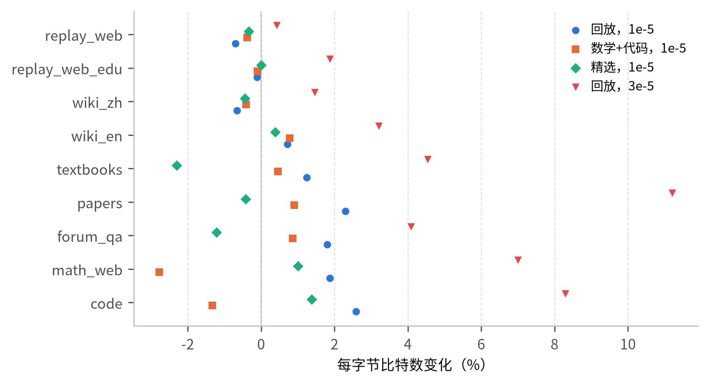

<div align="center">

# qwen-midtrain

[English](README.md) | [中文](README.zh-CN.md)

在通用文本上对 Qwen3.5 基座模型做继续预训练（continued pretraining），也就是“中期训练”（mid-training）。要回答的问题是：这些文本怎样配比（mixture）、精选（curation）和打包（packing），才能让基座模型微调得更好、在 k 次尝试内解出更多的题，同时不丢掉原来会的东西。小模型（0.8B、2B）负责做实验，4B 用来验证，9B 是目标。硬件：一台工作站上的四张 A100 40 GB GPU，以及一个 Slurm 集群的 A100 节点。

</div>

```
 9 个公开数据源，共 37 亿 token ──┐
 教师改写的真实文本 ──────────────┼──► 配方：占比、调度、 ─────► 继续预训练 ─────────┬──► 回归测试套件（遗忘）
 精选漏斗、卫生门槛 ──────────────┘    长序列占比、打包  （每次跑 4,000 万 token）   └──► 固定微调 ──► pass@1 … pass@64
　　　　　　　　　　　　　　　　　　　　　　　　　　　　                                      │
　　　　               下一批配方 ◄───── "不遗忘"约束下的最优解 ◄───── 混合定律、干扰矩阵 ◄───┘
```

> **状态，2026-11-20（第 1 天）。** 文本池（pool）、训练器、配比采样器、带判分器的评测集、微调探针（probe）和集群队列都已搭好并通过测试。0.8B 模型上的六次预实验（pilot）正在进行。第 13 节记录了预测，它们写在任何探针结果出现之前。标有*计划中*的章节，描述的是还没有写或还没有运行的代码。每出一个结果，本文件就更新一次。

## 概要

评价一个基座模型，通常看它的损失：在留出（held-out）文本上损失越低，模型越好。如果这个模型接下来要先微调、再用强化学习（RL）训练，这把尺子就用错了。对后训练（post-training）之后的效果来说，要紧的是两件事：模型接受微调的效果有多好；允许尝试 k 次时，它到底能解出多少道题（pass@k）。第二件事要紧，是因为 RL 只能强化模型有时能给出的答案。这两件事，损失都说明不了多少：在一项对 50 个模型的研究中，按困惑度（perplexity）给两个模型排出的先后，与微调之后的实际优劣相符的情况只占 33-38%（arXiv 2504.12491）。因此，我评判每个检查点（checkpoint）用两样东西：一次固定的短微调，之后对每道题采样 64 个回答；以及一个能发现遗忘的回归测试套件（regression suite，§3）。

最主要的调节手段是训练文本的配比。高密度文本（数学、代码、教科书、改写出来的讲解）预计能提高后训练所需要的能力，回放（replay）普通网页文本预计能保住其余的能力。各项占比之和为一，彼此之间还有交互作用，所以一次只调一个占比，找不到最好的配比。因此，我把配比当作一项实验来做：用正交设计（orthogonal design）安排 18 次运行，同时改变七个因子；用回归分析把这些运行变成一条混合定律（mixing law），它描述每项测量怎样随每个占比变化；再由这条定律给出最优配比，约束条件是回归测试套件的分数不下降（§6）。

在 9B 模型上做实验很慢：一次运行在三张 GPU 上大约要半天。小模型快 5 到 10 倍，但在小模型上做出的决定要有用，大模型给各种配比排出的顺序就得和小模型一样。因此，每个实验设计都在两种规模（0.8B 和 2B）上运行，并测量两者的排序一致性（rank agreement）；只有两种规模结论一致的配比，才交给 4B 和 9B（§6.5）。

另有三种手段改变的是文本本身。一个更强的教师模型把真实段落改写成讲解、笔记和带解答的问题，这样能增加推理内容，又不编造事实（§7）。一个漏斗去掉重复内容，留下学生模型还预测不了、更强的模型却能预测的文档（§8）。长序列里装的是彼此相关的文档，这样远处的上下文才值得读（§9）。有两道门槛守着这一切：基准测试的文本不得进入训练数据；任何一批生成文本的多样性不得低于真实文本（§11）。

最早的一批测量是关于学习率和回放的（§1.2）。峰值学习率为 3e-5 时，0.8B 模型在每个数据源上都变差了，连它训练用的那个也不例外。在 1e-5 下，只用网页文本训练，模型在代码、论文和数学上变差约 2%，在网页文本上变好 0.7%。**对这个模型来说，网页回放不是中性的锚点：它会把模型拉向网页。** 这改变了“回放”在这里应有的含义，也是 §13 中预测 P1 的由来。

改写文本两次没有通过多样性门槛，第三次才通过。显而易见的解释，即花样太少，是错的：话题经过改写保留了下来，改写共有的是教师指向自己来源的习惯（"这段文字""原文"），58% 的改写都有。要求教师以作者身份来写，并丢掉仍然指向看不见的来源的改写，两个改写来源就都过了门槛（§7.3）。

0.8B 设计的 18 次运行，以一种出乎意料的方式回答了主要问题（§1.2）。配比解释了留出损失和微调之前测得的少样本分数 92% 到 98% 的差异：数学文本降低数学损失，改写文本提高少样本推理，较低的学习率（3e-6）在每项损失和少样本 pass@1 上都更好。经过探针的短暂微调之后，这些都不见了：配比对探针差异的解释比例，还不如同样大小的定律对纯噪声的解释比例，而且微调前后各次运行的排序毫无关系。**在 0.8B 和 4,000 万 token 的条件下，一次短暂的微调抵消了继续预训练带来的变化。** 正在运行的 2B 设计会检验这一点在更大一级的规模上是否成立。

## 目录

1. [项目现状](#1-项目现状)
2. [快速开始](#2-快速开始)
3. [在训练之前定义成功](#3-在训练之前定义成功)
4. [文本池](#4-文本池)
5. [继续预训练循环](#5-继续预训练循环)
6. [把配比当作实验](#6-把配比当作实验)
7. [教师改写真实文本](#7-教师改写真实文本)
8. [按可学性精选](#8-按可学性精选)
9. [长上下文打包](#9-长上下文打包)
10. [为探索做铺垫](#10-为探索做铺垫)
11. [护栏](#11-护栏)
12. [算力计划](#12-算力计划)
13. [写在结果之前的预测](#13-写在结果之前的预测)
14. [仓库结构](#14-仓库结构)
15. [参考文献](#15-参考文献)
16. [数据与许可](#16-数据与许可)

[PITFALLS.zh-CN.md](PITFALLS.zh-CN.md) 汇集了搭建这条流水线时遇到的失败方式，以及现在用来发现它们的检查。

---

## 1. 项目现状

### 1.1 模型、数据与算力

| | |
|---|---|
| 模型 | 参数规模为 0.8B、2B、4B 和 9B 的 Qwen3.5 基座检查点（Apache-2.0）。只加载文本部分；保存检查点时，视觉等其他权重原样复制回去 |
| 文本池 | 9 个公开数据源，267 万篇文档，**37.1 亿训练 token**；每个数据源留出 0.5% 用于验证（`results/pool_summary.json`） |
| 一次运行 | 4,000 万 token 的继续预训练（预实验：2,000 万），序列长 4,096 个 token，每步 32,768 个 token，线性预热后线性衰减到零 |
| 探针 | 在 22,161 条对话上做固定微调（618 万 token，其中 349 万计入损失），2 个 epoch，然后在 GSM8K、MATH-500、HumanEval 和 MBPP 上对每道题采样 64 次（`results/probe_data_summary.json`） |
| 回归测试套件 | MMLU-Pro、ARC-Challenge、HellaSwag、CommonsenseQA、CMMLU、TriviaQA，再加上把检查点当作基座模型、用少样本（few-shot）方式做的 GSM8K、MATH-500、HumanEval、MBPP（*计划中*，§3.2） |
| 硬件 | 一台与其他作业共用的工作站上的 4 张 A100 40 GB；一个 Slurm 集群的 A100 节点（每个节点 3 张 GPU），通过基于文件的任务队列使用 |
| 实测速度 | 0.8B：预实验中每秒 7.7 千 token（单张 A100，含验证）。2B：设计运行中每秒 4.2 千；CPU 上的优化器步骤重写之前，冒烟运行中只有 2.2 千到 2.8 千（§5.1）。4B：2.8 千（速度测试）。9B 要用三张 GPU 运行，速度还没有测量 |

### 1.2 目前的结果

**预实验，验证损失。** 0.8B 模型，每次运行 2,000 万 token。表中是每个数据源的留出文档上每字节比特数（bits per byte）的变化，以起始值的百分比表示。负数表示变好。（`results/training/pilot_*.json`）

| 训练文本 | 峰值学习率 | 网页 | 教育网页 | 中文维基 | 英文维基 | 教科书 | 论文 | 论坛 | 数学 | 代码 |
|---|---|---|---|---|---|---|---|---|---|---|
| 网页 85%，中文维基 15%（只有回放） | 1e-5 | -0.70 | -0.11 | -0.66 | +0.71 | +1.24 | +2.30 | +1.80 | +1.87 | +2.59 |
| 回放 50%，数学 30%，代码 20% | 1e-5 | -0.38 | -0.10 | -0.41 | +0.78 | +0.46 | +0.90 | +0.86 | **-2.77** | **-1.33** |
| 回放 50%，精选 50%（英文维基、教科书、论文、论坛） | 1e-5 | -0.33 | +0.00 | -0.44 | +0.38 | **-2.30** | -0.42 | **-1.22** | +1.01 | +1.37 |
| 网页 85%，中文维基 15%（只有回放） | 3e-5 | +0.43 | +1.87 | +1.46 | +3.20 | +4.54 | **+11.21** | +4.09 | +7.00 | +8.29 |

<p align="center"></p>

每个标记是一次运行；落在竖线左边，说明这次运行让该数据源上的损失变好了。

从表中可以读出四件事。

- **3e-5 太高了。** 每个数据源都变差了，连这次运行训练用的网页文本也一样：这么大的步长把权重推得太远，2,000 万 token 的新文本补不回来。后面的实验设计使用 3e-6 和 1e-5。
- **只用网页文本做回放，其他领域要付出约 2% 的代价。** 基座模型预训练用的数据，比一份网页爬取数据宽得多。在网页爬取数据上训练，会把它推向网页，远离代码、论文和数学。
- **偏重高难度文本的配比把这个代价减半，并在自己的领域上有提升。** 用 30% 数学和 20% 代码时，数学上的损失下降 2.8%，代码上的下降 1.3%，论文和教科书上的损失也比只做回放时升得少。
- **精选文本在自己的领域上也是这样。** 用 50% 精选文本时，教科书上的损失下降 2.3%，论坛回答上下降 1.2%，数学和代码各付出约 1%。每种成分都让它来源的领域损失下降，让别的领域略有上升：这就是 §6.3 里干扰矩阵的缩影。

坦白地说，有这些局限：每次运行只有一个种子；每个数据源只有 24,576 个验证 token，所以小于约 0.5% 的差别都是噪声（英文维基在一次含 15% 维基的运行之后变化 +0.4%，就属于这种情况；正式设计中的运行用 131,072 个验证 token）；只看了损失，而 §3 解释了为什么这里不拿损失当尺子。3e-6 的预实验被搁置了，因为一半的设计运行会在完整预算下检验 3e-6（§6.2）。

**预实验：探针与知识。** 同样三次学习率为 1e-5 的运行，与基座模型逐题配对比较（`results/comparisons/pilot_*__minus__base_0.8B.json`，`mixing_law.py compare`）：

| 训练数据（2,000 万 token，学习率 1e-5） | 探针 pass@1（合并） | pass@16 | pass@64 | CommonsenseQA（完形） |
|---|---|---|---|---|
| 只做回放 | +0.03 [−0.42, +0.47] | −0.27 [−1.46, +0.92] | −1.23 [−3.69, +1.11] | +2.38 [+0.82, +3.85] |
| 回放 50%、数学 30%、代码 20% | −0.17 [−0.60, +0.27] | +0.92 [−0.25, +2.11] | +1.47 [−0.74, +3.69] | +3.19 [+1.64, +4.75] |
| 回放 50%、精选文本 50% | −0.24 [−0.64, +0.16] | −0.05 [−1.27, +1.19] | −1.72 [−4.05, +0.49] | +3.36 [+1.72, +4.91] |

没有哪次预实验让合并后的 pass@1 超出它的噪声。难题配比在较大的 k 上朝正确的方向偏，MATH-500 的 pass@16 为 +2.48 [+0.24, +4.85]；精选配比在 pass@64 上朝错误的方向偏。每次运行要做 16 个探针比较（四个任务、四个 k 值），所以大约每二十个区间里就有一个碰巧不含零；像 MATH-500 这样的单个数值只是线索。到目前为止，有一个效应在每次运行中都出现，预实验和第 1、4 次设计运行都一样：CommonsenseQA 的完形准确率上升 2.0 到 3.4 个百分点，每次区间都在零以上。ARC 在全部五次运行中都略有上升（+0.7 到 +1.4，其中两个区间在零以上），另外三个完形测试集的变化都在一个百分点左右以内。**在这样的规模和预算下，单次运行对探针来说信号太弱**，所以设计用 18 次运行拟合一个模型（§6.3），而不是一次一次地读。

**基座模型上的回归测试套件。** 0.8B 检查点在一张 A100 上要 12 分钟（`results/regression/base_0.8B.json`）：

| 测量 | 给 5 个示例 | 不给示例 |
|---|---|---|
| MMLU-Pro（1,200 道题，10 个选项） | 18.1 | 25.0 |
| ARC-Challenge（1,172） | 68.2 | 71.7 |
| HellaSwag（1,000） | 46.6 | 50.2 |
| CommonsenseQA（1,221） | 52.3 | 56.9 |
| CMMLU（1,000，中文） | 53.1 | 51.8 |

| 测量 | 数值 |
|---|---|
| TriviaQA 精确匹配（1,000，贪心解码） | 21.0 |
| 少样本 pass@1 / pass@16，温度 1 下 16 个样本：GSM8K、MATH-500、HumanEval、MBPP | 18.1 / 62.5、8.7 / 47.6、8.1 / 30.5、13.4 / 49.5 |
| 长论文最后 2K 个 token 上的损失：给 2K 上下文、给 14K 上下文 | 1.885、1.682 比特/token |

对实验设计来说有两点要紧。**示例反而降低了这个模型的选择题准确率**，五个集合里有四个是这样。数一数它选的字母就明白了：给了五个示例之后，模型更常选“B”（80 道 ARC 题里选了 33 次，不给示例时是 27 次），在 MMLU-Pro 上 80 道题里有 72 道选的是“A”或“B”。示例自己的答案是均衡的，所以这是一种偏爱靠前字母的倾向，示例把它放大了，这是小模型做带字母选项的题时已知的弱点。因此，配比搜索中的守护指标对每个集合取有示例和无示例两种结果的平均（§6.4），这个选择是在任何设计运行出结果之前做出的。**远处的上下文对基座模型值 0.20 比特/token**，这是一个清楚的信号，设计中的长上下文组可以拿它来比较。

**第一次设计运行。** 筛选设计的第 1 次运行（回放 55%、精选文本 34%、数学和代码 11%，峰值学习率 3e-6，4,000 万 token）与基座模型逐题配对比较（`results/training/`、`results/regression/` 和 `results/probe/screen18_r01_0.8B.json`；`mixing_law.py compare`）：

| 测量 | 第 1 次运行 − 基座 [95%] |
|---|---|
| 每字节比特数，每个数据源 | −0.3% 到 −1.8%（九个全部变好） |
| 完形方式的选择题，ARC / CommonsenseQA | +1.2 [+0.1, +2.4] / +2.9 [+1.3, +4.3]；其余三个在噪声以内 |
| 探针 pass@1，四个任务合并 | −0.06 [−0.48, +0.37] |
| 探针 pass@16 / pass@64，合并 | −0.53 [−1.86, +0.73] / +0.12 [−2.46, +2.70] |

在 3e-6 下，宽泛的配比让每个数据源都朝正确的方向挪了一点；而在 1e-5 下偏重网页的回放会让论文、数学和代码付出约 2% 的代价。探针没有变化。这次运行确定的是设计的分辨率：合并后 pass@1 的配对差值精确到 ±0.4 个百分点，所以半个百分点的效应就能看出来。

**0.8B 筛选设计，全部 18 次运行。** 这个项目要回答的问题是：继续预训练用什么样的文本配比最有帮助。设计用一条拟合全部 18 次运行的定律来回答（§6.3）：每项测量都是 token 占比、时间安排和学习率的线性函数。拟合结果说明配比解释了各次运行之间多少差异，以及一次运行的噪声有多大（`results/designs/screen18_0.8B_analysis.json`，`mixing_law.py analyze`）：

| 测量 | 被解释的差异比例 | 各次运行之间的差异（标准差） | 一次运行的噪声 |
|---|---|---|---|
| 数学损失 / 代码损失（比特/字节） | 0.98 / 0.94 | 0.0063 / 0.0031 | 0.0013 / 0.0011 |
| 少样本 pass@1，四个任务，未经任何微调 | 0.92 | 0.58 | 0.24 |
| 少样本 GSM8K pass@16 | 0.96 | 2.11 | 0.65 |
| 知识护栏（完形） | 0.63 | 0.14 | 0.13 |
| 探针 pass@1，四个任务，微调之后 | 0.12 | 0.20 | 0.28 |
| 探针 pass@16 / pass@64 | 0.31 / 0.29 | 0.52 / 0.61 | 0.63 / 0.75 |

一条有九项的定律，平均能解释 18 次运行纯噪声差异的约 0.53（17 分之 9）。所以，损失和少样本分数几乎全部由配比解释，而知识护栏和探针完全没有被解释。

<p align="center"></p>

每个点是某个因子在一个水平上各次运行的平均值（六次运行；学习率是九次），减去全部运行的平均值。灰色带是空列的范围，即"没有效应"时效应的大小。

变化了的东西，按每从回放中拿出全部 token 的 10% 计，t 统计量的自由度为 8：

- **损失跟着各自的领域走。** 数学文本让数学损失降低 0.011 比特/字节（t = 13），代码文本让代码损失降低 0.010（t = 7），精选文本降低论坛回答、论文、教科书和英文维基百科上的损失。让出 token 的每个来源都略微变差。
- **改写文本提高少样本推理。** GSM8K pass@16 上升 1.7 个百分点（t ≥ 3），MATH-500 的 pass@1 上升 0.4，pass@16 上升 1.6，四个任务的 pass@1 上升 0.25（t ≥ 2）。四项的方向一致。
- **较低的学习率更好。** 与 3e-6 相比，峰值 1e-5 让每项留出损失都变差，少样本 pass@1 损失 0.9 个百分点（t ≥ 3）。
- **微调之后，这些都不见了。** 探针合并后的 pass@1、pass@16、pass@64，没有哪一项达到 1.5 个标准误。少样本 pass@1 在各次运行之间的差异是探针之后的 2.9 倍，而两种排序毫无关系（Spearman -0.00）。

选用探针，是因为损失看不出后训练能达到什么（§3.1）。在这样的规模和预算下，它什么也看不到：在 620 万 token 的对话上训练两轮，就让 18 个相差 4,000 万 token 中期训练的模型几乎一样了。少样本分数能看到配比，但它是在任何后训练之前测的。**在 0.8B 和 4,000 万 token 的条件下，一次短暂的微调抵消了继续预训练带来的变化。** 2B 设计检验这一点在大一级的规模上是否成立，它也是上面每一个效应的重复验证。

坦白地说，有这些局限：
- 大约 400 次检验（45 项测量，每项 9 项）。自由度为 8 时，|t| ≥ 3 碰巧通过的大约有 7 次，所以只把各项测量之间一致的规律报告为效应。
- `analyze` 为探针 pass@16 给出的约束下最优解是对噪声的拟合（预测 60.6，平均值 60.0，在一次运行的噪声之内）；它不是一个建议。
- 每次运行一个种子，每次 4,000 万 token，目前只有一种模型规模。

**基座模型上的探针。** 0.8B 基座检查点经过固定微调之后，每道题在温度 1 下采样 64 次（`results/probe/base_0.8B.json`；95% 区间来自对题目的重采样）：

| 任务 | 题数 | pass@1 | pass@16 | pass@64 | 被 token 上限截断的回答 |
|---|---|---|---|---|---|
| GSM8K | 200 | 37.2 [33.1, 41.2] | 85.8 | **95.5** | 0.2% |
| MATH-500 | 250 | 13.6 [11.1, 16.2] | 52.4 | 71.2 | 5.0% |
| HumanEval | 164 | 9.6 [7.0, 12.3] | 37.2 | 57.3 | 0.6% |
| MBPP | 200 | 22.8 [19.2, 26.6] | 65.0 | 78.5 | 0.2% |

微调之后，采样一次的 GSM8K 回答有 37% 是对的，是基座模型自己少样本正确率（18.1%）的两倍；采样 64 次，95.5% 的题至少能做对一次。pass@1 和 pass@64 之间的差距，就是后续强化学习阶段可以发挥的空间，四个任务上这个差距都很大。一次探针在一张 A100 上大约 45 分钟：29 分钟微调，15 分钟采样和判分。

得到这些数字之前做过两处更正。第一次探针结果已经撤回：推理服务没有在助手这一轮结束时停下，回答一直延续到模型自己编出来的后续轮次里，判分器读到的是那里最后出现的答案（PITFALLS E1）。这些回答比基座模型的少样本回答长 7 倍，微调之后的 pass@1 反而低于基座模型的少样本 pass@1，问题就是这样暴露出来的。之后 MATH-500 的新 token 上限从 512 改为 1,024：512 时有 17.4% 的回答被截断（现在是 5.0%）。微调是确定性的：重跑一次，损失曲线到小数点后四位都相同。同一个微调后的检查点采样两次，在设置没有变的三个任务上，pass@1 相差不超过 0.2 个百分点，pass@64 相差不超过 2.5 个百分点，所以比这更小的 pass@64 差别是采样噪声。

**用同样方法测量的 2B 基座模型。** 它是 2B 设计的参照（`results/regression/base_2B.json`、`results/probe/base_2B.json`；0.8B 一列重复上面各表的数字）：

| 测量 | 0.8B | 2B |
|---|---|---|
| 知识护栏：五个测试集的完形，加问答 | 34.7 | 41.8 |
| TriviaQA 完全匹配 | 21.0 | 35.5 |
| ARC-Challenge，带字母选项，有 / 无五个示例 | 68.2 / 71.7 | 75.5 / 83.5 |
| 远距离上下文带来的增益（比特/token） | 0.20 | 0.18 |
| 探针 pass@1：GSM8K、MATH-500、HumanEval、MBPP | 37.2、13.6、9.6、22.8 | 53.2、22.9、21.5、35.5 |
| 探针 pass@64，顺序同上 | 95.5、71.2、57.3、78.5 | 99.0、81.2、79.9、82.5 |
| 用时：回归测试、探针微调 | 12 分钟、29 分钟 | 19 分钟、81 分钟 |

2B 模型知道得更多，也解出得更多，而且它和 0.8B 有同样的偏好：五个示例会降低它在带字母选项上的准确率（ARC 75.5 对 83.5），所以完形护栏对两种规模都适用。GSM8K 的 pass@64 已到 99.0，所以对 2B 模型来说，GSM8K 只有 pass@1 和 pass@16 还能显示变化；其他任务在每个 k 上都还有空间。加上约 20 分钟的采样，一次 2B 设计运行的评测在一张 A100 上约需两小时，训练时间另计。

---

## 2. 快速开始

```bash
# --- 环境 ------------------------------------------------------------------------------------------------------
cp site.env.example site.env            # 数据、模型和 Python 环境在这台机器上的位置
source scripts/env.sh                   # 设置 MIDTRAIN_DATA、MIDTRAIN_MODELS、MIDTRAIN_PYTHON、PYTHONPATH=src

# --- 文本池：下载、规范化、分词（CPU，约一小时）-------------------------------------------------------------------
env -u HF_HUB_OFFLINE $MIDTRAIN_PYTHON -m midtrain.data_sources download
$MIDTRAIN_PYTHON -m midtrain.data_sources build
$MIDTRAIN_PYTHON -m midtrain.data_sources summary                      # 写出 results/pool_summary.json

# --- 评测集，以及探针的微调数据 -------------------------------------------------------------------------------
env -u HF_HUB_OFFLINE $MIDTRAIN_PYTHON -m midtrain.eval_tasks build
$MIDTRAIN_PYTHON -m midtrain.eval_tasks check                          # 用标准答案检验判分器和沙箱
env -u HF_HUB_OFFLINE $MIDTRAIN_PYTHON -m midtrain.sft_probe build-data

# --- 测量审计：在相信任何结果之前先运行 ------------------------------------------------------------------------
$MIDTRAIN_PYTHON -m pytest tests -q
$MIDTRAIN_PYTHON -m midtrain.data_hygiene decontaminate --methods ngram   # 文本池里有基准测试的文本吗？
$MIDTRAIN_PYTHON -m midtrain.mixture show configs/recipes/pilot_hard_heavy.yaml   # 一个配方实际给出的占比

# --- 一个候选：继续预训练，然后做探针 --------------------------------------------------------------------------
CUDA_VISIBLE_DEVICES=0 $MIDTRAIN_PYTHON -m midtrain.train_continue --base-model $MIDTRAIN_MODELS/qwen35_0.8B_base \
    --recipe configs/recipes/pilot_hard_heavy.yaml --run-name pilot_hard_heavy_0.8B_lr1e-5 --peak-learning-rate 1e-5
CUDA_VISIBLE_DEVICES=0 $MIDTRAIN_PYTHON -m midtrain.sft_probe run --run-name pilot_hard_heavy_0.8B_lr1e-5 \
    --checkpoint $MIDTRAIN_DATA/runs/pilot_hard_heavy_0.8B_lr1e-5/checkpoint_final

# --- 多个候选：每个任务一个脚本，放进队列文件夹；每台机器启动一个 worker ------------------------------------------
MIDTRAIN_QUEUE=$MIDTRAIN_DATA/queue_local bash scripts/cluster/node_worker.sh --this-node-only
sbatch scripts/cluster/worker.slurm                                    # 同一个 worker，运行在集群节点上
```

---

## 3. 在训练之前定义成功

### 3.1 为什么不拿损失当尺子

常见的习惯是：训练，盯着验证损失，留下损失最低的检查点。上面的预实验表显示了损失确实能测好的一件事：一次运行把模型推向了哪个领域。它说明不了模型是否成了后训练更好的起点。两个损失相同的模型，在 64 次尝试中得到正确答案的频率可以不同，而这个数字就是 RL 阶段可以利用的空间。

因此，本项目的目标是在微调之后通过采样来测量的。损失仍然记在日志里，用作诊断，也用作运行出问题时最快的警报。

### 3.2 每个检查点的两个裁判

| 裁判 | 做什么 | 回答什么问题 |
|---|---|---|
| 回归测试套件（`base_regression.py`） | 把检查点当作基座模型来测：选择题按答案字母的对数似然判定，数学、代码和知识问答用少样本生成，每个数据源上的每字节比特数，以及少样本示例带来的增益 | 这次运行有没有让模型忘掉什么，模型会不会利用上下文 |
| 固定微调探针（`sft_probe.py`） | 对每个检查点做同样的小规模微调，然后在温度 1 下对每道题采样 64 次并判分 | 这个检查点接受微调的效果有多好，它到底能解出多少道题 |

回归测试套件有十个公开测试集。构建完成后，它们的规模记录在 `$MIDTRAIN_DATA/eval/manifest.json` 中：MMLU-Pro 1,200 道题（分层抽样），ARC-Challenge 1,172，HellaSwag 1,000，CommonsenseQA 1,221，CMMLU 1,000，TriviaQA 1,000，GSM8K 1,319，MATH-500 500，HumanEval 164，MBPP 257。

### 3.3 探针

探针的一切都固定在 `configs/probe.yaml` 里：对话及其顺序、学习率（2e-5）和两个 epoch、测试题和采样方式。变的只有检查点。这样，探针之后的差别就来自检查点。

微调集在有人工解答的地方用人工解答（GSM8K 和 MATH 的训练划分，以及 MBPP 中不参与测试的任务 id 的参考程序），其余部分用指令数据。其中数学题和代码题的题面，与测试题的题面出自同一个函数，所以微调教的是格式，测试量的是检查点自己带来的东西。

```python
# src/midtrain/eval_tasks.py：由 n 个样本（其中 c 个正确）得到的 pass@k 无偏估计
def estimate_pass_at_k(correct_sample_count: int, sample_count: int, k: int) -> float:
    return 1.0 - math.comb(sample_count - correct_sample_count, k) / math.comb(sample_count, k)
```

pass@1 是通常所说的准确率，即单个采样回答的准确率。pass@64 是模型在 64 次尝试中至少解出一次的题目所占的比例。两者之间的差距，就是后面的 RL 阶段能够补上的部分。如果一种配比提高了 pass@1、降低了 pass@64，它就让模型变得更自信，也更窄了。准确率虽然上升，对 RL 来说却是损失。

模型写的程序通过实际运行来判分。它们在沙箱里运行：没有网络，访问不了临时文件夹以外的文件，内存和时间都有上限（`eval_tasks.run_python_program_in_sandbox`）。

### 3.4 噪声，以及设计如何应对

一次 4,000 万 token 的运行很小，所以它对 pass@k 的影响也小。每个任务 200 道题时，单个 pass@1 数值的区间约为 ±3 个点。有三件事把噪声压到效应以下：

- **配对比较。** 每个检查点都用同样的采样设置回答同样的题目，所以两个检查点可以逐题比较。
- **每道题 64 个样本。** 每道题的成功率能确定到约 ±6 个点，对所有题目取平均之后，比每道题只取一个贪心（greedy）回答精确得多。
- **设计本身带来的合并（pooling）。** 在正交设计中，每个因子的效应是 6 或 9 次运行的均值与另外 6 或 9 次运行的均值之差（§6.2），这相当于把运行之间的噪声除以约 2.5。

噪声底线（noise floor）本身也要测量：在同一个检查点上换其他种子重复探针；小于这个离散程度的效应，一律不作为发现来报告。

### 3.5 留出了什么

验证文档按文档 id 的哈希值选出（每 200 篇取 1 篇），所以重新构建时选中的还是同一批。基准测试的题目从不进入文本池：§11 介绍了这两项检查。微调探针只在训练划分上训练；对于 MBPP，`sft_probe.py` 中对任务 id 的断言（assert）把参与测试的任务挡在外面。

---

## 4. 文本池

研究配比，需要角色明确的数据源。每个数据源都是一个大得多的公开数据集的开头一段，按 `configs/sources.yaml` 读取，并规范化为每篇文档一行（`docs/conventions.md`）。

| 数据源 | 角色 | 是什么 | 文档数 | 训练 token | token 中位数 |
|---|---|---|---|---|---|
| `replay_web` | 回放 | FineWeb 样本，未做质量过滤 | 662,491 | 4.770 亿 | 428 |
| `replay_web_edu` | 回放 | 同一份爬取数据，经过 FineWeb-Edu 分类器过滤 | 493,081 | 5.167 亿 | 629 |
| `wiki_zh` | 回放 | 中文维基百科 | 155,091 | 2.275 亿 | 728 |
| `wiki_en` | 精选 | 英文维基百科 | 220,833 | 2.523 亿 | 651 |
| `textbooks` | 精选 | 开放教科书和课程材料 | 93,611 | 2.258 亿 | 1,251 |
| `papers` | 精选 | 开放许可的研究论文，全文 | 59,525 | 9.741 亿 | 11,448 |
| `forum_qa` | 精选 | StackExchange 上带回答的问题 | 363,606 | 2.576 亿 | 469 |
| `math_web` | 高难度 | FineMath，含数学内容的网页 | 306,605 | 4.776 亿 | 888 |
| `code` | 高难度 | 宽松许可的教学代码 | 318,020 | 2.975 亿 | 488 |
| `synthetic_rephrase`、`synthetic_qa` | 合成 | 教师对真实段落的改写（§7） | *计划中* | | |

**为什么要为 4,000 万 token 的运行准备 37 亿 token 的文本池。** 一次运行不应该把同一篇文档看两遍，而精选之后的子集只保留数据源的一部分。每个数据源有 2 亿到 10 亿 token，一次 4,000 万 token 的运行在任何数据源上最多只读到百分之几。

**回放代表什么。** 回放本应是模型预训练时的数据分布。这个分布没有公开。我用一份网页爬取数据加一些中文文本来代替，而 §1.2 表明这个替代品很窄：只在它上面训练，模型就会漂移。因此，§6 的设计把回放占比当作一个需要测量的因子。

---

## 5. 继续预训练循环

### 5.1 为什么自己写循环

通常的选择是用通用的训练器。这个问题有三个特点，使得自己写一个小循环更简单。

| 隐患 | 为什么会在这里破坏训练 | 解决办法 |
|---|---|---|
| 词表有 248,320 个词。一次算出 16,384 个 token 的 logits 需要约 16 GB | 在 40 GB 的 GPU 上，每次前向 16K token 时显存不足（在第一次速度测试中测到） | 损失在隐藏状态的一份分离（detached）副本上按每块 1,024 个 token 分块计算；梯度只经模型主体回传一次（`chunked_language_model_loss`） |
| 1e-5 的学习率乘以一个典型的梯度，小于 16 位权重的分辨率 | 更新被舍入为零，训练悄悄停滞 | 工作权重是 16 位的，优化器另存一份 32 位的主权重（master weights），更新加在主权重上（`MasterWeightAdamW`） |
| 推理服务引擎要求检查点采用基座模型的完整布局 | 只含文本部分的检查点在加载时被拒绝 | `save_checkpoint` 按基座模型中的名字写出训练过的张量，其余张量和文件都从基座模型复制 |

学习率的安排是：在前 2% 的步数里线性预热，之后线性衰减到零。衰减到零就是本项目所研究的冷却（cooldown）阶段：最后那些步在最终的配比上只做很小的移动。

全局梯度范数在 1.0 处截断，而在这些数据上，基座模型的梯度范数约为 3（到目前为止每次运行的中位数都在 3.1 到 3.3 之间，从未低于 2.5；见每次运行日志中的 `gradient_norm`）。所以每一步都被截断。在 AdamW 下，对梯度做近乎恒定的缩放几乎不改变什么，因为更新量是一阶矩除以二阶矩的平方根；截断仍然起作用的地方是压住尖峰（最高到 12.7）。每次运行都一样，所以它不会让设计产生偏差。

**主权重放在 CPU 上。** 2B 模型的 FP32 主权重和 Adam 矩（约 22 GB）放不进一张 40 GB 的 GPU（模型本身也在上面），所以放在 CPU 上。第一版对每个张量做一次普通拷贝，两个方向都以 FP32 经过可分页内存，AdamW 也一个张量一个张量地算。这一步对 18 亿参数要 7.6 秒，比前向加反向还长，2B 冒烟运行因此只有每秒 2.2 千到 2.8 千 token。现在每个张量在 CPU 一侧有一块锁页（page-locked）的 BF16 缓冲区，所以每个方向只搬一半的字节，所有张量只等一次；BF16 与 FP32 之间的转换在 CPU 上做；AdamW 作为一个融合（fused）的 CPU 内核运行。同一基准测试中这一步用 2.1 秒。四步之后，18 亿个权重中只有 96 个与第一版不同，那是最后一位上的舍入差别（`tests/test_train_continue.py`）。0.8B 模型的主权重留在 GPU 上，那条路径没有改，所以它的各次设计运行之间仍然可比。第一次 2B 设计运行的训练速度是每秒 4.2 千 token，冒烟运行中是 2.2 千到 2.8 千，所以 4,000 万 token 用 2.7 小时，而不是约 4.5 小时。

### 5.2 精确的配比

混合数据源的常见办法，是为每条序列随机挑一个数据源。一次 2,000 万 token 的运行约有 5,000 条序列，这样一来，一个占 5% 的数据源实际拿到的量会与它应得的量相差百分之几，而这正是所研究的效应的大小。因此，采样器把每一个序列名额都分给当前落后目标最多的数据源（`mixture.py`）。实际占比与配方中的占比相差不超过一条序列；配方和种子都相同的两次运行，会按相同的顺序读到相同的 token。

```yaml
# configs/recipes/pilot_hard_heavy.yaml
token_budget: 20004864          # 610 步，每步 32,768 个 token
context_length: 4096
components: {replay_web: 0.425, wiki_zh: 0.075, math_web: 0.30, code: 0.20}
schedule: uniform               # 或 late / early：非回放占比在什么时候用掉（§6.2）
seed: 1
```

---

## 6. 把配比当作实验

### 6.1 为什么一次调一个占比行不通

最自然的计划是：其他一切固定，只改变回放占比，选出最好的，再去改变下一个占比。它行不通，原因有两个。第一，各项占比之和为一，所以“其他一切固定”做不到：一个数据源多了，另一个就少了，结果取决于让出份额的是哪一个。第二，因子之间有交互作用：改写文本的最佳占比，在低学习率和高学习率下可能不一样。一连串的单因子扫描需要很多次运行，却仍然看不到交互作用。

因此，各个因子按一张正交表（orthogonal array）同时变化。每个因子的每个水平，与其他任何因子的每个水平相遇的次数都相同，所以每个因子的效应都是在其他因子的所有取值上取的平均。

### 6.2 筛选设计

这个筛选设计（screening design）用的是 L18 正交表：18 次运行，一个两水平因子，以及最多七个三水平因子。因子都取成比例，因为要回答的问题都是关于比例的。

| 列 | 因子 | 水平 |
|---|---|---|
| 1 | 峰值学习率 | 3e-6、1e-5 |
| 2 | 回放在全部 token 中的占比 | 55%、70%、85% |
| 3 | 合成文本在非回放文本中的占比 | 0、25%、50% |
| 4 | 高难度文本（数学和代码）在真实非回放文本中的占比 | 25%、50%、75% |
| 5 | 数学在高难度文本中的占比 | 25%、50%、75% |
| 6 | 长上下文：40% 的非回放 token 放在 16K 序列中 | 无、随机打包、语义打包 |
| 7 | 非回放占比的调度 | 均匀（uniform）、靠后（late）、靠前（early） |
| 8 | （空列） | 它的“效应”显示纯噪声造成的效应有多大 |

在 L18 中，第 1 列与第 2 列的交互作用不和其他任何一列混杂，所以这个设计还能回答：最佳回放占比是否取决于学习率。`late` 和 `early` 给非回放占比乘上一个系数，这个系数在一次运行中从 0.4 线性变到 1.6（或者反过来）；三种调度的平均占比相同。

每次运行训练 4,000 万 token。整个设计在每种模型规模上要 18 次运行，而完整的网格要 2 x 3^6 = 1,458 次。

### 6.3 从运行到混合定律

每次运行给出一行测量值：每个探针任务的 pass@1、pass@16 和 pass@64，回归测试套件的各项分数，以及每个数据源上的每字节比特数。对每项测量，以绝对 token 占比为自变量做回归分析，得到

```math
y \;=\; b_0 \;+\; \sum_j b_j\, s_j \;+\; c_{\text{late}} + c_{\text{early}} + c_{\text{lr}}
```

其中 $`s_j`$ 是成分 $`j`$（改写文本、精选文本、数学、代码、随机打包、语义打包）的占比，剩下的部分是回放。这样，$`b_j`$ 就是把一个单位的回放换成成分 $`j`$ 时这项测量的变化。参数有 10 个，运行有 18 次，还剩 8 个自由度用来估计噪声。

把所有测量的 $`b_j`$ 汇总起来，就是**干扰矩阵**（interference matrix）：每项测量一行，每个成分一列。其中相当于对角线的元素，说明一个成分对自己的领域有多大帮助。非对角的元素，说明这个成分在别处让模型付出了什么，或者带来了什么。预实验已经给出了其中两个元素：30% 的数学让数学损失降低 2.8%，网页回放让论文上的损失升高 2.3%。

已发表的数据混合定律（arXiv 2403.16952）是占比的指数函数。对于这里测到的百分之几的变化，指数形式和线性形式的差别在噪声以内，所以拟合的是线性形式；如果三个回放水平显示有需要，再加一个关于非回放总占比的曲率项。

### 6.4 约束下的最优配比

最优配比要使目标最大（目标是各探针任务的平均 pass@16，pass@64 一并报告），同时要让预测的回归测试套件分数与只做回放的对照组相差不超出噪声。这个分数是五个选择题集合用完形方式（cloze，比较每个答案自身文本的似然，不用答案字母）打分的结果和 TriviaQA 的平均。最初的选择是带字母的格式，有示例、无示例各问一次；第一次设计运行之后，无示例的带字母 HellaSwag 下降了 6.4 个百分点，而完形方式和带五个示例的格式都没有变化，这是小模型对字母的偏好变了，而不是丢了知识（§1.2，PITFALLS B4）。搜索只在测试过的范围内进行：出了这个范围，这条定律就不可信了。

线性的定律会把最优点放在测试区域的边界上。这是一个诚实的答案，它说明区域在那一侧取小了。接下来的运行就沿最速上升（steepest ascent）方向越过边界，直到目标不再上升；然后在那个点附近再做一个小的设计，测出曲率。这就是经典的响应面（response surface）流程：先筛选，再爬坡，最后拟合顶部。

### 6.5 上大模型之前先看两种规模

小模型是一个代理（proxy）。检验的办法是看排序一致性：在 0.8B 和 2B 上分别按每项测量给 18 次运行排序，再计算两个排序的 Spearman 相关系数及其区间。效应（$`b_j`$）也要比较：符号、大小，以及它们怎样随模型规模变化。要向 9B 提出一个方案，它所依赖的那些效应在两种规模上符号必须一致。然后由 4B 运行提出的配比、只做回放的对照组和两个邻近的配比，作为第三个点。已知的隐患：用高学习率训练的代理模型会把配方排错顺序（arXiv 2512.24503），这也是这里学习率取得低的原因之一。

代码：`mixing_law.py` 把设计文件（`configs/designs/screen18.yaml`）变成 18 个配方和队列任务，再把完成的运行变成各水平的均值、配比定律、干扰矩阵、带约束的最优点，以及两个规模之间的排序一致性。`mixing_law.py compare` 把两次运行逐题对比。有一个测试在 18 个设计好的配比上埋入一条已知的定律，并能把它准确地还原出来（`tests/test_mixture_and_design.py`）。

---

## 7. 教师改写真实文本

### 7.1 为什么用改写，不用自由生成

好的公开文本是有限的。想要更多，最容易想到的办法是让模型凭空写新文本，这也是有风险的办法：用模型自由生成的输出训练模型，每过一代，分布都会更窄一些。在大规模上经得住检验的已发表工作，都保留一段真实文本作为事实的来源，只让模型改变形式。文献报告的最优值在 30% 改写文本附近，而且改写文本是加在真实文本之外的，从不取代真实文本。

### 7.2 生成什么

一个同系列的 27B 教师模型改写维基百科、教科书、论文、数学网页和论坛回答中的段落，每段 350 到 1,200 个 token（`synthetic_rephrase.py`）。六种形式从几个侧面呈现同样的内容：

| 形式 | 归入 | 增加了什么 |
|---|---|---|
| 从基本原理出发的讲解 | `synthetic_rephrase` | 各个论断之间的步骤 |
| 结构化笔记 | `synthetic_rephrase` | 定义、关系、一套步骤、两个典型错误 |
| 带详细解答的问题 | `synthetic_qa` | 针对段落内容的推理 |
| 例题 | `synthetic_qa` | 根据内容编出的习题，已解出并核对 |
| 含一处被纠正错误的对话 | `synthetic_rephrase` | 一次走错和对它的修正 |
| 假设分析（what-if） | `synthetic_qa` | 某个条件改变之后的后果 |

进入配比的那一批（v3，§7.3）保留了其中五种形式：三种按原样，问题和例题改写成不带固定标签的连贯文字；对话被去掉了。

输出是不带对话标记（chat token）的纯文本：有一个已发表的模型，中期训练数据中的对话标记让它的 GSM8K 分数从 49 掉到了 0。每条输出都要检查长度、拒答和元评论（meta-comment），还要检查是否照抄：如果一条输出有一半以上的 8 词序列与原文相同，就丢弃，因为照抄出来的只是一段价格更高的真实文本。之后，这一批输出还要通过 §11 的多样性门槛，配方才可以使用它。

**第一批样本。** 两个教师服务写出的 600 条改写（数据目录下的 `synthetic/v1/rewrites.jsonl`；第一批全部的计数在 `results/synthetic_summary_v1.json`）：

| 形式 | 保留 | 词数中位数 | 抄写的 8 词序列（中位数） |
|---|---|---|---|
| 讲解 | 92 条中 89 条 | 780 | 0.6% |
| 结构化笔记 | 98 条中 90 条 | 795 | 0.7% |
| 对话 | 99 条中 80 条 | 821 | 3.6% |
| 带详解的问题 | 116 条中 108 条 | 751 | 1.3% |
| 例题 | 103 条中 86 条 | 842 | 2.0% |
| 假设分析 | 92 条中 92 条 | 725 | 0.8% |

所有被丢掉的改写都碰到了 1,500 token 的上限，大多是对话；上限现在是 1,800。逐个形式读一些样本：它们都紧扣段落的内容，形式之间的差别也正是指令所要求的。在两张与别人共用的 GPU 上，生成速度约为每小时 3,400 条，所以这一批定为 12,000 条（约 1,100 万 token），对筛选设计来说够用：其中改写文本最多的那次运行，从两个来源各取 450 万 token。

### 7.3 第一批没有通过多样性门槛

人们对改写文本通常担心的是事实出错。这里没通过的检查却是多样性。第一批（v1：12,000 条改写，保留 11,574 条，温度 0.8，每段一到两种形式）与为它选出的真实段落做比较，两边各取 4,500 篇文档、100 万 token（`results/hygiene_diversity_*.json`）：

| 指标 | 真实段落 | rephrase | qa | 门槛要求 |
|---|---|---|---|---|
| 嵌入的 Vendi 分数 | 31.4 | **22.1** | **18.6** | 至少 25.1 |
| 二元组熵（比特） | 16.54 | **15.97** | **15.64** | 至少 16.04 |
| 与最近邻的平均余弦相似度 | 0.746 | 0.806 | 0.807 | 不设门槛 |
| zstd 压缩比 | 3.31 | 3.83 | 4.12 | 至多 4.30 |

Vendi 分数是一个样本中"有效的不同文档数"：文档相似度矩阵特征值的熵再取指数；所有文档都相同时为 1，所有文档都互不相关时等于样本量。同样的样本量下，英文维基百科单独算是 40.0。

有两种解释都与这些数字相符。一是这一批的不同母段落比文档少，因为一半的段落被改写了两次；二是改写本身让文本变窄了。每个母段落只留一条改写，就能把两者分开：结果是 22.2 和 18.7，没有变好。所以变窄来自改写本身。一个教师为同一类读者、用同一种口吻写每一段，而每种形式又把自己的结构套在每个话题上。

因此，我改了请求，门槛不变（v2）。温度为 1.0。每个请求随机抽一类读者（12 类，从高中生到需要温习的研究者）和一种写作者的口吻（12 种，从耐心的家教到出谜题的人）。每个段落只用一种形式，这样每条改写都有自己的母段落。v2 的段落还跳过了去污染门槛标记过的所有文档。v1 选段落时还没有这项检查，而一条改写可能换一种说法把评测题目带进来，n 元组检查再也找不到它。最后，改写来源不再计入运行的验证损失：这个损失衡量的是一次运行有多贴合教师的文字，没有哪项分析用到它，而且改动之前开始的运行测的是 v1。

**先测样本，再写全量。** 写一整批要两张 GPU 约 3.5 小时，所以先拿 600 条改写的样本，与它们自己的母段落在相同样本量下比较（`synthetic_rephrase.py check-sample`）。小样本更宽松。用这种方法检查 v1（每个来源 300 条）仍然不通过，只是差得少一些：Vendi 比值为 0.74 和 0.61（全量时为 0.70 和 0.59），二元组熵下降 0.46 和 0.70 比特（全量时为 0.57 和 0.90）（`results/synthetic_sample_check_v1_300.json`）。所以 v2 的样本要留出差不多这么多的余量才算通过：Vendi 比值约 0.84 以上，二元组熵下降约 0.40 比特以下，然后才写全量。

**v2 的样本差得更多，主要原因是教师的一个习惯。** 每个来源取 300 条改写时，Vendi 比值降到 0.63 和 0.59（`results/synthetic_sample_check_v2_300.json`）。有两项测量找到了原因（`results/synthetic_shared_direction.json`，由 `scripts/request_variants.py --diagnose` 得到）。去掉每个集合的平均方向之后，改写的分散程度是母段落的 92%，v1 和 v2 都是如此，所以话题经过改写保留了下来。改写共有的是一个方向：它们的单位嵌入平均向量的长度从母段落的 0.70 增加到 0.74（v1）和 0.76（v2），单是这一点就把 Vendi 分数拉了下来。沿这个方向走得最远的文档里，常见的是谈论一段文字时用的词（"passage"、"text"、"explicitly"、"consequently"、"conclusion"）；走得最近的是具体的词（"named"、"history"、"early"、"called"）。一次计数确认了这一点：原样请求得到的 144 条改写中，有 83 条在前 400 个词里提到"这段文字""原文"或"作者"，而读者从来看不到这个来源。v2 的读者和口吻又加上了自己的腔调：571 条改写中有 14 条以"Good evening, everyone."开头。

于是我在同样的 150 个段落上试了七种请求的写法，每种都与这些段落比较（`scripts/request_variants.py`，`results/synthetic_request_variants.json`）：

| 请求的写法 | Vendi 比值 | 平均向量长度（母段落 0.70） | 二元组熵下降（比特） | 提到自己来源的改写 |
|---|---|---|---|---|
| v2：一类读者和一种口吻 | 0.65 | 0.76 | 0.34 | 142 条中 74 条 |
| 每种形式随机配一种体裁 | 0.67 | 0.75 | 0.36 | 146 条中 58 条 |
| 保持来源的文体 | 0.71 | 0.75 | 0.32 | 144 条中 66 条 |
| 原样请求，温度 1.0 | 0.73 | 0.74 | 0.36 | 144 条中 83 条 |
| 保留具体的名字和数字 | 0.74 | 0.74 | 0.40 | 145 条中 75 条 |
| 以作者身份写，不提任何来源 | 0.78 | 0.73 | 0.15 | 149 条中 15 条 |
| **后两条合用（v3）** | **0.86** | 0.72 | 0.28 | 146 条中 23 条 |
| 单纯转述，不用推理形式 | 0.85 | 0.72 | 0.06 | 149 条中 18 条 |

每一条添加框架的指令（一类读者、一种体裁、一种文体）都让改写更相像。去掉教师自己加上的那层框架，即对来源的提及，效果最大。因此，v3 要求教师以这份材料作者的身份来写，不提任何来源，并保留材料自己的名字、地点、日期和数字。仍然指向看不见的来源的改写（"The text states that..."）会被丢弃。v3 保留了六种推理形式；单纯转述也能通过，但它没有给段落增加推理。

**v3 的样本通过了**（`results/synthetic_sample_check_v3_300.json`）。600 条改写保留了 452 条；127 条因为指向看不见的来源而被丢弃，大多是问答类的改写。保留下来的改写共有的部分更少：平均向量长度为 0.72，去掉平均方向后，分散程度是母段落的 94%：

| 来源 | 改写 | Vendi 比值（要求 0.80） | 二元组熵下降（要求至多 0.50） |
|---|---|---|---|
| rephrase | 264 | 0.83 | 0.24 |
| qa | 188 | 0.86 | 0.30 |

**每个来源 600 条的第二次检查抓住了剩下的问题。** 小样本偏宽松，所以这一批写到 2,225 条时又以每个来源 600 条检查了一次。rephrase 来源以 0.81 的 Vendi 比值通过，qa 来源的二元组熵差 0.01 比特没有达到门槛。按形式分别与各自的母段落比较，有三种形式下降 0.57 到 0.62 比特，另外三种只下降 0.09 到 0.26（`synthetic_rephrase.py check-styles`，`results/synthetic_style_check_v3_rewrites.json`）：对话、带解答的问题和例题。这三种都反复使用固定的标签（"Teacher:"、"Question"、"Step 1"、"Solution"、"Check"）。改写成不带标签的说法之后，问题在同样的小样本上只下降 0.10 比特（原来是 0.45），保留下来的比例从 40% 升到 81%。例题的保留比例从 54% 升到 73%，熵没有变化。给角色起名字的对话并没有更好（Vendi 比值 0.66），所以对话退出了 v3（`results/synthetic_style_check_v3_rewrites_style_test.json`）。为改写后的形式另外补充的段落，让每个来源都超过了 500 万 token。

**全量通过了门槛**，两边各取 4,500 条改写、100 万 token（`results/synthetic_sample_check_v3_4500.json`，`results/synthetic_summary_v3.json`）：

| 来源 | 形式（文档数） | token | Vendi 比值（要求 0.80） | 二元组熵下降（要求至多 0.50） |
|---|---|---|---|---|
| synthetic_rephrase | 讲解 2,754，结构化笔记 2,503 | 554 万 | 0.83 | 0.29 |
| synthetic_qa | 假设分析 2,942，用连贯文字作答的问题 1,513，用连贯文字求解的例题 696 | 559 万 | 0.82 | 0.39 |

这些形式的 11,686 条改写中，1,149 条因为指向看不见的来源被丢弃，94 条因为超过 1,800 个 token，35 条因为照抄。去污染门槛标记了保留下来的改写中的 3 条，采样器不会用到它们。用到改写文本的 12 次设计运行在 11 月 21 日 05:00 开始。

**一个反复出现的短语对多样性分数的影响，可能比任何额外添加的花样都大。添加花样之前，先找出文档共有的是什么。**

---

## 8. 按可学性精选

### 8.1 为什么不能只靠质量分类器

常见的过滤器是质量分类器：留下看起来有教育价值的网页。它能去掉垃圾内容，也会去掉那些看起来平淡、其实能教很多东西的文本，而且它完全不知道这个模型已经能预测什么。模型已经能完美预测的 token，什么也教不了。谁也预测不了的 token（噪声、人名列表），同样什么也教不了。有用的文本在两者之间：学生模型还预测不了，更强的模型能预测。

### 8.2 漏斗

`curation_funnel.py` 按成本从低到高的顺序去除文本，所以昂贵的阶段只会看到通过了便宜阶段的内容。

| 阶段 | 去掉什么 | 成本 |
|---|---|---|
| filter | 过短或过长、重复、符号堆砌、菜单 | 字符串检查 |
| dedup | 完全相同的副本，然后是近似副本（MinHash 加 banding），跨数据源进行 | CPU |
| embed、semdedup | 同义改写：每篇文档一个向量，k-means，每个簇内算余弦相似度 | 一个小模型 |
| score | 不去掉任何东西；记录每篇文档在学生模型和参考模型下的平均损失 | 每个模型一次前向 |
| select | 可学区间以外的文档：超额损失 = 学生损失减去参考损失 | 无 |

任何阶段都不改写文本。每个阶段写出一个按文档 id 索引的小文件，里面有 `keep`、`drop_reason` 和它测到的数值，所以改一个阈值不需要重新计算任何东西。

**为 P6 做的比较。** 在一个回放配方里，用同一份网页爬取数据的三个版本去填 85% 的网页份额，token 预算相同：原样的爬取数据（20 万篇 FineWeb 文档）；经过 FineWeb-Edu 质量分类器筛选的爬取数据；以及按可学性保留的同样 20 万篇文档（0.8B 学生模型与 4B 参考模型在前 512 个 token 上的损失差距最大者，保留 5,000 万 token）。漏斗的前两个阶段在 20 万篇里只去掉了 79 篇：FineWeb 在上游已经过滤和去重，所以在这次比较里全靠选择规则起作用。打分阶段排在筛选设计之后（`configs/recipes/curation/`）。

---

## 9. 长上下文打包

大多数文档都很短：维基百科的中位数是 651 个 token，论坛回答是 469 个。所以一条 16K token 的训练序列里装着很多篇文档。如果它们是随机拼接的，前 12K 个 token 里没有任何东西有助于预测最后 4K，模型学到的就是远处的上下文可以忽略。

因此，长序列里装的是彼此相关的文档：同一主题的一篇文章、一节教科书和一个论坛问题（`document_packing.py`）。对照组用完全相同的文档，只是随机分组，所以两组之间的差别只来自分组方式。第三组使用本身就很长的文档，大多是论文。

怎样找到相关的文档。每篇候选文档（64 到 8,192 个 token，来自维基百科、教科书、论坛回答、数学网页和代码）先变成一个 TF-IDF 向量，再降到 128 维。一个包从一篇随机文档开始，每次加入离包内文档均值最近的、还没用过的文档，直到装满 16,384 个 token。对 12.5 万篇文档，在 CPU 上构建约需两分钟。

| 包集合 | 包数 | 文档数 | 每包数据源数 | 相邻文档相似度 | 重复的 8 词序列 |
|---|---|---|---|---|---|
| 语义 | 6,782 | 108,246 | 1.89 | **0.811** | 0.27% |
| 随机（相同文档） | 6,827 | 108,246 | 4.65 | 0.152 | 0.003% |
| 天然（每包一篇长文档） | 7,324 | 7,324 | 1 | | |

相似度是同一个包里相邻两篇文档在 128 维空间中的余弦；最后一列是一个包的 8 词序列中，已经在同一个包里更早出现过的比例（`results/pack_summary.json`）。

第一次构建时出现了两个隐患，两个都会让比较变得不公平：

| 隐患 | 为什么会破坏比较 | 解决办法 |
|---|---|---|
| 同一节教科书有好几个版本，按相似度打包会把这些版本排在一起：9% 的语义包里有一篇文档一半以上与包里更早的内容重复 | 模型可以靠从上下文里抄写来降低损失，这和利用相关文本是两种不同的能力，而随机组里几乎没有这种情况 | 如果一篇文档超过 10% 的 8 词序列已经出现在包里，这个包就跳过它；重复文本从 2.07% 降到 0.27%，剩下的是常见套话 |
| 最后构建的那些包是剩下的边角料：包的平均相似度从前十分之一的 0.87 降到最后十分之一的 0.65 | 语义组里会带着一截互不相关的包，看起来和随机组一样 | 多抽 10% 的文档，把相似度低于 0.5 的包和最后构建的包从两组中一起去掉 |

还有一个选择是防止包集中到单一数据源上：同一来源中两篇无关的文档相似度为 0.25，不同来源之间只有 0.12，所以不加修正时 61% 的包只含一个来源。现在一篇候选文档要扣掉 0.1 乘以包里与它同一来源的比例，这样单一来源的包降到 37%，相似度只损失 0.01。

效应要到它应该出现的地方去找。回归测试套件测量两样东西：少样本示例有多大帮助（有示例时的准确率减去没有示例时的准确率）；以及与只给 2K 相比，给出 14K token 的上下文时，长文档最后 2K 个 token 上的损失下降多少。短任务的分数也要比较，因为长序列的代价预计会出现在那里。

---

## 10. 为探索做铺垫

项目任务书中的第四种手段，是能拓宽模型在 k 次尝试内所能达到的范围的文本：推理基元（reasoning primitive）、包含一处错误及其修正的轨迹，以及通用的工具调用格式。这个版本还没有做它的生成器，所以 §6.2 的设计里没有这个因子，§13 的预测 P4 也还没有检验。这个问题有两部分仍被现有的东西覆盖：探针对每种配比都同时报告 pass@64 和 pass@1。改写形式中唯一包含被纠正错误的一种，即对话，在两种说法下都没有通过多样性门槛，所以没有进入最终的那一批（§7.3）。

---

## 11. 护栏

训练文本有两种缺陷，在损失曲线上看不出来，却照样会毁掉结果（`data_hygiene.py`）。

**污染。** 训练文本里只要有一道基准测试题，这个基准测到的就成了记忆。门槛 1 把文本池与每一个评测文件比对，少样本文件也包括在内。第一层是精确匹配：评测文本（规范化之后）中的任何一个 13 词序列只要出现在文本池的某篇文档里，这篇文档就被标记。第二层给评测题目和文本池的窗口做嵌入，标记近似匹配，这样能抓住换了措辞的题目。被标记的文档不进入任何配比。评测文本从不写进 `results/`，因为这个文件夹是要提交的。

**坍缩。** 生成器可能用换了说法的同样几篇文档填满一整批。门槛 2 测量这一批文本（token 熵、不同 n-gram 的数量、压缩比、重复的模板、最近邻相似度、嵌入聚类的个数），并与在相同样本量的真实文本上测得的基线比较。明显不如真实文本多样的批次，在进入配方之前就被拒绝。

**13-gram 这一层查到了什么。** 它用 2 分钟把 2,686,237 篇文档和 8,886 道评测题对了一遍，标记了 6,030 篇文档，占文本池的 0.22%。（11 月 21 日改写来源加入文本池之后，这项扫描覆盖 2,696,645 篇文档，标记 6,033 篇；新增的 3 篇都是改写；`results/hygiene_decontamination.json`。）这个数字高估了污染。读一读匹配上的 13-gram，可以分成四类：

| 匹配的类型 | 文档数 | 是什么 |
|---|---|---|
| 只有数字和符号 | 3,257（54%） | HumanEval 和 MBPP 的测试用例里有很长的数字列表，论文或数学网页里的任何一张表也有 |
| 大部分是数字 | 731（12%） | 同上，中间夹着一两个词 |
| 一串单个字母 | 592（10%） | “a b c d e f g h i j k l m” |
| 文字 | 1,450（24%） | 真正的泄漏在这里：714 篇是中文维基百科匹配 CMMLU（很多是题目引用的著名古语），265 篇匹配 MATH-500，163 篇匹配 MMLU-Pro，141 篇匹配 TriviaQA |

门槛保持严格，把 6,030 篇全部去掉：这只花掉文本池的 0.2%，而一次真正的泄漏会毁掉评测。不过代价并不均匀：数学网页损失了 3.5% 的 token，论文损失了 2.7%，主要是因为数字串（被标记的数学 token 中占 79%，论文 token 中占 94%）。

**它能抓住泄漏吗？** 从十个评测集里各取一道题，塞进一篇无关的文档里。每一道塞进去的题都被标记了。如果只塞进一道题的后三分之二，十道里有 3 道漏掉了：剩下的部分不到 13 个词。换了说法的短题按设计会通过这一层；嵌入那一层就是为这种情况准备的，它还没有在整个文本池上运行。

---

## 12. 算力计划

项目任务书里的日期是按几个月来写的。下面的计划能放进十天，因为一次代理运行大约只要一小时。

| 阶段 | 模型 | 运行次数 | GPU 小时 | 在哪里运行 |
|---|---|---|---|---|
| 预实验：学习率、效应大小、探针噪声 | 0.8B | 6 次运行 + 7 次探针 | 12 | 工作站 |
| 筛选设计（§6.2） | 0.8B | 18 | 48 | 工作站 |
| 筛选设计 | 2B | 18 | 72 | 工作站 |
| 最速上升与确认，两个种子 | 0.8B、2B | 约 20 | 70 | 工作站、集群 |
| 第三种规模 | 4B | 6 | 42 | 工作站、集群 |
| 消融：精选、把合成占比一直加到坍缩、打包 | 0.8B、2B | 约 20 | 80 | 工作站 |
| 目标 | 9B | 提出的配比、只做回放的对照组、邻近配比、多个种子 | 每次运行 48 | 每次运行占一个 3-GPU 节点 |

这些估计用的是 §1.1 的实测速度，并按 0.8B 的一次探针约一小时来算。9B 的数字在它第一次运行之前只是估计。

**集群来得晚。** 这个账户在之前一个项目之后公平份额接近零，所以新作业的优先级就是它的等待时长：第一天晚上是 1,151，而开始运行的作业约为 4,000，每天约增加 500。第一天提交的 12 个作业预计在第六天前后开始。回填也帮不上忙：那天晚上开始的每个作业，包括只要 20 分钟的，优先级都在 3,800 以上。因此，2B 设计在 0.8B 设计之后在工作站上运行，集群承担 9B 的运行；集群的队列里已经放好了不依赖分析的工作（9B 和 4B 基座模型的评测，以及 9B 只做回放的对照组），因为一个作业开始后若发现无事可做，就会放弃它的位置。

**所有机器共用一个队列。** 一个任务就是文件夹里的一个 shell 脚本。worker 通过重命名来认领任务（在共享文件系统上，重命名是原子操作），运行它，再把它连同输出一起移到 `done` 或 `failed`（`scripts/cluster/node_worker.sh`）。工作站和每个集群节点运行的是同一个 worker。集群作业在任务还不存在时就提交，开始运行时才读取队列，因为在集群队列里排队是一次实验中最慢的环节。

---

## 13. 写在结果之前的预测

写于 2026-11-20。当时已经知道三次预实验的验证损失（§1.2），还没有任何探针或回归测试套件的结果。每条预测都写明了什么样的测量结果会证明它错了。这些预测会原样留在这里，结果出来后补在每一条的下面。

**我预计会为 9B 提出的配方：** 回放占 token 的 60% 左右；其余部分中约四分之一是改写文本，剩下的在精选文本与数学加代码之间平分；全部 token 中约 15% 放在由相关文档组成的长序列里；调度用均匀或靠前；峰值学习率在 3e-6 到 1e-5 之间，线性衰减到零。

| | 预测 | 什么结果会证明它错了 |
|---|---|---|
| P1 | **在这里，网页回放少一些更好。** 最佳回放占比在测试范围的低端（55 到 65%），回归测试套件在那里持平或略好，因为与网页爬取数据相比，宽泛的精选文本更接近模型预训练时用的数据。 | 回放从 85% 降到 55% 时，回归测试套件的下降超过它的噪声；或者探针在 85% 时最好 |
| P2 | **四分之一的改写文本有一点帮助；加到一半不会帮得更多。** 这里并不缺真实文本（4,000 万 token 的运行有 37 亿 token 可用），所以改写只能靠信息更密来取胜。对数学探针 pass@1 的预期影响：不到 1 个点。50% 时的 pass@64 不高于 25% 时。 | 50% 在 pass@64 上超过 25% 的幅度大于噪声；或者改写文本降低了 pass@1 |
| P3 | **高难度文本改变它自己的领域，对别处影响很小。** 数学占比每增加 10 个点，数学损失约 -0.9%；代码占比每增加 10 个点，代码损失约 -0.65%（预实验给出的斜率）；从最低到最高的高难度占比，数学探针 pass@1 提高 +0.5 到 +1.5 个点；知识类分数的变化在噪声以内。 | 知识类分数下降超过 1 个点；或者探针没有变化 |
| P4 | 含有推理基元和已修正错误的文本，会拉大 pass@64 与 pass@1 之间的差距。 | 未检验：生成器还没有做（§10） |
| P5 | **相关文档的打包能教会模型利用上下文；随机打包不能。** 用语义打包训练之后，少样本示例带来的增益和远处上下文带来的损失下降，都比用随机打包训练之后更大。长序列中的 token 占到 18% 以内时，短任务的探针分数不变。 | 随机打包带来同样的上下文增益；或者短任务分数的下降超过噪声 |
| P6 | **按可学性选择以小幅优势胜过质量分类器，同时让数据变窄。** 在探针上的优势不到 1 个点；§11 的多样性指标出现可测量的下降。 | 分类器选出的子集胜出；或者多样性指标没有变化 |
| P7 | **靠前胜过靠后。** 学习率线性衰减到零时，早出现的文本得到的按学习率加权的剂量是均匀调度的 1.2 倍，晚出现的文本是 0.8 倍。在这种小步长的情形下，起决定作用的是剂量，所以按非回放领域的损失排序，依次是靠前、均匀、靠后。这与通常的建议相反：通常建议把目标数据放到后期再注入。 | 靠后在数学和代码上给出最低的损失；或者给出最好的探针结果 |
| P8 | **总体损失给运行排序排得很差；对应领域的损失排得还可以。** 在 18 次运行上，网页损失与探针 pass@16 之间的秩相关（rank correlation），绝对值低于 0.4。数学损失与数学探针之间的秩相关为 0.5 到 0.7。 | 网页损失预测探针的相关系数高于 0.7 |
| P9 | **两种代理规模在损失上一致，在探针上的一致程度低一些。** 0.8B 与 2B 在 18 次运行上的秩相关：损失至少 0.7，pass@k 为 0.3 到 0.6。最大的两个效应在两种规模上符号相同。 | 最大的效应在两种规模之间变了符号 |
| P10 | **9B 的收益比代理模型小。** 相同预算下，提出的配比与只做回放的对照组相比：数学探针 pass@16 提高 +1 到 +3 个点，回归测试套件的变化在 ±0.5 个点以内，效应比 0.8B 上的小。对 9B 来说，GSM8K 的 pass@64 已接近上限，所以结果主要看 MATH-500 和 MBPP。 | 提出的配比输给对照组；或者回归测试套件下降超过 1 个点 |
| P11 | **微调会掩盖一部分差别。** 在 18 次运行上，未经微调的检查点做少样本测试时 pass@1 的离散程度，至少是探针之后 pass@1 离散程度的 1.5 倍，因为 600 万 token 的数学和代码微调会部分覆盖 4,000 万 token 的中期训练。 | 探针之后的离散程度与之前一样大 |
| P12 | **3e-6 什么都保得住，收益较小；1e-5 收益更大，知识类分数最多损失 1 个点。** | 1e-5 没有任何代价；或者 3e-6 的收益一样大 |

**在 0.8B 设计上的结果（11 月 21 日）。** 上表保持原样；2B 设计和 9B 运行会在这份清单上继续补充。

- **P1：没有得到支持。** 探针不随回放占比变化（各水平平均值的差别小于空列），知识护栏也没有变化。
- **P2：在探针上相符，但性质不对。** 改写文本没有改变任何探针分数，却让少样本分数几乎按其占比成比例上升（每 10% 的 token，GSM8K pass@16 +1.7），这是预测没有料到的。
- **P3：对了一半。** 损失的斜率比预测的更陡：数学占比每增加 10 个百分点，数学损失变化 -1.7%（预测 -0.9%）；代码每增加 10 个百分点，代码损失变化 -1.3%（预测 -0.65%）。探针没有变化，而预测把这一点写成了它出错的证据。
- **P4：未检验**（§10）。
- **P5：错了。** 两种包都没有改变远距离上下文带来的增益，语义包还降低了少样本 GSM8K pass@16（每 10% 的 token -0.85，t ≥ 3）。
- **P6：待定**；精选的几组实验已在队列中。
- **P7：没有得到支持。** 时间安排对数学和代码损失的影响小于空列。在少样本 GSM8K pass@16 上，靠后的安排最好（+2.8 个百分点，t ≥ 3），与预测相反；在少样本 MBPP pass@1 上，均匀的安排最好。
- **P8：对了一半。** 网页损失对各次运行的排序与探针不一致（Spearman -0.04），但对应领域的损失也不一致：数学损失对数学探针 -0.02 和 -0.10，代码损失对代码探针 +0.24 和 +0.15。
- **P9、P10：待定**（2B 设计正在运行；9B 运行要等集群）。
- **P11：得到证实，而且比预测的更强。** 少样本 pass@1 在 18 次运行之间的差异是探针之后的 2.9 倍（GSM8K 为 1.9，MATH-500 为 1.7），而且微调前后各次运行的排序毫无关系。
- **P12：错了。** 3e-6 在每项损失和少样本 pass@1 上都更好（高 0.9 个百分点）；1e-5 在完形知识护栏上没有任何损失，只在带字母选项的选择题（+1.1）和 CommonsenseQA 完形（+1.7）上有所提高。

---

## 14. 仓库结构

```
configs/
  sources.yaml            文本池的公开数据源：文件、许可、各取多少
  probe.yaml              固定微调及其测试：数据、步数、采样
  recipes/                每种配比一个 YAML 文件
docs/conventions.md       模块之间的约定：文件布局、数据模式（schema）
scripts/
  env.sh                  读取 site.env，设置路径和 Python 环境
  cluster/                node_worker.sh（队列 worker）、worker.slurm（同一个 worker，作为批处理作业）
src/midtrain/
  data_sources.py         下载、规范化、分词；文本池
  mixture.py              把配方变成精确的 token 序列；调度；长上下文占比
  train_continue.py       继续预训练循环；检查点采用基座模型的布局
  eval_tasks.py           十个公开评测集、提示词、判分器、运行模型所写代码的沙箱
  sft_probe.py            固定微调、采样、pass@k
  synthetic_rephrase.py   教师改写真实段落，并检查每条输出
  curation_funnel.py      过滤、去重、语义去重、损失打分、可学性选择
  data_hygiene.py         针对评测集的去污染；多样性门槛
  document_packing.py     把相关文档装进长序列；以及随机和天然两个对照组
  base_regression.py      回归测试套件：把检查点当作基座模型来测
  mixing_law.py           正交设计、配比定律、干扰矩阵、逐题配对比较
  figures.py              本 README 的所有图，都从 results/ 画出
tests/                    每个模块一个文件
results/                  小的结果文件；本 README 中的每个数字都出自其中之一
assets/                   图：README 用的 PNG 和 PDF，中英文各一份
PITFALLS.zh-CN.md         失败图谱：搭建流水线时遇到的事故
```

---

## 15. 参考文献

**中期训练与退火。** OLMo 3（arXiv 2512.13961）：中期训练的数据配比，中期训练数据中不含对话标记，长上下文阶段。代理运行与学习率（arXiv 2512.24503）。

**损失与后训练结果的关系。** 困惑度无法给微调后的模型排序（arXiv 2504.12491）。DataDecide（arXiv 2504.11393）。

**配比。** Data Mixing Laws（arXiv 2403.16952）。Scaling Laws for Optimal Data Mixtures（arXiv 2507.09404）。

**改写与合成文本。** WRAP、Nemotron-CC、REWIRE、BeyondWeb；改写文本的占比（arXiv 2510.01631）。

**精选。** SemDeDup；MinHash；FineWeb-Edu 分类器；WebOrganizer（arXiv 2502.10341）。

**探索与 pass@k。** RL 提高 pass@1，不提高 pass@256（arXiv 2504.13837）；在 RL 之前准备多样且经过验证的解答（arXiv 2605.08472）；训练文本中的错误与回溯（arXiv 2503.01307、2408.16293）。

**去污染。** Tulu 3：n-gram 重叠规则，以及嵌入匹配的局限。

---

## 16. 数据与许可

代码：MIT（`LICENSE`）。文本池由公开数据集构建，各数据集沿用自己的许可，按数据源列在 `configs/sources.yaml` 中（ODC-By、CC BY-SA、CC BY、CC0、宽松的代码许可）。文本池的文本和评测文本都不提交到仓库：提交的只有计数和分数。改写文本由开放许可的模型根据开放许可的段落生成。评测集保留各自的许可；CMMLU 采用 CC BY-NC，只用于评测。
