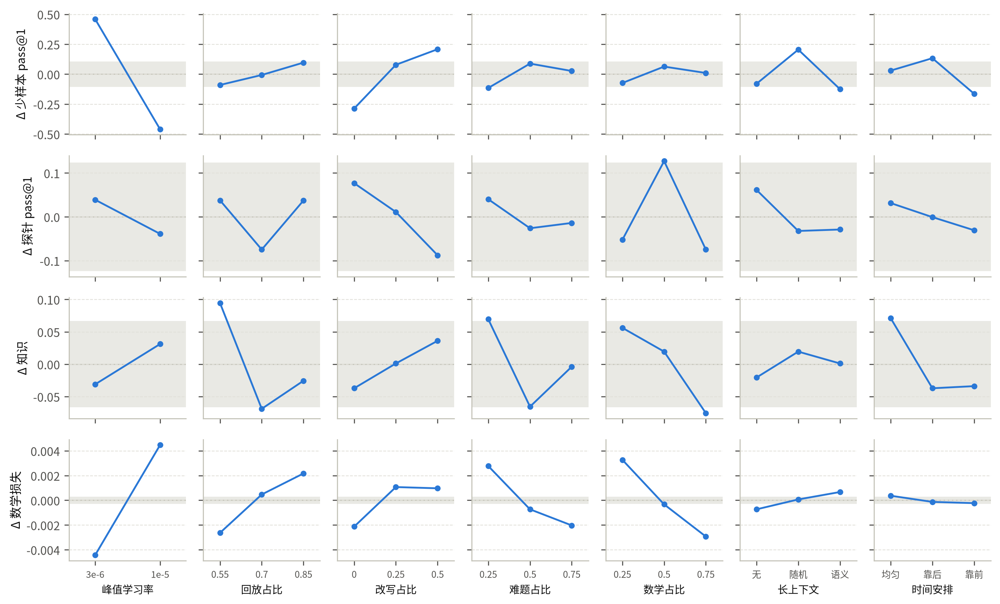
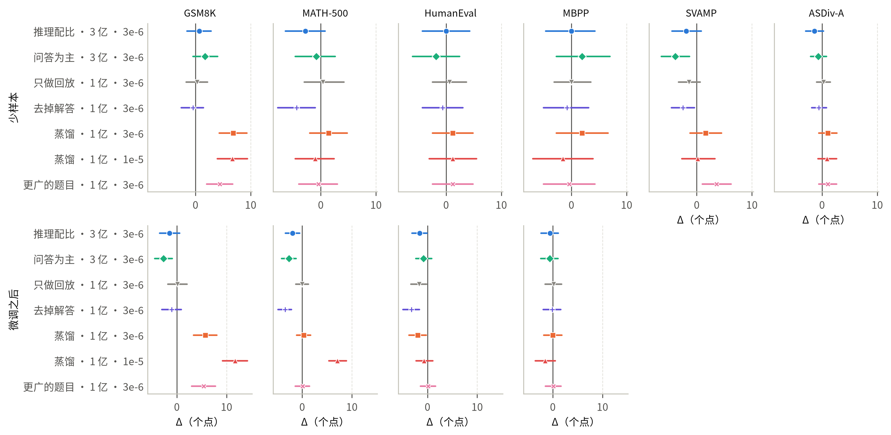
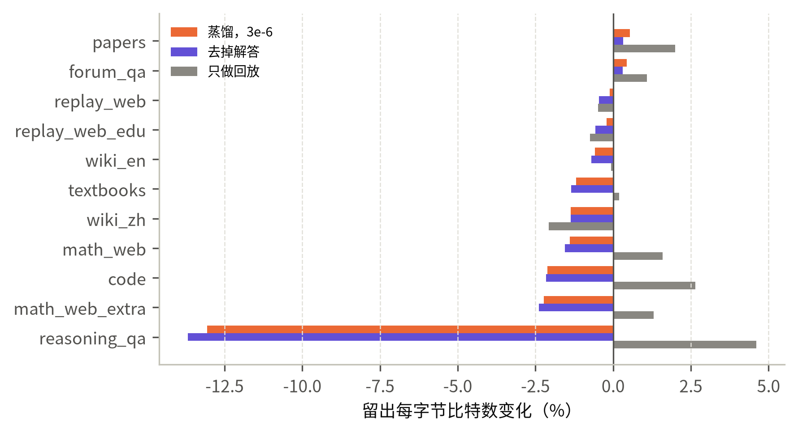
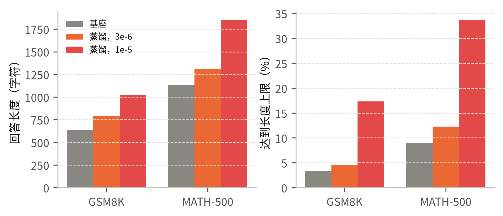

<div align="center">

# qwen-midtrain

[English](README.md) | [中文](README.zh-CN.md) | [Hugging Face 上的数据](https://huggingface.co/datasets/jiazhe868/qwen-midtrain-data) | [Hugging Face 上的检查点](https://huggingface.co/jiazhe868/qwen-midtrain-checkpoints)

本项目研究 Qwen3.5 基座模型的中期训练（mid-training），模型参数量从 0.8B 到 9B。公开文本没有让这些模型变好。更强的模型写出的详细解答，在每种规模上都提高了模型的少样本分数；经过微调之后，模型越大，增益越小。硬件：一台工作站上的四张 A100 40 GB GPU，以及一个 Slurm 集群的 A100 节点。

</div>

<p align="center"></p>

这张图展示主要结果。每个标记代表一种模型规模。标记的高度表示模型用蒸馏解答做中期训练之后提高了多少，比较对象是训练之前的同一个模型（即“基座”）。穿过标记的线段是 95% 区间：如果线段整体位于零以上，这个提高就超出了偶然因素能解释的范围。左图直接测试模型，提示中给出几道已解出的示例。右图先做一次简短、固定的微调，再测试模型（§2.2）。在右图中，模型越大，增益越小。GSM8K 在 0.8B 和 2B 上提高约 6 个点，在 4B 上提高 2.4 个点，在 9B 上没有提高（§5.5）。

## 摘要

大语言模型通常分三个阶段构建。预训练（pretraining）用数万亿 token 的文本教会模型语言和知识。随后，后训练（post-training）把模型变成助手，并提高它的推理能力。在这两个阶段之间，很多团队会加一个简短的中间阶段，叫作中期训练。在这个阶段，模型在一份精心挑选的高质量文本配比（mixture）上训练。

中期训练的目的，是给后训练一个更好的起点。对 Qwen3.5 这样强的开放模型来说，这很难做到。这个模型很可能已经用公开可得的大部分高质量文本训练过。它的预训练结束时，模型已经处于稳定的状态。新的训练还没有带来任何提高，就可能先扰乱这个状态。

本项目在 Qwen3.5 基座模型上测试了两类数据。第一类是公开文本：数学网页、问答对、维基百科、教科书、代码和普通网页文本。公开文本的任何一种配比都没有让模型变好。从 0.8B 到 9B 的每种规模都是这样，训练量最多到 10 亿 token 时也是这样。学习率较大时，这些配比让模型变差。学习率较小时，这些配比没有改变少样本分数，并让微调之后的 MATH-500 下降。

第二类是蒸馏数据（distilled data）。一个参数量为 27B 的更大模型担任“教师”（teacher），为 GSM8K 和 MATH 这两个数学基准的训练题写出逐步的解答。只保留最终答案正确的解答。在少样本测试中，这些数据让 GSM8K 准确率在 0.8B 模型上提高 6.8 个点，在 2B 模型上提高 4.3 个点，在 9B 模型上提高 5.3 个点。4B 模型只提高了 1.4 个点，在噪声以内。另一个来源的应用题上也有增益（SVAMP，9B 上 +5.1），模型的通用知识也保持不变。

第二种测试考察模型经过一次简短、固定的微调之后能做到什么。这更接近模型的实际用法。在这种测试中，模型越大，增益越小。GSM8K 在 0.8B 和 2B 上提高约 6 个点，在 4B 上提高 2.4 个点，在 9B 上没有提高。在 9B 上，微调后的基座模型和蒸馏后的模型表现一样好。另外十次 9B 运行分别换用了其他的种子、训练量、学习率、解答集和教师的思考轨迹，都没有改变这个结果。

两次对照运行说明了增益从哪里来。只用普通文本训练，模型没有变化。从同一配比中去掉解答再训练，模型同样没有变化。所以，增益是这些解答带来的。

后来的两项测试考察这些解答教了什么（§5.9、§5.10）。在第一项测试中，模型自己对同样这些题的正确回答代替了教师的解答。经过简短的微调之后，这些回答带来了很大一部分增益：在 0.8B 上，GSM8K 提高 +5.0，用教师的解答时是 +5.7。在第二项测试中，微调数据本身就包含详细的数学解答。这时大部分增益消失了，模型自己的回答带来的增益几乎完全消失。

**用详细解答做中期训练，增加的大部分是写出详细解答的习惯；在解答上微调，也能教会同样的习惯。** 有较小的一部分增益在这样的微调之后仍然保留。这部分增益来自教师的解答；在 0.8B 上，它主要来自学生解不出的题的解答。它在 0.8B 上最大（GSM8K +4.5，MATH-500 +2.8），在 4B 和 9B 上消失了。本文件的早期版本只根据增益随规模变化的趋势，得出了一条更宽泛的经验：当数据能教给模型尚未掌握的内容时，中期训练就有效。第 5.10 节说明了为什么这条经验只适用于这一小部分增益。

## 目录

1. [引言](#1-引言)
2. [怎样评估中期训练后的模型](#2-怎样评估中期训练后的模型)
3. [公开文本：哪些做法没有用](#3-公开文本哪些做法没有用)
4. [蒸馏：可选的方法与我们的流水线](#4-蒸馏可选的方法与我们的流水线)
5. [结果](#5-结果)
6. [结论](#6-结论)
7. [复现本研究](#7-复现本研究)
8. [附录](#8-附录)：文本池、训练循环、筛选设计、教师改写、为以后准备的组件、护栏、算力、预测、仓库结构
9. [参考文献](#9-参考文献)
10. [数据与许可](#10-数据与许可)

[PITFALLS.zh-CN.md](PITFALLS.zh-CN.md) 汇集了搭建这条流水线时遇到的失败模式，以及现在用来发现这些失败的检查。

---

## 1. 引言

### 1.1 什么是中期训练

语言模型分阶段学习。每个阶段用的数据不同，目标也不同：

```
预训练      数万亿 token 的广泛文本；模型学会语言和知识
中期训练    在预训练末尾，用一份较小的、精心挑选的配比；模型加强以后要用到的能力
后训练      先在对话上微调，再在答案可检查的题目上做强化学习（RL）
```

在预训练期间，学习率（learning rate）控制每次更新模型权重的幅度。它在训练开始时上升，之后缓慢降向零。临近结束时，每次更新都很小，模型进入稳定的状态。这种缓慢的冷却叫作退火（annealing），退火之后发布的模型称为经过退火的模型。

中期训练通常作为预训练的最后一个阶段来做，用的配比更窄。多个开放模型的报告都描述过这个阶段。OLMo 2 的最后阶段训练 500 亿乃至更多 token，数据由网页文本、数学和合成数据精选组合而成。Llama 3 在少量高质量的数学和代码数据集上退火。Qwen 的报告描述的最后阶段偏重科学、代码和推理。通常的配方（recipe）有三部分：

1. 增加重要领域的文本，比如数学和代码；
2. 回放（replay）一些普通文本，让模型不遗忘原来学到的内容；
3. 让学习率在这个阶段内衰减到零。

中期训练是否有效，取决于两个结果。第一个结果是后训练从新的起点出发能达到什么水平。中期训练做得好，模型在微调之后就能解出更多的题，也能给出更多正确答案，供强化学习奖励。第二个结果是模型保留了什么。它的通用知识和目标领域之外的能力都不应该变差。

### 1.2 为什么强基座模型难以改进

常见的看法是：高质量文本越多，模型越好。对 Qwen3.5 这样已经发布的基座模型，有三个事实让这个看法不那么确定。

**第一，模型很可能已经用这些文本训练过。** Qwen3.5 训练时用了数十万亿 token。中期训练配比会用到的公开数据集，比如 FineWeb-Edu、维基百科、FineMath 和 StackExchange，和它自己最后阶段的数据属于同一类。模型见过一本书之后，再读第二遍可能学不到多少内容。

**第二，模型已经稳定下来了。** 模型的权重已经在自己的数据配比上退火到稳定状态。继续训练必须重新调高学习率，更大的更新可能让模型离开这个状态。这种情况一旦发生，模型会先失去一些能力，然后才可能获得新的能力。有些继续预训练（continued pretraining）研究能从这种效应中恢复，它们用了几百亿到几千亿 token。本项目能负担的是几亿 token。

**第三，小的增益容易测量出错。** 每次训练都会改变模型在留出（held-out）文本上的损失，所以损失总会有一些变动。这种变动很难说明后训练能达到什么水平（§2.1）。如果测试先在被测任务自己的解答上做微调，它也可能掩盖模型之间的差别（§2.3）。而且每种设置只训练一次，就无法知道重复运行之间的噪声有多大。

### 1.3 本研究问了什么，发现了什么

本项目要回答三个问题：

1. 精心挑选的公开文本配比，在小剂量下还能改进 Qwen3.5 吗？
2. 如果不能，什么样的数据能？
3. 如果某种数据有帮助，微调之后增益是否还在，增益能否延伸到其他来源的题目上，从 0.8B 模型到 9B 模型是否都成立？

答案如下，顺序与各节的顺序一致：

- **公开文本没有帮助（§3）。** 0.8B 模型用很多种公开文本配比训练过，训练量为 4,000 万和 3 亿 token。峰值学习率为 1e-5 或更高时，每一种配比都让模型变差，只含普通文本的配比也一样。学习率为 3e-6 时，每一种配比都没有改变模型。在 2B、4B 和 9B 上的运行，以及 0.8B 上 10 亿 token 的运行，都得到了同样的结果（§3.5）。
- **蒸馏得到的解答有帮助（§5.1）。** 一个 27B 教师模型写出详细的解答，只保留其中正确的。用这些解答训练之后，少样本 GSM8K 准确率在 0.8B 上提高 6.8 个点，在 2B 上提高 4.3 个点，在 9B 上提高 5.3 个点。在 4B 上只提高 1.4 个点，在噪声以内。通用知识保持不变。
- **起作用的是这些解答（§5.2）。** 只用普通文本的运行没有增益。从同一配比中去掉解答的运行也没有增益。
- **结果可以重复（§5.8）。** 0.8B 蒸馏运行换用三个种子，少样本 GSM8K 都提高 6.3 到 7.3 个点。换一个种子，对照组仍然接近零。
- **增益有一部分延伸到了新题目上（§5.3）。** SVAMP 是一套由其他作者编写的应用题。在这套题上，从最小的模型到最大的模型，增益依次是 1.6、3.4、1.4 和 5.1 个点。在 4B 和 9B 上，GSM8K 的增益全部延伸了过去。直接提问时，MATH-500 测试没有变化，代码测试完全没有变化。
- **对最小的两个模型，微调显示出更多的增益（§5.4）。** 0.8B 和 2B 模型经过一次简短的通用微调之后，GSM8K 最多提高 11.8 个点，MATH-500 最多提高 7.6 个点。这部分额外增益大多是可靠性：模型原来偶尔能解出的题，现在答对的次数更多（§5.6）。
- **模型越大，微调之后保留的增益越少（§5.5）。** 经过同样的微调之后，GSM8K 在 4B 上提高 2.4 个点。蒸馏后的 9B 模型并不比微调后的基座模型好：只靠微调，基座模型就得到了同样的能力。另外十次 9B 运行，微调之后的增益最多为 +1.7 个点（§5.11）。
- **第一个解答集缺少最难的题（§4.4）。** 教师的回答限制在 1,024 个 token 以内。在最难的 MATH 题上，这个上限截断了教师 72% 的尝试，所以数据里几乎没有这些题。后来的一轮解题允许写 4,096 个 token，解出了其中 80% 的题。
- **包含详细解答的微调能补上大部分增益（§5.9）。** 如果微调数据本身就包含 4,000 条详细的数学解答，2B 模型在 MATH-500 上的领先就从 7.6 个点降到 1.4 个点。在 4B 和 9B 上，没有领先保留下来。
- **学生自己的回答能带来很大一部分增益（§5.10）。** 0.8B 模型用自己的正确回答训练，经过通用微调之后，GSM8K 提高 +5.0。经过包含解答的微调之后，只有教师的解答还保留增益，其中主要是学生解不出的题的解答。
- **微调之后，学习率的影响最大（§5.12）。** 在 0.8B 上，GSM8K 在 3e-6 时提高约 5.5 个点，在 1e-5 时提高约 12 个点，三个种子的结果相同。

> **状态。** 截至 2026-11-27，计划中的运行几乎都已完成。它们包括四种规模及其对照组、换用其他种子的重复运行、十一次 9B 运行、0.8B 上的扫描，以及考察解答教了什么的两项测试（§5.9、§5.10）。如摘要所述，这两项后来的测试缩小了主要结论的范围。仍在运行的有：用思考轨迹训练 9B 模型的第二个种子，以及几次 2B 和 4B 运行的数学微调。每得到一个结果，本文件就更新一次。

### 1.4 模型、数据与算力

| | |
|---|---|
| 模型 | 参数规模为 0.8B、2B、4B 和 9B 的 Qwen3.5 基座检查点（Apache-2.0）。只训练文本部分；每次保存时，视觉等其他权重原样复制回去 |
| 公开文本 | 11 个数据源，49.7 亿训练 token：网页文本、维基百科、教科书、论文、论坛回答、FineMath 的两个切片、教学代码，以及 WebInstructSub 中的 229 万对问答（附录 A） |
| 教师 | Qwen3.8-27B（Apache-2.0），4 位权重，每张 40 GB GPU 上放一份 |
| 教师写的文本 | GSM8K 和 MATH 训练题的 45,177 条检查过的解答（2,320 万 token）；NuminaMath-1.5 题目的 21,445 条解答（1,290 万）；真实段落的 10,349 条改写（1,110 万） |
| 一次运行 | 通常是 1 亿 token（筛选设计中为 4,000 万，最初几次剂量运行中为 3 亿）；序列长 4,096 个 token；每步 32,768 个 token；学习率在前 2% 的步数里预热，之后线性衰减到零 |
| 评测 | GSM8K、MATH-500、HumanEval、MBPP、SVAMP 和 ASDiv-A 完整测试集上的准确率；一次固定的微调测试；五个选择题集合和 TriviaQA 上的知识（§2.2） |
| 硬件 | 4 × A100 40 GB，在一台与其他作业共用的工作站上；一个 Slurm 集群的 A100 节点，由基于文件的任务队列分配任务（附录 G） |
| 速度 | 0.8B：单张 GPU 上每秒 7.7 千 token。2B：4.0 千。4B：1.9 千。9B：两张 GPU 上 1.1 千，所以 1 亿 token 约需 26 小时 |

---

## 2. 怎样评估中期训练后的模型

后面的每一个数字，都取决于怎样评估模型。所以先讲评估方法，再讲实验。

### 2.1 为什么只看损失不够

损失（loss）衡量模型预测文本中下一个词的能力。留出文本上的损失越低，说明这段文本对模型来说越不意外。在预训练中，观察损失并保留损失最低的模型，是很自然的做法。

对中期训练来说，损失的指导作用很弱。损失能显示一次运行让模型偏向了哪一类文本。它不能显示模型是否成了后训练更好的起点。本研究有两个结果说明了这一点。在 18 次运行的筛选设计（screening design，§3.2）中，各次运行之间的损失差异几乎全部由配比的选择解释。微调之后的差异，配比的选择几乎完全不能解释。在 §5.2 中，一次运行用了教师的解答，另一次没有用，它们让各项损失变化的幅度相同。只有前一次运行在测试上变好了。

损失仍然有用。运行出问题时，损失能及早显示出来，所以每次运行都会记录损失。

### 2.2 从四个视角评估模型

本项目从四个视角评估每个模型。每个视角回答一个不同的问题。

**1. 少样本（few-shot）准确率。** 提示中先给出几道已解出的示例，再给出一道新题，模型写出答案。这种测试不经过任何后训练，直接测试基座模型，也是衡量中期训练的标准方法。每个测试集的每道题都用一次，采用贪心解码（greedy decoding），也就是模型总是选概率最高的下一个词。这些测试集是 GSM8K（1,319 道小学应用题）、MATH-500（500 道竞赛题）、HumanEval（164 个编程任务）和 MBPP（257 个编程任务）。

**2. 其他来源的应用题。** SVAMP（1,000 道题）和 ASDiv-A（1,218 道题）是由其他作者编写的小学应用题。提问时，提示中仍然放同样的八个 GSM8K 示例。它们用来检验 GSM8K 上的增益能否延伸到其他来源的题目上。

**3. 一次固定的微调测试，即“通用探针”（generic probe）。** 每个模型都做同样的简短微调：在 6,842 段指令对话上训练两遍，峰值学习率为 2e-5。这些对话是一般性的指令：Python 函数、带约束的任务、摘要、改写和日常聊天。其中没有一条来自被测任务，也没有一条是数学题。微调之后，模型回答一组固定抽取的测试题：GSM8K 200 道，MATH-500 250 道，HumanEval 全部 164 道，MBPP 200 道。每道题在温度 1 下回答 16 次，也就是每次采样出一个不同的回答。这项测试显示从这个模型出发，后训练能达到什么水平。测试给出两个数字。pass@1 是采样一个回答时答对的概率。pass@16 表示模型尝试 16 次时，至少解出一次的题目占全部题目的比例。

**4. 知识与损失。** 五个选择题集合（MMLU-Pro、ARC-Challenge、HellaSwag、CommonsenseQA 和 CMMLU）和 TriviaQA 测试模型掌握的知识。选择题集合用完形（cloze）方式打分：比较模型给每个答案自身文本的似然，不用答案字母。小模型对某些字母有偏向，完形方式消除了这种偏差（PITFALLS B4）。每个数据源的留出文本上的损失也会记录下来。损失以每字节比特数（bits per byte）为单位：模型编码文本的一个字节平均需要多少比特。越低越好。

| 视角 | 考察什么 | 代码 |
|---|---|---|
| 少样本准确率 | 基座模型现在能做到什么 | `base_regression.py final` |
| 其他来源的应用题 | 增益能否延伸到别处编写的题目上 | 同一条命令 |
| 通用探针 | 从这个模型出发，后训练能达到什么 | `sft_probe.py --variant generic` |
| 知识与损失 | 模型有没有遗忘什么 | `base_regression.py run` |

pass@1 与 pass@16 之间的差距，对下一个阶段很重要。强化学习只能奖励模型有时会给出的答案。如果模型在 16 次尝试中一次也解不出某道题，RL 在这道题上就没有可以奖励的答案。

```python
# src/midtrain/eval_tasks.py：由 n 个样本（其中 c 个正确）得到的标准 pass@k 无偏估计
def estimate_pass_at_k(correct_sample_count: int, sample_count: int, k: int) -> float:
    return 1.0 - math.comb(sample_count - correct_sample_count, k) / math.comb(sample_count, k)
```

### 2.3 在被测任务上训练过的探针

微调测试的第一版没有用指令对话。它让每个模型在 GSM8K、MATH 和 MBPP 的约 15,000 条训练解答上微调，然后在这几个任务上测试。这看起来能直接测出后训练能达到什么水平。

结果发现，它测到的是另一个量。在 0.8B 基座模型上，这个“领域内”（in-domain）探针在每个任务上的分数都低于通用探针，也低于模型自己的少样本准确率：

| 任务 | 在任务自己的解答上训练的探针，pass@1 | 通用探针，pass@1 | 0.8B 基座，少样本 | 2B 基座，少样本 |
|---|---|---|---|---|
| GSM8K | 37.2 | 39.8 | 42.7 | 61.6 |
| MATH-500 | 13.6 | 22.8 | 23.0 | 37.2 |
| HumanEval | 9.6 | 15.4 | 21.3 | 34.1 |
| MBPP | 22.8 | 29.0 | 37.4 | 49.4 |

原因在于这些训练解答的风格。GSM8K 的解答是带计算器标记的简短笔记，MATH 的解答会跳步。微调让模型学会用这种简略的风格作答，这种风格不如模型原有的风格。这个探针还让不同的模型看起来很相近。经过这个探针之后，配比的选择只能解释 18 次设计运行之间 12% 的差异。同样大小的线性模型去拟合纯噪声，能解释的比例也比这更高。

因此，我把它换成了通用探针。通用探针的对话里不含任何被测任务。我还把完整测试集上的少样本准确率定为主要指标（`results/probe/`、`results/probe_generic/`、`results/final_eval/`）。

**探针如果用被测任务自己的解答训练，测到的更多是探针本身，较少是模型。**

### 2.4 噪声，以及一次运行说明不了什么

小的差别需要仔细比较。每个模型都用同样的提示回答同样的题目。所以两个模型可以逐题比较：在每道题上，可能一个模型对、另一个错，也可能两者得分相同。把这些逐题差值取平均，就得到增益。

为了判断增益是否真实，对题目随机重采样 2,000 次，每次重复这个比较。这些结果中间的 95%，就是每张表里给出的 95% 区间。如果区间不包含零，这个差别就超出了“哪些题恰好进入测试集”这种偶然因素能造成的范围（`mixing_law.py compare-with-base`，它写出 `results/comparisons/dose_vs_base_<size>.json`）。

这个区间有一个局限。它只反映题目选择带来的不确定性，不反映训练的随机性。换一种数据顺序再训练一次，可能会得到稍有不同的模型。第 5.8 节报告了换种子的第一批重复运行。

### 2.5 训练中排除了什么

只有测试题从未出现在训练数据里，测试测到的才是能力。如果一道测试题出现在训练文本中，模型就能凭记忆回答。这种泄漏叫作污染（contamination）。

训练文本池（pool）中的每篇文档，都要与每道测试题对照检查，少样本示例也包括在内。一篇文档只要与某段测试文本共有任何一个 13 词序列，就会被标记，采样器不会使用它。目前的扫描标记了约 13,500 篇文档，约占文本池的百分之零点二五（`results/hygiene_decontamination.json`）。给教师的题目只来自训练划分。由其他模型编写的题目集，在交给教师之前，还要用文本嵌入按语义检查一遍。附录 F 介绍这些检查，以及它们可能遗漏什么。

---

## 3. 公开文本：哪些做法没有用

### 3.1 文本池与配比

实验从一个公开文本池中取数据。文本池有 11 个数据源，共 49.7 亿训练 token（附录 A）。每个数据源承担一种角色：

- **回放**：普通网页文本（FineWeb 和 FineWeb-Edu）和中文维基百科，用来代替模型原来的训练数据；
- **精选文本**：英文维基百科、开放教科书、研究论文和 StackExchange 上的回答；
- **高难度文本**：FineMath 的两个切片（含数学内容的网页）和教学代码；
- **问答文本**：WebInstructSub 中带详细解答的 229 万道题。

配方规定每个数据源的占比，例如“30% 数学，20% 代码，50% 回放”。采样器填充每一条训练序列时，都选当前落后目标最多的数据源。所以一次运行实际用到的占比，几乎与配方完全一致（附录 B）。

§3.2 到 §3.4 的实验都用 0.8B 模型，剂量从小到大。第 3.5 节加入了更大的模型和更大的剂量。

### 3.2 四千万 token：筛选设计

调配比的常见做法，是一次只改一个占比。对配比来说，这样做效果不好。各项占比之和必须为一，所以提高一个占比，就会降低别的占比。各项占比之间还有交互作用：数学文本用多少合适，可能取决于学习率。

因此，我用正交设计（orthogonal design）同时改变七个因子。正交设计是实验统计学中的一种经典方案。在这种方案中，每个因子的每个水平，都与其他因子的每个水平搭配出现同样多次。十八次运行就足以估计每个因子的效应。这些因子是：学习率、回放占比、教师改写的占比、数学和代码的占比、其中数学所占的比例、长上下文打包，以及非回放文本在运行中何时出现（附录 C）。每次运行用 4,000 万 token 训练 0.8B 模型。

对这 18 次运行拟合一个简单的线性模型，就能看出每项测量有多少由配比解释（`results/designs/screen18_0.8B_analysis.json`）：

| 测量 | 由配比解释的比例 | 各次运行之间的离散程度 | 一次运行的噪声 |
|---|---|---|---|
| 数学损失 / 代码损失（每字节比特数） | 0.98 / 0.94 | 0.0063 / 0.0031 | 0.0013 / 0.0011 |
| 少样本 pass@1，四个任务的平均 | 0.92 | 0.58 | 0.24 |
| 少样本 GSM8K pass@16 | 0.96 | 2.11 | 0.65 |
| 知识（完形） | 0.63 | 0.14 | 0.13 |
| 领域内微调之后的探针 pass@1 | 0.12 | 0.20 | 0.28 |

怎样读这张表。第二列表示各次运行之间的差异有多大比例由配比解释。一个有十项的线性模型，能拟合任意 18 个数字的一部分，所以在这里，即使是纯噪声也能达到约 0.53。只有比例远高于 0.53，才说明一项测量确实随配比变化。第三列是 18 次运行之间的标准差。第四列是一次运行的噪声，即线性模型解释不了的部分。损失和少样本分数明显随配比变化。知识分数和探针分数不随配比变化。

<p align="center"></p>

每个点的算法是：取某个因子在一个水平上各次运行的平均值，再减去全部运行的平均值。灰色带是一个空因子的范围，它显示实际“没有效应”时，算出的效应能有多大。

这些效应是真实的，也都很小。数学文本每从回放中多占 10% 的 token，数学损失就降低 0.011 比特/字节。教师改写每占 10% 的 token，少样本 GSM8K pass@16 就提高 1.7 个点。较低的学习率 3e-6 在每一项损失上都优于 1e-5。经过领域内探针之后，这些差别全部消失。下一步自然是加大剂量。

### 3.3 三亿 token：学习率的限制

已发表的中期训练阶段用几亿乃至更多 token。所以下一个实验让 0.8B 模型训练 3 亿 token，是之前的 7.5 倍。配比富含推理内容：FineMath（25%）、WebInstructSub（25%）、教师改写（5%）、代码（7%）、教科书（3%）和回放（35%）（`configs/recipes/dose/`）。这个配比先用三个峰值学习率各运行一次：1e-5、3e-5 和 1e-4。同时还有一次对照运行，只用回放文本，学习率为 3e-5。

<p align="center"></p>

左图是每个学习率下，少样本准确率相对基座模型的变化。右图是知识的变化。越低越差。

各次运行的规律一致。学习率为 1e-5 或更高的每次运行，最终都低于基座模型。学习率越高，损害越大：

| 运行（3 亿 token） | GSM8K | MATH-500 | HumanEval | MBPP | 知识（完形） | FineWeb-Edu 损失 |
|---|---|---|---|---|---|---|
| 基座模型 | 42.7 | 23.0 | 21.3 | 37.4 | 34.7 | — |
| 推理配比，1e-5 | 40.1 | 21.0 | 20.1 | 31.9 | 34.5 | +0.2% |
| 推理配比，3e-5 | 33.5 | 17.2 | 12.2 | 22.2 | 32.0 | +3.0% |
| 推理配比，1e-4 | 18.4 | 11.2 | 3.7 | 7.4 | 26.8 | +9.7% |
| 只做回放，3e-5 | 28.2 | 8.6 | 7.3 | 18.3 | 32.9 | +0.9% |

然后，我把学习率降到 3e-6，也就是在筛选设计中表现最好的学习率。损害消失了。增益也没有了。下表列出每次运行减去基座模型的差值，附 95% 区间（`results/comparisons/dose_vs_base_0.8B.json`）：

| 运行（3 亿 token，学习率 3e-6） | GSM8K | MATH-500 | HumanEval | MBPP | 知识（完形） | FineWeb-Edu 损失 |
|---|---|---|---|---|---|---|
| 推理配比 | +0.7 [−1.5, +2.8] | −2.8 [−6.4, +0.8] | 0.0 [−4.3, +4.3] | 0.0 [−4.7, +4.3] | 35.0 | −0.5% |
| 以问答为主的配比（45% WebInstructSub） | +1.7 [−0.5, +4.0] | −0.8 [−4.6, +2.6] | −1.8 [−6.1, +2.4] | +1.9 [−2.7, +7.0] | 34.9 | −0.1% |

所有区间都包含零。经过通用探针之后，两次运行在每个任务上都比基座模型低 0.6 到 2.7 个点。

还检验了另一个想法。把受损运行的权重与基座模型的权重做平均，是一种已知的办法，能让模型从遗忘中恢复。我把 1e-5 的运行与基座模型做了平均，运行一方的权重取 25% 和 50%（`merging.py`）。平均之后，准确率回到了与基座模型相差 2.4 个点以内。它从未比基座模型高出 0.8 个点以上。权重平均能修复损害。它不能增加能力。

### 3.4 公开文本在这里为什么没有用

四项观察指向同一个解释。

**损害来自训练本身。** 只做回放的对照运行在 FineWeb-Edu 上训练。学习率为 3e-5 时，它在留出的 FineWeb-Edu 文本上的损失上升了 0.9%。用某一类文本训练，不应该让模型在同一类文本上变差。一种合理的解释是：学习率重新调高之后，模型离开了原来训练达到的稳定状态，3 亿 token 太少，不足以让它恢复。

**在安全的学习率下，模型能学的内容已经很少。** 学习率为 3e-6 时，留出的公开文本上的损失只下降了 0.1% 到 2%。模型已经能很好地预测这些文本。

**模型学到的是风格。** 损失下降最多的是留出的 WebInstructSub 回答，下降了 13%。不管配比里有没有教师的解答，都会出现同样的下降（§5.2）。只有含解答的那次运行在测试上变好了。所以模型学到的是这些回答的写法，这不是测试要求的能力。

**缺少的成分在公开文本中很少见。** 测试奖励正确的、逐步的解答。数学网页里大多是现成的答案和讨论。完整而正确的解题过程要少见得多。

**对经过退火的强基座模型，损坏它比改进它容易。在安全的学习率下，公开文本几乎没有增加模型尚未学会的内容。**

### 3.5 更大的模型和更大的剂量

上面的测试用的是 0.8B 模型，最多 3 亿 token。还剩两个问题。公开文本对更大的模型有帮助吗？训练的 token 更多时，它有帮助吗？五次运行回答了这两个问题。它们都用 §3.3 的推理配比，峰值学习率为 3e-6（`configs/recipes/dose/dose_reasoning_300m.yaml`，token 预算按各行所列）。

怎样读这张表。每一行是一次运行减去它的基座模型的差值。前两个数值列是少样本准确率，接下来两列是通用微调之后的 pass@1，知识列是完形分数。数值加粗，表示它的区间不包含零。

| 运行，减去基座 | GSM8K | MATH-500 | 探针 GSM8K | 探针 MATH-500 | 知识 |
|---|---|---|---|---|---|
| 0.8B，3 亿 token | +0.7 [−1.5, +2.8] | −2.8 [−6.4, +0.8] | −1.5 [−3.4, +0.5] | **−1.9 [−3.4, −0.5]** | +0.3 |
| 0.8B，10 亿 token | −0.6 [−3.0, +1.8] | −2.0 [−5.8, +1.8] | **−5.7 [−7.8, −3.8]** | **−2.8 [−4.3, −1.4]** | 0.0 |
| 2B，3 亿 token | −1.2 [−3.4, +1.1] | −0.4 [−4.0, +3.0] | **−3.1 [−5.2, −1.2]** | **−4.6 [−6.2, −3.0]** | +0.3 |
| 4B，1 亿 token | −0.8 [−2.4, +0.8] | **−4.4 [−8.2, −0.8]** | +0.4 [−0.9, +1.6] | **−2.0 [−3.6, −0.3]** | −0.1 |
| 9B，1 亿 token | +1.1 [−0.3, +2.4] | −3.4 [−7.0, 0.0] | −1.0 [−2.4, +0.3] | **−3.5 [−4.9, −2.1]** | +0.2 |

没有一次运行变好。每一次运行都让微调之后的 MATH-500 下降 1.9 到 4.6 个点，其中两次运行还让微调之后的 GSM8K 下降。在 0.8B 上，10 亿 token 造成的损害比 3 亿 token 大：微调之后，GSM8K 分别为 −5.7 和 −1.5。每一次运行的知识都保持不变（`results/comparisons/dose_vs_base_<size>.json`）。

**在这里测试过的每一种规模上，从 0.8B 到 9B，公开文本都没有帮助。**

---

## 4. 蒸馏：可选的方法与我们的流水线

如果模型已经学会了公开文本，要加的就是它没见过的文本。更强的模型是这种文本的一个直接来源。更强的模型能解出较小模型解不出的题，还能把步骤写出来。本节依次讲解：更强的模型有哪几种主要方式教较弱的模型，其中要做哪些选择，以及本研究具体做了什么。

### 4.1 更强的模型可以怎样教

蒸馏（distillation）是指训练一个较小的模型，让它的行为接近一个较大的模型。较小的模型叫学生（student），较大的模型叫教师（teacher）。各种方法的区别在于学生从什么内容中学习。

**软标签蒸馏（soft-label distillation）。** 在最初的形式中（Hinton et al., 2015），教师对每一个可能的下一个 token 给出完整的概率，学生学习去匹配这些概率。概率分布携带的信息比单个正确答案多。例如，它能显示哪些错误答案接近正确。这种方法代价很高：教师必须在每一个训练 token 上运行，两个模型还必须使用完全相同的词表。Gemma 2 用这种方法预训练了它的几个小模型。

**序列级蒸馏（sequence-level distillation）。** 这种方法由教师写出文本，学生用普通的下一个 token 损失在这些文本上训练（Kim and Rush, 2016）。教师只运行一次，用来写数据。训练过程不变。如今说到语言模型的“蒸馏”，通常指的就是这种方法。它等同于用更强的模型写出的合成数据训练。

**一般意义上的合成数据（synthetic data）。** 模型写出的任何文本都是合成数据。真实段落的改写、合成的教科书和问答对都是例子。合成数据有多大用处，取决于它增加了什么内容。改写只是重述学生已经掌握的事实。更强的模型写出的解答，可以包含学生还做不到的推理。本研究用同一个教师尝试了这两种数据，只有解答有帮助（§5.3）。

**验证（verification）。** 教师也会出错。一个补救办法是让教师多写几次尝试，再用外部信息检查，只保留通过检查的尝试。检查的依据可以是已知的参考答案、一组单元测试，或者一个裁判模型。这样，生成就变成了选择。STaR 和拒绝采样微调（rejection-sampling fine-tuning）等方法用的是同样的思路：用模型自己的正确输出训练模型。

**同策略蒸馏（on-policy distillation）。** 在上面几种方法中，学生从教师写的文本中学习。在同策略蒸馏中，学生自己写文本，教师给这些文本打分或加以纠正（Agarwal et al., 2024; Gu et al., 2024）。这样，学生就在它实际会生成的那类文本上学习。教师必须在训练循环内部运行，所以这种方法接近强化学习。

按学生从什么内容中学习，这四种思路可以概括如下：

```
软标签蒸馏    教师对每个下一个 token 给出的概率          训练时需要教师
序列级蒸馏    教师写的文本，用通常的下一个 token 损失    教师只负责写数据
  + 验证      只用答案通过检查的文本                     需要有已知答案的题目
同策略蒸馏    学生自己的文本，由教师打分或纠正           训练循环中需要教师
```

本研究用的是带验证的序列级蒸馏。它是四种方法中成本最低的。它不需要改动训练代码，就能放进普通的中期训练。验证还能去掉教师的大部分错误。

### 4.2 构建蒸馏数据要做哪些选择

构建蒸馏数据，要做一系列选择。每个选择都会改变学生学到的内容。下表列出主要的选择、本研究的选法，以及这个选法有没有检验过。

| 选择 | 可选项 | 本研究 | 状态 |
|---|---|---|---|
| 教师 | 模型、规模、权重精度、思考模式、采样方式 | Qwen3.8-27B，4 位权重，关闭思考模式，温度 1.0；第四个解答集打开思考模式（§4.4） | 一张 40 GB GPU 上放得下的最大模型；其他教师没有检验过 |
| 教师写什么 | 真实文本的改写、现有题目的解答、新题目 | 有已知答案的现有题目的解答；改写另外单独检验过（附录 D） | 检验过：解答有帮助，改写没有 |
| 验证 | 不验证、最终答案、单元测试、裁判模型 | 最终答案必须与参考答案一致，由测试所用的同一个判分器检查 | 对数学来说便宜又精确；论证错误、最后数字正确的解答仍能通过 |
| 题目 | 来自哪里、多难、多少道 | GSM8K 和 MATH 的训练划分（14,262 道题）；之后是 NuminaMath-1.5（20,000 道），以及再解一次的难题（2,591 道） | §4.4 |
| 回答长度 | 教师最多可以写多少个 token | 1,024；之后对难题放宽到 4,096；思考模式下为 8,192 | 1,024 太短（§4.4） |
| 每道题的份数 | 一道题保留多少条不同的解答 | 最多 4 条（NuminaMath 为 2 条） | 每道题一条的设置在集群扫描中 |
| 格式 | 对话格式还是纯文本；题目是否计入损失 | 纯文本 “Question: … Answer: …”；每个 token 都计入 | 中期训练数据中的对话标记可能破坏基座模型测试（OLMo 3）；其他格式没有检验过 |
| 怎样使用 | 用于微调还是作为中期训练的一部分；占比；用量；学习率 | 占 1 亿 token 中期训练配比的 40%；峰值学习率 3e-6 | 占比、用量和学习率在集群扫描中 |
| 学习信号 | 采样的文本还是概率；教师的文本还是学生的文本 | 教师采样出的文本，只写一次 | 概率和同策略方法没有尝试（§4.5） |

结果表明，起主要作用的是其中三个选择。验证决定数据是否正确。题目决定学生练习什么。回答长度决定哪些题有可能解出来，见 §4.4。

### 4.3 逐步讲解我们的流水线

这条流水线把有已知答案的题目变成训练文本。下面是第一个解答集的完整路径：

```
有已知答案的题目：GSM8K 的训练划分（7,473 道）和 MATH 的训练划分（6,789 道可用）
   │  教师为每道 GSM8K 题写 8 次尝试，为每道 MATH 题写 4 次，每次最多 1,024 个 token
   ▼
86,108 次尝试
   │  检查：尝试已经写完，并且最后一个 boxed 答案等于参考答案
   ▼
72,076 次正确的尝试 ── 每道题最多保留 4 条不同的 ──► 11,915 道题的 45,177 条解答
   │  对照每道测试题和每个少样本示例做污染检查：482 条解答被排除
   ▼
文本池中的数据源 synthetic_solutions（2,320 万 token）── 占 1 亿 token 配比的 40%
   │  以峰值学习率 3e-6 继续预训练
   ▼
学生模型
```

各个步骤的细节如下：

**第 1 步：向教师提问。** 教师收到一条指令和题目。它的思考模式是关闭的，所以它直接作答：

```python
# src/midtrain/synthetic_rephrase.py
solution_instruction = (
    "Solve the problem step by step. Write each step as a short sentence or an equation, check the result, and end "
    "with the sentence 'The final answer is \\boxed{...}.'")
```

下面是一条解答的例子。这个例子是为本 README 写的，格式与教师的解答相同。它展示的是训练时使用的确切格式，所以保留英文原文：

```
Question: A bakery makes 48 muffins in the morning and 36 in the afternoon. It sells three quarters of them.
How many muffins are left?

Answer: The bakery makes 48 + 36 = 84 muffins in total.
It sells three quarters of them: 84 × 3/4 = 63 muffins.
So 84 − 63 = 21 muffins are left.
Check: 63 + 21 = 84, which matches the total.
The final answer is \boxed{21}.
```

**第 2 步：检查每一次尝试。** 一次尝试只有在 token 上限内写完，并且最后一个 boxed 答案与参考答案一致，才会保留。比较答案时，用的是给测试判分的同一个函数。它按数值比较数字，所以 0.5 和 1/2 算作相等。其他答案按规范化之后的 LaTeX 比较：

```python
# src/midtrain/synthetic_rephrase.py (solve_training_problems)
predicted = find_last_boxed_content(solution_text)
is_correct = bool(finish_reason == "stop" and predicted is not None
                  and is_math_answer_equivalent(predicted, problem["reference_answer"]))
```

教师在 GSM8K 上的尝试有 94% 正确，在 MATH 上有 60% 正确（`results/synthetic_solutions_summary.json`）。有 2,347 道题，没有一次尝试答对。

**第 3 步：挑选并排版。** 相同的尝试合并为一条，每道题最多保留四条解答。每条解答成为一篇纯文本文档：先是题目，然后是答案。文本中没有对话标记（chat token）。对学生来说，它和其他文本没有区别，损失计入每一个 token。

**第 4 步：检查污染。** 这个新数据源和其他每个数据源一样，要通过同样的 13 词检查（§2.5）。检查标记了 482 条解答。其中大多数匹配的是 MATH 题目的固定措辞，比如“enter your answer in the form”。另有十六条是三道 GSM8K 训练题的解答，这三道题与 GSM8K 的测试题近乎相同。采样器不会使用这 482 条中的任何一条。

**第 5 步：混合并训练。** 解答占训练 token 的 40%。解答有 2,320 万 token，训练有 1 亿 token，所以每条解答在训练中大约出现 1.7 次。其余 60% 保留了之前配比中的问答文本、数学网页和代码，再加上少量回放：

```yaml
# configs/recipes/dose/dose_distill_100m.yaml
token_budget: 100007936           # 3,052 步，每步 32,768 个 token
components:
  synthetic_solutions: 0.40
  reasoning_qa: 0.15
  math_web: 0.10
  code: 0.10
  textbooks: 0.05
  wiki_en: 0.05
  replay_web_edu: 0.10
  wiki_zh: 0.05
```

训练用的循环与其他每次运行相同（附录 B），峰值学习率为 3e-6。这是 §3.3 中没有造成损害的学习率。

### 4.4 三个解答集，以及它们受到什么限制

<p align="center"></p>

蓝色柱表示教师的尝试中有多大比例答对。灰色柱表示有多大比例还没写完就超过了 1,024 token 的上限。各组依次是 GSM8K、MATH 的五个难度级别（L1 最容易，L5 最难）和 NuminaMath 的三个来源（`results/synthetic_attempts_*.json`）。

**第一个解答集缺少最难的题。** 1,024 token 的上限是按 GSM8K 选的，GSM8K 的解答很短。MATH 的解答更长，题目越难，解答越长。在第 1 级，只有 3% 的尝试被截断。第 4 级是 42%，第 5 级是 72%，这一级只有 27% 的尝试答对。教师并没有做错这些题：它的尝试还没写完就达到了 token 上限。结果，保留下来的 MATH 解答大多是容易的题，最难的题几乎没有。这是 MATH-500 在 9B 上没有变化的一个可能原因（§5.1）。

**第二个解答集拓宽了题目范围。** GSM8K 和 MATH 只覆盖两类题目。第二个解答集从 NuminaMath-1.5（Apache-2.0）的另外三个来源中抽取 20,000 道题：

- orca_math：由模型编写的小学应用题；
- cn_k12：译成英文的中国中小学习题；
- synthetic_math：新编的竞赛风格题目。

只抽取这样的题目：NuminaMath 把它标为有效，并且它的最终答案简短、可以检查。在把这些题交给教师之前，污染检查从抽出的 26,000 道题中去掉了 960 道。其中约 350 道与某道 SVAMP 或 ASDiv-A 题共有一个 13 词序列，另有 83 道与某道 MATH-500 题有这样的共同序列。被去掉的题大多来自 orca_math（`results/synthetic_solutions_numina_selection.json`）。教师对每道题写两次尝试，得到 11,367 道题的 21,445 条正确解答（1,290 万 token）。同样的 1,024 token 上限，总共截断了这些尝试中的 37%，在 cn_k12 和 synthetic_math 上截断了大约一半。

**第三轮解题补上难题。** 第一个解答集中的 2,591 道题又解了一次。它们是没有一次尝试答对的 2,347 道题，加上只有一次尝试答对的第 4、5 级 MATH 题。这 2,591 道题中，1,442 道是第 5 级，602 道是第 4 级。这一次，教师可以写 4,096 个 token，每道题尝试四次，温度为 0.8。

上限放宽之后，教师能把解答写完，解出了其中的大部分题。2,591 道题中它解出 2,085 道。以前没有一次尝试答对的 2,347 道题，这次解出 1,846 道。在第 5 级上，它解出 1,442 道题中的 1,194 道，71% 的尝试答对。即使上限是 4,096 个 token，第 5 级仍有 24% 的尝试被截断。只有这一轮中的 205 道 GSM8K 题大多仍没有解出（解出 44 道）（`results/synthetic_attempts_training_splits_hard.json`）。7,287 条正确解答（1,410 万 token）单独成为一个数据源：`synthetic_solutions_hard`。

随后，两次检查运行（0.8B 和 2B）用这个配方训练，其中 10% 的 token 取自这些解答（`configs/recipes/dose/dose_distill_hard_100m.yaml`）。MATH-500 的变化没有超出噪声。在少样本测试中，它在 0.8B 上变化 −0.4 个点，在 2B 上变化 +0.8。微调之后，它变化 +1.2 和 +6.4，只用第一个解答集时是 +0.3 和 +7.6。只有 2B 上 MATH-500 的 pass@16 多提高了一点，+4.0 对 +1.2，这同样在噪声以内（`results/comparisons/dose_vs_base_<size>.json`）。一种解释是，这些题太难，小模型还不能利用它们的解答。

**第四个解答集记录教师的推理。** 前三个解答集只包含教师写出的解答。对 9B 基座模型解不出的 3,597 道题（§5.5），教师还用思考模式做了一遍：它先做较长的推理，再写出解答。每道题尝试两次，温度 0.6，每次最多 8,192 个 token。7,194 次尝试中有 74% 答对，解出了 2,842 道题。在 MATH 第 5 级上，68% 的尝试答对，26% 的尝试被截断。保留下来的每个文档依次包含题目、推理和解答，都是纯文本。教师的对话格式用标签标记推理，文档里不带这些标签。保留的 5,332 个文档共 1,180 万 token（`results/synthetic_attempts_student_fails_9B_thinking.json`，`results/synthetic_solutions_thinking_summary.json`）。在这些轨迹上的 2B、4B 和 9B 运行见 §5.11。

### 4.5 哪些做法我们没有尝试，为什么

- **软标签蒸馏。** 它需要教师在每个训练 token 上给出概率。对 1 亿 token 来说，每个 token 都要让 27B 模型做一次前向计算，成本比训练 9B 模型本身还高。两个词表也必须完全一致。
- **同策略蒸馏。** 它把教师放进训练循环。这样，中期训练就接近强化学习，而强化学习是训练的下一个阶段。
- **用单元测试检查的代码解答。** HumanEval 和 MBPP 始终没有变化，配方里也没有代码解答。教师可以写程序，沙箱可以运行这些程序的测试。现有的时间不够做这项工作。
- **检查解答的每一步。** 裁判模型可以拒绝推理有错的解答，即使解答最后的数字是对的。只查最终答案时，这样的解答会通过检查。
- **更强的教师。** 比 27B 模型更强的教师，无法以可用的速度在工作站的 GPU 上运行。27B 教师的思考模式是后来加入的（§4.4）。

---

## 5. 结果

### 5.1 每种规模上的增益

第一个问题很简单：蒸馏配方有没有帮助？在每种规模上都有帮助吗？下表列出每次运行减去同一规模基座模型的差值。所有运行都用峰值学习率 3e-6 和 1 亿 token（`results/comparisons/dose_vs_base_<size>.json`）。

怎样读这张表。前面一组列是少样本准确率。“探针”列是通用微调之后的 pass@1。知识列是完形分数，单位是点。数值加粗，表示它的区间不包含零。

| 规模 | 基座 GSM8K | GSM8K | SVAMP | MATH-500 | HumanEval | MBPP | 知识 | 探针 GSM8K | 探针 MATH-500 |
|---|---|---|---|---|---|---|---|---|---|
| 0.8B | 42.7 | **+6.8 [+4.3, +9.3]** | +1.6 [−1.2, +4.5] | +1.4 [−2.0, +4.8] | +1.2 | +1.9 | +0.2 | **+5.7 [+3.3, +8.1]** | +0.3 [−1.1, +1.7] |
| 2B | 61.6 | **+4.3 [+2.0, +6.8]** | **+3.4 [+1.0, +5.9]** | −1.4 [−5.0, +2.0] | −2.4 | −1.6 | −0.5 | **+5.6 [+3.2, +7.9]** | **+7.6 [+5.8, +9.3]** |
| 4B | 82.8 | +1.4 [−0.5, +3.3] | +1.4 [−0.5, +3.2] | −2.2 [−6.0, +1.4] | −3.0 | −1.9 | −0.7 | **+2.4 [+0.9, +4.0]** | **+3.0 [+1.4, +4.7]** |
| 9B | 87.1 | **+5.3 [+3.7, +6.9]** | **+5.1 [+3.3, +6.9]** | +1.0 [−2.8, +4.6] | 0.0 | −0.4 | +0.4 | −0.1 [−1.3, +1.0] | 0.0 [−1.3, +1.4] |

值得注意的是：

- GSM8K 在四种规模中的三种上提高了 4 到 7 个点。在 4B 上只提高 1.4，在噪声以内。9B 模型本来就能解出 87.1% 的 GSM8K 题。对它来说，这次提高意味着答错的题目比例从 12.9% 降到 7.6%。错误减少了 41%。
- 知识保持不变。在任何规模上，它的变化都不到一个点。在每种规模上，11 个公开数据源中有 9 个的留出损失也下降了。
- 在少样本测试中，MATH-500 和代码没有变化。它们的变化都在噪声以内。
- 微调之后，MATH-500 也上升了，在 2B 上提高 7.6 个点，在 4B 上提高 3.0 个点。第 5.4 节解释两种测试的结果为什么不同。
- 在 9B 上，微调消除了增益。微调之后，蒸馏后的 9B 模型在 GSM8K 和 MATH-500 上得分与微调后的基座模型相同。第 5.5 节分析原因。

**用更强的模型写出并经过检查的解答做中期训练，能提高基座模型的少样本分数，而且不损失知识；模型越大，微调之后保留的增益越小。** 少样本 GSM8K 分数在 0.8B、2B 和 9B 上提高。微调之后，增益在 9B 上消失。

### 5.2 增益从哪里来

蒸馏配方与 §3 的公开文本运行有两处不同。它加入了解答。它还改变了配比的其余部分：另外 60% 主要是问答文本、数学网页和代码，回放很少。两处改变都可能是增益的原因。

两次对照运行把这两个原因分开。它们用同样的预算和同样的学习率。只做回放的对照组只用普通文本训练：FineWeb-Edu 和中文维基百科。消融运行（ablation）保留这个配方，只把解答占的 40% 换成普通网页文本（`configs/recipes/dose/dose_nosolutions_100m.yaml`）。

| 运行减去基座（1 亿 token，学习率 3e-6） | GSM8K | MATH-500 | HumanEval | 探针 GSM8K | 探针 MATH-500 | 知识 |
|---|---|---|---|---|---|---|
| 0.8B 蒸馏 | **+6.8 [+4.3, +9.3]** | +1.4 [−2.0, +4.8] | +1.2 [−2.4, +4.9] | **+5.7 [+3.3, +8.1]** | +0.3 [−1.1, +1.7] | +0.2 |
| 0.8B 去掉解答 | −0.5 [−2.6, +1.4] | **−4.4 [−7.8, −1.0]** | −0.6 [−4.3, +3.0] | −1.0 [−3.0, +0.9] | **−3.5 [−4.8, −2.2]** | +0.5 |
| 0.8B 只做回放 | +0.3 [−1.7, +2.2] | +0.4 [−3.0, +4.2] | +0.6 [−2.4, +3.7] | +0.1 [−1.8, +2.1] | 0.0 [−1.3, +1.2] | +0.6 |
| 2B 蒸馏 | **+4.3 [+2.0, +6.8]** | −1.4 [−5.0, +2.0] | −2.4 [−7.3, +2.4] | **+5.6 [+3.2, +7.9]** | **+7.6 [+5.8, +9.3]** | −0.5 |
| 2B 只做回放 | −0.7 [−2.6, +1.1] | −3.8 [−7.8, 0.0] | −1.2 [−5.5, +3.0] | +0.7 [−1.2, +2.6] | **−1.8 [−3.4, −0.2]** | +0.6 |
| 4B 蒸馏 | +1.4 [−0.5, +3.3] | −2.2 [−6.0, +1.4] | −3.0 [−7.3, +1.2] | **+2.4 [+0.9, +4.0]** | **+3.0 [+1.4, +4.7]** | −0.7 |
| 4B 只做回放 | +0.3 [−1.1, +1.7] | −2.8 [−6.4, +1.0] | −5.5 [−11.6, +0.6] | +0.5 [−1.0, +1.9] | +0.7 [−0.9, +2.3] | +0.9 |

结果没有歧义。单靠继续训练没有作用：在三种规模上，只做回放的对照组都持平。配比的其余部分也没有作用：去掉解答之后，同一配比没有任何增益，在 MATH-500 上还下降了 4.4 个点。**增益来自这些解答。**

<p align="center"></p>

这张图把本研究的每一次 0.8B 运行并排放在一起。上面一行是少样本准确率，下面一行是通用探针之后的 pass@1。每个标记表示一次运行减去基座模型的差值。只有蒸馏运行明显位于零的右边，而且只在 GSM8K 和 MATH-500 上。

留出损失从另一个侧面说明了同一件事：

<p align="center"></p>

图中画了三次 0.8B 运行。每根柱子表示其中一次运行在一个公开数据源上的留出损失变化。蒸馏运行（橙色）和去掉解答的运行（紫色）让每一项损失变化的幅度都很接近。两者都让 WebInstructSub 回答（reasoning_qa）上的损失降低了约 13%。只有前一次运行在测试上变好了。解答增加的能力，在这些损失里完全看不出来。只做回放的对照组（灰色）呈现第三种模式：它只用普通文本训练，所以大多数专门领域数据源上的损失上升，比如论文、代码和数学网页。

### 5.3 增益能延伸多远

这些解答回答的是 GSM8K 和 MATH 的训练题。GSM8K 的测试题来自同一个分布。所以 GSM8K 增益的一部分，可能只是在这一类题目上的增益。

SVAMP 和 ASDiv-A 用来检验这一点。它们是由其他作者编写的小学应用题，没有任何一条解答与它们共有 13 词序列（`results/hygiene_decontamination_word_problems.json`）。两者在提示中都用同样的八个 GSM8K 示例，所以只有题目不同。

| 运行减去基座 | GSM8K | SVAMP | ASDiv-A |
|---|---|---|---|
| 基座准确率，0.8B / 2B / 4B / 9B | 42.7 / 61.6 / 82.8 / 87.1 | 61.2 / 71.1 / 86.5 / 87.5 | 90.2 / 95.3 / 97.0 / 97.6 |
| 0.8B 蒸馏 | +6.8 [+4.3, +9.3] | +1.6 [−1.2, +4.5] | +1.1 [−0.6, +2.7] |
| 2B 蒸馏 | +4.3 [+2.0, +6.8] | **+3.4 [+1.0, +5.9]** | −0.4 [−1.6, +0.8] |
| 4B 蒸馏 | +1.4 [−0.5, +3.3] | +1.4 [−0.5, +3.2] | +0.6 [−0.3, +1.6] |
| 9B 蒸馏 | +5.3 [+3.7, +6.9] | **+5.1 [+3.3, +6.9]** | −0.2 [−1.1, +0.7] |
| 0.8B 只做回放 | +0.3 [−1.7, +2.2] | −1.4 [−3.3, +0.6] | +0.2 [−1.0, +1.5] |

值得注意的是：

- 模型越大，延伸过去的增益越多。在 SVAMP 上，0.8B 模型保留了 GSM8K 增益的约四分之一，2B 模型保留了约五分之四，4B 和 9B 模型全部保留。
- ASDiv-A 没有变化。基座模型本来就能解出其中 90% 到 98% 的题，所以提高的空间很小。
- 公开文本在这里有害。每一种公开文本配比都降低了 SVAMP 的准确率。
- 少样本 MATH-500 在任何规模上都没有变化。第一个解答集缺少难题（§4.4），这是一个可能的原因。
- 代码始终没有变化。配方里没有代码解答。

更宽的题目集把增益转移到了别的题目上。它没有让增益变大。第二个解答集（§4.4）替换了第一个解答集的一半，解答仍占 token 的 40%：

| 配比中的解答（0.8B） | GSM8K | MATH-500 | SVAMP | 探针 GSM8K | 探针 MATH-500 |
|---|---|---|---|---|---|
| 第一个解答集，40% | **+6.8 [+4.3, +9.3]** | +1.4 [−2.0, +4.8] | +1.6 [−1.2, +4.5] | **+5.7 [+3.3, +8.1]** | +0.3 [−1.1, +1.7] |
| 第一个解答集 20% + NuminaMath 20% | **+4.4 [+2.0, +6.8]** | −0.4 [−4.0, +3.0] | **+3.6 [+1.0, +6.2]** | **+5.4 [+3.0, +7.8]** | +0.1 [−1.4, +1.5] |

GSM8K 训练题的解答减半之后，GSM8K 上少了约两个点，SVAMP 上多了约两个点。其他都没有变化。解读 SVAMP 的增益时要注意一点。orca_math 中的题目和 SVAMP 属于同一类。污染检查只去掉近似副本，所以那些很接近、又不算副本的题目，仍然可能对 SVAMP 有帮助。另外，由于 1,024 token 的上限，较难来源保留下来的都是较短的解答。

教师对真实段落的改写是一个有用的反例（附录 D）。这些改写也是同一个教师写出的合成文本。它们没有帮助。在 4,000 万 token 时，它们有一个小的少样本效应，这个效应经过领域内探针之后消失；在 3 亿 token 时，没有任何效应。**起作用的是文本的内容，即在与测试相似的题目上经过检查的推理。文本是不是模型写的，并不重要。**

### 5.4 同一个模型的两种视角：少样本与微调之后

少样本测试直接向基座模型提问。通用探针先让模型学会回答对话，然后再提问。在 0.8B 上，对哪个学习率表现最好，两种视角的结论不一致：

| 0.8B 蒸馏减去基座 | GSM8K 少样本 | MATH-500 少样本 | 探针 GSM8K | 探针 MATH-500 | 知识 |
|---|---|---|---|---|---|
| 学习率 3e-6 | **+6.8 [+4.3, +9.3]** | +1.4 [−2.0, +4.8] | **+5.7 [+3.3, +8.1]** | +0.3 [−1.1, +1.7] | +0.2 |
| 学习率 1e-5 | **+6.7 [+3.9, +9.4]** | −1.0 [−4.6, +2.4] | **+11.8 [+9.2, +14.2]** | **+7.1 [+5.4, +8.9]** | −0.5 |
| 学习率 3e-5 | **+5.3 [+2.4, +8.1]** | +0.4 [−3.4, +4.4] | **+14.9 [+11.9, +17.9]** | **+7.2 [+4.9, +9.4]** | −2.6 |

在少样本测试中，两种学习率在 GSM8K 上的增益相同，在 MATH-500 上都没有增益。微调之后，1e-5 的运行在 GSM8K 上的增益翻了一倍，在 MATH-500 上提高了 7.1 个点。后来补做的 3e-5 运行延续了这个趋势：微调之后，它在 GSM8K 上提高 14.9 个点，知识下降 2.6 个点。

回答本身解释了这个差别：

<p align="center"></p>

左图是通用微调之后回答的平均长度。右图是回答中有多大比例达到探针的长度上限。每张图都把 0.8B 基座模型与两次蒸馏运行做比较。

在少样本测试中，每个模型都模仿提示里八个简短示例的格式，这些示例是人写的。微调之后，每个模型按自己的风格作答。1e-5 的模型像它的教师那样，写很长的详细解答。在 MATH-500 上，它的回答比基座模型的长 64%，其中三分之一达到长度上限，被算作错误。即便如此，它解出的题还是更多。解答教给模型的能力，只有在提示允许模型使用它时才会显现出来。

在 2B 上，较低的学习率就达到了 0.8B 上 1e-5 才达到的效果：微调之后，MATH-500 提高 7.6 个点。一种可能的解释是，较大的模型能从同样的解答中学到更多。

**学习率要在两者之间取舍：基座模型自身的分数，和微调之后能达到的水平。** 3e-6 保持了少样本分数和知识。1e-5 让微调之后的增益翻倍，代价是半个点的知识。3e-5 让微调之后的 GSM8K 增益更大，代价是 2.6 个点的知识。第 5.12 节在 0.8B 上对学习率做了更细的扫描。

在 9B 上，这种取舍在更低的学习率下就出现了，而且首先出现在代码上。学习率为 1e-5 的三次 9B 运行，少样本 MBPP 都下降了 10 到 13 个点；学习率为 3e-6 的运行，没有一次出现这种下降（§5.11）。从回答中可以看出变化在哪里。基座模型能解出、1e-5 的模型解不出的 MBPP 题有 45 道。在其中 33 道题上，模型写出一段结果错误的短程序；在 9 道题上，它写出一个循环，一直重复到 512 个 token 的上限。1e-5 的模型也不再模仿提示中示例的风格。这些示例用两个空格缩进。基座模型在 91% 的回答中也用两个空格，1e-5 的模型在 67% 的回答中用四个空格。它在留出代码上的损失仍然下降了（−0.8%）。经过通用微调之后，它的 MBPP 分数与基座模型的差别在噪声以内（−1.4 [−3.4, +0.4]）。所以，模型保留了它的代码知识，它的少样本行为发生了变化。在 0.8B 上，MBPP 上同样的下降要到 3e-5 才出现（−8.2 个点）。较大的模型在较低的学习率下就会受到扰动。

### 5.5 在 9B 上，微调带来同样的增益

9B 模型的微调测试最后才完成，结果和较小的规模不一样。经过通用微调之后，蒸馏后的 9B 模型并不比微调后的基座模型好。GSM8K 的 pass@1 变化 −0.1 [−1.3, +1.0]，MATH-500 变化 0.0 [−1.3, +1.4]。唯一明显的变化在 HumanEval 上，+2.5 [+0.6, +4.5]。4B 只做回放的对照组也有同样的变化（+2.5 [+0.4, +4.8]），所以这个变化不来自这些解答。

首先要排除样本的影响。探针只问 200 道 GSM8K 题和 250 道 MATH-500 题，所以它可能遗漏完整测试集上能看到的增益。因此，我在完全相同的这些题上比较了少样本的回答。在这些题上，蒸馏后的 9B 模型明显领先。它解出 200 道 GSM8K 题中的 94.5%，基座模型解出 86.5%，增益为 8.0 [+4.5, +12.0]。增益在样本里是存在的。消除增益的是微调。

下表用同样的题目，比较两个 9B 模型在微调前后的表现。少样本准确率用贪心解码，探针的 pass@1 是 16 个采样回答的平均，所以不同的列之间不能直接比较。应该看每一列里两行之间的差距（`results/comparisons/dose_vs_base_9B.json` 中的 `few_shot_greedy_on_probe_items`，以及 `results/probe_generic/`）：

| 9B，同样的题目 | GSM8K 少样本 | GSM8K 微调之后 | MATH-500 少样本 | MATH-500 微调之后 |
|---|---|---|---|---|
| 基座模型 | 86.5 | 89.9 | 51.2 | 65.2 |
| 蒸馏运行 | 94.5 | 89.8 | 54.4 | 65.2 |

由此得到两点观察。第一，微调让基座模型提高了很多：MATH-500 提高 14 个点，而微调数据里完全没有数学。所以 9B 基座模型本来就有这种能力。少样本提示没有引出这种能力，一次简短的微调引出了它。第二，微调之后，两个模型达到同一个水平。

回答本身说明了解答在少样本测试中怎样起作用。蒸馏后的 9B 模型写出的 GSM8K 回答，比它的基座模型长 51%（394 对 261 个字符）：它像教师那样把解题过程写了出来。在 0.8B 和 2B 上，少样本回答只变长了 7% 到 8%。微调之后，9B 基座模型也把解题过程写了出来（604 个字符），并达到同样的准确率（`results/final_eval/` 和 `results/probe_generic/` 中的 `mean_completion_characters`）。

2B 模型的表现不同。同样的微调只让它的基座模型在 MATH-500 上提高了 1.4 个点（在探针的题目上，从 37.2 到 38.6）。它让蒸馏后的 2B 模型提高了 12.6 个点（从 33.6 到 46.2）。在 GSM8K 上，蒸馏后的 2B 模型经过微调仍保持了大部分领先：微调前领先 7.0 个点，微调后领先 5.6 个点。在 2B 上，这些解答增加了一种只靠微调达不到的能力。

4B 模型介于两者之间。微调之后，它在 GSM8K 上提高 2.4 个点，在 MATH-500 上提高 3.0 个点，约为 2B 模型增益的一半。下表把四种规模排在一起，并列出 27B 教师的规模是每个学生的多少倍：

| 学生 | 教师规模 ÷ 学生规模 | 微调之后的 GSM8K | 微调之后的 MATH-500 |
|---|---|---|---|
| 0.8B | 34 | **+5.7 [+3.3, +8.1]** | +0.3 [−1.1, +1.7] |
| 2B | 13.5 | **+5.6 [+3.2, +7.9]** | **+7.6 [+5.8, +9.3]** |
| 4B | 6.8 | **+2.4 [+0.9, +4.0]** | **+3.0 [+1.4, +4.7]** |
| 9B | 3 | −0.1 [−1.3, +1.0] | 0.0 [−1.3, +1.4] |

从 2B 开始，学生越大，微调之后保留的增益越小。0.8B 模型在 MATH-500 上是例外：在这个学习率下，它在这项测试上没有增益；用 1e-5 时，它提高 7.1 个点（§5.4）。

**对最大的学生，教师的解答所教的内容，模型大多已经掌握，一次简短的微调同样能把这些内容引出来。** 最大的学生是 9B 模型。学生的规模越接近教师，教师的解答中对它来说的新内容就越少。

**教师文本上的困惑度与此一致。** 训练时的验证集不包括教师写的文本，所以我单独测量了每个模型在留出的教师解答上的损失，单位是每字节比特数（`base_regression.py teacher-text-loss`，`results/teacher_text_loss/`）。这些运行都没有用 §4.4 中难题的解答训练过，所以这些解答是一个干净的测试。

| 模型 | 基座，第一个解答集 | 蒸馏后，第一个解答集 | 基座，难题集 | 蒸馏后，难题集 | 只做回放，难题集 |
|---|---|---|---|---|---|
| 0.8B | 0.284 | 0.191 | 0.292 | 0.239（−18%） | 0.320（+10%） |
| 2B | 0.245 | 0.145 | 0.245 | 0.198（−19%） | 0.267（+9%） |
| 4B | 0.204 | 0.093 | 0.198 | 0.159（−20%） | 0.215（+9%） |
| 9B | 0.180 | 0.086 | 0.183 | 0.143（−22%） | — |

基座模型越大，在任何训练之前就越能预测教师的文本：在第一个解答集上，9B 是每字节 0.18 比特，0.8B 是 0.28。用第一个解答集训练之后，每种规模的模型在从未见过的解答上，损失都降低约五分之一，9B 也不例外。所以，9B 模型学到的教师写法和小模型一样多。在 9B 上，这并没有变成微调之后的增益。教师文本上的困惑度衡量模型学到了多少教师的风格。用普通文本训练，会让这个困惑度升高约十分之一。（留出的解答可能和训练过的解答属于同一道题，这是第一个解答集上蒸馏后数值更低的部分原因。）

**哪些题还能教给最大的学生新内容？** 这个结果决定了 9B 上接下来的实验（§5.11）。还能教给 9B 模型新内容的解答，是 9B 模型自己解不出的那些题的解答。为了找到这些题，我让 9B 基座模型把教师收到过的每一道题都做了一遍，共 25,621 道题。每道题生成四个回答，用训练数据的格式，提示里给四条教师解答作为示例，并用教师自己的检查来评分（`synthetic_rephrase.py student-check`，`results/student_check_9B_base.json`）：

| 题目 | 答对的回答 | 在 1,024 个 token 处被截断的回答 | 四次中最多答对一次的题 |
|---|---|---|---|
| GSM8K（7,469） | 86% | 2% | 6% |
| MATH 第 1–2 级（1,756） | 85% | 8% | 7% |
| MATH 第 3–4 级（2,989） | 65% | 25% | 27% |
| MATH 第 5 级（2,038） | 31% | 54% | 64% |
| NuminaMath（11,367） | 81% | 9% | 8% |

教师收到的题，9B 基座模型大多已经能解出。它解不出 3,597 道题，大多是 MATH 第 4、5 级。这些题在三个解答集中的解答共 1,420 万 token，其中 82% 来自 §4.4 的难题轮（`results/student_subset_9B_base.json`）。有一点要注意：9B 模型在第 5 级上一半以上的回答达到了 token 上限，所以这个集合偏向需要长回答的题。提高学习率是另一个选项：在 0.8B 上，它让微调之后保留的增益翻了一倍（§5.4）。

### 5.6 可靠性，不是覆盖面

pass@1 的增益可能有两种不同的含义。模型可能解出了以前从未解出的新题。也可能题目还是同样的题，模型答对的次数更多了。对后面的强化学习阶段来说，这个区别很重要。

<p align="center"></p>

每个点代表一次蒸馏运行（标记形状）在通用探针之后的一项测试（颜色）。横坐标是 pass@1 的变化，纵坐标是 pass@16 的变化。如果点落在虚线对角线上，两者的增益相同。如果点落在对角线下方，pass@1 的增益大于 pass@16 的增益。

点的位置取决于模型规模。在 2B 上，增益几乎全是可靠性。MATH-500 的 pass@1 提高 7.6 个点，它的 pass@16 只提高 1.2，在噪声以内。GSM8K 的 pass@1 提高 5.6，pass@16 提高 1.5。所以，基座模型原来偶尔能解出的题，蒸馏后的 2B 模型答对的次数更多，它新解出的题很少。在 0.8B 上，GSM8K 的覆盖面也有增益：3e-6 时 pass@16 提高 6.5 个点 [+1.0, +11.5]，1e-5 时提高的幅度相同。最小的模型也解出了新题。在 4B 上，增益同样是可靠性：GSM8K 的 pass@1 提高 2.4，pass@16 没有变化。在 9B 上，各点都落在零附近（§5.5）。

对强化学习来说，这两种增益的含义不同。可靠性提高，每组样本里可以奖励的正确答案就更多。覆盖面扩大，强化学习就多了一些可以学习的题目：这些题以前没有一个样本是对的，所以以前无法从中学习。2B 模型得到的是第一种增益。0.8B 模型在 GSM8K 上两种都得到了。

### 5.7 增益中有没有污染的成分？

三项检查的结果都是没有。

1. 这些解答在生成时就通过了污染检查。被标记的 482 条解答从未进入任何一次运行（§4.3）。
2. 任何一条解答触及的每一道测试题都已列出（`data_hygiene.py matched-items`）：GSM8K 3 道，MATH-500 53 道。去掉这些题之后，0.8B 在其余 1,316 道 GSM8K 题上的增益不变，是 +6.8 [+4.4, +9.2]；MATH-500 仍在噪声以内（`results/comparisons/dose_vs_base_0.8B.json` 中的 `without_matched_items`）。
3. 增益延伸到了 SVAMP，没有任何一条解答触及 SVAMP。

### 5.8 重复运行：不同运行之间数值变化多大

上面的每个数值都来自一次训练运行。换一种文档顺序再训练一次，会得到略有不同的模型，表中的区间不反映这种差别（§2.4）。因此，三次主要的 0.8B 运行换了种子又训练了一遍。种子只改变文档的顺序。

怎样读这张表。每一行是一次运行减去基座模型的差值。GSM8K、MATH-500 和 SVAMP 列是少样本准确率，“探针”列是通用微调之后的 pass@1。数值加粗，表示它的区间不包含零。

| 0.8B 运行，减去基座 | 种子 | GSM8K | MATH-500 | SVAMP | 探针 GSM8K | 探针 MATH-500 | 知识 |
|---|---|---|---|---|---|---|---|
| 蒸馏 | 1 | **+6.8 [+4.3, +9.3]** | +1.4 [−2.0, +4.8] | +1.6 [−1.2, +4.5] | **+5.7 [+3.3, +8.1]** | +0.3 [−1.1, +1.7] | +0.2 |
| 蒸馏 | 2 | **+6.3 [+3.6, +8.9]** | −0.6 [−4.2, +3.0] | **+4.2 [+1.3, +7.1]** | **+7.8 [+5.5, +10.0]** | +0.8 [−0.6, +2.1] | −0.6 |
| 蒸馏 | 3 | **+7.3 [+4.5, +9.9]** | −0.4 [−4.0, +3.2] | +2.7 [−0.1, +5.6] | **+6.9 [+4.8, +9.1]** | +1.6 [0.0, +3.1] | −0.3 |
| 只做回放 | 1 | +0.3 [−1.7, +2.2] | +0.4 [−3.0, +4.2] | −1.4 [−3.3, +0.6] | +0.1 [−1.8, +2.1] | 0.0 [−1.3, +1.2] | +0.6 |
| 只做回放 | 2 | +0.3 [−1.6, +2.2] | +1.0 [−2.2, +4.2] | +1.6 [−0.2, +3.5] | +0.7 [−1.4, +2.8] | −0.4 [−1.6, +0.8] | +0.4 |
| 去掉解答 | 1 | −0.5 [−2.6, +1.4] | **−4.4 [−7.8, −1.0]** | **−2.5 [−4.6, −0.4]** | −1.0 [−3.0, +0.9] | **−3.5 [−4.8, −2.2]** | +0.5 |
| 去掉解答 | 2 | −1.5 [−3.6, +0.6] | −1.4 [−4.4, +1.8] | +0.7 [−1.6, +3.0] | **−2.4 [−4.5, −0.3]** | **−2.8 [−4.2, −1.6]** | +0.2 |

值得注意的是：

- 蒸馏运行的增益可以重复。三个种子下，少样本 GSM8K 提高 6.3 到 7.3 个点，微调之后提高 5.7 到 7.8 个点。种子之间的差别，微调之前约为一个点，微调之后约为两个点。
- 两个种子下，只做回放的对照组都接近零。
- SVAMP 在种子之间的变化比 GSM8K 大，从 +1.6 到 +4.2。在这个规模上，读单个 SVAMP 数值时要考虑这个幅度。
- 去掉解答之后，少样本 MATH-500 用第一个种子时下降 4.4 个点，用第二个种子时下降 1.4 个点，后者在噪声以内。微调之后，两个种子在 MATH-500 上都下降约三个点。

2B 的蒸馏运行也有了第二个种子：

| 2B 运行，减去基座 | 种子 | GSM8K | MATH-500 | SVAMP | 探针 GSM8K | 探针 MATH-500 | 知识 |
|---|---|---|---|---|---|---|---|
| 蒸馏 | 1 | **+4.3 [+2.0, +6.8]** | −1.4 [−5.0, +2.0] | **+3.4 [+1.0, +5.9]** | **+5.6 [+3.2, +7.9]** | **+7.6 [+5.8, +9.3]** | −0.5 |
| 蒸馏 | 2 | **+4.0 [+1.7, +6.5]** | +1.6 [−2.2, +5.4] | **+3.8 [+1.6, +6.2]** | **+4.0 [+1.9, +6.0]** | **+5.1 [+3.5, +6.7]** | −0.3 |

少样本增益很接近：GSM8K 上是 4.3 和 4.0 个点，SVAMP 上是 3.4 和 3.8 个点。微调之后，第二个种子的增益比第一个小：GSM8K 上是 4.0 对 5.6 个点，MATH-500 上是 5.1 对 7.6 个点。两者都明显超出噪声。

2B、4B 和 9B 上也增加了种子：

| 运行，减去基座 | 种子 | GSM8K | MATH-500 | SVAMP | 探针 GSM8K | 探针 MATH-500 | 知识 |
|---|---|---|---|---|---|---|---|
| 2B 蒸馏 | 3 | **+4.1 [+1.7, +6.6]** | +0.2 [−3.6, +4.0] | **+4.4 [+2.0, +6.8]** | **+3.2 [+1.0, +5.5]** | **+4.8 [+3.2, +6.5]** | −0.4 |
| 4B 蒸馏 | 1 | +1.4 [−0.5, +3.3] | −2.2 [−6.0, +1.4] | +1.4 [−0.5, +3.2] | **+2.4 [+0.9, +4.0]** | **+3.0 [+1.4, +4.7]** | −0.7 |
| 4B 蒸馏 | 2 | +1.7 [0.0, +3.5] | −3.0 [−6.8, +0.8] | +1.6 [−0.4, +3.4] | **+2.2 [+0.5, +3.8]** | **+3.3 [+1.6, +5.0]** | −1.9 |
| 9B 蒸馏 | 1 | **+5.3 [+3.7, +6.9]** | +1.0 [−2.8, +4.6] | **+5.1 [+3.3, +6.9]** | −0.1 [−1.3, +1.0] | 0.0 [−1.3, +1.4] | +0.4 |
| 9B 蒸馏 | 2 | **+5.5 [+3.9, +7.2]** | +1.8 [−1.6, +5.6] | **+6.7 [+4.9, +8.7]** | −0.1 [−1.1, +1.0] | **−2.3 [−3.8, −0.9]** | −0.2 |

少样本增益在每种规模上都能重复。微调之后，4B 的两个种子非常接近（GSM8K +2.4 和 +2.2，MATH-500 +3.0 和 +3.3）。9B 的两个种子在 GSM8K 上都没有增益；在 MATH-500 上，第二个种子比它的基座模型低 2.3 个点。

微调测试本身也有一些噪声，因为它的微调和采样都不能完全重复。我在同样的基座模型上把这项测试运行了两次。在任何一个任务上，两次运行最多相差 1.2 个点：在 0.8B 上，GSM8K 相差 +1.2 [−0.9, +3.2]；在 9B 上相差 −0.8 [−1.9, +0.2]（`results/probe_generic/base_<size>.json` 与 `base_<size>_repeat.json` 的配对差值）。所以，模型之间超过约两个点的差别，大于这项测试自身的噪声。

### 5.9 包含详细解答的微调

通用探针在不含数学的对话数据上微调。所以，这项测试能单独测出模型自身带来了什么。实际的后训练不一样：它通常包含详细的数学解答。这就引出一个合理的问题：如果之后的微调也教解答，用解答做中期训练是否仍然有帮助？

为了回答这个问题，我构建了第二种微调测试，即数学探针（math probe，`configs/probe_math.yaml`）。它在通用探针的对话中加入了 4,000 条 NuminaMath 题目的解答，这些解答由教师写出，并且经过了检查。这些题目没有一道来自被测任务，而且全部通过了污染检查（§4.4）。每个模型都做同样的微调，然后回答与通用探针相同的题目。

怎样读这张表。每一行是一个经过中期训练的模型减去它的基座模型的差值，两者用同样的方式微调。前两个数值列用通用探针，后两个用数学探针。数值加粗，表示它的区间不包含零。

| 规模 | 中期训练用的数据 | 通用探针 GSM8K | 通用探针 MATH-500 | 数学探针 GSM8K | 数学探针 MATH-500 |
|---|---|---|---|---|---|
| 0.8B | 教师的解答 | **+5.7 [+3.3, +8.1]** | +0.3 [−1.1, +1.7] | **+4.5 [+2.4, +6.4]** | **+2.8 [+1.3, +4.2]** |
| 0.8B | 教师的解答，学习率 1e-5 | **+11.8 [+9.2, +14.2]** | **+7.1 [+5.4, +8.9]** | **+8.3 [+6.4, +10.3]** | **+3.6 [+2.0, +5.3]** |
| 0.8B | 自己的正确回答（§5.10） | **+5.0 [+3.0, +6.9]** | +0.8 [−0.7, +2.1] | +1.1 [−0.8, +2.8] | +0.1 [−1.5, +1.7] |
| 2B | 教师的解答 | **+5.6 [+3.2, +7.9]** | **+7.6 [+5.8, +9.3]** | **+3.9 [+1.6, +6.3]** | **+1.4 [+0.1, +2.8]** |
| 2B | 自己的正确回答（§5.10） | **+3.3 [+1.1, +5.3]** | **+2.9 [+1.3, +4.5]** | **+2.5 [+0.6, +4.3]** | −0.3 [−1.5, +0.9] |
| 4B | 教师的解答 | **+2.4 [+0.9, +4.0]** | **+3.0 [+1.4, +4.7]** | +1.4 [−0.4, +3.2] | −1.4 [−2.8, +0.1] |
| 9B | 教师的解答 | −0.1 [−1.3, +1.0] | 0.0 [−1.3, +1.4] | 0.0 [−1.5, +1.5] | +0.2 [−1.1, +1.6] |

值得注意的是：

- 用数学探针时，大多数增益都缩小了。在 2B 上，MATH-500 从 +7.6 降到 +1.4 个点，GSM8K 从 +5.6 降到 +3.9。
- 模型自己的回答带来的增益（§5.10）几乎消失：0.8B 上 GSM8K 为 +1.1，两种规模上的 MATH-500 都接近零。
- 在 0.8B 和 2B 上，教师的解答带来的增益有一部分保留了下来。在 0.8B 上，保留的是 GSM8K +4.5 和 MATH-500 +2.8；用较高的学习率时，是 +8.3 和 +3.6。0.8B 上的 MATH-500 是唯一变大的一项：通用探针在这里没有显示出增益。
- 在 4B 和 9B 上，没有增益保留下来。

（`results/comparisons/dose_vs_base_<size>.json` 中的 `math_probe`）

**教详细解答的微调，能补上用详细解答做中期训练带来的大部分增益。** 剩下的部分来自教师的解答，在最小的模型上最大。

### 5.10 解答教了什么：按学生已经会做的题拆分

第 5.5 节把增益的缩小归因于学生已经掌握的内容。这种解读给出两个可以检验的预测。第一，学生解不出的题的解答，应该比它已经能解出的题的解答教得更多。第二，学生自己的正确回答里没有它不知道的内容，所以应该教不了多少。

因此，我按每个学生已经会做什么来拆分第一个解答集。每个基座模型先用训练格式，把这个集合中的每道题各做四次（即 §5.5 的学生检查）。学生最多答对一次的题，算作解不出的题。然后，三次运行用下面的数据替换配比中第一个解答集所占的 40%：

- 教师对学生解不出的题写的解答；
- 教师对学生能解出的题写的解答；
- 学生自己对这些能解出的题给出的正确回答。

保留下来的每条解答，在训练中出现的次数与完整运行相同，约 1.7 次，所以各行的 token 数不同。40% 中剩下的部分给回放文本，回放文本单独使用时不改变任何结果（§5.2）（`synthetic_rephrase.py decompose-first-set`，`results/first_set_decomposition_<size>_base.json`）。

怎样读这张表。每一行是一次运行减去它的基座模型的差值。“少样本”是贪心解码的准确率；“通用”和“数学”是 §5.9 的两种微调测试之后的 pass@1。数值加粗，表示它的区间不包含零。

| 规模 | 中期训练用的数据 | 题数 | token 数 | 少样本 GSM8K | 通用 GSM8K | 通用 MATH-500 | 数学 GSM8K | 数学 MATH-500 |
|---|---|---|---|---|---|---|---|---|
| 0.8B | 全部题目（第一次运行） | 11,907 | 2,310 万 | **+6.8 [+4.3, +9.3]** | **+5.7 [+3.3, +8.1]** | +0.3 [−1.1, +1.7] | **+4.5 [+2.4, +6.4]** | **+2.8 [+1.3, +4.2]** |
| 0.8B | 教师的解答，学生解不出的题 | 7,479 | 1,590 万 | **+4.4 [+2.0, +6.8]** | **+5.8 [+3.7, +7.8]** | +0.5 [−1.2, +2.0] | **+3.5 [+1.4, +5.5]** | **+1.7 [+0.2, +3.2]** |
| 0.8B | 教师的解答，学生能解出的题 | 4,428 | 720 万 | **+5.3 [+3.0, +7.7]** | **+4.5 [+2.2, +6.9]** | −0.4 [−1.8, +0.9] | **+2.5 [+0.7, +4.3]** | +0.3 [−1.2, +1.7] |
| 0.8B | 自己的正确回答，学生能解出的题 | 4,428 | 370 万 | **+4.0 [+1.5, +6.4]** | **+5.0 [+3.0, +6.9]** | +0.8 [−0.7, +2.1] | +1.1 [−0.8, +2.8] | +0.1 [−1.5, +1.7] |
| 2B | 全部题目（第一次运行） | 11,907 | 2,310 万 | **+4.3 [+2.0, +6.8]** | **+5.6 [+3.2, +7.9]** | **+7.6 [+5.8, +9.3]** | **+3.9 [+1.6, +6.3]** | **+1.4 [+0.1, +2.8]** |
| 2B | 教师的解答，学生解不出的题 | 4,641 | 1,020 万 | **+2.6 [+0.2, +4.9]** | **+4.3 [+2.2, +6.4]** | **+4.1 [+2.4, +5.7]** | **+2.5 [+0.4, +4.6]** | −0.1 [−1.6, +1.3] |
| 2B | 教师的解答，学生能解出的题 | 7,266 | 1,290 万 | **+5.1 [+2.7, +7.4]** | **+4.9 [+2.8, +7.2]** | **+6.1 [+4.3, +7.8]** | **+3.0 [+0.9, +5.1]** | +0.1 [−1.4, +1.5] |
| 2B | 自己的正确回答，学生能解出的题 | 7,266 | 770 万 | **+4.4 [+2.1, +6.8]** | **+3.3 [+1.1, +5.3]** | **+2.9 [+1.3, +4.5]** | **+2.5 [+0.6, +4.3]** | −0.3 [−1.5, +0.9] |
| 4B | 全部题目（第一次运行） | 11,907 | 2,310 万 | +1.4 [−0.5, +3.3] | **+2.4 [+0.9, +4.0]** | **+3.0 [+1.4, +4.7]** | +1.4 [−0.4, +3.2] | −1.4 [−2.8, +0.1] |
| 4B | 教师的解答，学生解不出的题 | 1,131 | 240 万 | +0.4 [−1.4, +2.2] | +1.4 [0.0, +2.7] | +0.7 [−1.0, +2.4] | +0.1 [−1.6, +1.7] | **−1.4 [−2.8, −0.1]** |
| 4B | 教师的解答，学生能解出的题 | 10,776 | 2,070 万 | **+3.3 [+1.6, +5.2]** | **+2.3 [+0.7, +3.9]** | **+2.3 [+0.7, +3.8]** | 运行中 | 运行中 |
| 4B | 自己的正确回答，学生能解出的题 | 10,776 | 1,520 万 | +0.5 [−1.2, +2.4] | **+2.2 [+0.5, +3.8]** | **+1.9 [+0.3, +3.5]** | 运行中 | 运行中 |

值得注意的是：

- 通用微调之后，拆分几乎没有影响。在 0.8B 上，教师对能解出的题的解答带来 GSM8K +4.5，对解不出的题的解答带来 +5.8。在 2B 和 4B 上，能解出的题比解不出的题带来的增益略多。
- 通用微调之后，学生自己的回答用更少的 token 带来了很大一部分增益。在 0.8B 上，它们用 370 万 token 带来 GSM8K +5.0，在 4B 上带来 +2.2。在 2B 上，教师对同样这些题的解答在 MATH-500 上带来的增益更多（+6.1 对 +2.9）。
- 数学微调之后，0.8B 上出现了差别。解不出的题保留 GSM8K +3.5 和 MATH-500 +1.7，能解出的题保留 +2.5 和 +0.3，学生自己的回答保留 +1.1 和 +0.1。在 2B 上，三者保留的增益大致相同：GSM8K 上 2.5 到 3.0 个点，MATH-500 上没有增益。

（`results/comparisons/dose_vs_base_<size>.json`；4B 上用能解出的题和用学生自己的回答训练的两次运行，数学探针仍在运行。）

之前的解读太宽泛了。经过不含数学的微调之后，大部分增益是一种习惯：模型把详细的解答写出来。模型自己的回答教这种习惯，几乎和教师的解答教得一样好。包含解答的微调也教同样的习惯，这时只剩下较小的一部分增益。在 0.8B 上，这一部分来自教师对学生解不出的题的解答，与之前的解读预测的一致。在 2B 上，这一部分与拆分方式无关；在 4B 上，没有这一部分。

**大部分增益是写出详细解答的习惯；任何正确的解答都能教会它，在解答上微调也能取代它。**

### 5.11 十一次 9B 运行

得到 §5.5 的结果之后，9B 模型又用另外十种方式训练。每次运行相对第一次 9B 运行改变一两项：种子、训练量、学习率、解答集或文本的种类。除非行中另有说明，所有运行都用 1 亿 token。有针对性的运行只用 9B 基座模型解不出的 3,597 道题的解答（`configs/recipes/dose/dose_distill_targeted_9B_base_100m.yaml`），用思考轨迹训练的运行使用 8,192 个 token 的序列。

怎样读这张表。每一行是一次运行减去 9B 基座模型的差值。前三个数值列是少样本准确率；“探针”列是通用微调之后的 pass@1。数值加粗，表示它的区间不包含零。

| 9B 运行，减去基座 | GSM8K | SVAMP | MBPP | 探针 GSM8K | 探针 MATH-500 | 知识 |
|---|---|---|---|---|---|---|
| 第一个配方，种子 1 | **+5.3 [+3.7, +6.9]** | **+5.1 [+3.3, +6.9]** | −0.4 [−4.3, +3.5] | −0.1 [−1.3, +1.0] | 0.0 [−1.3, +1.4] | +0.4 |
| 第一个配方，种子 2 | **+5.5 [+3.9, +7.2]** | **+6.7 [+4.9, +8.7]** | −2.3 [−6.2, +1.6] | −0.1 [−1.1, +1.0] | **−2.3 [−3.8, −0.9]** | −0.2 |
| 第一个配方，2 亿 token | **+5.1 [+3.3, +6.8]** | **+4.8 [+3.0, +6.7]** | −0.8 [−5.5, +3.9] | +1.2 [0.0, +2.3] | −0.2 [−1.6, +1.1] | −0.6 |
| 第一个配方，学习率 1e-5 | **+4.2 [+2.4, +5.9]** | **+4.6 [+2.8, +6.6]** | **−13.2 [−18.7, −8.2]** | +0.6 [−0.7, +1.8] | +1.0 [−0.5, +2.5] | −0.3 |
| 全部三个解答集 | **+3.4 [+1.8, +5.1]** | **+5.1 [+3.4, +6.8]** | +1.2 [−2.7, +5.1] | +0.4 [−0.8, +1.6] | +0.5 [−1.1, +1.9] | +0.3 |
| 有针对性的解答（§5.5） | **+2.4 [+0.8, +4.0]** | **+2.1 [+0.5, +3.8]** | +0.8 [−2.7, +4.3] | 0.0 [−1.1, +1.0] | +1.1 [−0.3, +2.5] | −0.2 |
| 有针对性的解答，1e-5 | +0.7 [−1.1, +2.5] | **+1.9 [+0.1, +3.8]** | **−9.7 [−15.2, −4.3]** | +0.1 [−1.2, +1.4] | +1.3 [−0.2, +2.9] | −1.1 |
| 思考轨迹（§4.4） | −0.3 [−1.7, +1.2] | −0.2 [−1.8, +1.4] | +0.4 [−3.1, +3.9] | +0.4 [−0.8, +1.6] | **+1.7 [+0.2, +3.1]** | −0.5 |
| 思考轨迹，1e-5 | −0.5 [−2.2, +1.3] | +0.6 [−1.5, +2.5] | **−9.7 [−14.8, −4.7]** | −0.8 [−2.1, +0.6] | **−3.0 [−4.7, −1.4]** | −0.9 |
| 只用公开文本（§3.5） | +1.1 [−0.3, +2.4] | −0.3 [−1.7, +1.1] | −1.6 [−5.5, +2.3] | −1.0 [−2.4, +0.3] | **−3.5 [−4.9, −2.1]** | +0.2 |
| 只做回放 | +0.7 [−0.5, +1.9] | −0.1 [−1.1, +1.0] | −0.4 [−3.9, +3.1] | −0.6 [−1.7, +0.5] | +0.6 [−0.6, +1.9] | +0.8 |

值得注意的是：

- 用第一个解答集的每次运行，都让少样本 GSM8K 和 SVAMP 提高约 4 到 7 个点；两个种子都是这样，token 加倍时也是这样。
- 微调之后，没有一次运行的增益超过 1.7 个点。最大的变化出现在用教师的思考轨迹训练的运行上：MATH-500 +1.7 [+0.2, +3.1]。允许最长 4,096 个 token 的回答时，这个值是 +1.5 [+0.1, +3.0]（`configs/probe_generic_long.yaml`，`results/probe_generic_long/`）。换一个种子的第二次运行正在训练，用来检验这个结果。
- 1e-5 的学习率让少样本代码分数下降（MBPP −10 到 −13），微调之后也没有增益（§5.4）。
- 公开文本让微调之后的 MATH-500 下降 3.5 个点，回放文本没有改变任何结果。

思考轨迹对较小的模型也没有帮助。在 2B 和 4B 上，它们让通用微调之后的 MATH-500 分别下降 2.6 和 2.0 个点。允许最长 4,096 个 token 的回答时，下降缩小到 −1.6 和 −1.2，在噪声以内。

**这里试过了这个教师文本的多种形式，没有一种给 9B 模型带来能在微调之后保留下来的明显增益。**

### 5.12 0.8B 上的扫描：学习率、用量和占比

本节用最小的模型扫描配方的三项设置。每一行改变第一次 0.8B 运行的一项设置。那次运行的学习率是 3e-6，用 1 亿 token，解答占 40%，每道题最多四条解答。

怎样读这张表。每一行是一次运行减去基座模型的差值。第一个数值列是少样本准确率，后两列是通用微调之后的 pass@1。数值加粗，表示它的区间不包含零。

| 0.8B 运行，减去基座 | 少样本 GSM8K | 探针 GSM8K | 探针 MATH-500 | 知识 |
|---|---|---|---|---|
| 学习率 1e-6 | **+6.0 [+3.6, +8.4]** | **+5.3 [+3.4, +7.3]** | −1.3 [−2.8, +0.2] | −0.1 |
| 学习率 3e-6（第一次运行） | **+6.8 [+4.3, +9.3]** | **+5.7 [+3.3, +8.1]** | +0.3 [−1.1, +1.7] | +0.2 |
| 学习率 1e-5，种子 1 | **+6.7 [+3.9, +9.4]** | **+11.8 [+9.2, +14.2]** | **+7.1 [+5.4, +8.9]** | −0.5 |
| 学习率 1e-5，种子 2 | **+6.1 [+3.3, +8.6]** | **+11.4 [+8.8, +13.8]** | **+7.8 [+5.8, +9.8]** | −1.4 |
| 学习率 1e-5，种子 3 | **+3.9 [+1.4, +6.6]** | **+12.4 [+9.9, +14.9]** | **+7.9 [+6.0, +9.9]** | −0.8 |
| 学习率 3e-5 | **+5.3 [+2.4, +8.1]** | **+14.9 [+11.9, +17.9]** | **+7.2 [+4.9, +9.4]** | −2.6 |
| 5,000 万 token | **+7.3 [+4.7, +9.7]** | **+5.4 [+3.2, +7.6]** | −0.6 [−1.9, +0.7] | −0.1 |
| 2 亿 token | **+4.8 [+2.2, +7.5]** | **+9.3 [+6.8, +11.7]** | **+3.7 [+2.1, +5.4]** | −0.1 |
| 解答占 20% | **+5.2 [+2.7, +7.6]** | **+4.9 [+2.8, +6.9]** | +0.3 [−1.0, +1.6] | +0.3 |
| 解答占 60% | **+7.3 [+4.7, +9.9]** | **+6.9 [+4.6, +9.2]** | **+2.0 [+0.6, +3.4]** | −0.3 |
| 每道题一条解答 | **+5.3 [+2.8, +7.7]** | **+6.2 [+3.9, +8.6]** | +0.2 [−1.3, +1.7] | +0.1 |

值得注意的是：

- 少样本增益几乎不受这些设置影响：每一行的 GSM8K 都提高 4 到 7 个点。
- 微调之后，学习率的影响最大。GSM8K 在 1e-6 和 3e-6 时提高约 5.5 个点，在 1e-5 时提高约 12 个点（三个种子都是这样），在 3e-5 时提高 14.9 个点。知识上的代价随学习率增大，在 3e-5 时达到 2.6 个点。
- 更多的 token 在微调之后也有帮助：2 亿 token 带来 GSM8K +9.3 和 MATH-500 +3.7。
- 解答占比的影响较小：GSM8K 从 20% 时的 +4.9 到 60% 时的 +6.9。每道题只用一条解答、每条出现的次数是原来的四倍时，结果与每道题最多四条解答时大致相同。

（`results/comparisons/dose_vs_base_0.8B.json`）

---

## 6. 结论

### 6.1 本研究得出哪些结论

1. 对 Qwen3.5 这样经过退火的强基座模型，公开文本配比不能改进数学、代码或知识。从 0.8B 到 9B 的每种规模都是这样，训练量最多到 10 亿 token 时也是这样。1e-5 及以上的学习率会损害模型。学习率为 3e-6 时，公开文本不改变少样本分数，并让微调之后的 MATH-500 下降。
2. 更强的模型写出、并对照参考答案检查过的详细解答，提高了基座模型的少样本分数。GSM8K 在 0.8B、2B 和 9B 上提高 4 到 7 个点，在 4B 上提高 1.4 个点，在噪声以内。换用其他种子，结果可以重复；知识保持不变。
3. 增益来自这些解答。用普通文本继续训练没有增益；去掉解答之后，配比的其余部分也没有增益。
4. 经过一次不含数学的简短微调之后，学生越大，增益越小：GSM8K 在 0.8B 和 2B 上约 +6，在 4B 上 +2.4，在 9B 上没有增益。十一次 9B 运行在这种微调之后最多提高 +1.7 个点，其中包括用教师的思考轨迹训练的运行，以及只用 9B 解不出的题的解答训练的运行。
5. 这种微调之后的增益，大部分是写出详细解答的习惯。学生自己的正确回答能教会其中很大一部分（§5.10），包含详细解答的微调能取代其中大部分（§5.9）。
6. 在包含解答的微调之后仍然保留的那部分增益，在 0.8B 上最大（GSM8K +4.5，MATH-500 +2.8；1e-5 时为 +8.3 和 +3.6），在 2B 上较小，在 4B 和 9B 上消失。在 0.8B 上，这部分增益主要来自教师对学生解不出的题的解答。
7. 在 0.8B 上，较高的学习率用基座模型自身的分数，换取微调之后更大的增益。在 9B 上，1e-5 就已经让少样本代码分数下降，微调之后也没有增益。

本节的早期版本得出的结论是：当数据能教给模型尚未掌握的内容时，中期训练就有效。第 5 条和第 6 条缩小了这条结论的范围：它适用于在解答上微调之后仍然保留的那部分增益，而且在本研究中，只在最小的规模上明显成立。

### 6.2 其他项目也用得上的经验

- **测量后训练将会面对的情况，所用的测试不能在被测任务上训练。** 用被测任务自己的解答做微调，掩盖了模型之间的每一个差别。少样本测试掩盖了 1e-5 运行一半的增益。
- **在你关心的规模上，检查微调之后的增益。** 9B 上的少样本增益和 0.8B、2B 上一样大，一次简短的微调就消除了它。只看少样本测试，会把这次 9B 运行判为成功。
- **用成本最低的替代做法检验增益。** 在这里，两种低成本的替代做法解释了大部分增益：学生自己的正确回答，以及包含详细解答的微调。中期训练的结果中，经得住这两项比较的部分，才值得报告。
- **学生越大，教师能教的越少。** 只有 27B 教师才能带来的那部分增益，在 0.8B 上最大，到 4B 上就消失了。下一步可以换一个更强的教师，或者使用答案可检查的更难的题。
- **在这里，损失不能区分有用的数据和无用的数据。** 蒸馏运行和去掉解答的运行，让每一项留出损失发生同样的变化。其中只有一次运行变好了。
- **先选对学习率。** 在经过退火的模型上，没有作用的学习率和造成损害的学习率只差三倍。
- **数据有没有用，不取决于它是不是“合成”的。** 同一个教师的改写没有作用，它经过检查的解答有帮助。起作用的是新信息、正确性检查，以及与目标的接近程度。
- **检查生成器没能写出什么。** token 上限是按容易的题选定的，它去掉了大部分最难的题。按难度统计失败之前，这个解答集看起来是完整的。

### 6.3 本研究有哪些局限

- 大多数设置只训练了一次。区间只反映测试题选择带来的不确定性，不反映训练的随机性。重复过的运行，种子之间最多相差 2.5 个点（§5.8）。
- 增益在 GSM8K 上最大，教师解过的就是它的训练题。SVAMP 和微调之后的 MATH-500 显示出迁移；代码没有显示任何迁移。
- 学生检查只给 9B 基座模型每个回答 1,024 个 token，它在第 5 级上 54% 的回答被截断，所以有针对性的解答偏向需要长回答的题。
- 通用探针只是一次轻量的微调。带强化学习的完整后训练，保留下来的增益可能更多，也可能更少。
- 教师用 4 位权重和 1,024 token 的上限运行，所以解答集缺少最难的题。
- 公开文本在 0.8B 上最多检验到 10 亿 token，在 9B 上检验到 1 亿 token（§3.5）。预算大得多时，或者在 Qwen 薄弱的领域，结果可能不同。
- 数学探针加入了一组 4,000 条解答，都来自同一个教师。如果用更多的解答或其他解答微调，0.8B 和 2B 上剩下的差距也可能消失。

### 6.4 接下来做什么

11-27 仍在运行：

- 用教师的思考轨迹训练的那次 9B 运行，换第二个种子再训练一次。在 9B 运行中，只有它在微调之后有增益（§5.11）；
- 其余 2B 和 4B 运行的数学探针，以及在 2B 基座模型上重复一次数学探针，以测量它的噪声（§5.9、§5.10）。

在本研究之外，有三个实验可以进一步检验它的结论：

- 为 4B 和 9B 模型换一个更强的教师，或者使用答案可检查的更难的题；
- 在做过和没做过中期训练的 0.8B 模型上，各做一次完整的后训练：先在解答上微调，再做强化学习；
- 为 9B 运行增加更多种子。

---

## 7. 复现本研究

下面的命令能重建本 README 中的每一个结果。快速做法是从 Hugging Face Hub 下载数据和检查点，不用重新构建。

```bash
# --- 环境 ------------------------------------------------------------------------------------------------------
cp site.env.example site.env            # 数据、模型和 Python 环境在这台机器上的位置
source scripts/env.sh                   # 设置 MIDTRAIN_DATA、MIDTRAIN_MODELS、MIDTRAIN_PYTHON、PYTHONPATH=src

# --- 快速做法：从 Hub 取文本池、教师写的文本、探针数据和每一个检查点 ---------------------------------------------
env -u HF_HUB_OFFLINE $MIDTRAIN_PYTHON -m midtrain.hub download-data              # 约 28 GB，放进 $MIDTRAIN_DATA
env -u HF_HUB_OFFLINE $MIDTRAIN_PYTHON -m midtrain.hub download-checkpoint --run dose_distill_lr3e-6_9B

# --- 或者自己构建文本池（CPU，约一小时） ---------------------------------------------------------------------------
env -u HF_HUB_OFFLINE $MIDTRAIN_PYTHON -m midtrain.data_sources download
$MIDTRAIN_PYTHON -m midtrain.data_sources build
$MIDTRAIN_PYTHON -m midtrain.data_hygiene decontaminate --methods ngram          # 每个数据源都要通过的检查

# --- 测试集和探针数据 -----------------------------------------------------------------------------------------------
env -u HF_HUB_OFFLINE $MIDTRAIN_PYTHON -m midtrain.eval_tasks build
$MIDTRAIN_PYTHON -m midtrain.eval_tasks check                                    # 让标准答案过一遍判分器
env -u HF_HUB_OFFLINE $MIDTRAIN_PYTHON -m midtrain.sft_probe build-data --variant generic

# --- 蒸馏数据：教师解题，正确的解答加入文本池 ------------------------------------------------------------------------
$MIDTRAIN_PYTHON -m midtrain.synthetic_rephrase serve --gpu 0 --port 8200 &      # 每张 GPU 一个教师
$MIDTRAIN_PYTHON -m midtrain.synthetic_rephrase solve --endpoint http://127.0.0.1:8200 --samples-per-problem 8
$MIDTRAIN_PYTHON -m midtrain.synthetic_rephrase publish-solutions --maximum-per-problem 4
$MIDTRAIN_PYTHON -m midtrain.data_sources tokenize --source synthetic_solutions
$MIDTRAIN_PYTHON -m midtrain.data_hygiene decontaminate --methods ngram          # 新数据源必须通过这项检查

# --- 一次运行及其评测 -------------------------------------------------------------------------------------------------
CUDA_VISIBLE_DEVICES=0 $MIDTRAIN_PYTHON -m midtrain.train_continue --base-model $MIDTRAIN_MODELS/qwen35_0.8B_base \
    --recipe configs/recipes/dose/dose_distill_100m.yaml --run-name dose_distill_lr3e-6_0.8B --peak-learning-rate 3e-6
run=dose_distill_lr3e-6_0.8B; checkpoint=$MIDTRAIN_DATA/runs/$run/checkpoint_final
CUDA_VISIBLE_DEVICES=0 $MIDTRAIN_PYTHON -m midtrain.base_regression final --checkpoint $checkpoint --run-name $run
CUDA_VISIBLE_DEVICES=0 $MIDTRAIN_PYTHON -m midtrain.base_regression run --checkpoint $checkpoint --run-name $run
CUDA_VISIBLE_DEVICES=0 $MIDTRAIN_PYTHON -m midtrain.sft_probe run --variant generic --checkpoint $checkpoint --run-name $run

# --- 本 README 的比较和图 ---------------------------------------------------------------------------------------------
$MIDTRAIN_PYTHON -m midtrain.mixing_law compare-with-base --model-size 0.8B      # results/comparisons/dose_vs_base_0.8B.json
$MIDTRAIN_PYTHON -m midtrain.figures                                             # assets/*.png 和 *.pdf，中英文各一份

# --- 多次运行：每个任务一个脚本，放进队列文件夹；每台机器一个 worker ---------------------------------------------------
MIDTRAIN_QUEUE=$MIDTRAIN_DATA/queue_local bash scripts/cluster/node_worker.sh --this-node-only
```

一次 9B 运行在两张 40 GB GPU 上约需 26 小时。如果运行中途停止，`--resume-from-step N` 会从最后保存的检查点继续运行（附录 B）。每次运行的检查点都在 Hub 上，每次运行一个文件夹（`jiazhe868/qwen-midtrain-checkpoints`）。文本池、教师写的文本和探针数据也在那里（`jiazhe868/qwen-midtrain-data`）。

---

## 8. 附录

附录收录正文涉及的工程细节。它们按参考资料的方式编写。

### A. 文本池

每个数据源都取自一个大得多的公开数据集，只用它开头的一段。`configs/sources.yaml` 写明读取哪些文件，每个数据源都规范化为每篇文档一行（`docs/conventions.md`；计数见 `results/pool_summary.json`）。下面的计数是训练划分；每个数据源还留出一小份验证划分，用于计算损失。

| 数据源 | 角色 | 内容 | 文档数 | 训练 token |
|---|---|---|---|---|
| `replay_web` | 回放 | FineWeb 样本，未做质量过滤 | 662,491 | 4.770 亿 |
| `replay_web_edu` | 回放 | 同一份爬取数据，经过 FineWeb-Edu 分类器过滤 | 493,081 | 5.167 亿 |
| `wiki_zh` | 回放 | 中文维基百科 | 155,091 | 2.275 亿 |
| `wiki_en` | 精选 | 英文维基百科 | 220,833 | 2.523 亿 |
| `textbooks` | 精选 | 开放教科书和课程材料 | 93,611 | 2.258 亿 |
| `papers` | 精选 | 开放许可的研究论文，全文 | 59,525 | 9.741 亿 |
| `forum_qa` | 精选 | StackExchange 上带回答的问题 | 363,606 | 2.576 亿 |
| `math_web`、`math_web_extra` | 高难度 | FineMath，含数学内容的网页（两个切片） | 613,074 | 9.496 亿 |
| `code` | 高难度 | 宽松许可的教学代码 | 318,020 | 2.975 亿 |
| `reasoning_qa` | 问答 | WebInstructSub 问答对（Apache-2.0） | 2,289,334 | 7.919 亿 |
| `synthetic_rephrase`、`synthetic_qa` | 教师所写 | 真实段落的改写（附录 D） | 10,349 | 1,110 万 |
| `synthetic_solutions` | 教师所写 | GSM8K 和 MATH 训练题的解答，已检查（§4.3） | 44,950 | 2,310 万 |
| `synthetic_solutions_numina` | 教师所写 | NuminaMath-1.5 题目的解答，已检查（§4.4） | 21,338 | 1,290 万 |

**回放代表什么。** 回放的用意是近似模型预训练时用的数据。那些数据没有公开，所以用一份网页爬取数据加一些中文文本来代替。这个替代品的范围很窄。在第一次预实验中，以 1e-5 的学习率只用网页文本训练，0.8B 模型在代码、论文和数学上变差了约 2%，在网页文本上变好了 0.7%。对这个模型来说，网页回放不是中性的锚点：它让模型偏向网页文本。

### B. 继续预训练循环

专用的小训练循环（`train_continue.py`）比通用的训练器更简单，原因有三个：

| 问题 | 为什么会在这里破坏训练 | 解决办法 |
|---|---|---|
| 词表有 248,320 个词。一次算出 16,384 个 token 的输出需要约 16 GB | 在 40 GB 的 GPU 上显存不足 | 在隐藏状态的一份分离（detached）副本上，按每块 1,024 个 token 分块计算损失，梯度只经模型回传一次（`chunked_language_model_loss`） |
| 1e-5 的学习率乘以一个典型的梯度，小于 16 位权重的精度 | 更新被舍入为零，训练停止，没有报错 | 工作权重是 16 位的，优化器中保存 32 位的主权重（master weights）和 Adam 矩（`MasterWeightAdamW`） |
| 推理服务引擎要求检查点采用基座模型的完整布局 | 只含文本部分的检查点在加载时被拒绝 | `save_checkpoint` 按基座模型中的名字写出训练过的张量，其余每个张量和文件都从基座模型复制 |

**主权重放在 CPU 上。** 从 2B 起，32 位的主权重和 Adam 矩无法与模型一起放进一张 40 GB 的 GPU，所以放在计算机的主内存里。第一版对每个张量分别拷贝，优化器也逐个张量运行。2B 模型一步需要 7.6 秒。现在的版本为每个张量保留一块锁页（page-locked）的 16 位缓冲区，并把优化器作为一个融合（fused）的 CPU 内核来运行。现在一步只需要 2.1 秒，权重与第一版的结果逐位相同（`tests/test_train_continue.py`）。9B 模型把各层分在两张 GPU 上，并在主内存里保存 163 GB 的优化器状态。

**精确的配比。** 如果为每条序列随机选一个数据源，在短的运行中，小的占比会偏离目标，偏差可达它自身的百分之几。这个误差与要测量的效应一样大。所以，采样器把每一个序列名额都分给落后目标最多的数据源（`mixture.py`）。两次运行只要配方和种子都相同，就会按相同的顺序读到相同的 token。`--seed` 选项只改变文档的顺序。

**学习率安排与梯度截断。** 学习率在 2% 的步数里线性预热，之后线性衰减到零。全局梯度大小在 1.0 处截断。在这些数据上，基座模型的梯度大小约为 3，所以每一步都会被截断。在 Adam 优化器下，截断的主要作用是抑制突然出现的尖峰，而且每次运行都一样。

**热重启。** 一次 9B 运行在共用的工作站上要一天，一次崩溃就会丢失全部进度。`--resume-from-step N` 选项加载第 N 步之后保存的检查点，跳过它之前的批次，并继续执行学习率安排。对 9B 模型来说，保存 Adam 矩要占 72 GB，所以它们在重启时从空开始。一次测试运行在第 5 步之后停下，再从第 4 步重启，准确地重现了原来第 5 步的损失。

### C. 筛选设计与混合定律

这个设计用的是 L18 正交表（orthogonal array）：18 次运行，一个两水平因子，以及最多七个三水平因子。每个因子的每个水平，都与其他因子的每个水平搭配出现同样多次。所以每个因子的效应，都是在其他因子的所有取值上取平均得到的。要测试每一种组合，需要 1,458 次运行。

| 列 | 因子 | 水平 |
|---|---|---|
| 1 | 峰值学习率 | 3e-6、1e-5 |
| 2 | 回放在全部 token 中的占比 | 55%、70%、85% |
| 3 | 改写文本在非回放文本中的占比 | 0、25%、50% |
| 4 | 高难度文本（数学和代码）在真实非回放文本中的占比 | 25%、50%、75% |
| 5 | 数学在高难度文本中的占比 | 25%、50%、75% |
| 6 | 长上下文：40% 的非回放 token 放在 16K 序列中 | 无、随机打包、语义打包 |
| 7 | 非回放文本在什么时候出现 | 均匀、靠后、靠前 |
| 8 | （空列） | 它的“效应”显示实际“没有效应”时算出的效应有多大 |

对每项测量，以 token 占比为自变量做回归，就得到一条混合定律（mixing law）：

```math
y \;=\; b_0 \;+\; \sum_j b_j\, s_j \;+\; c_{\text{late}} + c_{\text{early}} + c_{\text{lr}}
```

其中 $`s_j`$ 是成分 $`j`$（改写文本、精选文本、数学、代码、随机包、语义包）的占比，剩下的部分是回放。$`b_j`$ 表示把一个单位的回放换成成分 $`j`$ 时，这项测量变化多少。参数有 10 个，运行有 18 次，还剩 8 个自由度用来估计噪声。所有测量的 $`b_j`$ 合在一起，组成一个干扰矩阵（interference matrix）：它列出每个成分给自己的领域带来什么，又让其他领域付出什么代价。

`mixing_law.py` 把设计文件（`configs/designs/screen18.yaml`）转换成 18 个配方和队列任务。运行完成后，它再算出各水平的均值、混合定律、干扰矩阵、约束下的最优配比，以及两种模型规模之间的排序一致性。有一个测试在 18 个设计好的配比中植入一条已知的定律，并能准确地还原它（`tests/test_mixture_and_design.py`）。剂量实验需要用 GPU 时，2B 设计在 9 次运行之后停了下来。

### D. 教师改写真实文本

高质量的公开文本数量有限。让模型不依据真实材料直接写文本，往往每过一代，文本的范围就变窄一些。已发表的方法中，经得住检验的那些都保留一段真实文本作为事实的来源，只让模型改变形式。这里，同一个 27B 教师改写了维基百科、教科书、论文、数学网页和论坛回答中的段落，每段 350 到 1,200 个 token。改写采用这些形式：讲解、结构化笔记、带详细解答的问题、例题，以及“假设”（what if）分析（`synthetic_rephrase.py`）。

**多样性检查失败了两次才通过。** 一批改写的多样性，必须与它所依据的真实段落大致相当（附录 F）。第一批没有通过。Vendi 分数衡量有效的不同文档数。第一批在两个改写来源上的 Vendi 分数是 22.1 和 18.6，对应的真实段落是 31.4。第二批为每个请求随机指定一类读者和一种写作口吻，结果与真实段落的差距更大。

测量找到了原因。改写保留了原来的话题。各条改写的共同点是教师的一个习惯：它反复谈论文本本身。144 条改写中有 83 条，教师提到了“这段文字”“原文”或“作者”，而读者看不到这个来源。在同样的 150 个段落上，试验了七种请求的写法。请求里每加一层框架，比如一类读者、一种格式或一种体裁，改写就更相像。去掉教师自己加上的那层框架，效果最大（`results/synthetic_request_variants.json`）。第三批要求教师以作者的身份来写，保留来源中的名字和数字，并丢弃仍然指向隐藏来源的改写。这一批通过了检查，Vendi 比值为 0.83 和 0.82（`results/synthetic_sample_check_v3_4500.json`）。

一个反复出现的短语对多样性分数的影响，可能大于任何额外增加的多样性。增加多样性之前，先找出各篇文档有什么共同之处（PITFALLS A3）。

### E. 为以后准备的组件：精选、长上下文打包、铺垫

这些组件已经构建并通过测试。它们不属于剂量实验。

- **按可学性精选**（`curation_funnel.py`）。质量分类器会去掉看起来平淡、实际能教给模型很多内容的文本，而且它不考虑模型已经能预测什么。这个漏斗先去掉垃圾内容、重复内容和同义改写，再用学生模型和一个更强的参考模型的损失给每篇文档打分。学生还预测不了、参考模型能预测的文本，就是有用的文本。同一份网页爬取数据的三方比较已经排进队列：原样的爬取数据、经过 FineWeb-Edu 分类器的数据，以及经过可学性选择的数据。
- **长上下文打包**（`document_packing.py`）。如果一条长训练序列里装满互不相关的短文档，模型就会学到远处的上下文可以忽略。语义包用彼此相关的文档填满一条序列（相邻文档的相似度是 0.81，用同样文档做的随机包是 0.15）。开发过程中修复了两个问题：同一本教科书的不同版本被排在一起，以及末尾剩下一批零散的包（PITFALLS A1、A2）。在筛选设计中，两种包都没有改变模型从远处上下文中得到的增益，语义包还降低了少样本 GSM8K pass@16。
- **为探索做铺垫。** 这类文本含有推理基元（reasoning primitive）和已修正的错误，用意是扩大模型在 k 次尝试内能解出的范围；这个版本没有构建它。

### F. 护栏

**污染。** 文本池中的每篇文档都要与每个测试文件比对，少样本文件也包括在内。只要在一篇文档里找到测试文本的任何一个 13 词序列，这篇文档就被标记，采样器不使用被标记的文档（`data_hygiene.py decontaminate`）。检查第一次扫描的匹配结果发现，被标记的文档有三分之二只匹配了成串的数字：HumanEval 和 MBPP 的测试用例，与论文和数学网页里的表格匹配上了（PITFALLS B2）。去掉它们只损失文本池的百分之零点二五，所以这项检查仍然把它们全部去掉。人为植入的题目全部被检出。短于 13 个词的题目，或者换了措辞的题目，能通过这项检查。所以由其他模型编写的题目集，还要按语义检查一遍。`results/` 文件夹是公开发布的，所以测试文本从不写进这个文件夹。`data_hygiene.py matched-items` 列出一个数据源触及的每一道测试题，`compare-with-base` 报告去掉这些题之后的每一项增益。

**坍缩。** 生成器可能把同样几篇文档换几种说法，填满一整批。多样性检查从几个方面测量一批文本（token 熵、不同 n-gram 的数量、压缩比、重复的模板、与最近邻的相似度、嵌入聚类、Vendi 分数），并与相同样本量的真实文本比较。如果一批文本的多样性明显低于真实文本，这一批就被拒绝。

### G. 算力与任务队列

所有机器共用一个队列。一个任务就是文件夹里的一个 shell 脚本。worker 通过重命名来认领任务，在共享文件系统上，重命名是原子操作。worker 运行任务，再把它连同输出一起移到 `done` 或 `failed`（`scripts/cluster/node_worker.sh`）。工作站和每个集群节点运行的是同一个 worker。名为 `node__…` 的任务占用一个 worker 的全部 GPU，9B 运行就是这样；名为 `gpu__…` 的任务只占一张。

集群作业在任务还不存在时就提交，开始运行时才读取队列。在集群队列里排队，是一次实验中耗时最长的环节。之前一个项目结束之后，这个账户的优先级接近零，所以新作业要一直等待，直到排队时长让它获得足够的优先级。11-20 提交的作业在 11-25 开始运行。因此，前几次 9B 运行在工作站上完成，每次用两张 GPU。集群节点有三张 GPU，没有其他用户，训练 9B 模型的速度约为每秒 1,750 个 token，工作站上是 1,100。

这里记录集群上的两次事故。11-24，七次运行在集群上完成了训练，评测全部失败。推理服务器默认的采样器在第一次使用时要编译一个 CUDA 内核，而计算节点上没有 CUDA 编译器。服务器的 PyTorch 采样器不需要编译（`VLLM_USE_FLASHINFER_SAMPLER=0`）。11-25，队列里有十几个 9B 任务，单 GPU 任务一个也没有运行。当时的规则是：节点只要发现有整节点任务在等待，就不再领取单 GPU 任务，以便整节点任务能够开始。现在，正在做单 GPU 任务的节点会继续做这类任务；整节点任务由刚启动的节点或刚做完一个整节点任务的节点领取。

### H. 实验前写下的预测

2026-11-20 写下了十二条预测，当时只知道三次预实验的损失。每条预测都写明了什么样的测量结果会证明它错了。这些预测保持原样，后面附上 0.8B 筛选设计给出的结果。

| | 预测 | 结果 |
|---|---|---|
| P1 | 网页回放少一些更好 | 没有得到支持：探针和知识都不随回放占比变化 |
| P2 | 改写文本占四分之一时有一点帮助，占一半时帮助不会更大 | 在探针上相符，但性质不对：改写文本让少样本分数按其占比成比例上升 |
| P3 | 高难度文本改变它自己的领域，对别处影响很小 | 对了一半：损失的斜率比预测的更陡，探针没有变化 |
| P4 | 推理基元会拉大 pass@64 相对 pass@1 的差距 | 未检验（附录 E） |
| P5 | 相关文档的打包能教会模型利用上下文 | 错了：没有哪种包改变了上下文带来的增益 |
| P6 | 按可学性选择略优于质量分类器 | 待定 |
| P7 | 靠前出现的文本优于靠后出现的文本 | 没有得到支持：在少样本 GSM8K pass@16 上，靠后最好 |
| P8 | 总体损失给运行排序的效果很差，对应领域的损失排序效果尚可 | 对了一半：两者给运行排出的顺序都与探针不同 |
| P9 | 两种小规模在损失上一致，在探针上的一致程度低一些 | 待定（2B 设计在 9 次运行时停了） |
| P10 | 9B 的收益比小模型小 | 在微调之后得到证实：从 0.8B 到 9B，GSM8K 依次提高 +5.7、+5.6、+2.4 和 −0.1（§5.5）；在少样本测试中，9B 提高 5.3，介于 0.8B 的 6.8 和 2B 的 4.3 之间；9B 只做回放的对照组要等集群 |
| P11 | 微调会掩盖一部分差别 | 得到证实，而且比预测的更强：探针之前的离散程度是探针之后的 2.9 倍 |
| P12 | 3e-6 能保留一切，收益较小；1e-5 收益更大，也会损失知识 | 在设计中错了（3e-6 处处更好）；对 0.8B 上的蒸馏来说对了（§5.4、§5.12）；在 9B 上，1e-5 让代码分数下降，也没有带来收益（§5.4） |

### I. 仓库结构

```
configs/
  sources.yaml            文本池的公开数据源：文件、许可、各取多少
  probe*.yaml             微调探针及其测试：领域内、通用、长回答、加数学解答
  recipes/                每种配比一个 YAML 文件；recipes/dose/ 里是剂量和蒸馏的配方
  designs/                筛选设计
docs/conventions.md       模块之间的约定：文件布局、数据模式（schema）
scripts/
  env.sh                  读取 site.env，设置路径和 Python 环境
  cluster/                node_worker.sh（队列 worker）、worker.slurm、sync.sh（把代码和数据同步到集群）
src/midtrain/
  data_sources.py         下载、规范化、分词；文本池
  mixture.py              把配方变成精确的 token 序列；调度；子集；采样时的污染检查
  train_continue.py       继续预训练循环；主权重；采用基座模型布局的检查点；热重启
  eval_tasks.py           十二个公开测试集、提示词、判分器、运行模型所写代码的沙箱
  base_regression.py      回归测试套件，以及少样本最终评测
  sft_probe.py            固定的微调探针、采样、pass@k
  synthetic_rephrase.py   教师：真实段落的改写、题目的解答，以及对它们的检查和汇总
  data_hygiene.py         污染检查、匹配到的测试题、多样性检查
  curation_funnel.py      过滤、去重、损失打分、可学性选择
  document_packing.py     把相关文档装进长序列；以及随机和天然两个对照组
  mixing_law.py           正交设计、混合定律、与基座模型的逐题配对比较
  merging.py              两个检查点之间的权重平均
  figures.py              本 README 的所有图，都从 results/ 画出
  hub.py                  数据和检查点上传到 Hugging Face Hub，或从那里下载
tests/                    每个模块一个文件
results/                  小的结果文件；本 README 中的每个数字都出自其中之一
assets/                   图：README 用的 PNG 和 PDF，中英文各一份
PITFALLS.md               失败图谱：搭建流水线时遇到的事故
```

---

## 9. 参考文献

**中期训练与继续预训练。** OLMo 2（Team OLMo, 2025, arXiv 2501.00656）：Dolmino 中期训练配比。OLMo 3（arXiv 2512.13961）：中期训练数据中不含对话标记。The Llama 3 Herd of Models（Dubey et al., 2024, arXiv 2407.21783）：在高质量的数学和代码上退火。Qwen3 Technical Report（2025, arXiv 2505.09388）。Simple and Scalable Strategies to Continually Pre-train Large Language Models（Ibrahim et al., 2024, arXiv 2403.08763）。Don't Stop Pretraining（Gururangan et al., 2020, arXiv 2004.10964）。OctoThinker：中期训练与基座模型对强化学习的准备程度（Wang et al., 2025）。代理运行与学习率（arXiv 2512.24503）。

**蒸馏与合成数据。** Distilling the Knowledge in a Neural Network（Hinton, Vinyals and Dean, 2015, arXiv 1503.02531）。Sequence-Level Knowledge Distillation（Kim and Rush, 2016, arXiv 1606.07947）。STaR（Zelikman et al., 2022, arXiv 2203.14465）。拒绝采样微调（Yuan et al., 2023, arXiv 2308.01825）。同策略蒸馏，GKD（Agarwal et al., 2024, arXiv 2306.13649）。MiniLLM（Gu et al., 2024, arXiv 2306.08543）。Gemma 2（2024, arXiv 2408.00118）：在预训练中使用蒸馏。NuminaMath-1.5（AI-MO，数据集卡片）。

**损失与后训练能达到什么。** 困惑度无法给微调后的模型排序（arXiv 2504.12491）。DataDecide（arXiv 2504.11393）。强化学习对 pass@1 的提高多于对 pass@256 的提高（arXiv 2504.13837）。

**配比。** Data Mixing Laws（arXiv 2403.16952）。Scaling Laws for Optimal Data Mixtures（arXiv 2507.09404）。

**改写。** WRAP、Nemotron-CC、REWIRE、BeyondWeb；改写文本的占比（arXiv 2510.01631）。

**精选与污染。** SemDeDup；MinHash；FineWeb-Edu 分类器；WebOrganizer（arXiv 2502.10341）；Tulu 3 关于 n-gram 去污染的做法。

---

## 10. 数据与许可

代码：MIT（`LICENSE`）。文本池由公开数据集构建，各数据集沿用自己的许可，按数据源列在 `configs/sources.yaml` 中（ODC-By、CC BY-SA、CC BY、CC0、Apache-2.0、宽松的代码许可）。教师写的文本由一个开放许可的模型（Qwen3.8-27B，Apache-2.0）生成，输入是开放许可的段落和题目（GSM8K 和 MATH，MIT；NuminaMath-1.5，Apache-2.0）。文本池的文本和测试文本都不提交到仓库，提交的只有计数和分数。测试集保留各自的许可；CMMLU 采用 CC BY-NC，只用于评测。检查点和基座模型一样，以 Apache-2.0 发布。
